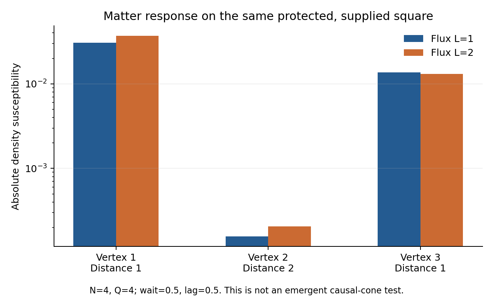

# Quantum matter and dynamical relational geometry: a constructive GRUT working model

**Constructive research sprint, 15 October 2026.** Baseline:
[a2f447d](https://github.com/ryangrvr/TestingGRUT/commit/a2f447dc37ea0a71f62c6e990a4630d727ebd85e),
continued through
[1801afe](https://github.com/ryangrvr/TestingGRUT/commit/1801afee27096c03c2a3b64cc811ac0be0d2a4a7).
No frozen CP-12 law, parameter or prior finding is changed.

## Abstract

We construct the strongest presently supported GRUT model as one quantum theory
of fermionic matter, compact gauge transport and dynamical graph resources. Three
calculable mechanisms connect its microscopic law to conditional relational
physics. First, an exact determinant and signed cycle/path-cover reduction gives
charged circulating-network transition amplitudes from the original neutral ray
without a spatial mask. It proves access when graph choice exists and distinguishes
two degree/resource-matched graph classes. Second, eliminating virtual matter
generates magnetic Wilson-loop interactions and, in a controlled static limit, a
positive coordination-variance term; neither interaction is added by hand. Third,
the exact graph-block leakage identity proves that full dynamics on any supplied
bounded-degree host approaches a genuinely local Hamiltonian for times
o(sqrt(N)), with an explicit source-response error. Full finite calculations show
matter response and geometric protection together in the same state. A further
neutral-origin prototype explicitly records a spontaneously reached charged
circulating sector, then measures its graph persistence and density response;
the sector weight and the record's energy and entropy costs are retained.

These results form a coherent conditional physical construction, rather than a
list of necessary conditions. They do not establish a dominant autonomously formed
three-dimensional phase, Lorentz invariance, Einstein dynamics or Standard Model
matter. Quantum rules and Hamiltonian time remain inputs. We give the matching
conditions that would turn the construction into a candidate theory of spacetime,
and a decisive joint formation/persistence/propagation test. Exact identities,
floating-point estimates and conditional infrared arguments are kept distinct.

## 1. Microscopic physical specification

There are N event vertices and M=binom(N,2) possible undirected connections.
Exactly Q connections are active. Each vertex has a fermion a_i; each potential
edge has a fermion b_e. Active edges carry integer half-leg fields E_ie,E_je and
unitary shifts U_ie satisfying [E_ie,U_ie]=U_ie. Inactive edges have their edge
fermion occupied and both fields zero. Total fermion number is M.

The physical Hilbert space is the Gauss-law subspace of the direct sum over
Q-edge graphs, fermionic Fock space and integer rotor spaces:

\[
\mathcal H^{\rm phys}_{N,Q}
=\bigoplus_{|g|=Q}\ker\{G_i,G_e\},\qquad
G_i=\sum_{e\ni i}E_{ie}-n_{a_i},\quad
G_e=-E_{ie}-E_{je}-n_{b_e}+1.
\]

The active subsystem has Q fermions. Consequently its number of edge holes is
exactly n_v=sum_i n_ai. A change of vertex labels acts with the appropriate
fermion and edge-orientation signs. Physical geometry diagnostics are invariant
under that relabelling; drawing a graph in a plane does not give it a metric.

In units with hbar=1 the unchanged Hamiltonian is

\[
H=\kappa Q+2m n_v+\frac{\epsilon_E}{2}\sum_{ie}E_{ie}^2+K+R,
\]
\[
K=t\sum_{e=(i<j)}n_e^{\rm graph}
\big[(a_i^\dagger U_{ie}-a_j^\dagger U_{je})b_e+\mathrm{h.c.}\big].
\]

R is the neutral-rewiring Laplacian. A removable active edge has b_e filled and
E_ie=E_je=0; it can exchange with any absent edge. Each off-diagonal transition
has amplitude -Gamma/M, and the diagonal is
Gamma*r*(M-Q)/M, where r counts removable edges. The frozen values are

\[
\kappa=\tfrac12,\quad m=t=1,\quad\epsilon_E=\tfrac14,\quad\Gamma=\tfrac1{10}.
\]

The positive electric operator is self-adjoint on its integer-rotor domain.
Hopping and rewiring are bounded at finite N,Q. In particular the rotor-angle
one-particle incidence matrix has trace(BB^dagger)=2Q, giving

\[
\|K\|\le |t|\sqrt{2Q\min(N,Q)},\qquad
\|R\|\le2\Gamma Q(M-Q)/M.
\]

Thus H is a bounded self-adjoint perturbation of the diagonal operator and is
bounded below. At Q=nu*N its lower bound is extensive. This establishes a
well-defined finite-resource quantum dynamics, not a continuum or thermodynamic
limit. State preparation and the graph entropy at growing N remain additional
large-system questions.

The specified formation input is

\[
|\psi_0\rangle={1\over\sqrt{\binom M Q}}
\sum_{|g|=Q}|g;\,n_v=0,\,b\mathrm{\ filled},\,E=0\rangle.
\]

It has no preferred labelled host, spatial lattice or loop phase mask. It is
nevertheless a special coherent preparation, not a state-selection principle
derived from H. Its energy is kappa*Q and its variance is 2Q*t^2.

An explicit count-register preparation implements this uniform fixed-Q state
without inspecting graph motifs: at each of M occupation stages, a controlled
rotation uses the ratio of remaining occupied modes to remaining positions.
An elementary construction uses O(MQ) count-controlled angles plus reversible
arithmetic and precision overhead. This is an externally controlled circuit,
not autonomous preparation by H; it also supplies a clock and gate model.
Exact small-system branch checks and record-memory accounting are provided in
[PREPARATION.md](PREPARATION.md).

Complex Hilbert space, composition of systems, Fermi statistics, compact U(1),
unitary evolution, the Born rule and external time T are explicit inputs. The
model makes predictions once these structures and its state are supplied; it
does not explain why nature uses those quantum structures or fix hbar.

## 2. The physical mechanism

Matter hopping transfers a fermion between an active edge and an endpoint and
shifts the corresponding electric field. The transfer preserves Gauss law and
correlates matter with gauge and graph resources. A hole or nonzero field makes
an edge unavailable to neutral rewiring. Closed coherent transfers can generate
electric circulation and effective magnetic interactions. If the resulting
connections persist, the same hopping law transports disturbances locally along
their incidence graph. These are stages of one Hamiltonian mechanism.

Protection and circulation differ. A hole can protect an edge with no through
current. A through-flow edge has opposite nonzero half-leg fields. A circulating
network is the union of edges on directed electric cycles. A persistent graph
can still be a random graph or a small-world network. It becomes a spatial
candidate only when its intrinsic geometry and operational propagation agree.

Earlier exact results are preserved. The cubic topology response establishes
recognition of higher correlations, not selection. The density-response work
establishes matter response beyond graph-distance reclassification. The a2f447d
all-time theorem excludes dominant extensive circulation with only subextensive
vertex matter from this neutral input. For Q=2N its vacuum refinement is

\[
\sup_T P(\text{all edges circulate},n_v=0)
\le {64N\over(N+16)^2},\quad N>16.
\]

Therefore a dominant formation route must retain extensive matter. Integrating
all matter out below is a mechanism calculation, not a way to evade that result.

## 3. Exact charged access and an internal formation kernel

For N>=5,Q=2N define G_N as the union of all connected four-regular graphs
whose active edges all circulate and n_v>=ceil(N/4). This is a final diagnostic
target, not an initial filter or an added degree-four energy term. It has
extensive cycle rank N+1; it does not define three-dimensional space.

Every target with e_C>=L circulating edges and n_v>=k has electric L1>=2L+k.
Diagonal terms and rewiring preserve that distance; a hop changes it by one.
The unitary Duhamel remainder and the exact first-hop norm sqrt(2Q)|t| give

\[
p(T)\le\min\left\{1,{1\over\min(N,Q)}
\left[{(b|T|)^d\over d!}\right]^2\right\},\quad
b=|t|\sqrt{2Q\min(N,Q)},\quad d=2L+k.
\]

This includes all paths and their amplitudes. For G_N it gives exponential
suppression at each fixed |tT|<4.25/(2e). Since both the minimum order and b
are extensive, it does not imply a formation time proportional to N or a
spatial causal cone. It becomes vacuous at later times.

To move beyond counting permitted paths, we derive an exact first-order
coefficient reduction. At the first possible d all events must be hops, so the
full-H coefficient equals the hopping-only coefficient on each target graph.
At rotor angles hopping is quadratic in fermions. Slater determinants and
Fourier-coefficient extraction reduce a minimally circulating target to

\[
F_S(A)=\det\cosh\sqrt A\;
\det\left[{\tanh\sqrt A\over\sqrt A}\right]_{S,S}.
\]

A contains the oriented edge variables; S comprises the distinct positive
endpoints of the two holes. The coefficient of the product of all edge
variables gives the target Taylor-amplitude magnitude, up to a Fock phase.
It can be extracted by signed closed-trail/path covers with
6^2*2^(N-2) local pairings. This preserves destructive interference and avoids
an enormous full-state simulation. Standard fermion determinant methods are
the mathematical tool [1]; the CP-12 coefficient reduction and graph sums are
derived in [charged_access/DERIVATION.md](charged_access/DERIVATION.md).

The original-ray coefficient includes 1/binom(M,Q) and all labelled target
graphs. Independent monotone integer half-leg recurrences agree on 16 controls,
including the largest graphs; an independent square-free polynomial determinant
check and direct Slater-minor checks provide further verification.

| System | Graph parents in the neutral ray | Target host classes | Exact leading probability |
|---|---:|---|---|
| N5,Q10 | 1 | K5 | 1.5627324776e-18 T^44 + O(T^46) |
| N6,Q12 | 455 | 15 labelled octahedra | 1.6716381749e-22 T^52 + O(T^54) |
| N7,Q14 | 116280 | Two exhaustive four-regular types | 1.3866817940e-26 T^60 + O(T^62) |

The exact N6 result is

\[
\boxed{p_{G_6}(T)=
{28937809141133489\over173110482737718477580671905802392578125}
T^{52}+O(T^{54}).}
\]

It proves overlap with the actual initial ray's cyclic subspace when graph
choice exists. It does not establish appreciable spectral weight or a dominant
phase. Finite-order differentiability suffices; no infinite Taylor convergence
or long-time extrapolation is asserted.

At seven vertices every four-regular host is the complement of C7 or of
C3 disjoint C4. They share Q14, cycle rank8, 60 Euler orientations,
n_v2 and minimum electric-square resource34. Their per-host formation
coefficient ratio in that order is exactly

\[
{23516510026538557850597839\over39328225756852078421560506}
=0.5979550202\ldots .
\]

The C7-complement fraction within the very rare charged readout tends to
0.6721452827, compared with its graph-family prior 24/31=0.7741935484.
Thus actual transition amplitudes discriminate structures that the listed
resources do not. This is a joint formation kernel, not unconditional
selection of an extended spatial phase. At this first order a classical
mixture of neutral graph parents has the same coefficient: interference within
each fermion amplitude matters, while inter-graph coherence does not yet enter.

## 4. Matter generates gauge dynamics and coordination regularization

Let P project onto the vertex-vacuum sector and Q_v=1-P. Removing the constant
kappa*Q, the exact Feshbach operator at an energy z outside the eliminated
spectrum is

\[
H_F(z)=PHP+PHQ_v(z-Q_vHQ_v)^{-1}Q_vHP.
\]

This is an exact energy-dependent spectral construction [2]. It is not
automatically an energy-independent Hamiltonian valid at every time. Its
off-diagonal matrix element between zero electric flux and a unit loop flux
is a magnetic Wilson-loop interaction generated by the original hopping.

In the explicit fixed-graph, zero-electric-kinetic, heavy-matter control, the
filled-edge fermion band has exact angle-dependent energy

\[
E_{\rm band}(\theta)=Nm-
\operatorname{Tr}\sqrt{m^2I+t^2BB^\dagger}.
\]

Expanding in t^2||BB^dagger||/m^2<1 produces

\[
E_{\rm band}=-{t^2\over2m}\operatorname{Tr}L
+{t^4\over8m^3}\operatorname{Tr}L^2-\cdots,
\quad L=BB^\dagger,
\quad \operatorname{Tr}L^2=\sum_i d_i^2+2Q.
\]

At fixed Q the positive fourth-order term favors homogeneous coordination.
This is a derived organizing tendency, not a hand-added regularity penalty.
At supplied zero incidence angles, an executed comparison over all 455 N6,Q12
graphs at m4 and m8 numerically finds the exact static-band energy minimized
by the 15 four-regular octahedra. Holonomies were not optimized. These are controlled
auxiliary limits, not a change to the frozen m1 law. Sharp rotor angles are
not finite-energy preparations at epsilon_E>0. An actual adiabatic graph
theory must also keep electric kinetic energy, state overlaps and Berry terms.
Static minima do not prove the original ray relaxes into them.

For a shortest simple cycle of length ell, the same expansion yields

\[
\boxed{H_F\supset J_\ell(W_\ell+W_\ell^\dagger),\qquad
J_\ell={\ell C_{\ell-1}t^{2\ell}\over(2m)^{2\ell-1}}>0,}
\]

where C_j is the Catalan number. Exact minimal-path checks at ell3 through6
verify the coefficient. For the triangle J3=3t^6/(16m^5). The sign favors pi
holonomy in this leading term. Holonomy is conjugate to electric flux; a
preferred angle must not be called a selected electric-flux graph. The Wilson
operator itself raises a closed electric flux loop, supplying the direct
connection between virtual matter and gauge circulation.

At the frozen electric coupling, the exact triangle small-t coefficient is
65536/653429, rather than 3/16. At t=m=1 the bare sixth-order approximation is
uncontrolled. We therefore compute the exact triangle Feshbach element at its
shifted ground energy z=-1.967299553189... and obtain

\[
\langle W0|H_F(z)|0\rangle=+0.0194943882733162.
\]

Analytical omitted-electric-space/resolvent estimates give a numerically
evaluated error of about 4.63e-16 for this element, with ordinary floating
rounding qualifications. The full ground-state residual is about7.43e-14.
The physical ground energy includes kappa*Q=1.5 and is -0.467299553189...
The ground has substantial matter admixture; the energy-dependent treatment
is necessary. This is a real induced interaction under the frozen law,
not a demonstrated photon or a vacuum route around the all-time bound.

## 5. Conditional local dynamics with a full-law error

Fix a supplied Q-edge graph g but keep all its physical matter and unbounded
electric configurations. Let P_g be its projector and H_g=P_gHP_g. Its
rewiring escape diagonal must be retained:

\[
H_g=D_g+K_g+{\Gamma(M-Q)\over M}\sum_{e\in g}r_e.
\]

Here r_e is the local removable-edge projector; D_g includes kappa*Q. The
off-block coupling consists only of rewiring. Different removed/added pairs
(e,f) have orthogonal destination graphs, so

\[
\boxed{\|(1-P_g)HP_gv\|^2=
\left({\Gamma\over M}\right)^2(M-Q)
\sum_{e\in g}\|r_ev\|^2.}
\]

Duhamel gives a useful large-size result without assuming high flux:

\[
\boxed{\|e^{-iHT}\psi-e^{-iH_gT}\psi\|
\le C_N|T|,\qquad C_N={\Gamma\over M}\sqrt{Q(M-Q)}.}
\]

At Q=nu*N this is Gamma*sqrt(2nu/N)[1+O(1/N)]|T|. Thus any supplied
bounded-degree host has a local compressed description with vanishing state
error for T=o(sqrt N). Part of graph persistence therefore comes directly from
the frozen 1/M normalization, not necessarily from flux. It preserves random
and nonspatial hosts too; it cannot select geometry.

Flux gives a further dynamical mechanism. The hopping on a single edge has
norm sqrt2|t|. If each initial active edge has fields (+/-L,-/+L), that edge
needs at least2L of its own hops to become removable. A unitary remainder
gives the improved error

\[
\varepsilon(T)\le C_N\min\left\{|T|,
{(\sqrt2|t|)^{2L}|T|^{2L+1}\over(2L+1)!}\right\}.
\]

Electric preparation costs at least epsilon_E*Q*L^2. Increasing L is not free
and cannot be assumed achievable from the neutral extensive-energy input.
The bound is on final dynamics, not a continuously monitored no-rewiring
history.

For the gauge-invariant source pulse exp(-i theta B) and bounded detector O,
the physical susceptibility is

\[
\chi_H(T)=-i\langle[O_H(T),B]\rangle
=2\operatorname{Im}\langle U\psi,OUB\psi\rangle.
\]

The same residual calculation for psi and B*psi gives

\[
|\chi_H-\chi_g|
\le2\|O\|(\|B\psi\|\varepsilon_\psi+\varepsilon_{B\psi})
\le4\|O\|\|B\|C_N|T|.
\]

H_g is local on the barycentric incidence graph: vertex mass is onsite,
electric energy and the removable-edge penalty are onsite at edge centers,
and hopping joins incident sites. The unbounded onsite terms can be treated
exactly in an interaction picture. Bounded hopping on a bounded-degree host
then permits a Lieb-Robinson commutator bound for bounded even gauge-invariant
observables [3,4]. Restriction from the enlarged rotor/CAR algebra to Gauss
states does not require factorizing the constrained physical Hilbert space.

Combining that cone with the explicit residual gives a full-law response
bound: a distance-decaying local term plus a controlled O(T/sqrt N)
graph-motion floor. If the supplied local model propagates ballistically
across a host with diameter O(N^(1/d)), this approximation controls a crossing
time for d>2, including3. It also controls higher-dimensional and logarithmic-
diameter random hosts. Failure of this sufficient bound for d<=2 proves no
instability and does not derive dimension3. A finite graph velocity is not
Lorentz invariance or an Einstein light cone.

The single-host rms gain must not be averaged over a coherent neutral
superposition: different starting graphs have overlapping outgoing ranges.
For a true collective state its full residual must be computed. Approximate
internal records can justify a branch description for record-preserving
observables, but recording/dephasing has physical costs and is not a free
state-selection controller.

## 6. Matter response and protection in the same evolving state

To test compatibility rather than assume it, we evolve the full unchanged
N4,Q4 Hamiltonian over all15 possible labelled hosts from a **supplied**
directed square carrying flux L and one Gauss-admissible vertex charge with
its edge hole. After unforced wait0.5, a phase source at vertex0 is applied;
after lag0.5 we measure fixed receiver density at initial graph distance2,
host identity, protection and original directed circulation together.

| Supplied L | Initial energy | Host probability at T1 | All edges protected | Distance2 density susceptibility |
|---:|---:|---:|---:|---:|
| 1 | 5.375 | 0.999998106616 | 0.961823756858 | -0.000156751483 |
| 2 | 8.625 | approximately1 | 0.999999998678 | -0.000206033144 |

The figure shows response magnitudes. This finite supplied-host comparison is
not a macroscopic causal-cone test.

At L2 the original circulation probability is0.999965789598. The response
restricted jointly to the original host differs from the unrestricted
response by about4.2e-16. The two electric cutoffs6/10 agree in responses to
about1.83e-15. Every retained column is independently checked against
unregulated transitions; all omitted columns enter analytical leakage
bounds. Electric-truncation response estimates are1.34e-13/1.61e-13;
a separate5e-12 numerical reporting allowance is stated. These are ordinary
floating-point evaluations, not formal interval-rounding certificates.

This is a genuine joint mechanism test in one state, not protection in one
experiment combined with matter response in another. Its initial energy
differs from the neutral input, and its graph is supplied. It proves neither
autonomous formation nor an extended causal region. Without hopping, every
vertex density commutes with the remaining Hamiltonian and the response is
exactly zero. Exact signed controls also give first graph-loss probabilities
T^8/259200+O(T^10) at L1 and
(216017/12906142470144000000)T^24+O(T^26) at L2.

### A neutral-origin recorded prototype

A further test begins with the **original neutral ray**, not the supplied
square. At N4,Q4, unforced evolution to wait5 reaches the charged spanning
circulation event G with probability0.055022107666. We then apply a complete
diagnostic record channel with outcomes {P_gG,P_g(1-G)} for every graph,
retain all outcomes, and analyze the G records. No graph or loop was
filtered into the original preparation.

After a source pulse exp(-i theta n0) and lag0.5, the same recorded ensemble
has conditional host survival0.999999997486 (controlled lower estimate
0.9999998162), and final full-circulation probability0.8931465182 with interval
[0.8931463516,0.8931466848], allowing either orientation and any final vertex
occupation. This does not require preservation of the original oriented flux.
The density receiver is opposite vertex0 on
the **recorded initial ring**, irrespective of the final graph. Its
susceptibility conditional on the initial G record is

\[
\boxed{\chi_{d=2}=0.0001311686013,
\qquad \chi_{d=2}\in[0.00013101254,0.00013132466].}
\]

The unnormalized joint response is7.217172902e-6. Restricting its detector
jointly to the original host agrees within controlled error, so this signal
does not rely on reclassifying final graph-distance bins. This density
response is conditional on the **initial** record only, not density within
a final circulation readout; no final-event quotient derivative is omitted.

The complete record is a physical intervention, not an autonomous mechanism.
It increases system energy by0.06547397275 with error estimate2.46e-7,
and produces measured-system entropy4.082400908 bits with error estimate
6.75e-7. Electric and mass terms commute with the record. The energy-change
operator therefore contains only bounded off-diagonal hopping/rewiring,
allowing its error to be controlled despite unbounded electric energy.
The entropy error uses the finite30-outcome record distribution; a unitary
system-plus-memory implementation need not create total entropy.

This gives a finite, resource-accounted chain from unmasked input through
charged formation, recorded persistence and matter response. The event is
rare, the diagnostic recording changes coherence, the graph has diameter2,
and no macroscopic or unrecorded phase is inferred. Full details and the
explicit source-quotient-to-physical isometry checks are in
[NEUTRAL_RECORD.md](protected_geometry/NEUTRAL_RECORD.md).

## 7. From this construction to spacetime: explicit matching conditions

The preceding sections are one microscopic model and its derived mechanisms.
A continuum description is earned only if the unfiltered state supplies a
non-negligible, persistent family of internal geometric records. On those
records one must measure a size-growing intrinsic regime with consistent
ball and spectral dimensions,

\[
V_g(x,r)\sim r^{d_H},\qquad
N^{-1}\operatorname{Tr}e^{-s\Delta_g}\sim s^{-d_s/2},
\]

and show spatially resolved retarded response on the same histories. A
regular graph or many loops alone does not imply d_H=d_s=3. The previous
matched ring/square/diamond controls and the present random-host locality
theorem explicitly prevent that shortcut. No simulation here has earned a
growing three-dimensional regime.

If a3D local continuum and a deconfined gauge phase were established, the
induced electric/magnetic operators could be matched to a compact U(1)
gauge effective action. Equal limiting propagation speeds, a relativistic
matter spectrum, negligible preferred-frame operators and a well-defined
continuum stress tensor would still have to be calculated. They do not follow
from a graph light-cone upper bound.

For gravity an economical matching target is

\[
S_{\rm IR}=\int d^4x\sqrt{-g}
\left[{M_*^2\over2}R-\Lambda_*
-{1\over4g_*^2}F_{\mu\nu}F^{\mu\nu}
+\mathcal L_{\rm matter}+\sum_a c_a\mathcal O_a\right].
\]

This is the conventional effective-field-theory form [5], not a new GRUT
derivation. A CP-12 derivation would need two physical helicity-two poles,
universal coupling to stress, the correct constraint/Ward identities and
computed matching coefficients. None is supplied by the present graph or
Wilson-loop calculations. Earlier CP03's conditional spin-two expansion
does not furnish a map from CP-12; its supplied Lorentzian expansion and
tuning cannot be imported as emergent results.

Entanglement equilibrium supplies a second conditional target: if Lorentzian
local vacuum geometry, suitable matter modular response and an entropy-area
coefficient alpha were independently derived, alpha*deltaA+deltaS_IR=0 can
yield Einstein response with G=1/(4alpha*hbar) [6]. CP-12 has not derived
those premises or its area coefficient. This route is a matching problem,
not an explanation by renaming entanglement as gravity.

The present fermions and one compact gauge group are not Standard Model
particles. Chiral SU(3)xSU(2)xU(1), generations, masses, neutrinos and observed
couplings have not emerged. A separately supplied Standard Model/GR sector
would be an extension with new inputs, not completion of this derivation.
Likewise T is still Hamiltonian time; operational clocks could be physical
subsystems, but neither a universal clock nor a cosmological arrow has been
derived. The closed pure state's entropy does not increase; reduced record
entropy can grow through entanglement.

Observers in this framework are physical memory-and-detector subsystems.
Their probabilities use the supplied Born rule; records are correlations
that can be analyzed by tracing physical degrees of freedom. Consciousness
does not enter H or select outcomes. No theory of subjective experience or
single-outcome selection is obtained merely from such a subsystem model.

## 8. Predictions, explanatory scope and the next decisive experiment

The construction is mathematically predictive at its microscopic interface.
Its discriminating results are not adjustable motif energies:

* The exact N6/N7 formation coefficients and N7 per-host ratio differ from a
  uniform energy/resource-only target model. They can be tested directly in
  independent classical calculations or a faithful quantum simulator.
* Virtual matter fixes the leading loop-length/sign hierarchy J_ell and the
  coordination coefficient in its declared regime. A separately added
  magnetic coupling is not needed to get this mechanism.
* The frozen1/M rewiring law fixes an O(T/sqrt N) full-versus-local error for
  supplied hosts, and flux fixes sharper short-time barriers. These are
  concrete quantitative consequences of this Hamiltonian.

They are model predictions and theorems within quantum mechanics. No
calibrated departure from established Standard Model/GR experiments has
been derived: a mapping from event, time and coupling units to real probes
is missing. A quantum simulator that deliberately implements H tests its
calculations and mechanisms, not whether fundamental reality follows H.

| Physical objective | Strongest result here | Remaining condition |
|---|---|---|
| Quantum rules | Consistent physical Hilbert space and unitary dynamics | Rules, hbar and Born probabilities are inputs |
| Persistent relational geometry | Exact charged access, induced loops, protected-host dynamics | Appreciable autonomous extended record population |
| Three dimensions | Intrinsic diagnostics and competing host discrimination | A growing3D phase selected without a spatial mask |
| Causality/locality | Local compression plus full-law response error | The original state must form suitable records; Lorentz limit |
| Gravity | Explicit continuum/entanglement matching targets | Helicity-two dynamics, universal coupling and matching |
| Ordinary matter | Gauge-coupled microscopic fermions | Relativistic chiral Standard Model spectrum |
| New tested physics | Exact model-specific predictions | Calibration and an experimentally different conventional comparator |

The next decisive calculation must join the stages, rather than declare them
complete separately. Starting with the original neutral ray at Q=2N and
multiple N where graph choice exists, obtain a controlled finite-time lower
or upper bound on appreciable charged connected-network weight. Use adaptive
Krylov/target subspaces with the actual outgoing residual rather than an
electric cutoff that excludes the target. On those same unfiltered states,
measure persistence of the same internal relational record, intrinsic ball
and heat-kernel growth, and receiver density responses sorted by initial
and final intrinsic distance. Account for record interventions and compare
random protected graphs and frozen arbitrary graphs. A small upper bound
over the relevant times rules out that phase under the tested preparation;
a positive joint regime justifies continuum matching.

We do not introduce a successor Hamiltonian solely to force a3D or Einstein
answer. CP-12 has not been shown incapable of every charged mechanism, and
the induced interactions/locality bridge already follow from it. Any future
successor must state the physical observation or theorem requiring its new
term and test its additional consequences. The strongest current result is
the explicit conditional quantum construction above. It is substantial
constructive progress, and it is not yet a viable complete theory of reality.

## Reproduction and references

The prior1801afe packaged Node verification and fresh no-cache Python audit
have now passed, closing the previously pending rerun. The sprint includes
exact rational/integer arithmetic, two electric-cutoff controls, full outgoing
residual estimates and separate-worker algebra review. That review is
internal, not external mathematical certification. All numerical interval
claims state their floating-point scope. See VERIFICATION.json and the
component derivations for the precise execution record.

1. I. Klich, [Full Counting Statistics: An elementary derivation of Levitov's
   formula](https://arxiv.org/abs/cond-mat/0209642). Established fermionic
   determinant methodology; not the source of the CP-12 formation coefficients.
2. S. Bravyi, D. DiVincenzo and D. Loss, [Schrieffer-Wolff transformation for
   quantum many-body systems](https://arxiv.org/abs/1105.0675); H. Feshbach,
   [Unified theory of nuclear reactions](https://doi.org/10.1016/0003-4916(58)90007-1).
3. B. Nachtergaele, R. Sims and A. Young, [Quasi-locality bounds, Part I](https://arxiv.org/abs/1810.02428).
4. B. Nachtergaele and R. Sims, [On the dynamics of lattice systems with
   unbounded on-site terms](https://arxiv.org/abs/1410.8174), particularly Theorem3.1.
5. J. Donoghue, [General relativity as an effective field theory](https://arxiv.org/abs/gr-qc/9405057).
6. T. Jacobson, [Entanglement Equilibrium and the Einstein Equation](https://arxiv.org/abs/1505.04753).
