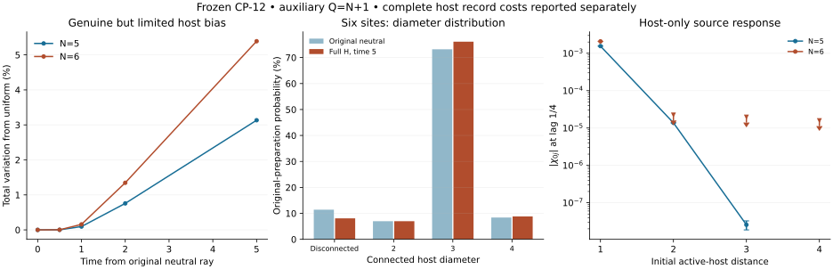

# Full-active-host geometry feasibility

**Result: conditional transport on the full host is testable and exhibits
a strong five-site distance hierarchy, but this bounded study does not
establish a dynamically selected spatial phase or a distinctive prediction.**
The six-site result is reported with its actual precision below, including
unresolved receiver signals. Frozen CP-12 is unchanged in every Path A run.

This continues `609db3f`; checkpoint `c2751a0` preserved the protocol and
five-site marginals after a runtime reset. No lost run counts as evidence.
`PROTOCOL.md` fixes the budget, host choice and claim boundaries.

## 1. Fixed edge count is not emergence

For Q>binomial(N-1,2), every host is connected and has diameter at most
two. Thus primary N=5,Q=10 is K5, and **all 455** N=6,Q=12 hosts have
diameter two. Their all-root mean balls `[1,5,6]` and mean pair distance
1.2 are forced for every state and every time. They cannot test extended
distances or establish three-dimensional geometry. This does not exclude
all larger-N phases.

The auxiliary Q=N+1 sequence permits maximum diameters three and four
at N=5,6. It is explicitly different from primary Q=2N scaling.

## 2. Original-neutral dynamics really bias hosts, modestly

Evolve the original equal coherent neutral ray over **all** labelled
fixed-Q hosts to times 0,0.5,1,2,5. The entire active graph is used: no
circulation, matter or electric-state filter. Exact labelled graph-class
counts supply the uniform time-zero baseline.

| N,Q | Connected at time 0 | Connected at time 5 | Maximum-diameter mass at 0 | Maximum-diameter mass at 5 | TV from uniform at 5 |
|---|---:|---:|---:|---:|---:|
| 5,6 | 97.619048% | 98.366108% | 28.571429% | 28.310022% | 3.133119% |
| 6,7 | 88.578089% | 91.917014% | 8.391608% | 8.821665% | 5.390020% |

These shifts are resolved well beyond the full-state numerical errors.
It would be wrong to call them purely combinatorial. However, connectivity
was already high in the supplied ensemble, and ball growth changes very
little. Six-site connected-host mean balls are
`[1.0, 3.33333333, 5.38245614, 5.96842105, 6.0]`
at time zero and
`[1.0, 3.33333333, 5.37768969, 5.96800859, 6.0]`
at time five. Mean connected pair distance changes only from
1.66315789
to 1.66419368.

Average degree four is not dimension: supplied N=64 four-regular
next-neighbor-ring and periodic-square controls have balls `[1,5,9,13]`
and `[1,5,13,25]`. No fitted dimension is extracted from these small hosts.

## 3. Host-only source experiment

At waiting time five, the complete instrument records every labelled
host P_g. The feasibility branch is chosen **without inspecting amplitudes**:
maximum connected diameter, greatest labelled multiplicity, minimum
canonical mask; choose the largest peripheral source orbit, then minimum
label. No circulating-core, matter or electric state is selected. The
initial host defines distances for every lag; all later rewiring remains.

| N | Host-class probability | Fixed source in chosen peripheral class | One labelled host | Source variance interval | Exact-host retention at lag 1/4 |
|---|---:|---:|---:|---|---|
| 5 | 28.310022% | 5.662004% | 0.004718337 | [0.23684048, 0.23684049] | [0.99992471, 0.99992473] |
| 6 | 6.092641% | 1.015440% | 0.00016924004 | [0.2316385, 0.23163851] | [0.99988771, 0.99995323] |

Use the gauge-invariant phase pulse exp(-i theta n0), with demonstrably
nonzero variance, and measure `chi_0j=2 Im <x,nj y>`. Responses are signed
susceptibilities, not arrival probabilities. Lags 1/8,1/4,1/2 and all fixed
receivers are in the data. Distance-shell means here coincide with fixed
receiver stabilizer orbits; all individual receivers are separately given.

| N | Initial host distance | Raw response interval at lag 1/4 | Nonzero resolved? |
|---|---:|---|---|
| 5 | 1 | [0.0015568077, 0.0015568197] | yes |
| 5 | 2 | [-1.3768011e-05, -1.3753036e-05] | yes |
| 5 | 3 | [-3.2636945e-08, -1.8737326e-08] | yes |
| 6 | 1 | [0.002067652, 0.0021036706] | yes |
| 6 | 2 | [-1.9013981e-05, 2.2619593e-05] | unresolved about zero |
| 6 | 3 | [-1.993393e-05, 1.9895211e-05] | unresolved about zero |
| 6 | 4 | [-1.5983784e-05, 1.5996989e-05] | unresolved about zero |

Far-below-near decisions and bounds are in `ASSESSMENT.json`. An interval
containing zero remains unresolved, not zero. This is finite-size evidence
conditional on the specified host record. It does not establish an
asymptotic front, a state-independent effective speed or relativistic
propagation. Microscopic hopping on active edges is already part of H.
For six sites, finer distance orders and nonzero distant signals must
not be claimed when their intervals remain unresolved. The neutral-state
preparation bound below is distinct from the larger source-evolution
errors reported for each lag.

At lag 1/4 the direct interval comparisons give:

- N=5: farthest/nearest absolute response is bounded above by 2.096402e-05; all adjacent distance orders resolved: True.
- N=6: farthest/nearest absolute response is bounded above by 0.00773679; all adjacent distance orders resolved: False.

These are upper bounds on response magnitude ratios, not estimates of
unresolved distant responses and not an inferred propagation speed.

The figure contains actual model data. Receiver intervals include every
unretained physical row. Downward limits denote unresolved magnitudes;
lines connect finite sampled data without extrapolation.

## 4. Persistence largely reflects a supplied coefficient

An exact full-law identity gives

`B_g^* B_g = (M-Q)/(100 M^2) sum_(e in g) Pi_e`,

where B_g takes a state from one fixed host to all others and Pi_e is its
neutral/removable-edge projector. Therefore

`P(same host at t) >= 1-Q(M-Q)t^2/(100 M^2)`.

At N=6,Q=7, every recorded host, of any shape, has lower retention bound
**0.99937778 at lag 1/2**. For Q=alpha N the cross-host norm is asymptotic
to sqrt(alpha/(50N)); recorded hosts become nearly static at fixed time.
That follows directly from the input rewiring normalization 1/(10M), not
an earned selection of spatial neighborhoods. Sampled exact-host, edge
and source-neighborhood retention are all reported. They are not
continuously monitored first-passage survival probabilities.

A Duhamel comparison with the original frozen-host block gives state
error <=c t and response difference <=4c t+2(c t)^2. All actual source
runs retain full H; the block is a bound/control, not a successful
modified-law experiment. The bound is too loose at these sizes to supply
a sharp propagation front. It cannot be applied to an unrecorded coherent
superposition of many hosts.

## 5. Complete recording is an intervention

Complete-host recording work is `-<R_off>`, evaluated without losing
rewiring that appears on signed-quotient diagonals. All outcomes are
included. At time five:

| N | Unconditional record energy change | Record entropy, bits |
|---|---|---|
| 4 | [0.035363299, 0.035363301] | [2.5849625, 2.5849625] |
| 5 | [0.087077791, 0.087077794] | [7.7093663, 7.7093664] |
| 6 | [0.12453324, 0.12453324] | [12.637183, 12.637183] |

The initial neutral record has work Q(M-Q)/(10M) and entropy
log2 binomial(M,Q). These are not a measuring-device derivation or a heat
dissipation claim. A full labelled N=4 control confirms that recording
also changes later source response: at lag 1/4 its nonselective change
interval is `[2.4127976e-06, 2.4210513e-06]`.
No classical host pointer is derived merely by using this instrument.

## 6. Large-N baseline is not large-N quantum dynamics

Seeded fixed-Q uniform graph samples and exact isolated-vertex moments
are reported separately. For Q=alpha N, the uniform ensemble has
E(I)~N exp(-2alpha) isolated vertices and Var(I)=O(N), so its connected
probability tends to zero. The exact finite-N variance bound at N=8192
is about 0.006064 for Q=2N and 0.0005363 for Q=N+1.

Those are **combinatorial** bounds. Full quantum dynamics could bias the
ensemble; this packet does not simulate it beyond six events. Ball means
from the samples are not a derived dimension or continuum limit. The
stated Hoeffding confidence bands cover connected fractions and bounded
ball means; diameter counts are descriptive sample counts.

## 7. A concrete Path B proposal, with an exact obstruction

`PATH_B_DESIGN.md` adds a neutral species with transport coefficient
`J g_e 1_(E_ei E_ej<0)`. This is a **new law**, never used in Path A.
The rule is local in primitive edge fields, gauge preserving and
Hermitian. In probe vacuum the original geometry law is preserved exactly.

But an allowed one-leg charged chord activates in one geometry hop.
The exact specified transfer coefficient is `J^2 T^4/4` at fixed N,
independent of its growing ring distance or ring flux. Its activation
diagonal detuning is -15/8, not a protective gap. Rational controls check
N=4,6,8,12 and fluxes 1,3,8. These supplied-state transfer controls do not
count as original-neutral phase-source experiments or a uniform
fixed-time large-N no-go theorem. The gate alone has not earned locality;
the next design needs a protected low-energy space and uniform
source-to-receiver leakage/virtual-path bounds.

## 8. Quotient-value continuity and decision

The latest review's proposed SCOUT-1 campaign already ran and is frozen
at `a2987fe`. Its actual handoff reports zero distinctive empirical
predictions and retains supplied representation/composition and basin
choices. `REVIEW_CONTINUITY.md` records the checked sources. The cited
`reviews/grut_review_report.md` itself was not found in the checked trees;
no unseen contents are claimed to have been read.

This packet does not reopen that campaign or promote a quotient pattern
to an axiom. H, its coefficients, Q, the preparation, quantum/gauge
structure, external time and the recording instrument remain inputs.
The conditional numerical outputs are not unique fundamental constants
or distinctive empirical predictions.

**Path A remains unestablished as an emergent spatial phase.** It has
earned a better conditional transport candidate than the failed ring
metric and a real, modest finite-size host bias. It has not jointly
demonstrated dynamically selected extended geometry, controlled
large-distance fronts or robust continuum scaling. The budget is closed
without another favourable-host search. Develop Path B's low-energy
protection mathematics before further large new-model runs; preserve all
failed benchmarks and the input ledger. No universal CP-12 no-go or
Milestone A/B/C success is claimed.

## Verification and reproducibility

The six-site neutral calculation has 1,980,546 signed orbits, 133,348
electric-boundary rows and full-state bound 2.16138481e-09 at
time five. The host-only source calculation uses 1,153,312
retained and 2,896,769 outgoing rows at level 9.
Source/error intervals include normalization, numerical initial tails,
all omitted hopping and rewiring, and analytic integration upper sums.

A final numerical refinement stayed within the declared 1.2-million-orbit
cap: all 278,453 still-missing physical rows reached
from the initial numerical source support were added. Its two initial
outgoing residual norms changed from
`[3.8757424255508744e-05, 2.46319187795564e-05]` to `[0,0]`.
This changes the numerical projection, not H, the host or preparation.
The level-8 pilot is retained for interval-overlap and error comparison;
the level-9 refined result is primary. Later-time residuals and unresolved
signals remain explicit; closing the first step is not exact evolution.

Independent labelled N=4 source/work/entropy controls, exact raw
cross-host norm identities, all dense primary hosts, equal-degree
counterexamples and the Path B rational controls are executable. Source
checks agree within their intervals. Ordinary floating point and its
reporting allowances are explicit; these are not outward-rounded formal
certificates or external validation. `reproduce.py` verifies saved
evidence; `--full` rebuilds it serially. Canonical GRUT, Stage3, PR12 and
all inherited Hamiltonian sources remain unchanged.
