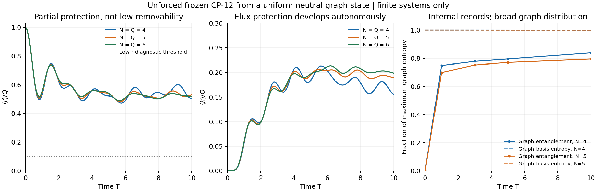

# CP-12 autonomous flux gate: internal graph records form; spacetime is not derived

**Frozen-law result:** an unforced, topology-neutral pure preparation develops persistent partial gauge-flux protection and internal graph records. Matter remains responsive in the tested four-event state. The unforced state does not reach low mean removability in the tested finite windows, and no extended spatial phase or causal cone is established.

Parent: `4e2b7a876a3a45ed554408ed803b572dd9cab580`. The independent extension is accepted and its previously unexecuted rational checker now passes. No coupling, microscopic law, spatial lattice, phase mask or pinned graph is added.

The figure shows the common Q=N comparison through T=10. Shading gives truncation bounds at sampled times; connecting lines guide the eye. Whole-interval statements below use a separate derivative bound.

## 1. The proposed internal process actually occurs

Start with the same equal-amplitude neutral ray over every Q-edge graph. Every edge initially is removable, all vertex modes are empty and all electric fields vanish. Let r count removable edges, k count occupied-edge-fermion edges with nonzero flux, and n_v count vertex fermions. Exactly r+k+n_v=Q.

The main size comparison keeps Q=N at N=4,5,6 and uses full finite-time matrix exponentials, with all outgoing electric-budget transitions retained for a full-law leakage bound. The table is at T=10. The error column bounds each displayed normalized count/event and graph TV, including rounding of its displayed center; it is not a statistical standard error. Displayed interval endpoints are rounded outward relative to the evaluated bounds. This formatting does not certify floating-point roundoff in the underlying calculation.

| N=Q | Electric budget | Mean r/Q | Mean k/Q | Bounded-fraction error | Probability r<=0.1Q | Graph TV from initial |
|---:|---:|---:|---:|---:|---:|---:|
| 4 | 256 | 0.5069257465721 | 0.1552613315634 | 4.568E-11 | 0.1727765302979 | 0.0369818231547 |
| 5 | 128 | 0.53016576 | 0.18969792 | 1.943E-4 | 0.11890993 | 0.10186750 |
| 6 | 128 | 0.51818300 | 0.19847183 | 4.346E-4 | 0.07184451 | 0.13974554 |

The hole-protected fraction is the remainder 1-r/Q-k/Q. Flux protection and matter occupancy are separated, rather than counting every nonremovable edge as flux protected. These are unrecorded evolutions: no graph-distance apparatus, geometry measurement, low-r postselection or feedback controller enters them.

The probability of n_v=0 with nonzero occupied-edge flux at T=10 is 0.0116156, 0.0050631, 0.0045326 for N=4,5,6 respectively. Each exceeds its bounded-event error in the table. In this sector all charge occupations are neutral and Gauss law makes the nonzero flux a closed circulation. Thus the flux signal is not exclusively open strings accompanying vertex excitations. These small probabilities do not establish an extensive density or persistence of local loops at increasing size.

An additional N=5,Q=6 run at T=10 gives approximately r/Q=0.49284529 and k/Q=0.22180273, with normalized-count truncation estimate 4.109E-4. The denser N=6,Q=12 run is extended to T=1 with budget 10, retaining 304,613 orbit states and 8,122,507 Hamiltonian entries:

| Time, N=6,Q=12, budget=10 | Mean r/Q | Mean k/Q | General bounded-fraction error |
|---:|---:|---:|---:|
| 0.4 | 0.77063604 | 0.00197278 | 7.398E-4 |
| 0.5 | 0.70259021 | 0.00611415 | 3.996E-3 |
| 1 | 0.73447608 | 0.07411658 | 2.157E-1 |

The general state bound alone stops resolving the small flux fraction at later times. Detector-specific forward/backward control gives E_O<=2 e d+e^2 instead, without adding a physical recording operation:

| Electric budget | Time | Controlled interval for mean k/Q | Zero excluded? |
|---:|---:|---|---|
| 6 | 0.4 | [0.0007848, 0.0031147] | Yes |
| 10 | 1 | [0.0540383, 0.0941949] | Yes |

The budget-six general bound at T=0.4 was insufficient, but its refined interval resolves flux formation; the larger budget independently controls the same early signal and its refined endpoint. The higher-density run has the continuous lower bound mean r/Q>=0.418818 throughout [0,1], so it also stays outside the low-mean-removability regime. These are genuine finite higher-density flux tests. They are not a long-time dense-phase test, and six-event twelve-edge graphs have diameter two, so this sector cannot establish an extended causal cone.

## 2. Persistence is bounded over continuous time

Only hopping changes r. A basis row has at most 2Q hopping transitions, each changing r or k by at most one. Therefore both normalized expectation rates have magnitude at most 2|t_hop|=2. At time spacing 0.1, subtracting 0.1 plus the numerical bound from a sampled minimum controls every intervening time.

| N=Q | Whole window | Continuous lower bound on mean r/Q | Flux window | Continuous lower bound on mean k/Q |
|---:|---|---:|---|---:|
| 4 | [0, 20] | 0.372761 | [3.0, 20.0] | 0.039552 |
| 5 | [0, 10] | 0.381326 | [3.0, 10.0] | 0.061146 |
| 6 | [0, 10] | 0.389312 | [3.0, 10.0] | 0.061080 |

This establishes sustained partial flux protection and excludes the **specific low-mean-removability regime** throughout these finite intervals. It does not prove a thermodynamic lower bound from three sizes, exclude later behavior, rule out rare protected branches, or establish a no-go for every state. Low mean r is sufficient for an earlier shortcut-suppression bound, not a necessary criterion for all possible emergent locality.

Persistence here concerns the mean amount of protection. It does not measure the lifetime of the same protected edge, the same loop or an intrinsic metric; protection can turn over while its mean stays positive.

The raw low-budget records are retained as regulator controls. Some of their late-time error estimates are vacuous; their apparently converged curves are not promoted to full-law results. Refinement to budgets 128 or 256 is what resolves the claims above.

## 3. Gauge and matter variables write internal graph records

This is a new positive mechanism result. Trace the unforced pure state over its complete fermion/electric configuration in the explicitly stated kinematic embedding. The graph entropy is initially zero. It increases without an external record, while total entropy remains zero.

| N=Q | Labelled graphs | Graph entropy at T=10, bits | Graph-basis Shannon entropy, bits | Maximum graph entropy, bits | Normalized graph l1 coherence |
|---:|---:|---:|---:|---:|---:|
| 4 | 15 | 3.28177803 +/- 9.607E-10 | 3.90098388 | 3.90689060 | 0.323276 |
| 5 | 252 | 6.34439808 +/- 2.209E-3 | 7.93217224 | 7.97727992 | 0.252861 |

The five-event calculation unfolds 748,410 physical amplitudes, including the signed fermionic permutation action. Independent full-space controls check the partial trace. Its 6.34-bit graph entropy is graph/environment entanglement, not entropy creation in a closed pure universe.

There is an exact reason protection and records are connected. Given a complete environment configuration mu, every edge with a hole or nonzero flux must be present. These variables reveal the protected core P(mu), leaving at most binom(M-Q+r,r) possible graphs. Thus H(graph | configuration)<=mean log2 binom(M-Q+r,r). If r=0, the environment determines the entire graph, and the graph reduced density matrix is diagonal. The saved r=0 audit verifies this; it does not select that sector in the main run.

Recording a graph and selecting a spatial graph remain separate requirements. The measured graph-basis distribution still has entropy close to its initial maximum, and its TV changes are modest. No three-dimensional volume law, preferred loop family or spatial attractor follows from the internal-record result. A record can preserve an arbitrary geometry.

Moreover, substantial residual coherent-removal capacity remains. Extending the earlier Johnson incidence identity to each physical matter/field fiber gives

    D^dagger D = (M-Q+1)r - (M/Gamma)R.

This evaluates the actual unforced state's coherent deletion norm. Its ratio to the hypothetical fully configuration-dephased value, mean r, is:

| N=Q | Coherent / dephased deletion norm at T=10 | Controlled ratio interval | Maximum ratio at matched mean r |
|---:|---:|---|---:|
| 4 | 2.450254 | [2.450254, 2.450255] | 3 |
| 5 | 4.056267 | [4.052584, 4.059953] | 6 |
| 6 | 5.675864 | [5.662728, 5.689021] | 10 |

The dephased comparator is not physically applied and would change energy and entropy. The identity is a bounded-operator resource diagnostic, not a finite-time transport response. The all-graphs preparation has no universally absent edge, so the common-vacant destination formula cannot simply be applied to it. These results nevertheless prevent replacing a measurement of residual coherent-removal capacity with graph entropy alone.

## 4. Matter can still respond after partial protection

At declared waits 5 and 10 in the same four-event unforced preparation, apply the gauge-invariant source exp(-i eta n_0). Detect mean density at the other vertices, independent of graph-distance bins. For the projector n_0, the difference between finite phases +/-pi/2 extracts the linear susceptibility exactly, without finite-difference bias.

| Wait | Lag | Density susceptibility | Absolute truncation bound | Before-source r/Q | Work of + and - pulses |
|---:|---:|---:|---:|---:|---:|
| 5 | 0.5 | +0.0062226262 | 9.437E-10 | 0.523021 | +0.757059, +0.690768 |
| 10 | 0.5 | +0.0061597607 | 9.835E-10 | 0.506926 | +0.815393, +0.791201 |

All six saved source responses exclude zero under their analytic truncation estimates. Removing hopping only after the same preparation makes the response zero. The initial source operation commutes with r and does not instantaneously select protection. The diagnostic has explicit work, and no claim of equal-energy pulse preparations is made. This verifies finite matter mobility alongside partial protection; four events do not test propagation through an extended network or provide a causal speed.

## 5. The stronger resource constraint survives negative hopping

The independent extension proves F>=epsilon_E(Q-r-n_v/2), where F is electric energy. We derive a complementary bound that includes the possibly negative hopping energy. For nu=Q/N and a=2m-epsilon_E/2,

    H >= kappa Q + epsilon_E(Q-r) - N C(nu),
    C(nu) = [sqrt(a^2+8 t_hop^2 nu)-a]/2.

It follows from the singular values of the gauge-covariant vertex/edge hopping matrix, whose square sum is 2Q, and positivity of rewiring. At the exact neutral initial energy E=kappa Q, mean r/N>=nu-C(nu)/epsilon_E at every time. With frozen parameters, this forces a positive removable density for nu>49/2. The inequality is vacuous at nu=1,2,3, so it does not prohibit protection in a candidate degree-six spatial sector or settle the phase diagram.

Electric energy can also be controlled numerically despite the unbounded rotor. Total energy is known exactly, and mass+hopping+rewiring is bounded at fixed N,Q. Subtracting these bounded terms supplies a full-law electric-energy interval; norm error alone would not do so.

| N=Q | Exact total mean energy | Electric energy and inferred error | Mass energy | Hopping energy | Rewiring energy |
|---:|---:|---:|---:|---:|---:|
| 4 | 2.0 | 0.492105762163 +/- 6.356E-10 | 2.7025034 | -3.2131878 | 0.0185787 |
| 5 | 2.5 | 0.608733551292 +/- 3.414E-3 | 2.8013632 | -3.4616218 | 0.0515250 |
| 6 | 3.0 | 0.720874228143 +/- 9.215E-3 | 3.4001420 | -4.2106440 | 0.0896278 |

Complementary component errors are in ENERGY_AUDIT.json. Negative hopping balances positive mass/flux costs. The stronger cost must therefore not be misread as an immediate prohibition based on positive terms alone.

## 6. Protection does not supply a near-destination rule

At fixed matter/field configuration, unprotected neutral connections undergo a Johnson-graph Laplacian: all legal replacement destinations have the same bare coefficient. An exact deletion-map identity proves equal instantaneous edge-creation coupling to any two edges absent throughout a state's support. A supplied flux-triangle comparator has candidate distances 2,3,4 and identical coupling squares 1/7500.

This is an instantaneous statement, not a theorem of equal finite-time responses. The earlier higher-order topology sensitivity remains intact. It shows that the proposed mechanism needs more than protection alone: actual dynamics must organize the protected core spatially and suppress aggregate distant channels while preserving matter motion. Completely freezing an arbitrary graph does not meet that requirement.

## 7. What has and has not passed

| Requirement | Finding |
|---|---|
| Stronger flux/fermion inequality | Confirmed; independent exact checker executed |
| Autonomous flux creation from an unmasked input | Resolved in the tested finite states |
| Persistent partial protection | Controlled over continuous finite windows |
| Internal graph records without external recording | Demonstrated at four and five events |
| Matter-density response after partial protection | Resolved at four events |
| Low mean removability in the tested unforced state | Not attained in the covered windows |
| Spatially selected protected network | Not demonstrated |
| Intrinsic 3D growth and extended causal propagation | Not demonstrated |
| Thermodynamic spatial phase or gravitational continuum | Open |

Q=N gives a connected graph only one independent cycle. These main runs are auxiliary mechanism tests, not the higher-density gauge-capacity/spacetime gate. The supplied pure initial state has energy Q/2, variance 2Q, zero entropy and coherent support over all binom(M,Q) graph configurations. A compact description does not establish its local physical preparation cost or explain why the theory selects it.

Fresh controls include the independent Gauss checker, 16 dense residual and eight dense expectation tests, independent 872- and 6075-state physical matrices, orbit/partial-trace checks, finite source pulses and a fresh rerun of the small unforced trajectory. Larger saved evolutions, dense-sector count refinements and the five-event record unfolding are hash-validated rather than silently rerun by the verifier.

All numeric error evaluations use ordinary floating point, not formal interval arithmetic. The mathematical inequalities concern the unbounded frozen law; the numerical scope remains the stated preparations, sizes and times.

The earned mechanism is now concrete: hopping creates flux/occupancy protection and internal records while matter remains responsive. The missing selection of an extended spatial geometry is an additional scientific problem, not a relabeling of that mechanism as spacetime.
