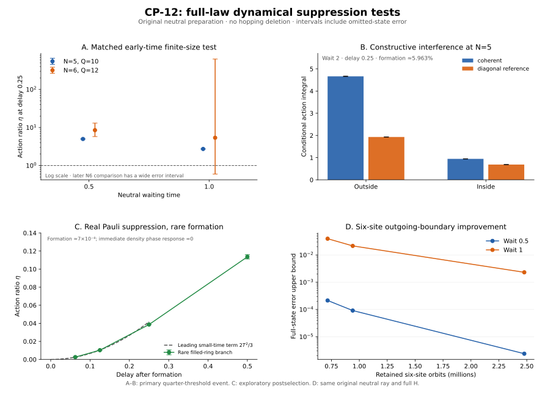

# CP-12 dynamical suppression: full-law mechanism tests

The tested five-site branches do not suppress outside-core hopping action.
Their interference is constructive, neutral edges retain substantial Pauli
availability, and the measured diagonal costs do not become large. An
exploratory filled-ring branch does show initial Pauli suppression, but it
forms with a probability of only about seven parts in one hundred million
and its blocking is unlocked by the original core dynamics.

Two exact controls sharpen the acceptance test: initial complete blocking
need not persist, and an initial-time global action ratio can decrease with
size while a specific long-distance transfer coefficient stays constant.
These are finite-model
results and diagnostic limitations, not a proof excluding every possible
CP-12 phase.

This isolated continuation starts at
768c46c96eae404a527d9cfee8f1b09abeb61a13. It changes no frozen Hamiltonian,
parameter, initial preparation or canonical GRUT-RAI file. All new time
evolutions use the full law, including every active hopping and rewiring
term. The larger bases change numerical accuracy only.

## 1. Common neutral-origin action test

The initial state is the original equal coherent neutral ray over every
labelled fixed-$Q$ graph. The primary event is

$$
P=\mathbf1\{c/Q\ge1/4,\ n_v/N\ge1/4\},\qquad
X=P e^{-iHt_w}\psi_0 .
$$

The circulation count uses opposite-sign half-leg fields on directed
cycles, including valid hole edges with fields $(2,-1)$. The same event
and thresholds are used at $N=5,Q=10$ and $N=6,Q=12$.

The inherited Hermitian operators are

$$
K_{\rm in}=\tfrac12\sum_e\{\chi_e,K_e\},\qquad
V_{\rm out}=K-K_{\rm in}.
$$

We calculate both conditional action integrals

$$
I_L(T)=\frac1p\int_0^T\|Le^{-iHs}X\|^2ds,\qquad
p=\|X\|^2,\qquad\eta=I_{\rm out}/I_{\rm in}.
$$

These are explicitly recorded conditional diagnostics. They are not
irreversible rates, probabilities of crossing a shortcut, or an autonomous
selection of space. The moving core can change during a hop. The event is
also much weaker than a spatial metric or a specified macroscopic geometry.

The five-site complete electric-square budget-50 calculation retains
162,191 signed permutation orbits and every outgoing transition. At delay
$T=0.25$, the results are:

| Neutral waiting time $t_w$ | Original formation probability | $I_{\rm out}$ | $I_{\rm in}$ | $\eta$ interval |
|---|---:|---:|---:|---:|
| 0.5 | $[4.8250997,4.8252033]\times10^{-6}$ | 4.43779–4.43843 | 0.889138–0.889522 | 4.98907–4.99173 |
| 1 | 0.00264308096–0.00264308583 | 2.54489–2.54494 | 0.931785–0.931809 | 2.73114–2.73124 |
| 2 | 0.0596161–0.0596438 | 4.65225–4.67287 | 0.940236–0.948982 | 4.90464–4.96759 |

Every one of the nine tested primary five-site ratios, spanning waits
0.5, 1 and 2 and delays 0.125, 0.25 and 0.5, has a lower bound above 2.53.
The denominator is resolved and nonzero throughout. A small denominator
from frozen dynamics is not explaining these ratios.

For $t_w=2,T=0.25$, the charged-event survival interval is
0.734162–0.736119. This permits different circulating cycles at the two
times; it is not persistence of the same ring. The complete binary record
has mean energy change 0.1115796–0.1138425 and entropy
0.3259193–0.3260293 bits. These resources are included rather than treating
the successful projection as free.

Raw joint integrals, conditional intervals, all waiting and lag errors,
record work and bounded statistics are in N5_B50.json.

## 2. What the three proposed mechanisms actually do here

The most populated tested five-site primary branch, $t_w=2,T=0.25$, gives:

| Mechanism diagnostic | Full-law interval | Interpretation within this test |
|---|---:|---|
| Empty-endpoint fraction on neutral active edges | 0.525512–0.527836 | More than half of the neutral endpoint action remains Pauli available |
| Coherent outside action / physical-basis diagonal reference | 2.40842–2.42273 | Integrated outside interference is constructive |
| Coherent inside action / physical-basis diagonal reference | 1.36494–1.38155 | Inside action is also enhanced, less strongly here |
| Outside allowed-hop diagonal-detuning RMS, capped at 8 | 2.07541–2.08532 | No large static diagonal scale in this diagnostic |
| Reference outside-action fraction with $\lvert\Delta D\rvert\ge4$ | 0–$8.56554\times10^{-7}$ | Large diagonal costs carry negligible bounded reference weight here |

The interference reference is constructed in the full labelled
electric/Fock basis before symmetry reduction. Taking an orbit-basis
diagonal would retain some physical coherence and produce the wrong
reference; the independent labelled calculation checks this distinction.
No dephasing is performed on the actual trajectory.

The detuning statistics use the complete physical rewiring escape diagonal.
They are not eigenvalue gaps or transition rates. They cannot exclude
spectral or multistep detuning mechanisms in other states or time windows.
The exact neutral-edge first-hop and completed-transfer diagonal costs
remain independent of surrounding ring flux, as in the parent algebra.

Thus these measurements find no aggregate outside-action suppression from
the three candidate mechanisms in this tested primary branch. They do not
establish that every individual outside path interferes constructively.

## 3. Pauli blocking can occur, and core dynamics can unlock it

An exploratory five-site event requires all vertices filled, a spanning
charged five-cycle at electric square 25, and all five non-core edges
neutral. This event is reached from the original neutral ray at wait 2 with

$$
p_F\in[5.58411,8.57783]\times10^{-8}.
$$

It is about one success per fourteen million original preparations at the
central estimate. Its complete binary record costs mean energy
$[7.17431\times10^{-7},1.00798\times10^{-6}]$ and entropy
$[1.42600,2.13738]\times10^{-6}$ bits.

Inside the exact $S_5$-invariant sector the event has a one-dimensional
range, a single orbit of size 24. Its normalized conditional shape is
therefore fixed exactly by symmetry and the event, while its formation
weight retains the waiting-time error interval. No filled ring was
substituted for the original preparation.

Initially,

$$
\|V_{\rm out}\phi_F\|^2=0,\quad
\|K_{\rm in}\phi_F\|^2=10,\quad
\|V_{\rm out}H\phi_F\|^2=20.
$$

The subsequent full-law action ratios are:

| Delay $T$ | $\eta$ interval | $I_{\rm out}$ interval | $I_{\rm in}$ interval |
|---|---:|---:|---:|
| 0.0625 | 0.00259336–0.00259565 | 0.00162098–0.00162241 | 0.625049–0.625051 |
| 0.125 | 0.0102524–0.0102549 | 0.0128316–0.0128346 | 1.25155–1.25157 |
| 0.25 | 0.0386366–0.0386617 | 0.0983185–0.0983725 | 2.54444–2.54470 |
| 0.5 | 0.111223–0.115949 | 0.659890–0.680750 | 5.87115–5.93303 |

Small outside action here is a real finite-time Pauli effect, with
nonvanishing inside action. It is not an appreciable geometry phase.
Moreover every vertex is initially filled, so an immediate local density
phase pulse is a global phase. Its density-response susceptibility is
exactly zero at every receiver and later delay. Other source operators or
later pulses are not excluded; this particular probe supplies no
propagating signal.

The rare event itself loses much of its filling: at delay 0.25 its return
probability is about 0.536, while the much broader primary charged event
still has probability about 0.99964. This also illustrates why a broad
charged-event survival statistic cannot certify persistence of the same
microscopic structure.

## 4. Exact algebra exposes two locality loopholes

There is also a sector-specific interference result. For a fixed recorded
core $C$ with all exterior fields zero and exterior edge fermions filled,
the first exterior action obeys the exact identity

$$
\left\|\sum_{e\notin C}K_e\psi\right\|^2
 =\left\langle\sum_{e=(i,j)\notin C}n_{g_e}(2-n_i-n_j)\right\rangle.
$$

Different exterior-edge holes and endpoint fields tag orthogonal outputs.
Coherence within that sector cannot cancel this first action; it vanishes
only through endpoint Pauli filling. Complex-vector physical-basis checks
at $N=5,\ldots,8$ agree to about $10^{-14}$. This does not exclude later
interference or dressed spectral suppression outside the specified sector.

The supplied-state controls in PAULI_ALGEBRA.json use exact rational
arithmetic, not numerical propagation or favourable neutral-origin
formation claims. A four-regular ring-plus-chord host is chosen only to
expose the mechanisms; it is not imposed on the primary preparation.

For a spanning charged ring with every vertex filled and all non-core
edges neutral, a core recombination hop creates a vacancy. A subsequent
neutral edge can inject its fermion into that vacancy. For this family,

$$
V_{\rm out}\phi_N=0,\quad
\|K_{\rm in}\phi_N\|^2=2N,\quad
\|V_{\rm out}H\phi_N\|^2=4N,
$$

and at each fixed $N$,

$$
\eta_N(T)=\frac23T^2+O(T^4).
$$

The blocked subspace is not invariant, and this leading coefficient has no
suppression with size.

With one vertex vacancy instead, the instantaneous ratio tends to
$1/(N-1)$. Both the numerator (2) and denominator ($2N-2$) are known.
Yet a specified neutral chord bypasses ring distance
$\lfloor(N-1)/2\rfloor$ with transfer probability

$$
\Pr(\text{specified transfer target})=\frac14T^4+O(T^6).
$$

The leading transfer coefficient is independent of size. The small global
ratio reflects a growing denominator, even though a distant shortcut
remains active. The identities are checked for $N=5,\ldots,12$, and their
counting derivation is in DERIVATION.md. Taylor remainder bounds uniform in
$N$ are not claimed.

The requested three-part gate therefore also needs a source-resolved
distance test. Nonzero core action plus a shrinking global ratio would
still be insufficient.

## 5. Actual neighbour response with a fixed ring record

The auxiliary $N=4,Q=5$ experiment repeats the parent's original neutral
wait of 5 and complete twelve-outcome host/ring record. This is a probe
control, not a $Q=2N$ scaling point. The selected-ring probability is about
0.05157925. The record's mean energy change is
0.08703468–0.08703502 and its entropy is
$2.87803050\pm0.00000041$ bits.

We apply the gauge-invariant source $e^{-i\theta n_0}$ and measure the mean
density at the two vertices a fixed distance one along the initially
recorded ring. Both neighbours are averaged, avoiding a preferred label.
All subsequent evolution uses full $H$.

At delay 0.25, the conditional neighbour susceptibility is

$$
\chi_{\rm neighbours}\in[0.0038018298,0.0038019548],
$$

and its joint response with the same ring still present is

$$
\chi_{\rm neighbours\ and\ same\ ring}
 \in[0.0014114392,0.0014115609].
$$

The same-ring survival interval is 0.95466392–0.95466418. Thus the apparatus
detects nonzero finite conditional matter response while the ring remains
present. This response can also receive contributions from active diagonals;
it does not attribute the signal solely to ring paths. The parent's resolved
diagonal transport result remains an obstruction to a metric claim.
N4_CORE_RESPONSE.json contains all record groups, distances and pulse checks.

## 6. Six-site boundary accuracy and matched-size results

The retained six-site basis grows from 715,985 to 940,985, then 1,421,197,
then 2,477,611 signed permutation orbits. The final basis has 59,215,219
Hamiltonian entries and 1,658,455 distinct outgoing rows. Its new-to-old
coupling checks differ by less than $10^{-15}$ and its Hermiticity residual
is below $5\times10^{-15}$.

The original neutral waiting-state error bounds improve as follows:

| Basis | Retained orbits | Error at wait 0.5 | Error at wait 1 |
|---|---:|---:|---:|
| Parent complete budget 12 | 715,985 | $2.14044\times10^{-4}$ | 0.0395152 |
| Priority extension | 940,985 | $9.13434\times10^{-5}$ | 0.0215047 |
| Two complete outgoing layers | 2,477,611 | $2.38485\times10^{-6}$ | 0.00231070 |

The final error bound is about 90 times smaller at wait 0.5 and 17 times
smaller at wait 1. All three approximations use the same original ray and
full physical Hamiltonian. Proxy coverage is not substituted for these
outgoing-residual bounds.

At delay 0.25 the six-site results are:

| Wait | Original formation probability | $I_{\rm out}$ | $I_{\rm in}$ | $\eta$ interval |
|---|---:|---:|---:|---:|
| 0.5 | $[7.17034,7.19592]\times10^{-6}$ | 6.67552–8.23764 | 0.629002–1.158618 | 5.78217–13.04981 |
| 1 | 0.00331898–0.00387282 | 1.76714–10.03812 | 0.0136830–3.454712 | 0.59687–628.70587 |

**The early matched comparison resolves an increase, not a decrease.**
At wait 0.5 and delay 0.25, the five-site interval is
4.98907–4.99173, below the six-site interval 5.78217–13.04981.
Delay 0.125 also resolves an increase, with six-site interval
7.35750–9.29656 versus five-site interval 4.92515–4.92908.
These early formation weights are only a few parts per million, so this
is not evidence for an appreciable spatial phase.

At wait 1 and delay 0.25, the much wider six-site interval overlaps the
five-site interval 2.73114–2.73124. The central six-site estimate of 5.38
does not settle this comparison. At wait 1 and delay 0.5, the core
denominator's lower bound reaches zero: there is no resolved finite upper
bound for $\eta$. A stored null upper endpoint means unresolved, not zero
outside hopping.

The charged-branch state-error bound at wait 1, delay 0.25 is 0.00886387
for an unnormalized branch with norm about 0.0599. This remains too large
for a sharp action-ratio comparison. The precision gain in neutral
formation therefore does not close the later charged-boundary problem.
There is no controlled six-site wait-2 counterpart to the five-site
5.963% formation point in this packet.

The complete binary record's entropy interval is
0.0001328824–0.0001333194 bits at wait 0.5 and
0.03211227–0.03660705 bits at wait 1. The corresponding work intervals are
$[-0.000121224,0.000107724]$ and $[-0.110517,0.111567]$; neither resolves
the work sign. These uncertainties are retained.

The primary event has the same integer thresholds, $c\ge3,n_v\ge2$, at
these two small sizes. Five-site hosts are complete graphs, while six-site
$Q=12$ hosts have diameter at most two. This is a finite-size control, not
long-distance scaling or an emergent three-dimensional metric.

## 7. Verification and the physical decision

The checks independently compare 24,636 labelled physical hops and Gauss
destinations, physical-basis interference references, finite spectral
action integrals and every column of a small adaptive basis. The large
extension checks every new-to-old coupling against an independent raw
generation. Additional sampled large columns use the original Python
canonicalizer rather than the C++ acceleration.

Action quadrature includes an analytic sixth-derivative remainder. Every
omitted outgoing transition contributes to the full-H state-error bound,
and Minkowski bounds transfer those state errors to squared-action
integrals. A new integer-certified filling-sector norm bound improves the
action bounds from 20 to 14 at five sites and from 24 to 17 at six sites.
The exploratory rare-state run keeps the valid older bound of 20.
Details and exact integer certificates are in DERIVATION.md and CHECKS.json.

All intervals use ordinary floating point with a reporting allowance;
they are not outward-rounded formal certificates. PASS in a data file
means its numerical or algebraic checks completed, not that the model
passed locality.

The tested mechanisms have not delivered the three properties together:
appreciable neutral-origin formation, persistent geometry carrying a
nonzero intrinsic-distance response, and suppressed distance-violating
propagation. The rare blocked branch does not repair this. The concrete
next target is a neutral-origin, source-resolved shortcut response with
fixed relational geometry and controlled errors, not another claim from a
global circulation or action ratio alone.
