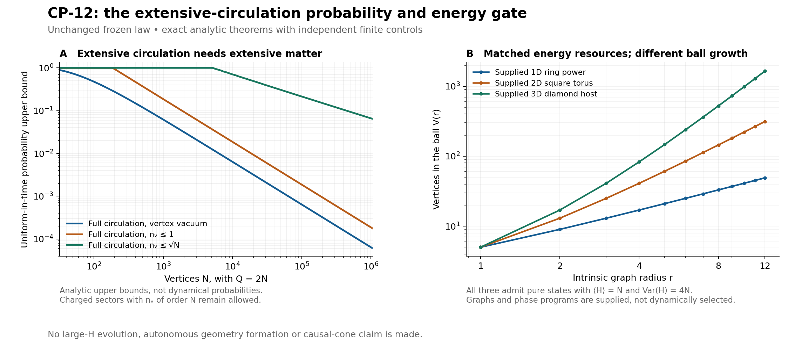

# GRUT CP-12: extensive circulation needs matter; energy does not choose dimension

**15 October 2026 UTC.** Continuation of the independent review of `36138c6`. The frozen Hamiltonian and original neutral preparation remain unchanged. This cycle follows the requested order: probability/energy bounds first, then capacity-valid exact controls. It adds no new claim based merely on another small nonzero susceptibility.

**Two results narrow the formation problem.** From the specified neutral input, extensive electric circulation with only a subextensive vertex-matter population has vanishing probability at large size, uniformly in time. Charged circulating networks remain energetically possible. Supplied states on very different intrinsic geometries can match the neutral input's mean energy and variance, so those resources alone cannot select three dimensions.

## An all-time constraint, not a small-time extrapolation

Let G require circulation support containing at least sN edges; it may additionally require a connected spanning network or extensive cycle rank. Let Q=nu N and let k bound occupied vertex modes. The derived full-law inequality is

\[
\boxed{\sup_T\Pr_T(G,n_v\le k)
\le\min\left(1,\frac{2\nu t^2}{\epsilon_E^2s^2N}
(1+\sqrt{k+1}+\sqrt k)^2\right).}
\]

Thus k=o(N) implies probability tending to zero, including at times that grow with N. The proof uses the exact conserved mean energy and variance, positivity of rewiring, the electric circulation cost, and a vertex-number-resolved hopping norm. It does not assume a spatial lattice or a bounded electric field.

For fully circulating Q=2N networks, the vacuum refinement at frozen couplings gives

\[
\boxed{\sup_T\Pr_T(G,n_v=0)\le\frac{64N}{(N+16)^2},\qquad N>16.}
\]

At N1024 this upper bound is about 0.060592; at N1048576 it is about 0.000061034. The broader connected-spanning vacuum bound is weaker but also tends to zero. These are upper bounds, not simulated frequencies. The few-matter constants are often vacuous at small sizes.

The conclusion is specific: **a dominant extensive circulation phase, if reached from this neutral input, must involve an extensive vertex-matter population.** It does not exclude charged phases, alternative preparations with different energy resources, or geometries encoded by a different mechanism.

An additional mean-energy tradeoff includes negative hopping. For fully circulating Q=2N networks of probability one, a coarse necessary bound is <n_v>/N>=0.018125 approximately. This is a lower bound, not a predicted density or an optimum.

## Charged networks are available at the needed energy

To test whether positive electric cost makes the target sector inaccessible energetically, we construct physical pure states on an arbitrary **supplied** connected four-regular graph. Each graph has Q=2N and N+1 independent cycles. An Euler orientation assigns two edge modes to each vertex. A local bright superposition exchanges a vertex fermion with those two modes while preserving Gauss law and circulation.

Every configuration in the constructed state has a connected fully circulating network and zero removable edges. Its exact moments follow from independent local three-state blocks plus all outgoing full-H transitions. No electric cutoff is used in the small checks.

| Supplied charged family | Matter density | Mean energy per vertex | Variance per vertex |
|---|---:|---:|---:|
| Local-band variational state | 0.178474 | 0.840839 | 1.528285 |
| Neutral-mean-matched product | 0.050671 | exactly 1 | 2.415623 |
| Two-orientation pure state, N>=128 | exactly 1/4 | exactly 1 | exactly 4 |

The original neutral ray at Q=2N has mean energy N and variance 4N. The third family matches both exactly. Its phase parameters have an explicit size dependence, verified by rational inequalities, and are supplied preparation resources. This is not an autonomously generated controller or a reachable-state certificate.

The comparison therefore blocks a tempting overinterpretation of the new probability bound: **charged extensive circulation is not excluded by the neutral input's first two energy moments.** The specific product family matching only the mean has a different variance and cannot be its exact unitary endpoint. The two-orientation family removes that particular mismatch, while leaving the full spectral-distribution and symmetry-sector questions open.

## The same resources support different dimensions

The charged-state formulas depend on degree and local parameters, not host dimension. We tested matched graph families at common sizes up to N11664:

| Supplied host, N11664 | Q | Independent cycles | Intrinsic ball volume, radius 12 |
|---|---:|---:|---:|
| Ring with first- and second-neighbor edges | 23328 | 11665 | 49 |
| Square torus | 23328 | 11665 | 313 |
| Diamond-type three-dimensional host | 23328 | 11665 | 1647 |

Each admits the same mean, variance, purity, matter density and electric resources in the stated constructions. Their different intrinsic ball growth is explicitly supplied. These are graph/BFS controls and factorized moment calculations, not large-H evolutions or emergent-dimension fits.

Fixed hosts break permutation symmetry. A permutation twirl preserves the moments and circulation probability but changes purity. The packet does not claim that these states lie in the original neutral ray's same pure symmetry sector or have its complete energy distribution. Nor does matching resources make different geometries dynamically equivalent: higher spectral information and subsequent evolution can distinguish them.

This is a concrete failure of **energy-and-protection-only dimension selection**, not a no-go theorem for the full dynamics.

## Persistence is still a separate gate

For the charged product controls, full-circulation loss begins at quadratic order with an extensive coefficient. A hop can turn a circulating edge into a still-protected hole edge. Full-protection loss has zero quadratic coefficient and begins no earlier than quartic order. The two properties must remain separate.

These are short-lag checks of supplied states, not evidence of a macroscopic lifetime. An event requiring every edge to remain circulating is also stricter than persistence of a usable coarse metric. Actual network weight, relational structure and propagation must be tested together in the unfiltered evolved state.

The constructed inputs require electric-square support up to 7N, and a complete one-H action reaches 7N+3. They therefore admit matter and the intended network together. This avoids the earlier numerical obstruction in which a cutoff admitted only a vacuum ring, or excluded the target network entirely.

## Checks and the next decisive calculation

Fresh checks include exact rational algebra; an independent 6,075-state physical matrix; 105 vacuum columns with 840 distinct unregulated hopping targets; 120 evolutions in 24 separate matrices; two full-H-action implementations on six charged states through N8; and the opposite-orientation moment identity. The largest moment discrepancy is below 1e-12. Numerical amplitudes and norm checks are ordinary floating point, not formal interval-roundoff certificates. [VERIFICATION.json](VERIFICATION.json) records exactly what was rerun.

The next sector to assess is **charged, extensively cyclic and geometrically selective**. Its overlap with the neutral ray's occupied spectral directions—not just its minimum electric cost or matched moments—is the next probability target. [DERIVATION.md](DERIVATION.md) gives a spectral-window bound in the initial invariant subspace and states the still-unknown overlap explicitly. The matched comparators also show why an unrestricted energy-window norm combined only with a variance tail bound would be vacuous; repeating that moment-only strategy would not advance the test.

If that sector has appreciable unfiltered weight, the same calculation must then measure persistence, intrinsic ball growth and spatially resolved matter response, including initial versus final distance and recording costs. Random circulation, arbitrary graph freezing and all-to-all response remain the adversarial alternatives.

**Scientific ruling:** the new all-time theorem excludes a vacuum or subextensive-matter route to dominant extensive circulation for the specified input. Explicit charged controls show why this does not exclude the model's charged target sector. Even mean energy, variance, circulation and protection together do not identify a three-dimensional geometry. Autonomous formation and causal propagation remain unproved.
