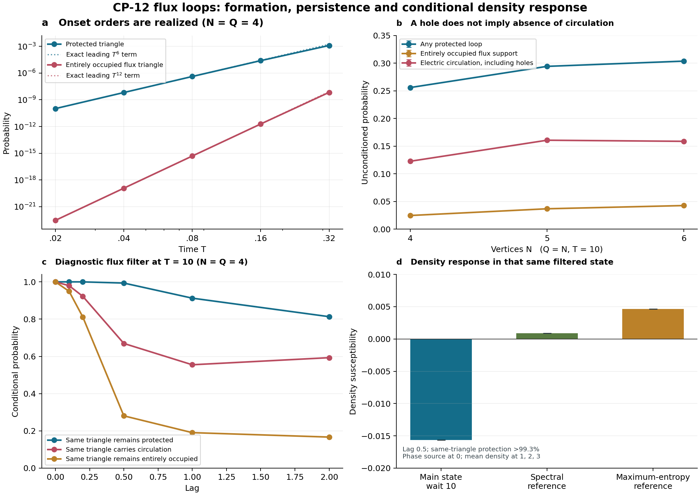

# CP-12 flux-loop gate: protection transfer, electric circulation and conditional matter response

**14 October 2026.** Additive continuation of [fe90e7f](https://github.com/ryangrvr/TestingGRUT/commit/fe90e7f88735aa9159f69c248c0a3b76a5680f2b), following the relational audit `9d0f2ef`. The frozen Hamiltonian and main neutral preparation are unchanged.

The test finds a concrete finite mechanism: **electric circulation and protected geometry can survive changes in edge-fermion occupation, while a conditioned state retains a nonzero matter-density response.** Entirely occupied-edge flux is a much narrower property than circulation itself. Some hole-containing loops carry real closed electric circulation.

This advances the microscopic mechanism. It does not establish an autonomously selected, persistent three-dimensional geometry or a causal cone. The positive same-state response below includes an explicit diagnostic loop filter and source intervention; their energy and information effects are recorded.

## The onset bounds are saturated by nonzero quantum amplitudes

We fetched the parent report and checker by immutable Git blobs, verified their hashes and executed the checker. It reproduces 44 reachable configurations through six hops, with the first protected and occupied-flux triangles at three and six hops.

We then calculated **signed quantum amplitudes** with exact rational arithmetic, without an electric cutoff. For the neutral N=Q=3 triangle:

\[
\boxed{P_\triangle(T)=2T^6+O(T^8),\qquad
P_{\triangle,\mathrm{occupied\ flux}}(T)=\frac{2}{225}T^{12}+O(T^{14}).}
\]

Thus the permitted leading processes do not cancel. The two occupied-flux orientations have H^6 amplitudes -48. For the uniform fixed-Q preparation the corresponding coefficients are multiplied by its mean initial triangle count. The existing N4, N5 and N6 matrices reproduce the formulas, including the dense Q12 case.

The mean occupied-edge flux fraction k/Q is different from a completed flux loop: its first nonzero term is T^6, with exact coefficient 2(N-2)(Q-1)/[9(M-1)]. Total protected-edge fraction begins at 2T^2. These results distinguish ordinary hole protection, single flux edges and completed circulating loops. None is a uniform-in-size or long-time Taylor prediction.

## A hole can carry circulation

We distinguish three observables:

| Property | Criterion |
|---|---|
| Protected loop | Every cycle edge has some nonzero electric support |
| Entirely occupied-edge flux loop | Every cycle edge also has occupied edge fermion |
| Electric circulation | Both half-leg fields on each cycle edge carry consistent nonzero through-flow around the cycle |

The edge Gauss equation is E_ie+E_je=1-n_be. An occupied edge has fields (f,-f). A hole can have (2,-1), which still carries one unit of through-flow plus the local charge. Subtracting a unit around a directed incidence cycle preserves every Gauss constraint. This was independently checked against the full bipartite incidence graph and explicit gauge-loop shifts.

Conversely, an undirected occupied-flux cycle need not have consistently oriented flow in a larger charged network. Both the occupied directed subset and the broader circulation predicate are reported. We do not call a static circulation component a stationary current or a self-sustaining phase.

At T10, the existing unmeasured Q=N states give these probabilities of **containing at least one** loop of the stated type:

| N=Q | Protected loop | Entirely occupied flux support | Electric circulation, including holes | Spanning circulation network |
|---|---:|---:|---:|---:|
| 4 | 0.255832 | 0.024694 | 0.122665 | 0.032406 |
| 5 | 0.294109 | 0.036844 | 0.160685 | 0.006864 |
| 6 | 0.303585 | 0.042660 | 0.158686 | 0.002062 |

Conservative common absolute allowances for the displayed probabilities, including decimal rounding, are 0.000001, 0.000195 and 0.000435 respectively. The saved positive-observable intervals are sharper for rare events. For example the N6 spanning-circulation probability lies within the outward-rounded interval **[0.002042531,0.002081995]**.

Most protected-loop configurations lack an entirely occupied-edge flux loop. It would nevertheless be incorrect to conclude that they therefore lack circulation: at N6 roughly half the loop-bearing configurations contain a genuine circulation component, much of it on hole edges. The hole and occupied cycle events can also coexist; the saved disjoint event decomposition avoids double counting.

These observations reuse the actual wave snapshots reconstructed for `9d0f2ef`. Protected-loop probabilities and vacuum-flux probabilities agree with the prior records within numerical precision. No main state was measured or re-prepared to obtain this population table.

## Protection transfer has an exact dynamical order

For a named cycle let P_C be its protected-loop projector and F_C its entirely occupied-flux projector. The full physical operator identity is

\[
\boxed{(1-P_C)H F_C=0.}
\]

A single hop converts an occupied edge into a hole, which remains protected by Gauss's law. Consequently an initially occupied-flux loop has geometric-loss probability O(tau^4), even though its occupied-flux classification can change at O(tau^2).

If every vertex mode is initially empty, two hops still cannot erase any initially protected cycle edge. Geometric loss then starts no earlier than O(tau^6). An exact unit-circulation triangle basis control gives:

| Loss event | Leading short-lag probability |
|---|---:|
| Entirely occupied-flux classification | 6 tau^2 |
| Electric circulation | 3 tau^2 |
| Protected triangle geometry | tau^6/3 |

The real basis controls have even higher-order remainders as detailed in [DERIVATION.md](DERIVATION.md). A leading all-hole triangle can lose geometry at 3tau^2. These are local structural results for supplied control states, not energy-matched long-lived phases. Higher flux and coherent superpositions require their own finite-time analysis.

The physical candidate is therefore circulation and protection maintained through changing occupations, rather than a requirement that every edge fermion remain occupied forever.

## Same-triangle persistence and reference comparisons

We resolved the named triangle (1,2,3) in the existing N4,Q4 states using an exact stabilizer basis. This changes no physical Hamiltonian term. The basis inclusion, outgoing residual and independent raw physical calculations were checked.

The following table begins with a diagnostic filter selecting that triangle's occupied-flux event. It measures the same triangle two time units later:

| Preparation before filtering | Still entirely occupied flux | Still carries circulation | Still protected |
|---|---:|---:|---:|
| Main neutral-sea evolution, wait 10 | 0.166785 | 0.593015 | 0.813088 |
| Spectral energy reference | 0.213001 | 0.733833 | 0.909487 |
| Maximum-entropy energy reference | 0.268770 | 0.705070 | 0.902959 |

Absolute allowances including rounding are 0.000001, 0.000001 and 0.000100 respectively. Thus most loss of the occupied-flux label is conversion, not immediate erasure of the geometry. The physical references show comparable or greater retention; the main state is not distinguished as a uniquely stable spatial preparation by this test.

If the initial filter instead selects actual circulation, allowing holes, the main wait10 state retains circulation on the same triangle with probability **0.709254** at lag2 and retains protection with probability **0.879584**, each within 0.000001. Both energy references retain circulation with probability about 0.771-0.773 under that diagnostic.

An initial projective filter changes the state. These conditional probabilities are not unmeasured classical histories. We also calculated unforced two-time correlators and the norm of projector change. For the main circulation projector its normalized real autocorrelation at lag2 is approximately 0.639; it has not become a conserved classical record. The measured window does not establish indefinite persistence or a macroscopic metric.

## Density response within the continuing circulation readout

Starting from the **same** occupied-flux diagnostic branch of the N4,Q4 main state at wait10, apply exp(-i eta n_0), evolve the unchanged Hamiltonian for lag0.5, and measure mean vertex density at 1,2,3. This detector does not use graph distance or multiply density by a geometry bin.

The exact linear density susceptibility has the outward-rounded controlled interval

\[
\boxed{\chi_{\rm density}\in[-0.015664384,\,-0.015664380].}
\]

For the two phase paths used to evaluate this exact response, the same triangle remains protected with probability above **0.993243** and retains electric circulation with probabilities approximately **0.666423** and **0.672392**. These quantities are measured in the same evolved diagnostic states.

To exclude an explanation based solely on changing the circulation bin, we separately measured circulation probability g, circulation-weighted density f and their source derivatives. The derivative of the conditional density f/g inside the continuing-circulation readout is

\[
\boxed{\chi_{\rm density\mid circulation}
\in[-0.016020064,\,-0.016020058].}
\]

Both intervals exclude zero. This is a genuine finite matter-density response compatible with substantial continued circulation and almost unchanged protected geometry in the specified diagnostic. It is stronger than observing protection and susceptibility in unrelated finite states.

The source is a projector phase, so its +/-pi/2 identity gives the derivative exactly; it is not a finite-difference approximation. An independent commutator-vector calculation agrees. The same prepared state with hopping removed afterward has exactly zero density susceptibility. A vacuum-flux branch also has exactly zero response to this particular density-phase source because every n_i annihilates it.

The references give density susceptibilities approximately +0.000905 and +0.004660, both also nonzero with controlled errors. All these are finite diagnostic responses. Vertex number itself is not conserved, so this does not by itself prove migration of a preexisting vertex particle, propagation speed, a distance hierarchy or a causal cone.

## Conditioning and source work are part of the result

Before filtering, the main state and both physical references have mean energy 2. The references are mixed and do not match every instantaneous resource or purity. Filtering changes conditional energy:

| Preparation | Energy after occupied-flux selection, before source |
|---|---:|
| Main wait10 | 4.921379 |
| Spectral reference | 4.907034 |
| Maximum-entropy reference | 3.368944 |

These branches are not silently called energy matched. The main conditional-energy interval uses conservation of the full energy second moment and a bounded commutator, rather than applying a norm-only error estimate to an unbounded energy observable.

The named occupied-flux filter succeeds with probability **0.003558871** in the main state. Its hypothetical binary nonselective recording changes mean energy by approximately **+0.0129371** and gives measured-system pinching entropy h_2(p). The subsequent +/-pi/2 source kicks require mean work approximately **+0.454801** and **+0.046185** in that normalized branch. Apparatus construction, local accessibility of an internal record, and autonomous outcome selection are not derived.

The main population evolution uses none of these filters or kicks. Their resources belong to the diagnostic, not to the unforced formation dynamics. [MEASUREMENT_CONTROLS.json](MEASUREMENT_CONTROLS.json) and [CONDITIONAL_DENSITY.json](CONDITIONAL_DENSITY.json) keep the quantities separate.

## Why these are not extended three-dimensional space

A connected spanning union of occupied-flux cycles needs at least N occupied flux edges. At Q=N it is necessarily a vacuum simple ring. A spanning circulation network that includes holes can coexist with matter, but at Q=N it is still a simple ring, with zero removable edges and E^2>=2N+3n_v. These sparse cases cannot supply a three-dimensional extended network.

The input already superposes all Q-edge graphs, including rings. At T10 the full-graph ring probabilities are approximately 0.236982,0.068745,0.021034 for N4,N5,N6, versus initial probabilities 0.2,0.047619,0.011988. The coupled dynamics changes those probabilities and protects some rings. It has not selected a dominant extended spatial phase, and the single-time data do not trace a particular ring's autonomous history.

In the existing N6,Q12 calculation, budget10 excludes every spanning circulation network, whose electric square must be at least12. Its projected zero is **not** a full-law absence result. The full-law spanning probability is bounded above by 0.010521 at T1. Rare circulation is resolved at earlier times: at T0.4 its probability lies within **[3.6610e-7,1.8083e-6]**. At T1 the general circulation interval includes zero; a detector-specific refinement of its directed occupied-edge subset also failed to exclude zero. Positive numerical centers are not certificates of detection.

## Reproduction and ruling

[README.md](README.md) supplies commands. [DERIVATION.md](DERIVATION.md) gives definitions, exact amplitudes, protection-transfer orders, full-law bounds, energy controls and the conditional-response formula. [VERIFICATION.json](VERIFICATION.json) distinguishes fresh checks from hash-validated larger calculations.

Independent checks include all 729 oriented four-vertex graphs; 3,750 physical configurations with circulation, checked on the bipartite incidence graph and by Gauss-preserving loop extraction; 684 charged spanning circulation configurations; an independent 6,075-state physical Hamiltonian; purification-compression and same-triangle correlator controls; and 24 independent dense unitary dilations of the positive dual bound. Exact onset arithmetic is unregulated. Dynamical cutoff bounds are analytic but evaluated in ordinary floating point, not formal roundoff interval arithmetic.

**Ruling:** CP-12 permits and actually generates finite circulation records. Protected geometry can outlive its occupied-flux label, and a specified conditioned state shows matter-density response within a continuing circulation readout. The energy references show that these properties do not identify a unique spatial phase. The remaining formation target is an unforced state with a persistent, extended geometry and spatially constrained propagation, tested in a size/density sequence that can support it. Spacetime emergence and a complete theory of reality are not established.
