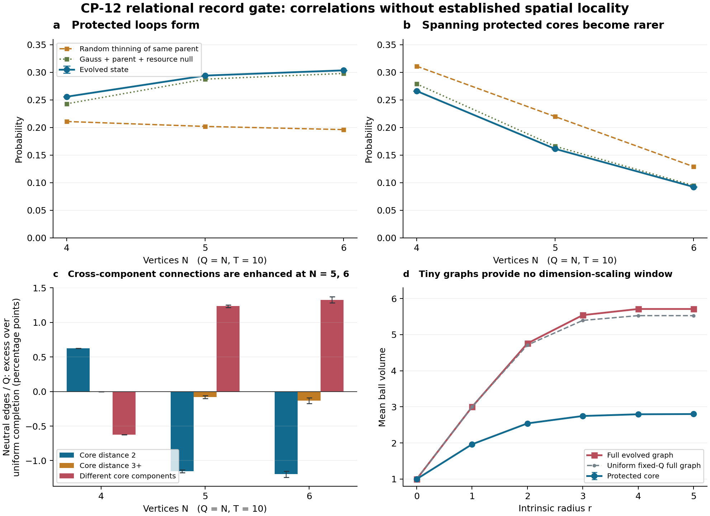

# CP-12 relational record gate: correlations found, spatial locality unestablished

**14 October 2026.** Additive research continuation of [a351fea](https://github.com/ryangrvr/TestingGRUT/commit/a351fea238f819f29ea1edbd8b7559d43b0be732). The frozen Hamiltonian and topology-neutral supplied initial state are unchanged.

The existing evolved states contain nontrivial **unlabelled protected-core correlations**. They differ from random thinning and from a more constrained Gauss-law/resource reference. This is a positive finite-system relational result. The cores are usually disconnected, their statistics are still changing, and the remaining neutral connections do not exhibit a consistent preference for connecting nearby parts of a single protected geometry. These calculations do not establish spacetime formation.

An exact mechanism result accompanies the calculation: **neutral rewiring preserves the entire protected core, including its topology. Only matter hopping can change it.** A separate sharp energy bound explains why a classical configuration shuffle cannot serve as an energy-matched null at the neutral preparation's energy.

## What was actually computed

The previous packet `8ece3e2` saved trajectories and matrix caches, not final wavefunctions. We reconstructed the identical projected states, using the existing cached Hamiltonians and the same already published times. We checked all reconstructed removable, flux-protected and hole-protected fractions against every intervening published time point. The maximum count discrepancy over the main cases was below \(6.1\times10^{-14}\). No larger system, longer evolution, new initial state, source or external recording operation was introduced.

The protected core contains every nonremovable present connection. On physical Gauss states, it is exactly the support of the nonzero electric fields. We retain isolated vertices, classify core shapes up to vertex relabelling, and measure connectivity, all-cycle support, triangles, squares, short-cycle packing and intrinsic balls in the same joint graph/matter/flux state. These are final-time diagonal diagnostics; they do not select a measurement outcome or demonstrate an observer.

The main comparable cases are the already tested \(Q=N\) states at \(T=10\). This is an auxiliary sparse sector: a connected full graph with \(Q=N\) has cycle rank one. It is not a three-dimensional macroscopic scaling sequence.

| N, Q | Core has a cycle | Core spans all N vertices | Core-shape TV from Gauss/parent/resources | Absolute error allowance for each displayed probability or TV |
|---|---:|---:|---:|---:|
| 4, 4 | 0.255832 | 0.266052 | 0.021289 | 0.000001 |
| 5, 5 | 0.294109 | 0.161182 | 0.023242 | 0.000195 |
| 6, 6 | 0.303585 | 0.092227 | 0.024591 | 0.000435 |

The allowances include the analytic cutoff bound and rounding of the displayed centers. They are not statistical standard errors. Numerical evaluation uses ordinary floating point, without an interval-arithmetic roundoff certificate.

## Much of the loop excess is kinematic

The references progressively control more information:

* Uniform fixed core size controls the number of protected edges.
* Random thinning of the same parent graph also controls full-graph topology.
* The Gauss/resource reference uses only actual physical configurations represented in the existing reachable signed-invariant basis, weighted by their labelled orbit sizes. It matches the joint distribution of \((n_v,E^2,r)\).
* The Gauss/parent/resource reference additionally matches the unlabelled parent graph.

The physical-configuration references have explicitly restricted support. Outside that represented set their full-law extension is the identity. They are well-defined bounded comparisons, not claims about the uniform distribution over the entire unbounded physical Hilbert space. See [DERIVATION.md](DERIVATION.md).

At \(T=10\), the core cycle probabilities are:

| N = Q | Evolved | Random thinning of same parent | Gauss/parent/resources | Evolved minus Gauss/parent/resources |
|---|---:|---:|---:|---:|
| 4 | 0.255832 | 0.210814 | 0.242968 | +0.012864 |
| 5 | 0.294109 | 0.201877 | 0.287662 | +0.006447 |
| 6 | 0.303585 | 0.196148 | 0.297945 | +0.005640 |

The same error allowances apply to each displayed probability and contrast. The contrast is a single bounded observable evaluated in the same state, so its bound does not require adding two independent state errors.

Thus uniform thinning understates the expected loop population once Gauss constraints and flux resources matter. For example, with no vertex fermions the flux is divergence free and nonzero flux cannot live on a bridge. Small residual differences survive the stronger reference, but neither those differences nor the larger raw loop excess identify a spatial dimension. At earlier times some loop contrasts have the opposite sign; they are not a monotonic topology-selection law.

The N4 core-shape TV is stable between the already computed electric budgets 128 and 256 to below \(2.1\times10^{-14}\). This is a small-system sensitivity check. It does not prove that every conditional null has stabilized at larger N.

## Dense-sector relational result with detector-specific bounds

The same analysis was applied to the existing \(N=6,Q=12\) state. At \(T=0.4\), its core-shape TV from the Gauss/parent/resource reference has the outward-rounded controlled interval

\[
D_{\rm TV}\in[0.017970,\,0.019451].
\]

At \(T=1\), a generic state-error bound is too loose. We used the existing forward/backward detector method on core-cycle and core-connectivity projectors and on a fixed TV witness. It gives

\[
\Pr(\text{core has a cycle})\in[0.165853,\,0.259184],
\]

\[
\Pr(\text{core spans all vertices})\in[0.077708,\,0.162055],
\]

\[
\boxed{D_{\rm TV}\ge0.014437.}
\]

The projected TV is 0.0576215, but the refined witness supplies a **lower bound**, not a narrow two-sided TV interval. Its full-law expectation error is 0.0431836 before outward decimal rounding. The test therefore distinguishes this evolved relational distribution from the declared reference, while establishing that a spanning protected core is uncommon in this state. It does not establish an energy-matched or macroscopic spatial phase.

All \(Q=12\) full graphs on six vertices have diameter two. Core paths can be longer, but hopping acts on the full graph. Core distance cannot simply be promoted to a physical propagation metric while neutral connections remain dynamically available.

## Neutral connections do not demonstrate spatial selectivity

For each configuration we classified noncore vertex pairs by their distance in its protected core: distance two, finite distance at least three, or distinct components. For a core P, uniform completion puts an expected fraction

\[
\frac rQ\frac{K_c(P)}{M-|P|}
\]

of the total Q connections into class c, where \(K_c\) counts possible pairs in that class. We compared the actual removable-edge population with this reference.

At \(T=10\), the following entries are **neutral edges divided by Q**, actual minus uniform completion:

| N = Q | Core distance 2 | Core distance 3 or more | Distinct core components |
|---|---:|---:|---:|
| 4 | +0.006270 | -0.000037 | -0.006233 |
| 5 | -0.011546 | -0.000810 | +0.012355 |
| 6 | -0.011974 | -0.001311 | +0.013284 |

The probability/contrast error allowances in the first table apply. At N5 and N6, neutral connections between separate protected components are enhanced, rather than uniformly suppressed. This geometric completion reference does not control parent topology or energy.

The stronger Gauss/parent/resource comparison reduces the cross-component excess to **+0.002696 at N5** and **+0.000683 at N6**, with absolute allowances 0.000195 and 0.000435. Both remain positive. At N6 the residual finite-distance-3-or-more contrast is -0.000221 and is not resolved by its error bound. [SHORTCUT_CONTROLS.json](SHORTCUT_CONTROLS.json) contains all bins and tested times.

These are final-state occupation correlations, not measured propagation speeds or transition probabilities for a fixed initial destination pool. A connection joining two core components may be useful for assembling a network; its presence alone is not proof of an unphysical shortcut. The result is that a locality-selecting rule has not emerged from this diagnostic. In particular, the bare allowed rewiring coefficient is still independent of intrinsic distance.

## Ball growth does not identify three dimensions

For \(N=6,Q=6,T=10\), mean intrinsic ball volumes are approximately:

| Radius | Protected core | Full evolved graph | Uniform fixed-Q full graph |
|---|---:|---:|---:|
| 0 | 1.0000 | 1.0000 | 1.0000 |
| 1 | 1.9636 | 3.0000 | 3.0000 |
| 2 | 2.5419 | 4.7587 | 4.7123 |
| 3 | 2.7468 | 5.5415 | 5.3956 |
| 4 | 2.7944 | 5.7115 | 5.5275 |
| 5 | 2.8006 | 5.7115 | 5.5275 |

The core and evolved-full-graph entries have absolute allowances 0.00266 after decimal rounding; the uniform reference is a finite exact combinatorial average, shown rounded. Averages include isolated roots and disconnected components. The protected core saturates at a small accessible component; the full graph rapidly spans most vertices. There is no interval of radii and sizes supporting a controlled dimension fit. No dimension is fitted.

## Exact mechanism and an energy-control obstruction

The new operator result is

\[
\boxed{[H_R,F(P)]=[H_D,F(P)]=0.}
\]

Only hopping can create, erase or rearrange the protected core. This includes the formation of protected loops. It does not imply that a new full-graph loop has been created from an initially acyclic ensemble: the supplied uniform graph ensemble already contains cyclic graphs. Neutral rewiring can influence subsequent core formation through its effect on the evolving state.

The ensemble is not stationary at the end of these runs. For example, at N6,Q6,T10 the protected-core connectivity probability has derivative approximately -0.011503, with analytic operator-error allowance 0.007376 including decimal rounding. This does not measure the lifetime of the same edge or exclude frozen individual branches. No persistent metric or edge-identity autocorrelation is established here.

The energy result is also exact. At the frozen couplings, every density operator diagonal in the **complete** graph/fermion/electric configuration basis satisfies

\[
\boxed{\langle H\rangle_{\rm diagonal}
\ge\kappa Q+\frac{\Gamma Q(M-Q)}M.}
\]

For \(0<Q<M\), that exceeds the main preparation's conserved mean energy \(\kappa Q\). A completely incoherent classical graph/flux randomization therefore cannot match that energy. The Gauss/resource distributions above control diagonal resources, and their physical diagonal-mixture energies are explicitly reported rather than presented as energy matched. At T10 these projected-mixture energies are 5.26220, 6.04264 and 7.30756 for N4,N5,N6, versus main-state energies 2,2.5,3.

We constructed two genuinely physical, configuration-coherent mean-energy references in the existing N4,Q4 retained symmetry sector:

| State/reference | Full mean energy | Core cycle probability | Core connectivity probability | Global entropy, bits |
|---|---:|---:|---:|---:|
| Main pure state, T10 | 2 | 0.255832 | 0.266052 | 0 |
| Initial neutral ray, T0 | 2 | 0 | 0 | 0 |
| Dephase initial ray in retained-H energy basis | 2 | 0.268585 | 0.250836 | 3.869534 |
| Maximum entropy at that mean energy within retained sector | 2 | 0.464394 | 0.360574 | 5.209479 |

The spectral reference preserves the entire **projected** energy distribution. The maximum-entropy reference has inverse temperature 0.673651 in the frozen units. These are positive density operators on physical Gauss states, so their full-H mean energies equal their retained-H means. They are not asserted to be stationary under the unbounded full H or to be its Gibbs state. They do not match each instantaneous matter/flux resource distribution. The maximum-entropy reference also has different energy variance; global entropy differs as shown. A single reference matching energy, resources, purity and every other statistic has not been constructed.

Thus the finite loop response cannot be described as unusually spatial on the basis of energy alone. The main preparation's global purity remains one; the previous graph entropy is subsystem entanglement in the stated kinematic embedding. Neither the reference construction nor final-configuration analysis supplies a state-selection principle or an observer.

## Preparation and physical scope

The main input remains a supplied coherent uniform sea over all Q-edge graphs, all edge fermions occupied, empty vertex modes and zero electric field. It has no preferred graph or spatial phase mask. Its low energy relies on coherence: even the neutral configuration-diagonal mixture has the strict energy gap above. Its logical preparation is the previously declared uniform fixed-weight construction. A physical locally implementable preparation and an autonomous selection of that special ray have not been derived.

All tests here are source free. The earlier nonzero matter susceptibility remains a separate diagnostic experiment. This packet does not measure a source response conditioned on a locally accessible internal record, a growing causal region, a persistent common geometry, gravitational field equations or a continuum limit.

## Reproduction and scientific ruling

[DERIVATION.md](DERIVATION.md) supplies the exact operator identities, null definitions, energy gap, shortcut reference and full-law error bounds. [README.md](README.md) gives commands. [VERIFICATION.json](VERIFICATION.json) records fresh checks and explicitly distinguishes them from the larger saved calculations.

The independent checks include 1,244 small-graph oracle comparisons, exhaustive permutation orbit catalogues up to six vertices, raw N4 physical unfolding over 13,401 configurations, labelled-edge and matter marginal tests, raw nonhopping transitions preserving the protected core, and 10,024 exact rational resource cases for the energy inequality. The verifier freshly rebuilds the small model, reruns its analysis and both energy references, checks all saved distributions and bounds, and verifies source/data hashes. Larger replays and the dense backward calculation are saved reproducible calculations, not silently rerun by the default verifier.

**Ruling:** the defined random-protection references do not fully explain the finite relational record distribution. There are residual unlabelled correlations. Much of the loop excess is nevertheless explained by Gauss constraints and measured resources, spanning protected cores remain uncommon, and the remaining neutral network has not demonstrated local propagation on a persistent shared geometry. The spatial-formation gate remains open scientifically and is not passed by these data. This is a finite-condition outcome, not a no-go theorem for CP-12 or a completed theory of reality.
