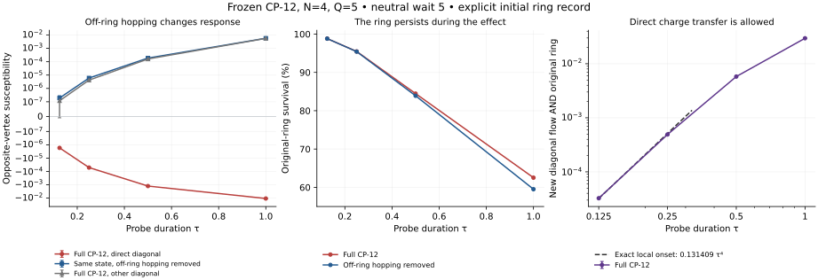

# CP-12: a circulating ring does not automatically govern matter transport

Continuation from `aedf49249d911d938b8c0a0f73dd98f9804879fe` and `69098c1`.

**The shortcut concern now has an executed CP-12 example.** In the frozen microscopic law's N=4,Q=5 auxiliary sector, an original neutral state forms a circulating ring with a neutral active diagonal. That diagonal admits a gauge-invariant two-hop charge transfer. Retaining its hopping reverses an opposite-vertex response relative to the same recorded state with off-ring hopping removed, while the ring remains present with high probability.

This is a finite recorded-history result. The four-site sector is not the Q=2N scaling sequence. The N5/Q10 and N6/Q12 calculations below separately test the original neutral ray and the exact moving-core operator in that sequence. None of these systems provides a large-distance locality limit or an autonomous geometric record.

The frozen Hamiltonian, its parameters, the full rewiring escape diagonal, all labelled neutral graph parents, electric shifts and fermion signs are retained in every full-law run. The comparison evolutions are explicitly identified interventions.

## 1. The gauge constraint permits the shortcut

For a neutral active edge e=(i,j), define the physical matter transfer

\[
T_{j\leftarrow i}=a_j^\dagger U_{je}U_{ie}^\dagger a_i.
\]

It transfers a vertex fermion from i to j, changes the half-leg fields by (-1,+1), and preserves Gauss law. The exact local CAR identity is

\[
K_e^2=2n_b+(1-2n_b)
(n_i+n_j-T_{j\leftarrow i}-T_{i\leftarrow j}).
\]

When the edge fermion is occupied, an occupied source and empty receiver have a two-hop transfer amplitude of magnitude tau²/2. The path is edge→receiver followed by source→edge. The original ring's fields do not change in these two hops. Thus gauge invariance does not prohibit this direct transfer or force it around the ring.

For the actual recorded waiting state in this experiment,

\[
\Pr(\text{new diagonal through-flow AND original ring}\mid\text{initial record})
=c_4\tau^4+O(\tau^5),
\]

with

\[
c_4\in[0.1314091853,\ 0.1314092402].
\]

The coefficient is one quarter of the probability that the diagonal endpoints have unequal vertex occupations. This finite derivative is not an irreversible formation rate and is not the onset coefficient of the local phase response. Its waiting-state uncertainty is included.

`TRANSFER_ALGEBRA.json` independently checks all eight local CAR states with integers. It also checks 48 recorded Gauss-admissible basis states; 24 have nonzero direct transfer, and all 24 destinations lie outside that check's retained electric basis. They are retained in the unregulated algebra check. No numerical cutoff can explain the allowed process.

The first-action identity is also useful:

\[
\|K_ev\|^2=\langle v,(2-n_i-n_j)v\rangle
\]

for a neutral occupied edge. In the recorded shortcut category, the normalized outside-hopping action is approximately **1.11665424** in frozen units. Pauli filling can block an edge when both endpoints are occupied; that blocking is not realized throughout this state.

The exact diagonal energy changes along a direct transfer are
2+1/8-Gamma(M-Q)/M at its first hop and 1/4-Gamma(M-Q)/M at completion.
They include the change in the physical rewiring escape diagonal. Neither
depends on the original ring's flux magnitude, since its fields are unchanged.
Thus simply raising that flux to protect a ring against rewiring does not
produce a growing diagonal detuning for this neutral shortcut. These are
basis-diagonal energy changes, not eigenvalue gaps, long-time rates or a
controlled heavy-matter approximation.

## 2. The ring and the matter response are measured on the same preparation

Start from the original equal coherent neutral ray over **all six** N4/Q5 labelled hosts. Its energy is 2.5 and variance is 10. Evolve under full H to waiting time 5. A complete twelve-outcome projective record resolves each graph and whether its unique spanning four-cycle is circulating, carries matter, and has a neutral fifth edge. All outcomes remain in the complete record channel.

The total event probability is

\[
p_G\in[0.05157924746,\ 0.05157925387].
\]

The subset whose diagonal directly joins source0 to its opposite receiver has unconditional initial probability approximately **0.02578962533**. The selected ring is obtained from the neutral dynamics; it is not supplied as the initial state. The record is an external diagnostic resource.

After that record, apply the local gauge-invariant phase pulse exp(-i theta n_0). Measure density at the opposite vertex of the **initial recorded ring**. The receiver label stays fixed independently of the final graph. The source commutes with every record projector, so the initial event probability has zero source derivative.

The table gives the conditional phase susceptibility, not an arrival probability. Each full/control pair starts from exactly the same recorded branch. The comparison H_C removes hopping on the two possible diagonal labels, while retaining all mass, electric and rewiring terms and all graph states.

| probe duration | full frozen CP-12, active direct diagonal | same recorded state, off-ring hopping removed | original-ring survival under full H |
|---:|---:|---:|---:|
| 0.125 | -1.71539e-6 | +1.91379e-7 | 98.8114% |
| 0.25 | -5.11652e-5 | +6.02000e-6 | 95.4664% |
| 0.5 | -1.24804e-3 | +1.88562e-4 | 84.4622% |
| 1 | -1.06721e-2 | +5.76371e-3 | 62.5244% |

At duration 0.25, the full response interval is [-5.12567e-5,-5.10736e-5], the core comparison interval is [5.93425e-6,6.10574e-6], and their difference interval is [-5.73625e-5,-5.70079e-5]. The sign reversal is resolved. The original-ring survival interval is [0.9546638793,0.9546642208]. The host survives with probability greater than 0.9999829 on the same branch.

At that duration, the joint probability of new diagonal through-flow and survival of the original ring, conditional on the initial shortcut record, lies in [0.00049115357,0.00049115761]. Under the core comparison it is exactly zero: all non-core half-leg fields remain zero. The full system can retain the ring while developing a direct charge-transfer route across it.

The unnormalized full/control state distance is approximately 0.04481955, with interval [0.0448195398,0.0448195673]. The independently integrated full-law Duhamel upper bound is 0.04712222. Optimizing away each record branch's global phase still leaves a distance of approximately 0.04479696. The effect cannot be explained entirely by a common dynamical phase.

The hosts whose extra diagonal joins the other two vertices provide a useful additional control. At duration 0.25 their opposite-receiver full response is +4.20157e-6. At longer durations indirect off-ring effects also occur in that category. Source/receiver degrees are 3 in the direct-diagonal category and 2 in the other category, so the category-to-category comparison is **not** a degree-matched scaling test. The within-branch full-versus-core intervention is the controlled attribution used here.

## 3. The record has a measurable resource cost

The complete graph/event record changes mean energy by

\[
\Delta E\in[0.08703467795,\ 0.08703501456]
\]

and produces measured-system entropy **2.878030497 bits**, with continuity uncertainty below 4.071e-7 bits. The full state before recording is pure; an enlarged coherent apparatus could retain global purity. Apparatus construction and reset are not derived.

The energy estimate bounds the operator Phi(H)-H, which is bounded because the record commutes with the unbounded diagonal electric operator. It does not infer an unbounded-energy expectation from state-norm closeness alone. See `DERIVATION.md`.

## 4. Exact moving-core action at N5 and N6

Let chi_e be the corrected opposite-sign directed-cycle indicator. The moving-core split is

\[
K_{\rm in}=\tfrac12\sum_e\{\chi_e,K_e\},\qquad
V_{\rm out}=K-K_{\rm in},\qquad H_c=H-V_{\rm out}.
\]

Each hop receives its mean source/destination core membership, preserving Hermiticity even when the core changes. The full operator is gauge invariant and permutation covariant. It retains graph rewiring. It includes creation, destruction and core-boundary effects as well as possible bypasses; V_out is not exclusively a spatial shortcut operator.

An exact neutral-state identity is

\[
K_{\rm in}\psi_0=0,\quad H_c\psi_0=(Q/2)\psi_0,
\quad\|V_{\rm out}\psi_0\|^2=2Q.
\]

Consequently the moving-core-only model cannot form geometry from the original neutral ray. A neutral-origin full/core comparison alone cannot separate failed formation from failed transport. Our second comparison starts from a common state already evolved with full H.

For N5/Q10 at wait 2, the primary event c/Q≥1/4 and n_v/N≥1/4 has probability approximately 0.05962997288. Its separate branch has outside-hopping action norm 1.09164173, or **4.47041481 per normalized event state**; the action norm interval before normalization is [1.09107602,1.09220744]. This is not a Born probability or a fraction of transport.

At subsequent duration 0.25, the full state and moving-core comparison differ in phase-optimized norm by [0.19742755,0.19788140] before dividing by the event norm approximately 0.24419249. The event's sequential survival is approximately **0.73514017** under full H and **0.96312008** under H_c. The approximation that drops outside hopping changes actual dynamics substantially; apparent persistence in the restricted model cannot be taken as full-law persistence.

`RESPONSE_N5_B50.json` separately applies a fixed local source and fixed-receiver density measurement to that common N5 waiting state and its primary-event branch. Its receiver is any one fixed j!=0, represented exactly by the average over the other vertices in the source-stabilizer sector. It never uses the final graph to select the receiver. The numerical comparison is reported in the handoff and the saved data; it is not a distance-bin calculation.

At wait2/probe0.25, the **unfiltered** N5 full response is approximately 0.00123705516, and the moving-core comparison gives a central value0.00004183250. Their difference interval is [0.00091754159,0.00147298707], excluding zero. Thus dropping outside-core hopping changes an actual local matter response in the Q=2N sequence as well as changing loop probabilities. The comparison response's own interval includes zero, so a finite ratio between the responses is not certified; the central-value ratio about29.57 is not a transport-speed result.

Within the separately recorded primary-event branch, the corresponding conditional responses are approximately 0.00096029649 and 0.00041847010, but their difference interval [-0.00081789990,0.00190180378] includes zero. The branch-specific response change is **not resolved** at this budget. The resolved unfiltered difference must not be substituted for that missing conditional result.

For N6/Q12 at wait 0.5, the primary-event probability interval is [6.08258e-6,8.37742e-6]. Its unnormalized outside-action norm interval is [0.00930190,0.01957601], which excludes zero. The conditional event-survival intervals for the full and moving-core comparisons overlap. They do not resolve a persistence advantage or a locality hierarchy. The earlier N6 time-2 gate remains uncontrolled and is not promoted by this work.

## 5. Verification and what this establishes

The N4 labelled full-basis computations use electric-square budgets 128 and 256, with dimensions 53,178 and 106,914. The larger waiting-state error bound is 6.547e-9; the smaller is 1.2324e-6. Their probability and response intervals overlap. Every outgoing electric transition contributes to a Duhamel error estimate. The full N5 invariant basis has 162,191 states, its source-stabilizer basis 810,377, and the N6 invariant basis 715,985.

Independent checks cover 24,636 physical hopping/Gauss transitions, 2,904 hops that change core membership, 2,052 hops involving unequal opposite-sign charged-hole fields, and 780 permutation/core comparisons. A separate labelled-basis embedding agrees with both full H and V in full-permutation and source-stabilizer quotients. The largest reported intertwiner/Gram discrepancies are below 1e-13. The new stream agrees with the inherited full-grid propagator to about 2e-15 on its control problem. The earlier ten-site one-particle control is also reproduced separately and remains labelled non-CP-12.

Analytic norm upper sums and response intervals use ordinary floating-point arithmetic with a separate 5e-10 reporting allowance. They are not outward-rounded certificates. The saved-evidence verifier, manifest and complete reproduction commands are included; internal checks are not external peer review.

**Scientific result:** the frozen law permits, and this finite neutral-origin recorded experiment exhibits, a matter-response effect from an active non-ring connection while the ring remains present. Circulation alone is insufficient to identify the operational metric in this example. The N5 operator calculation also rules out treating its outside-core action as negligible in the tested state.

**Still open:** a transport-distance hierarchy at increasing N, degree-matched and irregular-host controls, autonomous record formation, and a dynamical mechanism that suppresses non-geometric hopping in the proposed physical regime. A larger unrecorded phase might have such a mechanism; this packet neither derives it nor rules out every possible CP-12 phase. No new Hamiltonian has been adopted to manufacture that suppression.
