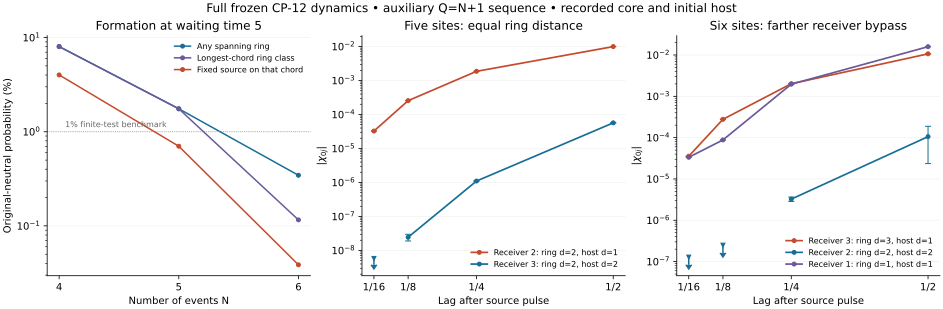

# CP-12: can matter detect the distances of a formed core?

**Result: the tested recorded-ring metric fails the source-resolved
six-site benchmark. Milestone A is not achieved.** A receiver three ring
edges from the source responds more than 550 times as strongly as a
receiver two ring edges away at lag 1/4, while the original ring has
greater than 90.4% retention probability. The farther receiver has an
active direct chord. The complete frozen Hamiltonian was retained.

All displayed table intervals are rounded; the accompanying JSON files
contain their full reported precision. This is a negative result for this candidate geometry and preparation,
not a no-go theorem for every CP-12 phase. It supplies no empirical
prediction about nature. The five GRUT research gates and next
architecture decision are stated in `PROGRAM_TESTS.md` and
`ARCHITECTURE_CHARTER.md`.

## Experiment and scope

Start with the original equal coherent neutral ray over all labelled
fixed-Q active hosts. Evolve to waiting time 5, record a spanning simple
cycle that is the **entire** directed-circulation mask, and apply the
gauge-invariant pulse `exp(-i theta n0)`. No outside electric state or
matter occupation is filtered. Evolve with all physical hopping and
rewiring. Receiver distances always refer to the initial recorded core.

The matched size sequence is **Q=N+1**, with N=4,5,6 and unchanged
microscopic coefficients. It is an auxiliary sector sequence, explicitly
different from the previous primary **Q=2N** sequence. A separate N=5,
Q=10, waiting-time-2 result is included below; this packet does not settle
large-size scaling of Q=2N.

The endpoint control also records the initial active host: the ring plus
one chord. Record every equivalent core-host outcome and one failure
outcome, then examine the longest-chord class with the fixed source at
an endpoint. Initial graph coherence is removed only as specified by
this complete instrument. All later graph changes remain dynamical.

For a branch phi, evolve `x=exp(-iHt)phi` and
`y=exp(-iHt)n0 phi`. The measured response is exactly
`chi_0j=2 Im <x,nj y>`. Source variance bounds are positive throughout;
at N=6 the interval is `[0.230599074,0.230599117]`. The source is not a
global phase. The response is signed and is **not** a transfer probability.
Each value also satisfies the exact finite-pulse identity using
theta=plus/minus pi/2.

`TEST_PROTOCOL.md` fixed the six-site comparison locally before that
source result was inspected. The four- and five-site pilots were already
known. This is not an independently preregistered blind comparison or a
claimed victory over random graphs or conventional lattices.

## Individual receivers expose the bypass

At N=6 the ring is `0-1-2-3-4-5-0`, with initial extra edge `0-3`.
Receivers 2 and 4 have ring and initial-host distance 2. Receiver 3 has
ring distance 3 and initial-host distance 1. They see the same source,
recorded branch and Hamiltonian.

| Lag | Response at receiver 2, ring distance 2 | Response at receiver 3, ring distance 3 | Same original ring probability |
|---|---|---|---|
| 1/8 | `[-7.958e-10, 2.495e-7]` | `[2.77635e-4, 2.77884e-4]` | `[0.97213784, 0.97213810]` |
| 1/4 | `[2.85250e-6, 3.65290e-6]` | `[2.01985e-3, 2.02060e-3]` | `[0.90405749, 0.90405872]` |
| 1/2 | `[2.35641e-5, 1.88195e-4]` | `[1.06013e-2, 1.07483e-2]` | `[0.73698839, 0.73726000]` |

The lag-1/8 response at receiver 2 is unresolved about zero; it must not
be called zero. The lag-1/4 ratio of absolute responses is
`[552.946,708.362]`. Both prospective primary lags fail the operational
distance-ordering benchmark with survival above 0.75. The later 1/2
survival is below that benchmark and is retained in the table. At 1/4
the distance-3 receiver also responds slightly more strongly than the
distance-1 receiver, whose interval is `[0.00196731,0.00196809]`.

The five-site control distinguishes receivers with **equal** ring
distance. For ring `0-1-2-3-4-0` plus chord `0-2`, receivers 2 and 3
both have ring distance 2. At lag 1/4 their responses are

- Directly connected receiver 2: `[0.00186558087,0.00186559076]`.
- Receiver 3 without a direct source edge: `[1.09652e-6,1.10816e-6]`.

The ratio is `[1683.50,1701.37]`, with same-ring retention exceeding
92.46%. Individual responses therefore depend strongly on the active
host relation that the ring metric omits. The six-site result extends
this problem to a strictly greater intrinsic separation.

Nonmonotonic susceptibility alone is not a universal failure criterion
for local quantum systems: interference, nodes and initial correlations
can break pointwise ordering. These tests concern a specified circulating
metric with an actual active bypass, backed by matched fixed-receiver
controls. They establish neither a complete causal decomposition of
every amplitude nor a general no-go theorem. They provide no positive
growing-distance front or effective propagation speed.

Core-only records, with the initial host left coherent, give decreasing
shell-mean far/near responses at lag 1/4: about 0.224 at N=4 and 0.111
at N=5. The endpoint controls demonstrate why that averaged decrease
cannot certify locality. The two instruments prepare different branch
ensembles; their differences are not presented as a free intervention.

The plot shows actual model data. Receiver bars are the analytic error
intervals; downward limits denote unresolved responses bounded in
magnitude. Formation errors are smaller than the markers. Lines connect
sampled finite-size data and do not extrapolate. The ring and longest-
chord class probabilities coincide at N=4 and N=5.

## Formation is a separate obstacle

All percentages below refer to the **original neutral preparation**,
before conditioning. The same waiting time and microscopic coefficients
are used at all auxiliary sizes.

| N,Q | Any exact spanning ring | Longest-chord ring class | That class with the fixed source on its chord | Any spanning connected circulating mask |
|---|---:|---:|---:|---:|
| 4,5 | 8.025916% | 8.025916% | 4.012958% | 12.587610% |
| 5,6 | 1.753043% | 1.753043% | 0.701217% | 2.661384% |
| 6,7 | 0.344661% | 0.115830% | 0.038610% | 0.509952% |

At N=6 the longest-chord class has 180 equivalent records. One labelled
core-host outcome has probability `6.434999e-6`. The full refined
instrument includes **540** successful core-host outcomes across both
chord lengths, plus failure. Symmetry permits one representative
calculation per class; it does not remove the probability cost.

The six-site ring and chord-class probabilities fall below the protocol's
1% finite-test benchmark. That benchmark is an operational convention,
not a fundamental definition of a spatial phase. The decreasing sequence
and only three sizes do not establish its thermodynamic limit. They do
not support a claimed appreciable spatial phase at these tested points.

The unfiltered geometry scan uses the entire circulating mask, not a
chosen ring. Any circulation occurs with probabilities about 27.33%,
23.70% and 20.73%; spanning connectivity is much rarer. At N=6 the
conditional all-root mean ball volumes of spanning connected circulating
masks are approximately `[1,3.10804,5.18310,6]`. The selected ring itself
has `[1,3,5,6]`, whereas the endpoint branch's initial active host has
`[1,4,6,6]`. These are finite graph observables. Ring ball growth follows
from the selected event; average degree does not derive three dimensions.

## Recording has a physical effect

The complete core-host record, including failure, has the following
unconditional energy change and record entropy:

| N | Complete-record energy change | Complete-record entropy, bits |
|---|---|---|
| 4 | `[0.057651821,0.057652121]` | `[0.610558620,0.610558664]` |
| 5 | `[0.00535574436,0.00535576400]` | `[0.230890820,0.230890825]` |
| 6 | `[0.00151705376,0.00151721746]` | `[0.0644433334,0.0644433480]` |

These are properties of the specified projection instrument, not a
derived measuring device or an entropy-to-heat claim. At N=4, keeping
**all** record outcomes changes the fixed receiver-1 response at lag 1/4
from approximately `0.001591642` without recording to `0.001469195` with
the refined record. The resolved difference interval is
`[-0.0001224683,-0.0001224254]`. Thus neither the record nor its effect
is treated as free.

The source runs report raw local responses, joint same-core responses
and properly differentiated final conditional densities. Global final
core selection can itself change responses. Only the raw local
receivers, accompanied by core-retention probabilities, support the
distance test. Retention at sampled lags is not a monitored first-passage
survival probability.

## Primary Q=2N supplement

For N=5,Q=10 at waiting time 2, the original-neutral exact spanning-ring
probability is `[0.00126718042,0.00126729023]` and source variance is
`[0.195077159,0.195098078]`. All active hosts here are the complete graph.
At lag 1/4, near response is `[0.00119434,0.00129430]`, ring-distance-2
response is `[-0.000243813,-0.000139811]`, and ring retention is
`[0.84731869,0.84745900]`. The distant response is nonzero and opposite
in sign. At 1/8 it is unresolved. This has maximum ring distance 2 and
does not settle the primary sequence's large-distance scaling. The
auxiliary six-site result must not be silently substituted for Q=2N.

## Verification and numerical advance

The six-site neutral electric-budget matrix has 1,980,546 signed
permutation orbits and 133,348 outgoing physical rows. A real 128-column
Krylov reduction makes this preparation tractable without removing its
charged boundary or return amplitudes. Its full-state bound at waiting
time 5 is `2.161385e-9`, including electric-boundary residual, last Krylov
column, full finite-H relation defect and reporting allowance.

The six-site source basis has 513,066 orbits and 331,974 outgoing rows.
All unretained outgoing hopping and rewiring remain in the error action.
At lag 1/4 the norm errors of the two evolved source vectors are about
`3.23e-7` and `1.29e-7`; the receiver intervals above include them and
the normalized conditional preparation error.

Independent checks include:

- Full labelled N=4 physical evolution with 106,914 basis states,
  checking both signed lifts and the local responses against the
  rooted calculations. Central response differences are below 1e-14.
- Full labelled core-only and refined instruments, including failure,
  confirming record work, entropy and the nonselective response effect.
- 68,376 raw transition checks with no one-step switch between distinct
  exact spanning-cycle records.
- Smaller-system full-basis comparisons of the Krylov reduction, where
  measured nonzero errors lie within their full-law bounds, and a
  larger Krylov-space six-site convergence check.
- Unchanged frozen source hashes and inherited dependencies, Hermitian
  source matrices and independent new-to-old transition blocks.

The derivations and error formulas are in `DERIVATION.md`; executable
commands are in `reproduce.py`. `VERIFICATION.json` distinguishes passed
numerical consistency checks from the failed physical acceptance test.
These are analytic truncation/integration bounds evaluated in ordinary
floating point with stated allowances, not outward-rounded formal
certificates.

## Decision for GRUT

This packet does not demonstrate dynamically selected physical space,
a relativistic front, gravity, recovery of the Standard Model, or a new
empirical prediction. It resolves the immediate candidate-metric
question negatively in the tested endpoint branch, while improving the
ability to test the full law at six sites.

The constructive next step is a separately frozen metric/transport
hypothesis, not a favorable reinterpretation of a shrinking global
ratio. `ARCHITECTURE_CHARTER.md` gives its obligations and the elementary
formation obstruction to simply blocking all neutral-state hopping.
Preserve the tested mathematics and error controls; require the next
architecture to earn the same formation and source-resolved tests.
