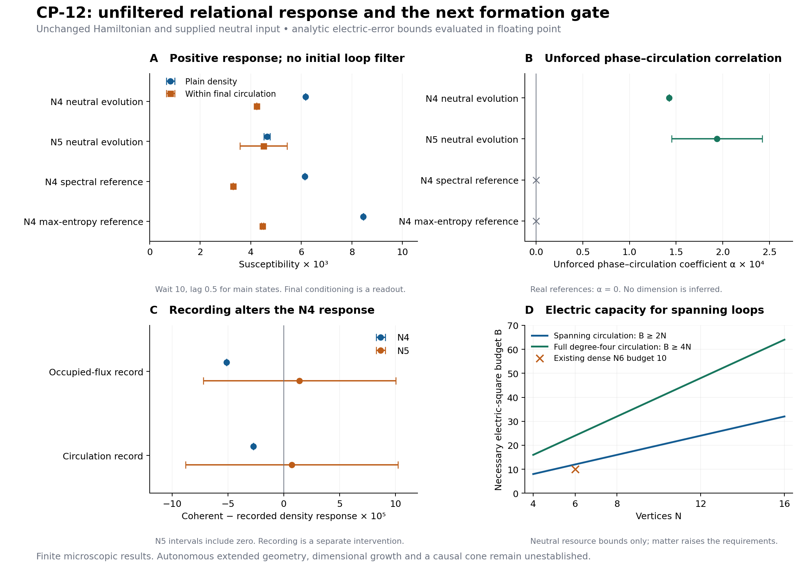

# GRUT CP-12: an unfiltered relational-response gate

**15 October 2026 UTC.** Additive continuation of [7d41496](https://github.com/ryangrvr/TestingGRUT/commit/7d414961a56a49df1265b9501cd305331354ffc6). Frozen CP-12 and the topology-neutral coherent input are unchanged. [CHAT_REVIEW.md](CHAT_REVIEW.md) is the handoff for independent review; [THEORY_STATUS.md](THEORY_STATUS.md) identifies the remaining formation gate.

**The initial loop-selection filter is no longer needed for a positive finite response within a circulation readout.** The original, unfiltered evolved state gives a nonzero distance-independent density susceptibility, including after correcting for changes in the final circulation bin. This is established at four and five vertices. A second result identifies an unforced phase–circulation correlation that permutation-invariant marginal measurements hide.

This is a stronger microscopic result, not spacetime formation. The source phase remains a diagnostic intervention, final circulation conditioning remains a readout postselection, and neither tested size supplies an extended metric or a causal cone.

## Positive response without initial loop preselection

Evolve the existing uniform Q-edge neutral ray for wait 10. Apply exp(-i eta n_0), evolve unchanged H for lag 0.5, and measure D, the mean vertex density outside zero. C asks whether the final configuration contains an actual electric-circulation loop avoiding zero. At N4 this is triangle (1,2,3); at N5 it is the union event over loops on the other four vertices.

The response inside C is the derivative of <CD>/<C>, evaluated with its quotient rule. Thus a change in the probability of C alone cannot account for the result. Outward-rounded full-law intervals are:

| Preparation | Plain density susceptibility | Density susceptibility inside final C |
|---|---:|---:|
| N=Q=4, wait 10 | [0.0061597602, 0.0061597611] | [0.004234589, 0.004234601] |
| N=Q=5, wait 10 | [0.0045161, 0.0047623] | [0.0035746, 0.0054341] |

Both columns exclude zero at both sizes. N4 wait 5 also passes: its within-C interval is [0.0012437319,0.0012437391]. The exact projector-phase identity uses phases +/-pi/2; it introduces no numerical finite-difference bias.

Final C probabilities without a phase source are about 0.0220674 and 0.0570523. These are small readout subsets, not dominant spatial phases. At N5 the event does not identify the same named loop before and after evolution. The earlier 99.3% protection retention belongs to the filtered diagnostic at 7d41496 and is not reassigned to this experiment.

The main path includes no loop recording or preselection. Its source kicks still require work: approximately (+0.815393,+0.791201) at N4 and (+0.727757,+0.656891) at N5 for the two phase paths. The full-law absolute work allowances are below 6e-10 and 0.00275 respectively. Global entropy before and after the source remains zero; the supplied initial mean energy is Q/2 with variance 2Q. No physical preparation or observer apparatus is derived.

## An exact relational phase witness in the unforced state

The earliest off-source density response is controlled by a Hermitian gauge-dressed vertex-coherence operator K_0. Its definition and sign are derived in [DERIVATION.md](DERIVATION.md). Permutation symmetry forces <K_0>=0 in the original unforced state, so the plain remote susceptibility begins no earlier than cubic order in the probe lag.

The circulation-weighted quantity alpha=<C K_0> need not vanish. For p_C=<C>, the exact fixed-system onset is

\[
\boxed{\chi_{D\mid C}(\tau)=\frac{\alpha}{p_C}\tau^2+O(\tau^3).}
\]

The full-law alpha intervals at wait 10 are:

| N=Q | alpha interval | alpha/p_C interval |
|---|---:|---:|
| 4 | [0.0001425392848, 0.0001425393112] | [0.00631685788, 0.00631685906] |
| 5 | [0.0001452680, 0.0002423883] | [0.0026355, 0.0044048] |

These are positive bounded-observable expectations in the **unforced, unfiltered state**. Averaging C_i K_i over source labels gives a fully permutation-invariant observable with the same expectation. No labelled geometry or phase mask is supplied to generate this correlation.

Every real configuration-basis density operator has alpha=0, including the two physical energy references. Basis conjugation reverses alpha while preserving every configuration probability and the entire energy-measurement distribution. The new witness therefore exposes relational phase information generated during the neutral preparation's ordinary evolution.

This witness is not a macroscopic spatial order parameter. We prove ||K_0||<=t^2/[2sqrt(N-1)] and, for exchangeable Q=nu N states, |alpha|<=t^2 sqrt(p_C 2nu)/[2(N-1)]. The average-over-all-other-vertices detector dilutes with size. Its short-lag coefficient cannot be extrapolated to a finite continuum signal.

## The loop records are not an exactly classical mixture

We separately compare the original state with a hypothetical nonselective recording of its initial occupied-flux or circulation event. This pinching is an intervention with work and entropy effects. It is not performed on the main response path.

At N4 wait 10 and lag 0.5, the coherent-minus-recorded plain density susceptibility is approximately:

| Initial record choice | Response interference | Absolute analytic allowance |
|---|---:|---:|
| Occupied-flux triangle | -0.00005114297 | 0.000000000080 |
| Circulating triangle, including holes | -0.00002704866 | 0.000000000150 |

Both exclude zero. The recording changes mean energy by approximately +0.0129371 and +0.0083228. The corresponding pure-state trace distances to the pinched states are 0.0595500 and 0.148512. At N5 the response-interference intervals include zero, so no resolved five-vertex interference is claimed.

These findings reject an **exact** replacement by the specified classical mixture for the N4 diagnostic. They do not reject a suitably quantified approximate classical description or all possible internal records. The leading quadratic coefficient itself commutes with these record projectors; the observed response interference occurs at later lag order. Phase coherence within a record and interference between records are distinct quantities.

## Energy controls still prevent a unique-phase claim

The existing N4 physical configuration-coherent energy references also pass the no-initial-filter finite-response test. Their within-C susceptibilities are approximately 0.00329191 for spectral dephasing and 0.00445936 for the maximum-entropy reference, with controlled nonzero intervals. Their quadratic alpha coefficients are exactly zero because the reference density operators are real.

Thus the new short-lag witness distinguishes a phase-sensitive property of the evolving state. A finite nonzero response still does not uniquely identify a spatial phase. These references match full mean energy, not every resource, purity or full-law equilibrium distribution.

The exact total-fermion response identity is satisfied to about 10^-16, including edge-mode holes. Vertex number is not separately conserved. A density response does not alone establish tagged-particle transport. Removing hopping after the same preparation gives exactly zero response.

## A stronger capacity condition for the next formation calculation

Let mathcal C be the complete directed-circulation support, e_C its edge count, h_C its edge-fermion-hole count, and beta_C its cycle rank. The new unregulated resource inequality is

\[
\boxed{\sum E^2\ge2e_C+n_v+2h_C.}
\]

If this support is connected and spans all N vertices,

\[
\boxed{\sum E^2\ge2(N-1+\beta_C)+n_v+2h_C.}
\]

A cutoff must admit this cost before it can test that network. Merely setting the budget to 2N admits only a vacuum spanning ring in the spanning-circulation sector; that sector is inert to a density-phase source. A fully circulating degree-four graph has Q=2N and needs electric-square budget at least 4N+3n_v. This is a resource example, not a dimension theorem or formation prediction.

The existing dense N6,Q12 budget10 calculation excludes even a spanning ring from its numerical projection. Its projected zero therefore has only the inherited full-law upper bound, approximately 0.010521 at T1. Q=N spanning-circulation sequences remain rings at every size. Neither family is an adequate numerical demonstration of an extended three-dimensional circulating phase.

The capacity inequalities concern component energy. Negative hopping can offset electric costs in the total conserved energy, so they are not a no-go theorem for formation.

## Verification and scientific ruling

The checks use an independent 6,075-state physical Hamiltonian, 1,875 regulator-interior columns for the exact lag identities, 18 independent representation-level response comparisons, 24 dense unitary dilations with pure and mixed inputs, and capacity checks on 414,568 retained orbit configurations. [README.md](README.md) gives commands, and [VERIFICATION.json](VERIFICATION.json) separates fresh reruns from hash validation.

Electric truncation errors have analytic full-law bounds evaluated in ordinary floating point. There is no formal interval-arithmetic roundoff certificate. Short-lag identities and the finite-lag susceptibility calculations are separate results.

**Ruling:** the initial loop filter is unnecessary for the tested finite density response inside a circulation readout. Unchanged CP-12 also generates a measurable phase–circulation correlation from its supplied topology-neutral input. Candidate loop records retain observable quantum interference, and macroscopic circulation tests require substantially greater electric and cycle capacity. Autonomous selection of a persistent extended geometry, dimensional growth, causal propagation and a complete theory of reality remain unestablished.
