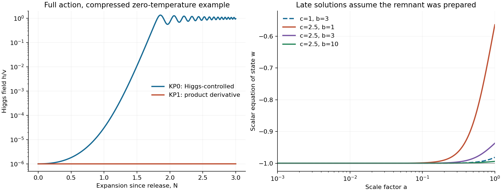

# An action can retain the remnant; its physical preparation remains unresolved

22 October 2026. Base `10e66b7`. One-author exploratory construction, with
internal numerical verification; no external replication or blinded test.

**There is an action-level slowing mechanism.** A kinetic pole can retain a
displacement induced by the Higgs potential through a radiation era, leaving

\[
\rho_*\simeq\frac{c^2\lambda^2v^8}{16\alpha^2M^4}.
\]

This is the existing Dimopoulos--Markkanen mechanism [S1], not new GRUT physics.
We built a specified positive hybrid action and evolved its fields with energy
accounting. This answers the existence question conditionally. It does not
yet produce a viable, independently normalized cosmological history.

The two tested realizations face different problems:

- The Higgs-controlled kinetic term (QV3-KP0) gives an invisible Higgs width
  **.322584 GeV**, corresponding to a reference branching fraction **.98745**.
  This exceeds the named ATLAS bound **.107** under SM-production and invisible
  light-scalar assumptions [S2]. This realization is retrospectively excluded.
- The product-derivative alternative (QV3-KP1) stretches the required field path.
  With physical c=1,b=3 endpoints it requires **at least 156.185 e-folds** in
  flat Einstein gravity with nonnegative energy, even allowing the scalar all
  of the energy. It cannot be treated as a rapid electroweak switch. The bound
  is analytic; it does not extrapolate the compressed run to physical scales.

These results concern the declared actions and preparation. They do not exclude
all mechanisms for retaining vacuum energy. The later inflaton-controlled
assisted-relaxation action [S3] is a specific different candidate to test.

## Scale and parameter provenance

At c=1 the potential is S1 eq. (2.3). We combine it with the separately
illustrated kinetic metrics (3.6) or (3.8), plus canonical Higgs kinetic energy.
This defines a **positive hybrid completion**, not S1's full (3.6). The c-dependent
exponential portal continuation is explicitly our choice. It changes the q
model's scalar representative: these are proposed QV3 extensions, not a
consequence of closure, an unchanged q prediction or an owner-adopted target.

Before h moves, its potential fixes a conditional minimum phi0. With rounded
Higgs/inflation inputs phi0/M=4.13933e-56 at c=1. Preserving this displacement
after h reaches v leaves the energy above.

| Choice | Initial retained density (GeV^4) | Fourth root | Interpretation |
|---|---:|---:|---|
| c=1 | 3.99167e-48 | 1.41348 meV | Benchmark action; .158399 of known reference |
| c=2.5 | 2.49479e-47 | 2.23490 meV | Literature choice already adjusted using dark energy |

The known reference is 2.52e-47 GeV^4. Alpha=9.97e-6 is calibrated within a
Starobinsky inflation model, with horizon-exit/reheating assumptions; it is not
a universally measured constant. Pure (1 TeV)^8/M^4 has fourth root .41068 meV,
not 2.24 meV. The alpha^-2 enhancement matters. An arbitrary TeV epoch has not
been derived from electroweak data. Absolute U(0,v)=0 remains a supplied vacuum
reference, not an all-loop selection mechanism.

## Coupled transition and conditional late states

Full runs evolve both fields, radiation, log H and expansion work, with no
externally timed potential deletion. Their compressed units are M=1,m=10,v=.2,
lambda=1,c=1,b=3,rho_r=100 V_H(0),h=1e-6 v,phi=phi0, zero velocities.
They run three e-folds after release in the zero-temperature potential. This
is an equation check, not a thermal SM simulation or a controlled EFT at m>M.

| Metric | Final h/v | Final phi/phi0 | Outcome in this example |
|---|---:|---:|---|
| KP0: Higgs-controlled | .953304 | .999989 | Higgs rolls, displaced scalar stays near its minimum |
| KP1: product derivative | 1.00509e-6 | 1.00000003 | Higgs scarcely moves; unreleased Higgs energy accelerates |

KP1's acceleration is not the intended tiny dark energy. Higgs energy has not
been released. It cannot be replaced by an imposed h=v while dropping its
kinetic cost.

Separately, **assume** the desired post-transition state h=v,phi=phi0 was
prepared. Both metrics along fixed h give a canonical exponential potential.
The following conditional late backgrounds start at a=1e-8 with zero canonical
velocity, using known physical matter/radiation normalization.

| c | b | w at a=1 | H at a=1 (km/s/Mpc) |
|---:|---:|---:|---:|
| 1 | 1 | -.848810 | 42.9601 |
| 1 | 3 | -.981375 | 43.7557 |
| 1 | 10 | -.998303 | 43.8594 |
| 2.5 | 1 | -.563515 | 54.4983 |
| 2.5 | 3 | -.936987 | 65.1617 |
| 2.5 | 10 | -.994145 | 66.9936 |

H_ref=67.4,Omega_m=.315,Omega_r=9.2e-5 specify physical background densities;
the computed H(a=1) is not forced to H_ref. At b=3,c=1 the field is frozen to
|chi/M|<3.5e-11 before a=1e-3 and its potential retains 97.06% at a=1.
It is thawing quintessence, not a permanent positive Lambda. c=1 supplies too
little energy for this reference late universe. c=2.5's initial near-agreement
is calibrated, and b is an independent supplied control on rolling. There is
no new fit, held-out success, global likelihood exclusion or empirical identification.

The panels describe separate stages. The late panel assumes a preparation
which the KP1 trajectory did not accomplish; neither is an observational fit.

## Verification and limitations

The first execution passed seven analytic controls and 28 numerical gates,
then passed a fresh temporary-directory re-execution. A transient workspace
reset interrupted publication. This packet restores the source from the
recorded equations, parameters and checks and **repeats every integration**.
The first raw files are not represented as having survived. The restored
results and verification record are included below; the public source checkpoint
is `988843e0df9a843a8266b5b200f2d339701a429d`.

Four full-action runs and six conditional late scenarios each refined once
retain all CSV and JSON diagnostics. The checks cover independent H evolution,
scalar expansion-work closure, metric-force differentiation, normalization,
and tighter tolerances with halved time steps. They are internal checks, not
35 independent scientific replications. Physical uncertainties in the action,
vacuum reference, inflation, quantum corrections and thermal preparation
dominate numerical errors. There is no loop calculation, noise transport,
physical thermal transition, detector re-fit, cosmological likelihood or
false-vacuum tunneling lifetime here. The old q packets are unchanged.

## Next bounded construction

S3 makes the kinetic pole depend on a **separate inflaton**, avoiding the tested
Higgs derivative portal and our particular product-path bound. Its action is
written in MATHEMATICS; it has been read, not numerically verified here.

The next calculation must propagate the remnant's **distribution**, including
inflationary fluctuations and the energy receiver during reheating, through
the changing metric. Setting the inflaton to zero and importing a tiny mean
field is insufficient. Test that preparation before using its conditional
scale relation as an empirical target. Absolute vacuum reference, mass/coupling
selection and a separate unused observable remain additional dependencies.

**Current result:** conditional action-level retention and a derived scale
relation; a retrospective collider exclusion of KP0; an analytic obstruction
to rapid preparation of KP1. No complete viable GRUT cosmology or independently
fixed positive vacuum density has been established.

Read [MATHEMATICS.md](MATHEMATICS.md), [LEDGER.md](LEDGER.md),
[SOURCES.md](SOURCES.md), [PROTOCOL.md](PROTOCOL.md),
[REPRODUCE.md](REPRODUCE.md), [VERIFICATION.md](VERIFICATION.md),
[INPUTS.json](INPUTS.json) and [RESULTS.json](RESULTS.json).
