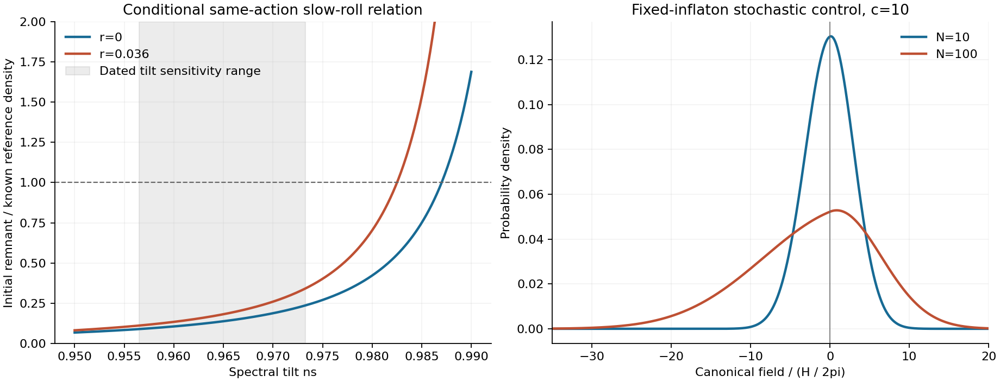

# A conditional observable relation, and a preparation problem

22 October 2026. Base 4f4b4b0. This is a bounded continuation using the
Camargo-Molina--Markkanen--Scott action, not a new GRUT principle, an approved
target change or a complete reheating calculation. One author; no outside
replication. All observational information was already exposed.

**A concrete consistency relation emerges when the same action calibrates
inflation and the remnant.** Its apparent freedom to choose c and alpha
independently disappears in the single-adiabatic-inflaton slow-roll limit:

\[
\boxed{\rho_*=
\frac{128 V_0^2}{9\pi^2 A_s M^4[8(1-n_s)-r]^2}},
\qquad V_0=\lambda v^4/4.
\]

rho* is the **initial prepared remnant energy**, not automatically today's
vacuum density. This relation uses the literal printed kinetic normalization,
the common potential scale and a tiny selected displacement. It does not
derive those choices from closure or select the absolute quantum vacuum zero.
No novelty or priority claim is made for rewriting the borrowed model this way.

At the named Planck snapshot's central n_s and rounded A_s, the BK18 r range
gives rho*=3.453e-48 to 4.543e-48 GeV^4, well below the known reference
2.52e-47. Even the declared rectangular n_s±2 quoted standard errors/r-bound
sensitivity box reaches only **.3425 of the reference**. This is a retrospective
conditional inconsistency, **not a combined confidence interval, global
likelihood exclusion or a claim about the latest data**. If the prepared
scalar is separately conserved after transition, expansion can only reduce
its energy; subsequent rolling does not increase this initial value.

The action's printed kinetic coefficient is 3c^2/4, hence its canonical factor
is sqrt(3/2)c. Following the different intermediate canonical prefactor printed
in the paper's next paragraph would change factors of two. We derive directly
from the action. Details, assumptions and finite-derivative checks are in
[MATHEMATICS.md](MATHEMATICS.md).

## The quantum preparation cannot be represented by a tiny mean alone

We then tested a **fixed early inflaton limit of the same full action**. Its
remnant metric can be almost canonical near the tiny minimum but still has an
infinite-distance pole at sigma=0. A Gaussian in sigma crosses this boundary
and is not a global distribution allowed by that action. We used the canonical
coordinate first. Its negative side corresponds to **positive sigma approaching
zero**, not opposite-sign vacua.

In a controlled limiting geometry, the canonical potential is quadratic for
positive coordinate and nearly flat for negative coordinate. A probability
evolution with quantum diffusion then spreads away from an initially exact
minimum. For a light-field c=10,b=3 control, its normalized, refined
Fokker--Planck solution gives:

| Time (e-folds) | Positive canonical probability | rms sigma / selected sigma0 |
|---:|---:|---:|
| 10 | .491670 | 1.81e50 |
| 100 | .420515 | 3.42e50 |

The remnant's coarse-grained energy is only about 1e-12 of the inflationary
background in this probe, so broadness relative to the extremely tiny target
does not imply large gravitational backreaction. The canonical minimum and
pole transition widths are vastly below a single H/(2pi) noise scale. A
stationary classical point is not a narrow stationary quantum distribution;
indeed the fixed-H equilibrium measure is not normalizable along the pole's
asymptotically flat canonical half-line.

**This is not a post-reheating prediction.** c=10 is a light-field numerical
control, whose calibration r=.0695 is not compatible with the named BK18
bound; it is not a proposed successful empirical point. Fixed inflaton/H,
light stochastic dynamics, asymptotic geometry and omitted quantum/thermal
effects are declared assumptions. The calibration sensitivity and this probe
are different conditional limits, not a single successful population/history.
The calculation shows why the presumed tiny distribution needs a transport
calculation. It does not prove that reheating cannot erase the spread or
that every realization of the complete action is excluded.

## What was verified

**27 internal checks passed.** They include canonical normalization and direct
potential derivatives; direct versus eliminated density; probability positivity,
normalization and boundaries; grid refinement and larger domain; an exact free
Brownian control; and a separately integrated mode equation against Hankel
Bunch--Davies modes with a Wronskian check. Largest mode power discrepancy is
below 7e-7 here. Finer-grid moment changes are below 5e-5 relative, and larger
domain changes below 7e-13. The raw CSV and all parameters are retained.

These numerical agreements do not estimate truncation error in stochastic
inflation or higher-order slow roll. In particular, infinite relative precision
on the wrong preparation would not supply its cosmological history. There
is no detector or cosmological likelihood re-fit, reheating source, completed
end-of-inflation state, quantum loop completion or empirical validation here.

The left panel is a dated sensitivity exercise, not a posterior. The right
panel is a different conditional limit, not the late remnant distribution.

## Decision and next dependency

The constructive advance is an explicit relation among measurable inputs,
with its normalization tied to one action rather than adjusted separately.
Its intended prepared-state limit does not match the named observational
snapshot. The quantum preparation probe supplies a second reason not to
import a tiny mean as a completed physical state.

The next indispensable input is a **specified reheating interaction/receiver**
and a calculation transporting the joint inflaton/remnant distribution. The
published action used here leaves the ordinary SM terms implicit; we have not
derived a reheating rate or receiver from them. Choosing one is additional
physics/history, to be versioned before it becomes an empirical target.
If a different distribution rather than sigma0 is used to obtain dark energy,
the density relation must be rederived; it cannot be silently preserved as
an independently fixed prediction. Freeing the relative remnant mass merely
adds a normalization parameter unless another observation fixes it.

The old q and kinetic-pole packets are unchanged. No route has yet derived
today's positive vacuum density without additional assumptions, and no new
field has been empirically identified. See [LEDGER.md](LEDGER.md),
[SOURCES.md](SOURCES.md), [PROTOCOL.md](PROTOCOL.md),
[REPRODUCE.md](REPRODUCE.md), [VERIFICATION.md](VERIFICATION.md),
[INPUTS.json](INPUTS.json), and [RESULTS.json](RESULTS.json).
