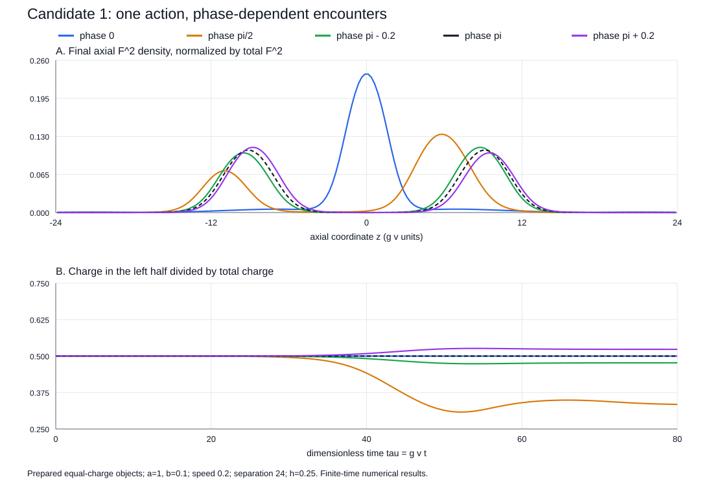

# Candidate 1 two-object dynamics

**Working theory:** [the explicit action, derived binding boundary, bulk phase and response predictions](../grut_theory_synthesis_20261020/THEORY.md), with a [construction brief for Claude](../grut_theory_synthesis_20261020/CLAUDE_HANDOFF.md).

**Follow-up completed:** [conditional assembly, post-collision persistence and a charge record](persistence/REPORT.md) adds 31 evolutions under the same full scalar action, with a separate rigid-field comparison. Selected transverse m=1 response remains unconverged.

**Completed:** all 27 prescribed evolutions and all 33 numerical consistency checks pass. Prepared equal-charge objects show phase-dependent central concentration or separated outgoing structure, including substantial charge exchange at relative phase pi/2. This is a finite-time classical axisymmetric result under Candidate 1's unchanged scalar action.

Read [REPORT.md](REPORT.md) for the physics, controls, numerical error and limitations. The result does not establish autonomous formation, settled asymptotic particles, non-axisymmetric stability, a memory apparatus, quantum behavior, or new physics in nature.

## Inspect or reproduce

- [Frozen physical protocol](protocol.json)
- [Numerical summary and comparisons](results/summary.json)
- [Raw diagnostic outputs](results/)
- [Coarse V8 runtime replay](results_v8/)
- [Supplementary controls and initial-current derivation evidence](results/additional_controls.json)
- [Completed execution logs](https://github.com/ryangrvr/TestingGRUT/actions/runs/39336072781)

Run `node run.cjs`, then `node verify.cjs`. Supplementary checks use `node additional_controls.cjs`; `node plot.cjs` recreates the figure. No package installation is required. For one case, use `node run.cjs fine_pair_phase_halfpi`. The full verifier requires the complete suite.

Parent: 96a7e7e6a49f49dc30e1c92f0855522af41d9641. Kernel/input/protocol freeze: 52f552802759392a2353af068f60efea2c5c95b2. Execution commit: 879dbd59cc307d03f8f2cf23c63bc7ad2ba00aac. Hosted runtime: Node v22.23.3 on Linux x64. [The execution amendment](EXECUTION_AMENDMENT.md) explains the switch from the unavailable shell workspace to the hosted replay.
