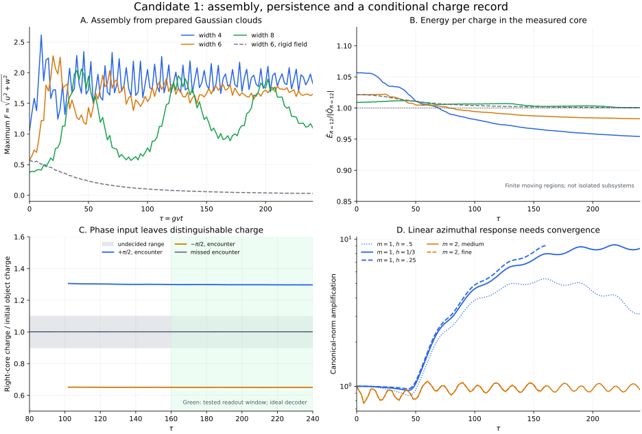

# Candidate 1: conditional assembly, persistence and a charge record

19 October 2026, America/Chicago · Author numerical research · Independent scientific review pending

**The unchanged coupled scalar equations now have a demonstrated route from a prepared diffuse charged cloud to a localized core, and from a prepared collision phase to a retained, distinguishable charge.** These are conditional mechanisms inside the supplied classical model. They strengthen its working account of objects and records; they do not select the fundamental laws or establish a theory of everything.

All **31 additional evolutions** completed: 12 persistence/linear-response cases, 13 Gaussian-cloud cases, and 6 exploratory record/control cases. All **89 saved-source, implementation, numerical-consistency and decoder checks** pass. This count includes file-presence and hash checks; it is not 89 independent confirmations of the physical theory. The selected transverse m=1 response remains quantitatively unconverged.



The package is additive to the [earlier 27-case two-object study](../REPORT.md). Machine-readable results are in [SUMMARY.json](SUMMARY.json). Exact diagnostic outputs and execution logs are in [raw_outputs.tar.gz](raw_outputs.tar.gz), indexed by [RAW_OUTPUTS_MANIFEST.json](RAW_OUTPUTS_MANIFEST.json).

## What the runs establish

The following measurements use a dimensionless radius-12 sphere around the specified density concentration. Fractions use each run's total discrete charge. A finite sphere exchanges energy and charge with its surroundings; its energy per charge is a useful diagnostic, not an isolated-system stability theorem.

| Question | Completed result | Scope |
|---|---|---|
| Can an initially undepleted organizing field respond to diffuse charge? | Gaussian widths 4 and 6 assemble localized, breathing cores. At medium resolution and tau=240, the measured cores retain 81.18% and 55.00% of total charge, with Ebar/abs(Qbar)=0.95430 and 0.98281. | Supplied coherent charged clouds, not formation from vacuum or equilibrium. |
| Does the feedback matter? | The matched width-6 rigid-field control retains 1.55% in the measured core; its maximum charged-field amplitude falls to 0.0298. | Explicit feedback ablation, with a different comparison law. |
| Does every tested cloud earn the same conclusion? | Width 8 remains a breathing concentration; its measured Ebar/abs(Qbar) stays above 1 throughout the late medium and fine windows. | No bound-core formation conclusion for this case. |
| Do the earlier outgoing cores immediately disperse? | Quarter-cycle collision cores remain separated through tau=240 at coarse/medium resolution and tau=160 at fine resolution. Late local charge and energy ratios change only modestly. | Finite persistence; no lifetime or asymptotic scattering theorem. |
| Can the interaction leave a record of a past input? | Opposite quarter-cycle phase inputs leave distinct right-core charges, approximately 519 and 260. A missed encounter stays near 400. Every registered late-window sample meets its decoder target. | Ideal charge readout; no implemented detector or consciousness result. |
| Are transverse perturbations resolved? | The selected m=2 response is modest. The selected m=1 norm grows in the quarter-cycle case and depends substantially on spatial resolution. | No verdict of full nonlinear three-dimensional stability or instability. |

## Model and the feedback mechanism

No physical coupling was fitted or changed. The full runs retain the parent's flat-space, D=0 scalar equations, a=1 and b=0.1, with g_X=0.1, lambda_phi=0.01 and lambda_X=0.001. Gravity and the reporter field are not evolved. Define F squared=u squared+w squared and S=phi/v. The potential is

\[
V(S,F)=\frac a4(S^2-1)^2+\frac12S^2F^2+\frac b4F^4.
\]

The two-way effect is explicit in the equations: charged-field density drives S away from its vacuum magnitude, and a smaller magnitude of S lowers the charged field's local quadratic energy. Minimize only this local potential over S, temporarily ignoring gradients and time dependence:

\[
S_{\min}^2=\max(0,1-F^2/a),
\qquad
V_{\min}(F)=
\begin{cases}
\tfrac12F^2+\tfrac14(b-1/a)F^4,&F^2\leq a,\\
\tfrac a4+\tfrac b4F^4,&F^2\geq a.
\end{cases}
\]

Thus ab<1 gives an attractive low-amplitude quartic in this **local algebraic envelope**. The upper branch has a positive quartic, and the original potential is nonnegative; the attraction does not imply an unbounded potential. At S=0 the local S curvature is F squared minus a, so a sufficiently dense core changes S=0 from a local maximum to a local minimum in that coordinate. In physical coupling notation the negative envelope quartic condition is g_X to the fourth power greater than lambda_phi times lambda_X.

This supplies a concrete candidate for the requested assembly threshold: charge can alter the field controlling its own localization cost, with saturation at high amplitude. It is an explanation of the feedback, **not** a complete dynamical formation criterion. Gradient energy, conserved charge, preparation width, radiation and the time-dependent S response matter. The actual runs retain them; they do not evolve the minimized envelope as a substitute equation. The width-8 result directly shows why a local inequality alone cannot certify the final state.

With S rigidly fixed at 1, this feedback is absent and the remaining charged-field quartic is repulsive. That comparison isolates the proposed mechanism. Holding S fixed changes the law: it is not a claim that an external constraint is free inside a closed universe.

## Assembly without a prepared soliton

The Gaussian study supplies no preformed depleted-S object. Initially,

\[
u=Ae^{-r^2/(2\sigma^2)},\quad w=0,\quad S=1,
\qquad
\dot u=0,\quad \dot w=-u,\quad \dot S=0,
\]

with widths sigma=4,6,8 and A fixed by continuum Qbar=399.4384624223012. The preparation frequency is 1; no drive holds that frequency during subsequent evolution. There is no external damping. Energy can leave a local core as field radiation while remaining in the evolved domain.

For general preparation frequency omega, write I=Qbar/omega. The continuum initial energy is

\[
\bar E=\tfrac12(\omega^2+1)I+
\frac{3I}{4\sigma^2}+
\frac{bI^2}{4(2\pi)^{3/2}\sigma^3}.
\]

All these clouds start with total Ebar/Qbar above 1. Discrete initial charge and energy approach their continuum values on refinement; the same continuum preparation is sampled, rather than retuning each grid's amplitude. In the setup control, S starts exactly at 1; after tau=2 the full width-6 model reaches minimum S about 0.677, while the rigid control remains exactly 1.

| Medium grid, tau=240 | Core Qbar | Fraction of total charge | Core Ebar/abs(Qbar) | Maximum F | Minimum S |
|---|---:|---:|---:|---:|---:|
| Width 4, full model | 324.456 | 81.18% | 0.954302 | 1.8203 | 0.12895 |
| Width 6, full model | 219.732 | 55.00% | 0.982812 | 1.6490 | 0.23060 |
| Width 8, full model | 208.506 | 52.19% | 1.000661 | 1.1021 | 0.62899 |
| Width 6, rigid S=1 | 6.191 | 1.55% | 1.000858 | 0.0298 | 1 |

During sampled tau=160..240, width-4 core Ebar/abs(Qbar) spans 0.95430..0.96458 and width 6 spans 0.98281..0.98678. At the fine grid's sampled tau=120..160, the corresponding ranges are 0.96349..0.97290 and 0.98678..0.99127. Width 8 is above 1 in both windows. The cores breathe and radiate; detailed endpoint profiles and retained fractions are not claimed to be exact continuum or asymptotic values.

The width-6 larger-box comparison changes the recorded core charge by at most 4.83e-13 and its energy ratio by 2.67e-15 over the shared run. Global radiation-sensitive measures differ more. This supports the local-core result over this time window, not arbitrary-time boundary independence.

The initial charge, coherence, low-entropy resources, dimension and laws remain supplied. The result supplies an assembly mechanism within that preparation family; it does not account for the origin of those resources.

## Persistence after the encounter

The original paired profiles start at z=-12,+12 with velocities +0.2,-0.2. The follow-up retains that preparation and couplings, enlarges the domain, and extends the evolution from the earlier tau=80 to tau=240 at h=0.5 and 1/3. At h=0.25 it runs to tau=160. Isolated stationary objects provide controls. Equal-phase and quarter-cycle pairs are followed. Medium-grid half-timestep and enlarged-domain cases test the quarter-cycle result; an additional enlarged-domain case tests equal phase.

At medium resolution, the quarter-cycle cores end near z=-47.986 and +25.818. Over 41 sampled times in tau=160..240:

| Measured core | Qbar range | Ebar/abs(Qbar) range |
|---|---:|---:|
| Left | 259.533..259.710 | 0.986091..0.986145 |
| Right | 518.087..519.001 | 0.893235..0.893778 |

The fine-grid cores also remain separated through tau=160, with late energy ratios approximately 0.98673 and 0.8940..0.8946. For the equal-phase case, a central concentration persists through tau=240; its medium-grid radius-12 charge spans 634.14..644.26 during the late window, and its energy ratio spans 0.86935..0.87343. A settled, spherical final fused soliton has not been established.

These are finite moving measurement regions. Their energy includes canonical kinetic, potential and matched lattice bond energy; interior bonds are split between endpoint cells and outer ghost bonds are included. Charge uses the same Noether convention as the parent. Balls of radii 8 and 16 are also retained in the raw diagnostics, and overlaps are flagged. Axial concentrations are found from F-squared line density above 5% of its maximum and carrying at least 5% of its total. Component count and center are measurement conventions, not exact particle labels.

In the separated late windows, halving the medium timestep changes matched radius-12 charge by at most 0.03913 and its energy ratio by 1.185e-5. Medium/fine comparison over tau=120..160 gives maxima 0.16255 and 5.846e-4. Enlarging the medium domain changes quarter-cycle core charge by about 1.03e-12 and its energy ratio by 2.23e-15.

The summary also preserves larger **all-time** matched-ball differences: for example, the half-timestep maximum charge difference is 43.77 across the full evolution. During overlap and component splitting, a nearest-center match is not a persistent object identity and can jump when the region finder changes its assignment. The late separated windows answer a more controlled question. Neither comparison should be silently substituted for the other.

## A candidate classical record

The record study supplies relative phases +pi/2 and -pi/2 to incoming prepared pairs. It asks whether a later separated right-hand core retains distinguishable charge after the encounter. A third preparation reverses the velocities, so the objects move apart without the encounter. There is no later applied drive or detector in any case.

The reference charge is Qref=399.4384624223012. The ideal decoder assigns +1 above 1.1 Qref, -1 below 0.9 Qref, and undecided between them. The charge is measured in a nonoverlapping radius-12 ball around the rightmost separated concentration.

| Input/control | Medium Qbar range, tau=160..240 | Outcome at all 41 samples | Fine Qbar range, tau=120..160 | Outcome at all 21 samples |
|---|---:|---|---:|---|
| Incoming +pi/2 | 518.087..519.001 | +1 | 518.919..520.288 | +1 |
| Incoming -pi/2 | 259.533..259.710 | -1 | 259.557..259.732 | -1 |
| Outward missed encounter | 399.9094..399.9102 | Undecided | 399.7002..399.7008 | Undecided |

This meets a bounded physical-record predicate: an earlier supplied input becomes correlated with a distinguishable, localized later degree of freedom, and that distinction persists over the tested window. It does not yet implement a detector that reads the charge, a write/read/reset cycle, an error-correcting memory, an observer, or consciousness. The geometric address, ideal access, reference charge and decoding rule are supplied by this analysis. The result is exploratory, informed by the earlier positive-phase outcome and a reflection prediction; it is not an independently sealed holdout.

During figure review, an ambiguity was found in the frozen raw readout code: before the registered readout window, a single central component with a tiny positive numerical centroid can be assigned as the right receiver. The frozen source and raw output are preserved. Final analysis and the figure enforce distinct left and right concentrations (centers below -1 and above +1) and a nonoverlapping receiver ball. **Every registered readout-window row already satisfies that stricter condition; none of the six late-window outcomes changes.** The amended qualification is a disclosed post-run analysis check.

## Selected transverse response and the unresolved test

The axisymmetric background is extended with linear perturbations proportional to cos(m azimuth), for m=1 and 2. The perturbation Laplacian includes minus m squared divided by rho squared. Potential terms use the exact background Hessian. Kick-drift-kick updates propagate the derivative of the same discrete background integrator; the perturbations have no backreaction.

The m=1 seed gives the incoming objects opposite infinitesimal transverse displacements; on a single object it is a translation seed. The m=2 seed gives an infinitesimal transverse ellipticity. Fields and momenta are both seeded. Each starts with positive canonical norm 1e-4 times the background norm, where the latter uses S-1. The angular average gives a factor one-half for squared nonzero-m cosine perturbations.

The chosen norm is the square root of the integrated sum of squared field and momentum perturbations. It is positive but not conserved or unique. Its growth can include translations, deflections and phase differences; it is not by itself a Lyapunov exponent or a nonlinear instability.

For the quarter-cycle pair, the final m=1 amplification is 3.108 on the coarse grid and 8.662 on the medium grid at tau=240. At the common endpoint tau=160, medium gives about 7.971 and fine gives 9.064. The isolated-object translation seed also has substantial grid dependence. **A quantitative m=1 conclusion is not converged.** Near-neutral motion and lattice effects are possible explanations, not established diagnoses.

The quarter-cycle m=2 amplification remains modest, with maximum about 1.085 across these runs. The equal-phase m=2 maximum is about 1.67. No mode reaches the registered background-relative 0.1 warning level, starting from 1e-4. Remaining small in this linear calculation does not prove all-mode or finite-amplitude nonlinear stability.

Implementation controls give bitwise-identical background evolution to the original kernel, zero perturbations staying zero, global-phase tangent error 9.69e-19, and central finite-difference tangent errors falling by a factor 4 when the comparison amplitude halves. Manufactured angular-operator errors are at roundoff. These establish implementation consistency, while the observed spatial dependence still limits the physical inference.

The decisive next calculation is a continuum-controlled transverse response around these trajectories, separating neutral translation/deflection from shape deformation and then testing finite perturbations with backreaction in unrestricted 3D. Repeating axisymmetric backgrounds alone cannot settle that question.

## Execution, preservation and reproduction

| Study | Cases | Largest relative energy drift | Largest normalized charge error |
|---|---:|---:|---:|
| Persistence and tangent modes | 12/12 | 7.283e-5 | 1.607e-13 |
| Gaussian assembly and rigid control | 13/13 | 4.298e-4 | 3.884e-13 |
| Exploratory record and miss control | 6/6 | 9.605e-6 | 1.044e-13 |

These are sampled numerical diagnostics, not rigorous error enclosures or laboratory uncertainties. All satisfy the prescribed energy-drift limit 0.001 and normalized charge-error limit 1e-9. Charge errors measure conservation relative to the discrete initial state; continuum quadrature errors in that initial state are separate. Node v24.19.0 executed all evolutions locally on Linux. Python 3 with NumPy/SciPy supported the local workflow; analysis uses the standard library and plotting uses Matplotlib 3.10.8.

Source identities and timing are explicit:

- The earlier completed two-object report is pinned at [e68de81](https://github.com/ryangrvr/TestingGRUT/commit/e68de81d99756fe39e512a167b979ba992e752c1).
- Persistence sources/input choices were locally committed at 917caa0 before extended runs. A time-2 timing pilot and implementation controls had already run and are preserved. An ordinary Git push failed authentication; identical frozen sources were subsequently published at [04f22ad](https://github.com/ryangrvr/TestingGRUT/commit/04f22ad7fff44a9398fed2a65588feab31da713f), after launch and after initial coarse execution, before inspecting its extended physical outcome. This is a local pre-run freeze, not a public preregistration before launch.
- Gaussian sources and preparation choices were publicly frozen at [15224b5](https://github.com/ryangrvr/TestingGRUT/commit/15224b5b82c7a8226218af75aa68b3b96098aae7) before the cloud evolutions.
- Exploratory record sources and decoder choices were publicly frozen at [2b039b2](https://github.com/ryangrvr/TestingGRUT/commit/2b039b2e21b2779ba803d789d5f9705eded5202a) before the record evolutions. The stricter receiver qualification above was added during final analysis.
- Each study's FREEZE_MANIFEST.json checks its unchanged evolution sources and protocol. The parent kernel remains byte-identical. Analysis, assembly setup checks and figure code are additional disclosed review tools.

The archive contains the exact 31 JSON diagnostic outputs, their logs, and three execution-status files. It contains sampled scalar histories, concentration/ball diagnostics and axial profile frames; it is not a full 3D state checkpoint or an independently written solver. Its manifest records every entry's byte count and SHA-256 plus the archive's SHA-256.

From this directory, unpack and check the archived result with:

```sh
python3 unpack_raw.py
python3 analyze.py
python3 plot.py
```

`python3 build_kernel.py` regenerates the tangent kernel from the unchanged parent. `node controls.cjs` replays its implementation controls. `node formation/controls.cjs` replays the Gaussian setup controls. Individual evolutions can be replayed with `node run.cjs RUN_ID`, `node formation/run.cjs RUN_ID` or `node record/run.cjs RUN_ID`; each protocol lists its IDs. The corresponding run_suite.py scripts run complete suites. Reruns can replace local unpacked result files; the published archive preserves this execution exactly, and archive verification will identify changed files.

Dimensionless time is tau=g_X v t. The scale v has not been empirically fixed here; a tau=240 run is not a specified number of seconds or a human-memory timescale. E=(v/g_X) Ebar and Q=Qbar/g_X squared. These are classical fields, not quantized particle eigenstates.

## What this contributes to the working theory

Candidate 1 has advanced from a prepared isolated object to a conditional sequence: a charged cloud can organize its mediating field and localize; such localized preparations can interact; a phase-dependent interaction can leave unequal retained charges; an ideal later observation can distinguish those charges. The cloud and collision experiments are separate preparations; no single end-to-end cloud-to-collision-to-readout experiment has yet been executed.

That sequence is a concrete account of some required mechanisms inside one action. It does not derive the action, spacetime dimension, quantum rules, initial charge supply, arrow of time or empirical parameters. It also does not establish nonlinear 3D stability or an implemented observer. The useful next development is to close those particular gaps with calculations that can change the conclusion, while retaining the failed or marginal cases as constraints on the theory.
