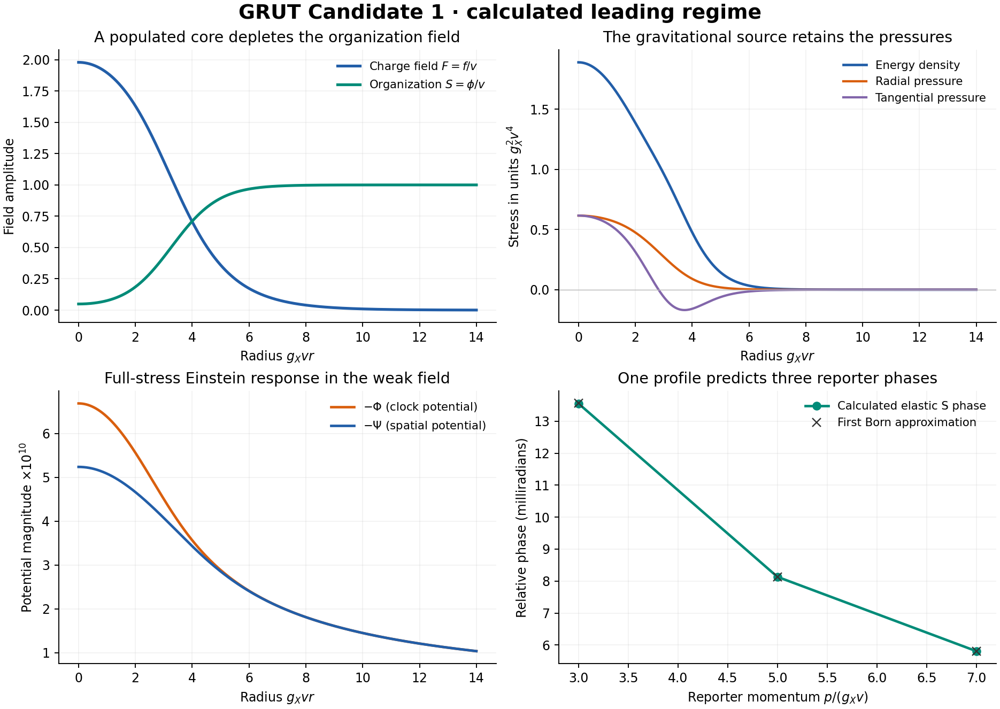

# GRUT Candidate 1

**18 October 2026 · construction milestone**

This package contains one specified leading effective field theory and its executed populated regime. It adopts Einstein gravity, quantum probabilities and ordinary matter, then adds an explicitly coupled charge field X, organization field phi and reporter D. The moving-channel architecture is replaced; its results are not inherited.

**Final outcome: a narrower working model rather than the intended universal theory.** It is not a validated description of nature or a completed nonperturbative quantum theory.

Read in this order:

1. [GRUT_CANDIDATE_1.md](GRUT_CANDIDATE_1.md): postulates, action, state/observable prescription, constraints, preparations and instruments.
2. [WORKED_REGIME.md](WORKED_REGIME.md): the populated solution, fluctuation checks, full-stress weak gravity, reporter evolution and ideal readout.
3. [COMPATIBILITY.md](COMPATIBILITY.md): integrated status, what was supplied/derived/computed, and the challenge verdict.
4. [PREDICTIONS_AND_TESTS.md](PREDICTIONS_AND_TESTS.md): independent calibration, outputs, baselines, rejection and error inventory.
5. [OPEN_CLAIMS.md](OPEN_CLAIMS.md): quantum/global stability, formation, apparatus, UV and empirical gaps.

The source review was anchored at TestingGRUT commit `f0795a9aaaecb5ecdaf26c291f9ee7adb62e60e3`. This separately named successor package leaves that archived repository checkout unchanged. No remote repository write or external publication was performed. The earlier builder handoff is an index to history, not a proof supporting the new equations.

The scalar solution has mean/classical charge about 39,944, energy per charge `0.91109 m_X`, central `phi/v≈0.04908`, and compactness about `5.67×10^−10`. It changes a weak reporter phase and sources the metric in the same action. Local classical stability has numerical support; global fission resistance and quantum lifetime are unproved.

All numerical sources, exact configurations, failed initial starts, raw outputs and execution notes are in [code/](code/README.md). Constructor and Challenger notes are in [audit/](audit/README.md). They are complementary automated workers, not independent validation.

Run `python code/run_all.py` in a fresh extracted copy to reproduce the finite calculations. No network service, account, scheduler or background worker is required. `FINAL_MANIFEST.json` records hashes of the distributed files; `ARCHITECTURE_SNAPSHOT.json` preserves the initial architecture/reporter snapshot. Subsequent qualifications and numerical diagnostic additions are explained in `EXECUTION_RECORD.md`.
