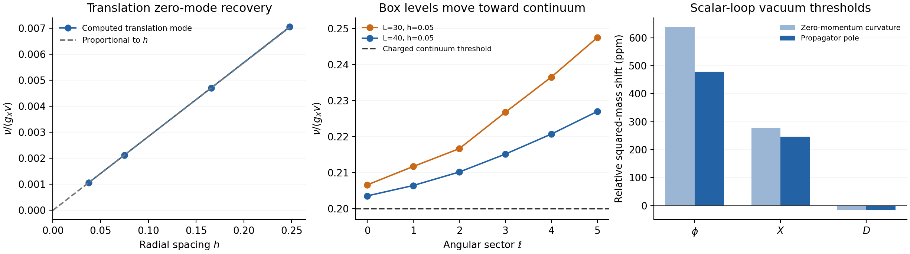

# GRUT Candidate 1 — rotating fluctuations and physical particle thresholds

19 October 2026 UTC · same action, couplings and matching · continuation of `7c06320`

**The prepared classical GRUT object survives the rotating scalar linear-stability tests performed here.** Forty finite-box spectra through angular sector \(\ell=5\), with radial, volume and symmetry controls, show no resolved growing mode outside the symmetry sector. The vacuum charged-particle threshold has also been calculated from its momentum-dependent propagator at one scalar loop; the neutral scalar thresholds are included. These are new calculations, rather than an extension of the homogeneous-potential interpretation.

This does **not yet demonstrate a stable quantum bound object**. The spectrum calculation is tree-level and uses finite reflecting boxes and bounded fine-grid probes. Its continuum generalization has explicit mathematical hypotheses. The renormalized fixed-charge quantum energy and lifetime remain uncalculated. No field, physical coupling, renormalized matching value or gravitational vacuum constant was adjusted.

The original [candidate](../grut_candidate_1_20261018/GRUT_CANDIDATE_1.md), [classical follow-up](../grut_candidate_1_stability_20261018/REPORT.md) and [one-loop potential/RG report](../grut_candidate_1_quantum_20261018/REPORT.md) remain unchanged. This packet implements bounded parts of the first two stages of the preceding [next-calculation specification](../grut_candidate_1_quantum_20261018/NEXT_CALCULATION.md) within the limits below.



Translation frequencies tend toward their symmetry zero; box levels approach a continuum threshold; the physical vacuum pole corrections differ from zero-momentum curvature corrections. None of the panels is a soliton quantum-energy or lifetime calculation.

## 1. The actual rotating, charge-constrained problem

Use \(\tau=g_Xvt\), \(\rho=g_Xvr\), \(A=\sqrt2X/v\), \(S=\phi/v\). The background is

\[
A_*=e^{-i\Omega\tau}F(\rho),\quad S_*=S_0(\rho),\quad D_*=0,
\qquad\Omega=0.8000000019763.
\]

For \(A=e^{-i\Omega\tau}(F+u+iw)\), \(S=S_0+z\), the radial transformed variables are \(q=\rho(u,w,z)\). Their equations are

\[
\ddot q+G\dot q+K_\ell q=0,
\quad\mathcal A_\ell=\begin{pmatrix}0&I\\-K_\ell&-G\end{pmatrix},
\quad G_{uw}=2\Omega,\;G_{wu}=-2\Omega,
\]

\[
K_\ell=\begin{pmatrix}L_u&0&2FS_0\\0&L_w&0\\2FS_0&0&L_z\end{pmatrix},
\]

\[
\begin{aligned}
L_u&=-\partial_\rho^2+\ell(\ell+1)/\rho^2+S_0^2+0.3F^2-\Omega^2,\\
L_w&=-\partial_\rho^2+\ell(\ell+1)/\rho^2+S_0^2+0.1F^2-\Omega^2,\\
L_z&=-\partial_\rho^2+\ell(\ell+1)/\rho^2+3S_0^2-1+F^2.
\end{aligned}
\]

The existing reporter fluctuation is a separate block,

\[
L_D=-\partial_\rho^2+\ell(\ell+1)/\rho^2+1+0.01S_0^2\ge1.
\]

This includes the velocity mixing and gradients absent from the local static potential. It is the original action's operator, with no positive fixed-charge term inserted arbitrarily into \(K_\ell\).

The linear charge variation is

\[
Q_1\propto\langle\rho F,2\Omega\rho u-\rho\dot w\rangle.
\]

It is conserved; every exact nonzero-frequency mode has \(Q_1=0\). For \(\ell>0\), the angular integral enforces this directly. For \(\ell=0\), the numerical generator has the corresponding charge left-null vector. A separate energy diagnostic minimizes over the charge-compatible phase velocity and obtains the expected positive rank-one amplitude term. Adding that term to the full gyroscopic generator as well would change the system and double count the constraint.

[DERIVATION.md](DERIVATION.md) supplies the canonical \(H-\Omega Q\), quadratic conserved energy, charge projection, zero/Jordan modes and sufficient stability conditions. Its proof concerns the classical linear starting saddle. It does not quantize the object.

## 2. Workload and stationary-state convergence

The original hashed profile is unchanged. On each grid, its fields seed a stationary solve for the **same finite-difference operator** at fixed original \(\Omega\). This prevents a sampled continuum residual from becoming a false numerical phase instability. The discrete charges differ by discretization error and converge toward the original preparation:

| \(N,L=30\) | \(h=L/(N+1)\) | Discrete \(\bar Q\) |
|---:|---:|---:|
| 120 | 0.24793388 | 398.596525626 |
| 180 | 0.16574586 | 399.062504484 |
| 400 | 0.07481297 | 399.361905993 |
| 800 | 0.03745318 | 399.419277406 |
| Original continuum BVP | — | 399.438462422 |

Thus these are fixed-charge **perturbations of each discrete fixed-frequency saddle**, converging to the reference. Identical prepared charge on every finite grid is not claimed.

The frozen workload and two pre-execution amendments cover 40 spectra. Dense diagonalization returns each complete finite-matrix spectrum at the coarse controls; fine grids use declared sparse probes around \(s=0.08i,0.18i,0.05\), with bounded iterations. Volume controls use exactly \(h=0.05\) at \((N,L)=(599,30),(799,40)\). All planned workloads completed, with no ARPACK or stationary-solver failure, in about 26 seconds total in the available runtime.

These Dirichlet radial boxes reflect waves. They are not outgoing scattering boundary conditions or a complete infinite-volume spectral calculation. Protocols, original outputs, all apparent positive-real roots and amendments are retained; see [MODE_NOTES.md](MODE_NOTES.md).

## 3. Symmetry modes and genuine growth are distinguished

The phase vector \((0,\rho F,0)\) is a zero mode. Its charge-changing generalized partner follows from the derivative of the stationary branch and is excluded from the fixed-charge tangent space. In the tightened test, phase, charge-left-null and Jordan identities have residuals of order \(10^{-14}\)–\(10^{-13}\).

One original dense matrix showed a pair \(s\simeq\pm3.40\times10^{-7}\) with phase overlap essentially one. It was preserved. Tightening that background's stationary residual changes the pair to \(s\simeq\pm i1.65\times10^{-8}\), while nonsymmetry frequencies remain unchanged. This is evidence of an ill-conditioned numerical splitting of the phase Jordan zero, not a converged internal growth mode.

Translations lie in \(\ell=1\), with threefold angular multiplicity and profile \((\rho F',0,\rho S_0')\). Their computed frequencies approach zero under radial refinement:

| \(N,L=30\) | Translation \(\nu\) |
|---:|---:|
| 120 | 0.00704572194 |
| 180 | 0.00470278810 |
| 400 | 0.00212059226 |
| 800 | 0.00106141784 |

At matched \(h=0.05\), changing \(L=30\) to 40 changes this frequency by only \(1.6\times10^{-12}\); its overlap with the continuum translation profile is 0.999974. The finite translation frequency is a spatial discretization effect, not an earned physical excitation gap.

Apart from the diagnosed phase split, no growing root was resolved in the returned spectra. Their largest nonsymmetry \(|\operatorname{Re}s|\) is about \(1.93\times10^{-14}\). The largest eigenvector residual is about \(1.57\times10^{-10}\), so that real-part number is **not a certified continuum growth bound**. Fine sparse probes also do not exhaust each fine matrix's spectrum. Returned nonzero modes satisfy the normalized linear-charge test to better than \(7.3\times10^{-13}\).

## 4. Vacuum thresholds and the lowest spectral gap

The vacuum numerical operator reproduces its exact discrete dispersions to about \(10^{-13}\). The infinite-volume **tree** positive-frequency thresholds in units \(g_Xv\) are

| Branch | Threshold |
|---|---:|
| Charged lower, \(\sqrt{k^2+1}-\Omega\) | 0.199999998024 |
| Charged upper, \(\sqrt{k^2+1}+\Omega\) | 1.800000001976 |
| \(z\), \(\sqrt{k^2+2}\) | 1.414213562373 |
| D, \(\sqrt{k^2+1.01}\) | 1.004987562112 |

The static profile tail scale \(\sqrt{1-\Omega^2}\simeq0.6\) is **not** the rotating charged continuum threshold.

No nonsymmetry localized mode was resolved in \(10^{-5}<\nu<0.199998\) for \(\ell=0\)–5. At matched spacing, the lowest nonsymmetry box frequencies move toward the charged threshold as the box grows:

| \(\ell\) | \(L=30\) | \(L=40\) |
|---:|---:|---:|
| 0 | 0.206611866 | 0.203548488 |
| 1 | 0.211710869 | 0.206434577 |
| 2 | 0.216660152 | 0.210178810 |
| 3 | 0.226749100 | 0.215143282 |
| 4 | 0.236527004 | 0.220708626 |
| 5 | 0.247499709 | 0.226989228 |

These are continuum-like box levels, not six volume-independent internal frequencies. The finite volume/window cannot rule out an arbitrarily shallow bound state near threshold, and this calculation does not resolve higher-channel resonances or their continuum spectral density.

## 5. What supports higher-angular stability

The radial fixed-charge amplitude energy has a positive lowest finite-box value, approximately 0.366967 at \(L=40,h=0.05\). Its **unconstrained** local amplitude operator has a negative eigenvalue approximately \(-0.188834\). This contrast illustrates why the charge condition and phase velocity matter.

The phase operator has an exact ground-state factorization when the continuum background is nodeless. For amplitudes, if \(F'<0,S_0'>0\), a sign flip turns the translation vector \((-\rho F',\rho S_0')\) into a positive zero solution of a cooperative \(\ell=1\) matrix operator. Its quadratic form factors into positive terms. Higher \(\ell\) add a positive centrifugal term. Together with a positive radial fixed-charge form and the positive D block, these are sufficient hypotheses for absence of internal exponential growth modulo the symmetry coordinates. The hypotheses are stated and the conditional implication is proved in [DERIVATION.md](DERIVATION.md); finite samples are not substituted for certified continuum coercivity or monotonicity.

A distinct comparison addresses **real modes in the common lowest gap**. If

\[
K_{\mathrm{local}}-K_{\mathrm{vac,local}}\succeq-B/\rho^2
\]

holds on the whole radial half-line, then \(\ell(\ell+1)>B\) makes the gap pencil positive, excluding subgap modes at that \(\ell\). The saved-profile diagnostic gives \(B\simeq28.01003\); a conservative numerical comparison value 31 would begin exclusion at \(\ell=6\), which motivated explicitly computing \(\ell=5\).

**The half-line bound is not certified.** The finite-domain spline maxima, grid refinement and small saved tail are useful diagnostics but are not a rigorous global error bound. Accordingly, the higher-angular subgap conclusion is conditional. It also does not exclude higher-channel resonances or replace the separate energy argument about growth. Raw data are in [angular_bound_results.json](angular_bound_results.json).

## 6. Physical particle thresholds now calculated

The momentum-dependent vacuum self-energy is a separate one-loop calculation at the original \(\overline{\mathrm{MS}}\) matching. It includes all new scalar modes and the previously computed tadpole displacement, without a finite tadpole or mass fit. The independent X-specific integral and full vertex-tensor contraction agree.

| Vacuum particle | Strict one-loop pole squared / \(v^2\) | Strict one-loop pole mass / \(v\) |
|---|---:|---:|
| \(\phi\) | 0.0200095687556 | 0.141455186897 |
| X, each real component | 0.0100024653881 | 0.100012326940 |
| D | 0.0100998306010 | 0.100497913420 |

These are strict first-order mass expansions; square roots and implicit solutions of truncated expressions are separately recorded as induced higher-order diagnostics. In particular,

\[
M_{X,\mathrm{pole}}^2-M_{X,\mathrm{curv}}^2
=-3.09918333078\times10^{-7}v^2.
\]

The sign and value follow from the independent exact identity \(\Delta B_0=1+\ln2-\pi/2\). All nonzero one-loop scalar bubbles are below their pair cuts at these vacuum shells, so no elementary-particle absorptive width appears in this approximation. This says nothing about a finite object's tunneling or lifetime.

[POLE_THRESHOLDS.md](POLE_THRESHOLDS.md) supplies the inverse propagator, ordered-pair factors, quadratures, scale diagnostics and primary formula source. Standard Model/graviton contributions are excluded. These quantum vacuum thresholds are **inputs for a future consistent quantum binding comparison**. Substituting them beside an uncorrected classical object energy or frequency cannot establish that comparison.

The preceding raw scalar vacuum-energy shift and its gravitational matching obligation remain unchanged. Neither the tadpole calculation nor relative energy subtraction sets the gravitating total vacuum density to zero.

## 7. What remains before the proposed quantum milestone

| Obligation | Status after this pass |
|---|---|
| Rotating quadratic scalar action and fixed-charge constraint | **Derived**; symmetry and vacuum checks executed |
| Finite-box scalar spectra through \(\ell=5\) | **Numerically supported**, with radial/volume/tolerance controls |
| All-angular and infinite-volume growth exclusion | **Conditional** on specified exact operator/coercivity hypotheses |
| Complete continuum spectral density and resonance structure | **Missing** |
| New-scalar vacuum particle pole thresholds | **Calculated at one loop**, with matching and scope fixed |
| Renormalized rotating fixed-charge quantum energy | **Missing** |
| Quantum emission/fragmentation binding comparison | **Missing** until that energy and its uncertainties are calculated |
| Quantum lifetime and empirical fit | **Missing** |

The next energy calculation must use the spatially varying rotating operator with fixed charge, collective modes, continuum normalization and ultraviolet/Born subtractions matched to the existing counterterms. A raw finite-box frequency sum or a local CW integral would not meet those requirements. No such sum or quantum energy is reported here.

The outcome is a stronger **narrower working EFT model**: the coupled classical saddle passes these fluctuation tests, and the vacuum threshold obligation has advanced from a curvature proxy to a pole calculation. The user’s decisive stable quantum-configuration milestone has not yet been reached, and Universal GRUT is not derived by this result.

## 8. Execution and reproduction

Source, frozen protocols, raw spectra, retained initial output, amendments and adversarial review accompany this report. The 42 integrating cross-checks pass, and a fresh-directory eight-command replay passes all 90 substantive comparisons. These checks overlap and are not independent physical confirmations. See [EXECUTION_RECORD.md](EXECUTION_RECORD.md), [CHALLENGE.md](CHALLENGE.md), [VERIFICATION.json](VERIFICATION.json), [REPRODUCTION.json](REPRODUCTION.json) and [MANIFEST.json](MANIFEST.json). Agreement between the collaborating workers is internal review, not outside validation.

The replay below creates a new directory, preserves posted originals, copies the hashed parent inputs, reruns the bounded workload and compares physical outputs with tolerances suitable for sparse eigenvectors/zero modes:

```bash
OPENBLAS_NUM_THREADS=1 OMP_NUM_THREADS=1 python research/reality_framework/grut_candidate_1_fluctuations_20261019/reproduce.py /tmp/grut-fluctuations-new-replay
```

The destination must not exist. The computation uses the existing Python/NumPy/SciPy runtime, with Matplotlib for the scientific figure. No installation, paid compute, empirical data or indefinite background execution was used.
