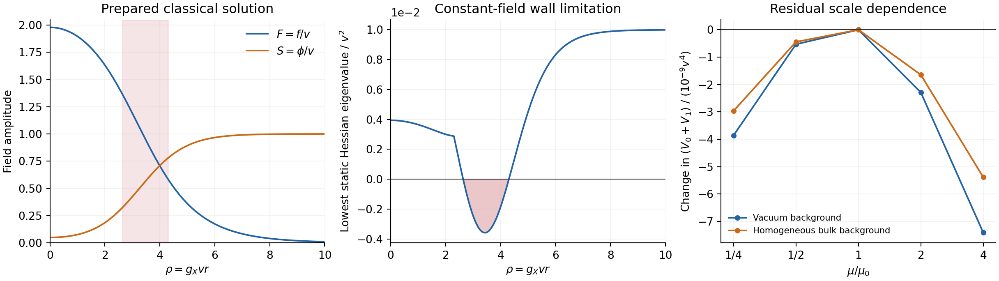

# GRUT Candidate 1 — scalar quantum consistency report

18–19 October 2026 · fixed action and matching · bounded one-loop calculation

**Candidate 1 passes a first quantum consistency check in its flat-space scalar potential.** The required running interactions have been derived, the one-loop renormalization-group identity holds exactly, and the local vacuum and homogeneous bulk diagnostics receive small corrections at the original benchmark. This is additional support for a calculable EFT proposal. It does not demonstrate a quantum-stable organized object or a theory of all reality.

Two limitations are now concrete. The constant-field approximation develops negative Hessian modes at field values occurring in the classical wall, so integrating its real part over the soliton would not be a controlled quantum-energy calculation. Also, the original zero tree vacuum energy does not remain zero after scalar loops with the literal coefficient inputs held fixed; quantum asymptotic flatness needs an explicit total-vacuum-energy matching condition.

The [candidate specification](../grut_candidate_1_20261018/GRUT_CANDIDATE_1.md), [original worked regime](../grut_candidate_1_20261018/WORKED_REGIME.md), and [classical stability follow-up](../grut_candidate_1_stability_20261018/REPORT.md) are unchanged. This report adds calculations and narrows the quantum claim boundary. No field, physical coupling, charge preparation, or finite counterterm was adjusted to obtain these results.



The red region marks sampled classical-profile values with a negative **local static** Hessian eigenvalue. It does not show an unstable mode of the complete rotating soliton. The last panel shows residual scale dependence of the truncated running potential at fixed backgrounds; it is neither a measured uncertainty nor a quantum lifetime.

## 1. The same theory and a deliberately restricted calculation

Use four canonical real fields \(q=(\phi,x,y,D)\), with \(X=(x+iy)/\sqrt2\), and write \(R^2=x^2+y^2\). The scalar polynomial is

\[
V_0=C+\frac12m_\phi^2\phi^2+\frac12m_X^2R^2+\frac12m_D^2D^2
+\frac{\lambda_\phi}{4}\phi^4+\frac{\lambda_X}{4}R^4+\frac{\lambda_D}{4}D^4
+\frac c2\phi^2R^2+\frac d2\phi^2D^2+\frac\alpha2R^2D^2.
\]

Here \(c=g_X^2\), \(d=h_D^2\), and \(m_X^2\) is the additional quadratic coefficient, not the mass of a particle in the vacuum. At \(\mu_0=0.1v\), the original inputs are

\[
(\lambda_\phi,\lambda_X,c,d,\lambda_D,\alpha)
=(0.01,0.001,0.01,0.0001,0.001,0),
\]

\[
(m_\phi^2,m_X^2,m_D^2)=(-0.01,0,0.01)v^2,
\qquad C=0.0025v^4.
\]

The \(\alpha\) portal and the independent quadratic/constant operators were already admitted by Candidate 1's matching prescription. This calculation implements their running. It does not introduce them as new fitted physics. The reference \(v\) denotes the original matching unit throughout, rather than being reset to the running vacuum expectation value.

The calculation includes only the new scalars in flat spacetime, at one loop in \(\overline{\mathrm{MS}}\). It excludes gravitational/curvature corrections, Standard Model vacuum contributions, finite-temperature or finite-density quantum loops, and the nonlocal effective action. Zero Higgs portals supply no field-dependent Standard Model contribution to this scalar one-loop potential; this observation does not calculate the Standard Model contribution to the total gravitational vacuum energy. Scalar loops in curved spacetime would require the nonminimal and curvature operators already allowed by the EFT.

## 2. An exact consistency result

Let \(H_{ab}=\partial_a\partial_bV_0\), with squared-mass eigenvalues \(h_a\). For a stable constant background,

\[
V_1=\frac1{64\pi^2}\sum_{a=1}^{4}h_a^2
\left[\ln\left(\frac{h_a}{\mu^2}\right)-\frac32\right].
\]

The scalar one-loop anomalous dimension vanishes, so consistency requires

\[
\boxed{\sum_p\beta_p\,\partial_pV_0
=\frac{\operatorname{Tr}(H^2)}{32\pi^2}
=-\partial_{\ln\mu}V_1\big|_{p,q}.}
\]

The sum includes all six quartics, three quadratic coefficients and the constant \(C\). [RG_DERIVATION.md](RG_DERIVATION.md) supplies every beta function and normalization. The code constructs the symmetric quartic tensor, calculates its one-loop contractions, and separately differentiates a directly entered polynomial to obtain the Hessian. Exact rational arithmetic gives **50 monomials on each side and zero residual**. All 290 component, symmetry, normalization and identity checks pass. The checks share an automated research team and standard loop framework; their agreement is not external validation.

The generated coefficients are nonzero even though their matching values vanish:

\[
\beta_\alpha(\mu_0)=1.26651479553\times10^{-8},\qquad
\frac{\beta_{m_X^2}(\mu_0)}{v^2}=-1.26651479553\times10^{-6}.
\]

Suppressing either running term, or the vacuum-constant running, leaves a nonzero polynomial residual. The narrower rule “those coefficients vanish at every scale” is rejected. It was not Candidate 1's specified rule.

## 3. Same matching, different calculation scales

All ten coefficients were evolved from the one matching point, without resetting any minimum or constant. The numerical ODE trajectory gives:

| \(\mu/\mu_0\) | Generated \(\alpha\) | Generated \(m_X^2/v^2\) | Tree coupling ratio \(c^2/(\lambda_\phi\lambda_X)\) |
|---:|---:|---:|---:|
| 1/4 | \(-1.75400\times10^{-8}\) | \(1.75410\times10^{-6}\) | 10.01265 |
| 1/2 | \(-8.77441\times10^{-9}\) | \(8.77466\times10^{-7}\) | 10.00632 |
| 1 | 0 | 0 | 10.00000 |
| 2 | \(8.78322\times10^{-9}\) | \(-8.78297\times10^{-7}\) | 9.99368 |
| 4 | \(1.75753\times10^{-8}\) | \(-1.75743\times10^{-6}\) | 9.98736 |

The quartic potential satisfies a sufficient boundedness condition at every sampled scale. A negative running quadratic coefficient alone is not a particle tachyon or a physical rejection: the running vacuum, interactions and momentum-dependent self-energy also enter the particle mass. These scale choices describe the same matched theory; they are not different physical parameter fits.

Seven prescribed four-field backgrounds were checked. At strict one-loop order, their potential values cancel the explicit scale change to a maximum numerical spread \(8.67\times10^{-19}v^4\). The numerical beta/Hessian identity agrees to relative \(1.04\times10^{-15}\). Retaining a numerically integrated one-loop trajectory inside \(V_0+V_1\) leaves a residual scale spread of \(5.14\text{–}7.96\times10^{-9}v^4\). A separate bookkeeping test multiplies the **leading-log** parameter displacement and \(V_1\) by a loop-counting parameter; the residual behaves as its square. This is an order-counting check, not an integration of a new physical family.

These residuals check consistent implementation. They do not bound unknown two-loop terms, derivative corrections, or quantum soliton errors. Protocol and raw numbers are in [flow_protocol.json](flow_protocol.json), [flow_results.json](flow_results.json), and [flow_scale_values.csv](flow_scale_values.csv).

## 4. What the constant-field calculation actually says

At \(\mu=\mu_0\), no finite counterterm is fitted. Strict first-order results are distinguished from numerical minimization of the truncated function \(V_0+V_1\), which contains some induced higher-order terms but is not a two-loop calculation.

| Quantity | Tree result | Strict one-loop result |
|---|---:|---:|
| Local vacuum \(\phi/v\) | 1 | 1.00012193740 |
| Vacuum \(\phi\) curvature squared / \(v^2\) | 0.020000000000 | 0.020012778428 |
| Each vacuum \(X\) real-mode curvature squared / \(v^2\) | 0.010000000000 | 0.010002775306 |
| Vacuum \(D\) curvature squared / \(v^2\) | 0.010100000000 | 0.010099830632 |
| Homogeneous ratio minimum \(h/v^2\), below | 0.003162277660 | 0.003162395532 |
| Scalar vacuum energy / \(v^4\), fixed coefficients | 0 | \(-1.22652632365\times10^{-6}\) |

All four local vacuum curvatures remain positive. These are derivatives of the zero-momentum effective potential, **not physical pole masses**. Tadpole-induced displacement of the vacuum is included in the strict curvature correction.

The bulk diagnostic is

\[
h(\phi,F)=\frac{2\,[V_{\mathrm{eff}}(\phi,F,0,0)-V_{\mathrm{eff}}(\mathrm{vac})]}{F^2},
\quad x=F.
\]

The tree depleted-\(\phi\) minimum has \(\phi=0\), \(F/v=10^{1/4}\). Its strict correction is \(+1.17872091832\times10^{-7}v^2\), or **+0.00372744%**. A one-dimensional minimizer and three two-dimensional starts agree on the local truncated minimum. The tree Hessian has a positive analytic bound on the prescribed bulk rectangle; positivity of the loop-corrected curvatures is sampled, not certified by interval arithmetic.

This is a useful local perturbative result. It does not establish a quantum free-particle threshold, finite-charge binding, a corrected soliton profile, or lifetime. The prepared classical solution rotates at \(\omega\simeq0.08v\), comparable with vacuum scalar masses of order \(0.1v\). A small-frequency derivative expansion has not been demonstrated.

## 5. A shortcut rejected by the calculation

Evaluating the **static constant-background** Hessian at values taken from the unchanged classical profile gives a negative eigenvalue at 84 of 1,001 sampled radii. The sampled interval is

\[
2.64\leq\rho=g_Xvr\leq4.30,
\qquad \min h_a=-0.00357857280730v^2.
\]

The endpoints have a \(\Delta\rho=0.02\) sampling resolution. The principal-log continuation retains an imaginary local potential in this interval; neither its signs nor its imaginary values were discarded. Raw values are in [potential_profile_flags.csv](potential_profile_flags.csv).

This matrix omits spatial gradients, the rotating-phase mixing and the charge constraint. Its negative eigenvalue is therefore **not a demonstrated soliton instability or decay rate**. It does show why a pointwise real Coleman–Weinberg potential cannot simply be integrated over this profile and called the quantum energy. No such integral was performed. Quantum binding requires the charge-constrained, spatially varying fluctuation operator and a consistent subtraction against the physical vacuum/particle states.

## 6. Gravity exposes a matching obligation

For the literal matched polynomial \(C=0.0025v^4\), with no compensating finite total constant, the new-scalar contribution to the strict vacuum value is

\[
\rho_{\mathrm{vac,new}}=-1.22652632365\times10^{-6}v^4.
\]

The separate action coefficient \(\rho_\Lambda\) and the polynomial constant \(C\) enter gravity through their sum. Their separation is bookkeeping, and scalar constant running must be assigned to that total once. Imposing a physical zero total vacuum energy at this order would require an explicit finite matching contribution of the opposite sign, together with the contributions of any other sectors. **No adjustment has been applied here.**

At the illustrative \(v/M_P=10^{-5}\), the uncancelled new-scalar value alone would give a negative cosmological density and an AdS curvature radius \(L_{\mathrm{AdS}}v\simeq1.56\times10^8\). This is a conditional consequence of leaving that contribution uncancelled, not a prediction of the observed cosmological constant. Standard Model and gravitational vacuum contributions were not computed.

Subtracting the vacuum value in a relative matter energy does not remove its gravitational effect. The earlier asymptotically flat calculation remains a **leading classical** benchmark. Carrying that boundary condition into a quantum calculation requires a stated physical total-vacuum matching rule; the original tree-zero polynomial relation cannot supply it automatically.

## 7. Integrated status after this pass

| Component | Status earned by the same candidate | Remaining physical gap |
|---|---|---|
| Geometry | **Defined** by a supplied common spacetime metric; weak gravitational response **derived in a stated regime** | Geometry and dimension are not derived; quantum background needs vacuum matching |
| Populated matter | Classical family, binding comparisons and finite-time 3D persistence **numerically supported**; scalar one-loop potential and RG **derived in a stated regime** | Quantum finite-charge energy, full mode spectrum, global minimum and lifetime **missing** |
| Common propagation | Common local covariant kinetic terms **defined**; weak reporter scattering **calculated** | Complete quantum propagation/readout with recoil and inelastic channels **missing** |
| Gravity | Einstein sector **defined by postulate**; original linear stress response **derived** | Quantum total vacuum calibration and coupled nonlinear Einstein/quantum state **missing** |
| Observation | Probabilities, ideal instrument and separate selection/delivery quantities **defined** | Source, reference arm and detector implementation from action **missing** |
| Predictions | Conditional classical outputs and scalar-loop diagnostics **calculated**; rejection criteria specified | New-sector empirical parameters and held-out physical data **missing** |

Outcome remains **a narrower working model rather than the intended universal theory**. The new calculation supports scalar perturbative consistency; it does not promote the demonstrated classical organization mechanism into a validated quantum or empirical theory.

## 8. Reproduction and review record

The packet contains frozen protocols, exact code/results, raw numerical scans, a separate challenger review, correction history and a manifest. See [RG_DERIVATION.md](RG_DERIVATION.md), [POTENTIAL_NOTES.md](POTENTIAL_NOTES.md), [CHALLENGE.md](CHALLENGE.md), and [EXECUTION_RECORD.md](EXECUTION_RECORD.md).

There are **290 exact algebra checks, six flow acceptance conditions, and 39 cross-checks**. These counts overlap in what they test and are not independent physical confirmations. The cross-checks compare separately implemented Hessians/CW evaluations and exact versus numerical beta functions, check stationarity and finite differences, preserve negative-mode flags, and enforce the approximation boundary. A fresh-directory end-to-end replay is supplied and recorded.

Use an existing Python environment with NumPy, SciPy and Matplotlib:

```bash
python research/reality_framework/grut_candidate_1_quantum_20261018/reproduce.py /tmp/grut-quantum-new-replay
```

The destination must not already exist. The replay preserves posted originals, copies the single hashed classical-profile input, reruns the bounded calculations and figure, and compares their substantive outputs. No network, installation, paid compute or continuing background execution is required. See [REPRODUCTION.json](REPRODUCTION.json) and [VERIFICATION.json](VERIFICATION.json).

The next discriminating quantum calculation is specified in [NEXT_CALCULATION.md](NEXT_CALCULATION.md): the rotating, fixed-charge fluctuation problem with physical threshold matching and zero modes treated explicitly. Its result is still needed; it is not replaced by the small local bulk correction reported here.

## Primary reference

Stephen P. Martin, *Two-loop effective potential for a general renormalizable theory and softly broken supersymmetry*, [hep-ph/0111209v2](https://arxiv.org/html/hep-ph/0111209v2), section 3 and equation (7.1), for the standard scalar one-loop potential and RG conventions. All model-specific contractions, numbers and checks in this report were performed by the supplied code. No two-loop result was evaluated.
