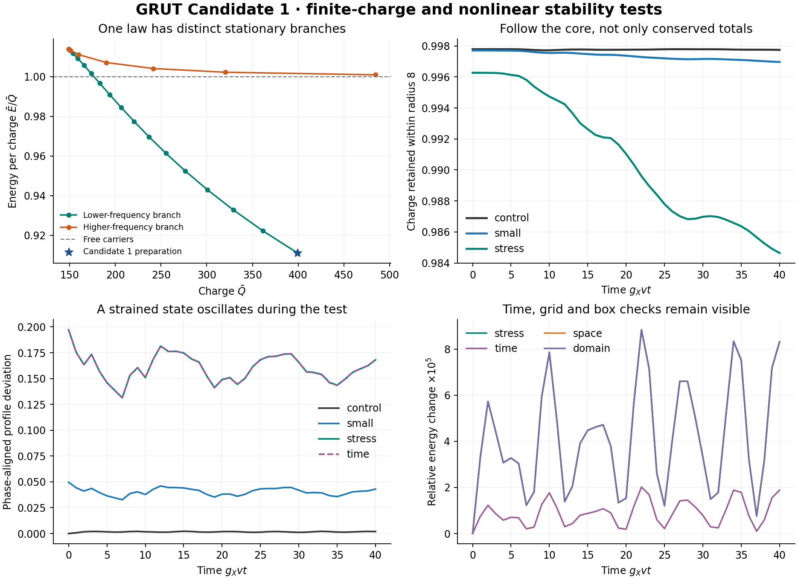

# GRUT Candidate 1: charged-state family, fragmentation and nonlinear persistence

**Research result · 18 October 2026 · fixed action and benchmark**

## Result

Candidate 1 now has a resolved family of classical charged configurations, a separate finite-volume reproduction of three states, explicit energetic fragmentation comparisons and finite three-dimensional perturbation tests. The central result is a prepared, populated scalar regime with evidence of binding and finite-time persistence. Its reporter scattering and weak-gravity observables use the same original preparation.

The physical action, fields and couplings were held fixed. No controller, damping, reservoir or favorable change of interaction was introduced. This is a stronger working EFT regime, not experimental validation, a global ground-state proof, a quantum lifetime or a completed theory of reality.

## One action and one prepared matter sector

The full [Candidate 1 action](../grut_candidate_1_20261018/GRUT_CANDIDATE_1.md) adopts Einstein gravity, ordinary quantum matter, a spacetime metric and Born probabilities. Its new fields are complex X and real phi,D, with

$$
U=\frac{\lambda_\phi}{4}(\phi^2-v^2)^2+g_X^2\phi^2|X|^2+\lambda_X|X|^4
+\frac12(m_{D0}^2+h_D^2\phi^2)D^2+\frac{\lambda_D}{4}D^4.
$$

The present dynamics set the reporter to zero, keep ordinary matter in its prepared vacuum and omit metric feedback at leading order. The original metric potentials are about 10^−9; no nonlinear Einstein evolution or new gravitational claim is inferred from the scalar evolution.

Use `g_X=.1`, `lambda_phi=.01`, `lambda_X=.001`, `h_D=.01`, `m_D0=g_X v`, `lambda_D=.001`, and `v/M_P=10^-5`. None was fitted during these tests. Dimensionless variables are `A=sqrt(2)X/v`, `S=phi/v`, `tau=g_X v t`, `y=g_X v x`, `a=1,b=.1`:

$$
\ddot A=\nabla^2A-(S^2+.1|A|^2)A,\qquad
\ddot S=\nabla^2S-[(S^2-1)+|A|^2]S.
$$

The conserved classical charge and energy are

$$
\bar Q=-\int\operatorname{Im}(A^*\dot A)d^3y,
\quad
\bar E=\int d^3y\left[\frac{|\dot A|^2+|\nabla A|^2+\dot S^2+|\nabla S|^2}{2}
+\frac{(S^2-1)^2}{4}+\frac{S^2|A|^2}{2}+.025|A|^4\right].
$$

Physical `Q=Qbar/g_X²` and `E=(v/g_X)Ebar`. The reference preparation has `Qbar=399.4384624223`, `Ebar=363.9229985517`, `Omega≈.800000002`, `S(0)≈.04908`, and `E/(m_X Q)=.91108652`. Charge and energy are supplied initial resources. The calculation does not demonstrate autonomous formation from diffuse matter.

The known charge-supported scalar mechanism is a quartic extension of the Friedberg–Lee–Sirlin construction; its numerical bounds are not borrowed from the original potential. See [Heeck and Sokhashvili](https://arxiv.org/html/2303.09566v2). Candidate 1 is a successor to the moving-word route, not a completion of its emergent-geometry derivation.

## 1. A family, including an unfavorable branch

At the same couplings, continuation from `Omega=.80` to `.999`, four alternate numerical starts and fixed-charge solves resolved two profiles at eligible charges. All 112 scalar BVP attempts and six differentiated-equation solves are recorded. An initial turning-point minimizer reached its declared call cap; that stopping failure was preserved before a separately bounded sensitivity-root refinement.

| Located feature on the found spherical family | `Omega` | `Qbar` | Meaning |
|---|---:|---:|---|
| Reference state | .800000002 | 399.4384624 | Bound against all-free carriers |
| Free-carrier binding threshold | .906544041 | 176.6043883 | `Ebar/Qbar=1` |
| Stationary charge minimum | .959804749 | 148.7340421 | Turning point of this found family |
| Second state at reference charge | .998480388 | 399.4384624 | `Ebar≈400.00816`, above free carriers and the reference |

Domain refinements change the located threshold energies and charges by about 10^−9. These are convergence comparisons, not interval-certified errors or proof that no other family exists. Small targets below the found minimum remain unresolved.

Fixed-charge radial Hessian checks yield a positive lowest value near `+.03052` at `Omega=.95` and a negative value near `−.02734` at `.97`, with mesh confirmation. Thus the same law contains a resolved adverse stability direction as well as the reference regime. The original reference's nonspherical amplitude and phase checks remain in [WORKED_REGIME.md](../grut_candidate_1_20261018/WORKED_REGIME.md); this new radial scan does not extend those angular tests to every state.

## 2. Separate numerical reproduction

A cell-centered shell-volume energy minimization imposes Q directly through `E_Q=Q²/(2I)+gradient+potential`, with `I=sum V_i F_i²`. It imports no stationary ODE/BVP implementation. It used two frozen starts—one source-profile seed and one explicit broad Gaussian—at each charge and each of `N=800,1600`, with `L=40`.

| Charge fraction | Fine finite-volume `Ebar` | Refined BVP `Ebar` |
|---:|---:|---:|
| 1 | 363.9216078576 | 363.9229985516 |
| .75 | 282.6263217720 | 282.6274675594 |
| .5 | 197.2976750889 | 197.2984205537 |

The energy errors shrink approximately fourfold when h halves. Assuming leading h² error, Richardson values agree with BVP energies to about 10^−7. That is cross-method consistency, not a rigorous error enclosure.

All twelve first optimizations stopped on relative energy and failed their requested gradient tolerance; those records remain visible. A separately prescribed, bounded Newton check of the three fine Gaussian-origin states then reached full discrete gradients below `1.2×10^−11`. It changed the converged energies only about 10^−10. These are accurate roots of the independent finite-volume stationarity equations, not a global-minimum certificate or external validation. See [independent_notes.md](independent_notes.md).

## 3. Fragmentation costs and the remaining gap

Each comparison has the same total Q as the reference. Energies include field rotation, gradients and potential terms. Both found stationary branches and free-carrier alternatives were retained.

| Resolved components, fractions of reference charge | Excess `Ebar` over reference |
|---|---:|
| All free X carriers | +35.51546387 |
| Two lumps: .375 + .625 | +28.51433616 |
| Two lumps: .4 + .6 | +29.33901713 |
| Two equal lumps | +30.67384256 |
| .8 lump + .2 free charge | +15.10481616 |
| .45 lump + .45 lump + .1 free charge | +34.91744518 |

The largest refined fragment-energy change is about `4.1×10^−7`, much smaller than these margins. The independent finite-volume equal-halves cost is `+30.67374232` on its fine grid, approaching the BVP value under refinement.

For a smooth stationary branch, `dE/dQ=Omega` and the virial identity gives `E−Omega Q=2K/3>0`. Therefore `d(E/Q)/dQ=−2K/(3Q²)<0`. Together with the found envelope and the free-carrier alternative, this supports a conditional comparison against every positive-charge partition drawn from that envelope. It does not establish that the found envelope exhausts possible fields or branches. Equal three-, four- and five-lump targets lie below the found branch minimum and remain unresolved rather than forbidden. See [branch_notes.md](branch_notes.md) for the exact conditions and all resolved combinations.

An additional exact classical control is the potential identity, with `Omega_0=(ab)^(1/4)`:

$$
V-\frac{\Omega_0^2|A|^2}{2}
=\frac{[\sqrt a(S^2-1)+\sqrt b|A|^2]^2}{4}
+\frac{1-\sqrt{ab}}{2}S^2|A|^2\ge0.
$$

It implies `Ebar>=Omega_0 |Qbar|`. A separated free-radiation component has energy at least its absolute charge. If such a decomposition applies, the charge remaining in non-free bound structures obeys `|Q_bound|>=(Q_total−E_initial)/(1−Omega_0)`. This excludes complete free dispersion below the free threshold, but permits other bound lumps and does not pin a core at the origin. [DERIVATION.md](DERIVATION.md) states all assumptions.

## 4. Nonlinear three-dimensional operating test

Both fields are distorted by the volume-preserving map `M=diag(exp(epsilon),exp(−epsilon),1)`. The continuum charge, potential and rotation energies are unchanged, while

$$
\Delta\bar E=\frac43T_{grad}\sinh^2\epsilon,
\quad T_{grad}=66.558341736314.
$$

This gives injected energies `.222046085` for epsilon .05 and `3.597361753` for .20. Charge is normalized again on the actual evolution grid. This is an ellipsoidal strain, containing higher angular harmonics at finite amplitude; it is not a single linear eigenmode.

The original proposed perturbation protocol was retained and amended **before the first physical trajectory** to use this analytically controlled family. No unfavorable trajectory was discarded. All seven finite trajectories use exact linear Klein–Gordon evolution plus local nonlinear kicks, a matching Fourier-collocation Hamiltonian, periodic boundaries and no damping. Time, space and box controls are separate. They end at `tau=40`, about five carrier phase periods.

| Run | N / cube side | dt | Strain epsilon | Minimum Q fraction inside r=8 | Max relative energy change |
|---|---:|---:|---:|---:|---:|
| control | 96 / 64 | 0.1 | 0 | 0.99771597 | 1.32e-05 |
| small | 96 / 64 | 0.1 | 0.05 | 0.99696188 | 1.64e-05 |
| stress | 96 / 64 | 0.1 | 0.2 | 0.98464449 | 8.84e-05 |
| time | 96 / 64 | 0.05 | 0.2 | 0.98480669 | 2.02e-05 |
| coarse | 64 / 64 | 0.1 | 0.2 | 0.98457002 | 8.84e-05 |
| space | 128 / 64 | 0.1 | 0.2 | 0.98474880 | 8.84e-05 |
| domain | 128 / 85.33 | 0.1 | 0.2 | 0.98464449 | 8.84e-05 |

The largest global relative charge drift is `6.12×10^−13`. Halving dt reduces the strong-case maximum energy change from `8.84×10^−5` to `2.02×10^−5`, a factor 4.38. The original strong-case absolute energy variation is about `.0325 Ebar`, below 1% of the injected `3.59736 Ebar`. The small-case maximum variation is about `.006 Ebar`, approximately 2.7% of its injected `.22205 Ebar`; the unperturbed control supplies the numerical motion floor.

For the strong strain, the time-step comparison changes sampled core-Q fractions by at most `.0001622`; spatial refinement changes them by `.0001354`, including the hard spherical-mask quadrature effect. The larger-box change is at most `1.21×10^−9` in the r=8 core fraction and `6.54×10^−8` in central S. The scalar phase-aligned-profile-error history agrees across the two finer spatial grids within `1.28×10^−8`; that agreement of scalar diagnostics is not itself a norm of the full solution difference.

A direct comparison of saved final central-plane fields, with spectral resampling, gives maximum spatial-grid differences inside radius 12 of `3.58×10^−6` in complex A and `5.72×10^−6` in S. The band-truncation remainder of that comparison is retained in [convergence_slices.json](convergence_slices.json). The matched-spacing box comparison gives core-plane differences below `8.1×10^−8`, while outer common-plane A differences reach `.00244`. This is a single-plane field check; it does not bound the full three-dimensional solution. The box also changes the global profile-error diagnostic by `1.21×10^−5`. No perfect numerical causal isolation is claimed.

The strong cases retain about 98.5% of charge inside radius 8 and about 99.3% inside radius 12 over the sampled window. The initial strong profile deviation is `.19724`, compared with a control-motion floor below `.00221`; its final deviation remains about `.16812`. This is a persistent, oscillating deformed state rather than demonstrated return to the initial spherical profile.

Core retention and global conservation are different diagnostics. The stronger perturbation redistributes some charge outside the selected radii, and its core charge is still declining at the last sample. This is not a measurement of permanent escape to infinity; outer content could remain bound or return. The result supports persistence over this duration and these preparations; it does not establish asymptotic relaxation, arbitrary perturbation stability or a long lifetime. Periodic-box comparison and initial boundary tails are reported rather than replaced by an exact causal-isolation claim.

## 5. An observable of the same state

For the original weak reporter on this prepared scalar profile, `u''+[k²−.01(S²−1)]u=0` and `S_0=exp(2i delta_0)`. A direct elastic partial-wave quantity is

$$
\sigma_0(g_Xv)^2=4\pi\sin^2\delta_0/k^2.
$$

| `p/(g_Xv)` | `delta_0` | `sigma_0(g_Xv)^2` |
|---:|---:|---:|
| 3 | .00677651098 | 6.41169713×10^−5 |
| 5 | .00406651158 | 8.31211393×10^−6 |
| 7 | .00290476954 | 2.16389371×10^−6 |

These use the original executed phase calculation and its two-method numerical check. They are s-wave contributions, not a new calculation of the total plane-wave cross section. Their apparatus assumptions and omitted recoil/inelastic/quantum terms are explicit in [OBSERVABLES.md](OBSERVABLES.md). A physical source, flux calibration, target preparation and detector remain unconstructed; replacing an arm probability with a scattering observable does not build them.

The same original stress gives central weak-field clock redshift `6.68813×10^−10` and exterior bending `2.89601×10^−10` radians at `b g_Xv=20`. Those are adopted Einstein dynamics applied consistently to the source, not new gravitational laws. The deformed trajectories were not evolved with gravity or measured with a reporter. Their oscillating nonspherical profile does not inherit the static spherical scattering phase as a readout-robustness result.

## Verification, reproduction and claim boundary

All **60 follow-up acceptance checks passed**; detailed evidence is in [VERIFICATION.json](VERIFICATION.json). Protocol conservation/retention gates were fixed before trajectories. Additional convergence and cross-method checks were consolidated for reporting after execution; this is not statistical preregistration. The seven nonlinear runs consumed approximately 13.44 minutes of recorded local wall time, with no installs, paid compute or persistent process.

Start with [README.md](README.md) for a clean reproduction that preserves archived outputs. Numerical protocols, failures to meet stopping rules, later bounded refinements, source hashes, raw results, evolution diagnostics and internal [challenge notes](CHALLENGE.md) are included. The independent code and automated workers share the same project assumptions; this is not independent peer review.

The candidate can now be described as a **specified gravitational EFT with a numerically demonstrated charge-bound scalar regime, tested finite-time nonlinear persistence, and conditional quantitative observables**. The word “stable” must retain the particular energetic, linear or finite-time meaning actually tested.

Quantum lifetime, global minimization over every field/partition, nonlinear gravity, autonomous preparation, physical apparatus and empirical calibration remain open. The illustrative parameters have not undergone a quantitative portal-running/abundance/experimental-constraint study. Large charge and small couplings suggest, but do not establish, a controlled quantum state or phenomenological viability. No additional fields or interactions were added to conceal those gaps.
