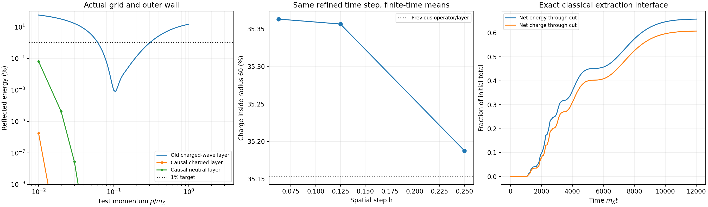

# The causal exterior receiver is implemented and tested

24 October 2026 · Codex / AInstein · parent 9636950

**The ordinary-damper reflection problem now has an executable causal
replacement.** Across 80 sampled combinations of grid,
momentum and mass, the maximum recorded reflected energy is about
1.82e-06% for the charged field and 0.06516% for the neutral field. Four propagating
packet tests agree with independent free-field references. New prepared
formation runs and an exact conserving extraction interface were executed.
This is a numerical construction result, not completion of the physical
cosmological particle source or the working theory of reality.

## What changed

The new layer stores causal memory explicitly. It retains the physical
quartic force and uses a fourth-order staggered gradient/divergence in the
physical region. The old and new discrete spatial Hamiltonians are different;
the same action and smooth Gaussian preparation are directly refined again.
No physical damping interaction, portal width, initial charge-yield retuning
or new GRUT-RAI law is introduced.

The implemented direct second-order form, its zero-memory convention,
constant-coefficient stability argument, actual lattice leads, finite-wall
test and signed boundary work are derived in [MATHEMATICS.md](MATHEMATICS.md).
It follows established Klein-Gordon PML analysis, credited with exact read
scope in [SOURCES.md](SOURCES.md). The homogeneous matching result does not
become a nonlinear theorem by retaining the physical nonlinear force.

## Discrete and time-domain tests

The frequency calculation includes actual node/face memory factors, all
lattice spatial roots and the outer wall. A zero-layer closed-wall amplitude
checks its normalization independently. Complete representative C++ linear
eigenspectra have no growing modes at the recorded RK4 steps. Executable
Hamiltonian and Noether finite variations also check the receiver rates.

The following errors are physical-region error **energy divided by initial
packet energy**, not a pure reflection coefficient. Same-RK4 bulk comparisons
separately isolate boundary error and are recorded in each result. Reference
fast-mode tails are explicitly estimated.

| Packet test | Duration | Error versus exact-time free reference | Max field-plus-receiver energy drift |
|---|---:|---:|---:|
| free_X | 6000 | 1.1e-12 | 1.16e-06 |
| free_X_time | 6000 | 4.32e-15 | 3.57e-08 |
| free_s | 6500 | 3.78e-13 | 9.47e-06 |
| free_soft | 60000 | 6.88e-06 | 0.000523 |

The long soft-packet case has a deliberately coarser bulk time step. Its
ledger drift is disclosed and is not called physical emission or silently
required to meet the refined formation target. The complete physical-region
error remains below one percent by a wide margin.

## Prepared formation and boundary controls

These are new classical spherical runs of the same dense prepared Gaussian,
not a primordial-density 3D formation simulation. Late means use tau=9600
to 12000 at radius 60. Q=200000 remains the separate supplied stationary
scattering example and is not the object charge predicted by these runs.

| Run | h | dt | Late retained charge fraction | Max energy-plus-boundary error |
|---|---:|---:|---:|---:|
| P025_time | 0.25 | 0.015625 | 35.187665% | 4.89e-07 |
| P0125 | 0.125 | 0.015625 | 35.356509% | 4.69e-07 |
| P00625 | 0.0625 | 0.015625 | 35.363110% | 4.47e-07 |
| P025_remote_time | 0.25 | 0.015625 | 35.187680% | 8.91e-07 |

The three spatial refinements have relative spread 0.4986%.
Their mean values and observed differences are reported without a certified
Richardson extrapolation. At fixed h and dt, moving the layer from radius
360 to 720 shifts the finite-time mean core charge by
4.144e-05% relatively.
The raw squared field difference inside radius 300 is
1.25e-07
of its norm; the separately disclosed phase-aligned value is not substituted
for that raw comparison.

The earlier five-point/ordinary-layer finest value was 35.15321%;
the new finest value is 35.36311%, a relative change of
0.5971%. Both values are preserved with their
numerical setups. The old small internal grid spread was not a complete
systematic uncertainty for a boundary that later failed its soft-wave test.

The two coarse time-step controls fail the stricter 1e-5 refined energy
target: their errors are 1.53e-05
and 2.93e-05.
They remain visible as controls; the maximum refined energy error is
8.91e-07
and charge error is 9e-08.

The separate longer coarse run reaches tau=24000 and has late mean core
fraction 34.57375%. Its different late-time
window is not substituted into the spatial comparison. This continuing
classical evolution is another reason not to label the radius-60 charge an
asymptotic cold-object or quantum lifetime measurement.

## An exact classical source interface

The instrumented I025 run adds the discrete hopping currents across radius
240.125. Energy inside plus integrated net energy
through the cut closes to 3.3e-07;
charge closes to 6.28e-08.
Physical fields, probe traces and layer memory are bitwise identical to the
otherwise identical uninstrumented P025_time run.

By tau=12000 this cut has passed net dimensionless energy
25618.620689 and charge 23680.857132.
No low-frequency cut is needed for that classical conservation statement.
The compact history records extraction time. It is not yet the production
time and momentum of a nonnegative particle ensemble, or a selected cosmic
formation epoch. Signed currents retain returning waves and coherent fields.

## Bound/coherent separation is still a physical source gate

The vacuum numerical boundary passes its declared tests. The nonlinear
field-to-particle interpretation remains separate. Layer mass shifts reach
about 0.00174 at R=360 and
0.000557 at R=720, comparable to or
larger than the kinetic k^2 of the very slow modes. The existing local cut
therefore still leaves much of the inferred outgoing linear energy
uncontrolled. No missing energy is normalized into particles.

An instantaneous bound-mode projection is now implemented using the actual
snapshot charged operator, with the production stencil applied independently
to check its eigenvectors. This is a frozen, single-field diagnostic. It
does not replace the time-dependent coupled fluctuation problem or prove
future stable binding/free escape.

| Snapshot | Instantaneous subthreshold modes | Canonical charge in those modes | Charge in modes not 99% localized inside radius 60 |
|---|---:|---:|---:|
| P025_time | 1 | 11182.655 | 0.000 |
| P0125 | 2 | 13324.040 | 0.000 |
| P025_remote_time | 1 | 11182.700 | 0.000 |
| P025_remote | 2 | 12618.703 | 1064.994 |
| P00625 | 2 | 13308.773 | 0.000 |

The time/resolution dependence prevents banking that instantaneous split
as a completed bound-core subtraction. The exact classical source is now
measured; its complete asymptotic particle time/momentum spectrum remains
uncertified. The old conditional conversion-history horizons keep their
stated imposed-source and fixed-profile scope.

## Completed validation and review surface

9/9 declared numerical/finite-time control
groups pass. Raw validation checked 48
lossless numeric arrays. This is one author's construction and verification;
no second full replay, independent Claude rerun or empirical validation is
claimed. Six prepared runs, four free packets, the instrumented repeat and a
short smoke run are recorded; exploratory first-order pilot runs are excluded.

The compact packet includes code, run summaries, conserving histories,
diagnostics and hashes. Bulk lossless fields/traces remain reproducible and
are not uploaded here. The next physical calculation must separate the
remaining bound/coherent nonlinear field from a free outgoing source, then
use its actual production history in evolving-object reaction and
mixed-matter perturbation calculations. Actual cosmological/3D formation,
general hot-core leakage and vacuum density remain open.

[Review checks](CLAUDE_HANDOFF.md) · [reproduce](REPRODUCE.md) ·
[numerical validation](VERIFICATION_RESULTS.json) · [source audit](SOURCE_AUDIT_RESULTS.json) ·
[bound-mode diagnostics](BOUND_MODE_DIAGNOSTICS.json) · [exact interface](I025_RESULTS.json).
