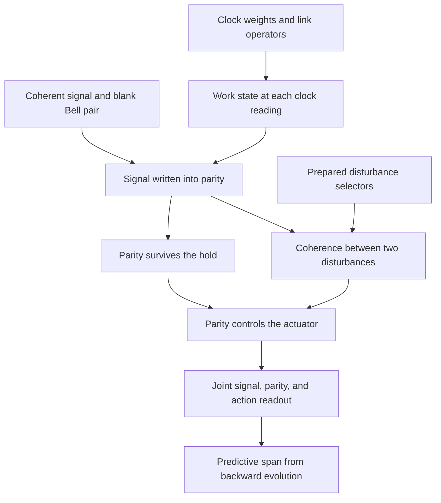

# GRUT Construction 1

6 November 2026 · Completed finite quantum candidate

A single autonomous Hamiltonian writes a signal into a two-qubit record, keeps that record through a phase-changing hold, and uses it to control a later action. The clean model gives perfect agreement between signal and action. A control with identical pre-action marginals gives 50% agreement under the same Hamiltonian. In the withheld run, the full and reduced quantum models give **81.25%** agreement. A population-only model that matches the calibration gives **62.5%**, as does the full model after an intermediate parity measurement with its outcome ignored.

The [frozen specification](SPECIFICATION.md) defines the complete tuple, all seven interactions, operational access, and the acceptance tests. The [parameter card](parameters.json) fixes every angle, test program, and tolerance. The model uses standard quantum mechanics, an engineered clock, and declared preparation resources. The chosen physics question is whether a specified interacting whole can turn a stored correlation into a later action and which information an effective state must keep to predict it.

## One connected model

The universe has an eight-state clock \(C\) and six qubits. \(S\) supplies the signal, \(M_1,M_2\) hold the record, \(A\) stores the action, and \(D_1,D_2\) are internal bits that enable two possible disturbances. The Hilbert dimension is \(512\). Set \(\hbar=\Omega=1\), with physical time expressed in units of \(\Omega^{-1}\). The Hamiltonian is

\[
H=\sum_{k=0}^6 \frac{\Omega}{2}\sqrt{(k+1)(7-k)}
\left(|k+1\rangle\langle k|\otimes U_k+|k\rangle\langle k+1|\otimes U_k^\dagger\right).
\]

The time-independent \(U_k\) are link operators. The first writes from \(S\) into \(P=Z_{M_1}Z_{M_2}\). The next rotates the memory phase while preserving \(P\). The following three links apply a selector-controlled rotation about \(X_{M_2}\), a parity phase, and a second selector-controlled rotation. The sixth flips \(A\) if \(P=-1\) without touching \(S\). The last transports the clock with identity on the work registers. All links coexist in \(H\). The selectors are conserved, so changing the disturbance program requires a different preparation of those two bits.

The initial work state is \( |+\rangle_S|\Phi^+\rangle_{M_1M_2}|0\rangle_A|d_1d_2\rangle_D\). The ready Bell pair has definite parity \(+1\) and known phase. The signal and action are initially uncorrelated and their measured agreement is \(1/2\). The clock starts at \(K=0\).



### Parts and interactions

The primitive probes are single-qubit Pauli generators and clock position and adjacent matrix units. The noncommutation graph separates them into one \(M_8\) and six \(M_2\) algebras. The clock units generate all matrix units by multiplication along the path. The qubit pairs generate each full qubit algebra. The algebras commute across factors and their tensor product has the declared dimension. This recovers the supplied decomposition operationally.

The graph of Hamiltonian interactions is a separate calculation. If \(G_k=\langle k+1|H|k\rangle\), the squared weight on exact work support \(F\) together with \(C\) is
\[
W_{C\cup F}^2=\frac{2}{8}\sum_{k=0}^6\sum_{\mathrm{supp}(B)=F}
                     \left|\frac{\mathrm{Tr}(B^\dagger G_k)}{64}\right|^2 ,
\]
with \(B\) a work Pauli string. Orthogonality of clock blocks and Pauli strings gives the normalization. The replay recovers 12 supports and 12 pair edges. It finds the writer support \(C,S,M_2\), two separate pulse supports \(C,D_i,M_2\), the phase support \(C,M_1,M_2\), and the actuator support \(C,M_1,M_2,A\). The graph has no \(S,A\) edge. The squared weights sum to \(5.25\), equal to \(\mathrm{Tr}(H^2)/512\) to roundoff. The [raw support weights](calibration.json) preserve the many-body terms as well as the pair projection.

Within the memory, the writers and pulses use \(\tau_x=X_{M_2}\), and the phase and actuator use \(\tau_z=P\). Their commutator generates \(\tau_y=Z_{M_1}Y_{M_2}\). These operators are a logical qubit. In the basis with label \(g=m_1\) and parity \(p=m_1\oplus m_2\), they act on \(p\). The operators \(\bar X=X_{M_1}X_{M_2}\), \(\bar Y=Y_{M_1}X_{M_2}\), and \(\bar Z=Z_{M_1}\) act on \(g\) and commute with the logical algebra. This explains why the readout and controller can track the record while other degrees of freedom in its carriers evolve.

## Internal clock and its cost

Let \(V_k=U_{k-1}\cdots U_0\) with \(V_0=I\). Conjugating the uncoupled spin clock \(H_C=\Omega J_x\) by \(\sum_k |k\rangle\langle k|\otimes V_k\) gives \(H\). Therefore for a tick-zero preparation the normalized conditional state at any supported \(k\) is \(V_k\rho_W V_k^\dagger\). This predicts a joint single-read experiment using only the internal clock outcome. Independently, the reference solver diagonalizes the full Hamiltonian and evolves the full state at fixed lab times. The maximum conditional trace-distance discrepancy was \(1.73\times10^{-12}\) over the registered times and probability floor. Clock weights agreed with the analytic binomial distribution to \(3.89\times10^{-16}\).

The monotonically increasing clock mean works over one traversal \(0\le\Omega t\le\pi\). The single-read lab-time estimate has RMS error \(0.428\,\Omega^{-1}\) at the midpoint and a maximum of \(0.512\,\Omega^{-1}\) on the registered central grid. This precision is distinct from the accuracy of the conditional state at a specified tick. At the midpoint the clock and work have 1.182 bits of entanglement entropy in the pure clean run. The final-tick probability falls from 1 to \(0.20947265625\) if the clock is projectively read at the midpoint and the outcome is ignored. The theoretical value is \(\sum_k [\binom7k/2^7]^2\), since propagation to the endpoint then sums probabilities over dephased intermediate ticks.

A separate stationary eigenhistory gives the same conditional joint probabilities within \(2.59\times10^{-15}\) total variation. Its history was prepared directly. The main run writes the record dynamically from an uncorrelated signal and blank. The model supplies \(H\) and a unitary lab-time parameter for propagation, while the operational prediction for one clock-conditioned readout is independent of the unknown lab time. Multiple clock reads must include backaction. The finite clock eventually reverses and returns.

This use of conditional time and autonomous link dynamics is consistent with standard internal-clock and Hamiltonian-computation constructions. [Page and Wootters](https://doi.org/10.1103/PhysRevD.27.2885) · [Caha, Landau and Nagaj](https://doi.org/10.1103/PhysRevA.97.062306) · [Christandl et al.](https://arxiv.org/abs/quant-ph/0309131)

## Record and action

The write transforms the uncorrelated signal and blank into
\[
\frac{|0\rangle_S|\Phi^+\rangle_M+|1\rangle_S|\Psi^+\rangle_M}{\sqrt2},
\qquad |\Psi^+\rangle=(|01\rangle+|10\rangle)/\sqrt2.
\]
The probability \(r=\Pr(Z_S=P\mid K=k)\) goes from \(1/2\) to 1. The two memory carriers separately remain maximally mixed even conditional on a source outcome, within \(4.24\times10^{-15}\) trace distance. Together they hold one bit of mutual information in the declared \(Z_S,P\) readouts. The memory marginal entropy grows from zero to one bit, and the joint signal-memory state immediately after writing has two bits of quantum mutual information. The clean work state remains pure at each conditioned tick. Blank memory, clock localization, and source coherence are preparation resources.

The record remains correct at ticks 1 through 7 of the clean run, a span of six clock intervals. At tick 2 the hold rotates \(\langle\bar X\rangle\) from 1 to 0 and \(\langle\bar Y\rangle\) from 0 to 1. Hence the memory changes while the record survives. Any memory-only trace-preserving channel with each Kraus operator commuting with \(P\) preserves its projectors and the joint signal-parity probabilities. The diagnostic \(Z_{M_1}\) read at tick 1 erased \(\langle\bar X\rangle\). Continued full-Hamiltonian evolution retained the correct record at every scored tick 2 through 7. This is storage against the declared parity-preserving class during the traversal. Reversibility and parity-changing disturbances limit the lifetime claim.

The actuator obeys \(U_5^\dagger Z_A U_5=PZ_A\). With a blank action qubit the agreement after the action is \((1+\langle Z_SP\rangle)/2\). The control cases test both the availability of the record and the role of its correlation with the signal.

| Case at tick 7 | Record agreement | Action agreement | Controlled difference |
|---|---:|---:|---|
| Informative | 1 | 1 | Clean writing and parity-controlled action |
| Scrambled parity basis | 0.5 | 0.5 | Same Hamiltonian, with a different pure initial joint state |
| Writer removed | 0.5 | 0.5 | Identity in place of the writer |
| Fixed action | 1 | 0.5 | Identity in place of the actuator |

The scrambled preparation rotates the written logical qubit into a different basis using the inverse writer at preparation time. It retains quantum correlations in the full state. In the recorded \(Z_S,P\) basis the outcomes are independent. Immediately before action, the informative and scrambled reduced states of \(S\), the complete dimer, \(A\), and the selector pair match within \(1.46\times10^{-15}\) trace distance. Both states are pure and no intervention occurs between the write and action. All the tick-zero variants share the full eight-level total energy distribution to \(4.45\times10^{-16}\) in probability, including the two different Hamiltonians used for the removal controls. Its mean is zero and variance is \(7\Omega^2/4\). The record-use effect follows from the correlation accessed by the actuator. This model supplies no separate local work-energy Hamiltonian.

## The predictive state

The target is the eight joint outcome probabilities for \((Z_S,P,Z_A)\) at each tick, with disturbance selectors known. Before action, use blocks indexed by source and action signs \((s,a)\). In each block keep the probability \(w_{s,a}\) and unnormalized Bloch vector \(v_{s,a}\) of the logical parity qubit. The effective update rotates \(v\) about \(x\) for the writer and enabled disturbances and about \(z\) for the parity phase. The other memory phase acts on the commuting complement. The readout probability for parity sign \(p\) is \((w_{s,a}+p v^z_{s,a})/2\). At the actuator, relabel the action sign \(a\to pa\).

For the lower bound on predictive dimension, take the real span of \(V_k^\dagger E_{s,p,a}V_k\) over all ticks and all eight joint projectors. Within each \((s,a)\) sector the span consists of identity and the backward-propagated parity axes. The single enabled pulse gives one extra axis. With two pulses and the intervening phase, the axes span all three logical Pauli directions. The final action permutes the projectors and adds no axes. This also gives an exact minimality result for fixed linear expectation summaries of arbitrary states within the program sector. A direction missed by such a summary can be added and subtracted as a sufficiently small traceless Hermitian perturbation of the maximally mixed state. The two states share the summary and differ on at least one required future readout.

| Enabled pulses | Backward span rank including identity | Full Hermitian dimension at fixed program |
|---|---:|---:|
| Neither | 8 | 256 |
| First only | 12 | 256 |
| Second only | 12 | 256 |
| Both | 16 | 256 |

The spectral solver and the Bloch-block solver agree within \(4.71\times10^{-15}\) total variation across all declared pure and fixed-seed mixed-state tests. The two-pulse readouts require 15 independent real expectations after normalization, compared with 255 for full work-state tomography in that sector. This compression is specific to the readouts, allowed preparations, and dynamics. The clock distribution and diagnostic phase measurements are separate outputs.

A predictor using only the separated pre-action marginals has identical input for the informative and scrambled cases. The two correct agreement probabilities differ by \(1/2\), so at least one absolute prediction error is \(1/4\) or larger. Taking the product of the marginals and applying the parity controller predicts \(1/2\) for both. It incurs \(1/2\) error in the informative case. Keeping the recorded correlation fixes this example. Keeping its transverse parity components is necessary for the withheld comparison.

## Withheld disturbance program

The coherent prediction and the population-only comparator were frozen in [commit 7bd26e2](https://github.com/ryangrvr/TestingGRUT/commit/7bd26e2ba72a4b28344298187f9771e1f3508d42). The code and the three calibration runs were published in [commit d58209b](https://github.com/ryangrvr/TestingGRUT/commit/d58209bc3b4a2b199ca55e5f442feb972e7c1e1d) before opening \(D_1D_2=11\). Both models match all eight registered probabilities at all ticks in the zero- and single-pulse calibration for the informative state. Single-pulse final agreement is \(3/4\), which fixes the comparator flip probability to \(1/4\). The pulse and phase angles were chosen in advance to give a test with partial interference and were kept fixed.

In the new preparation both disturbance bits are enabled. The parity phase between them rotates the transverse component created by the first pulse. The second pulse returns part of that component to the record axis. For \(\alpha=\pi/3,\beta=2\pi/3\),
\[
\langle Z_SP\rangle_{K=5}
 =\cos^2\alpha-\sin^2\alpha\cos\beta=\frac58.
\]
Keeping parity populations only removes the second term and gives \(1/4\) for the correlation. The two versions differ even though they agree at the intermediate parity readout. The primary registered observable is action agreement at tick 7.

| Evaluation | Frozen agreement | Replayed agreement |
|---|---:|---:|
| Full coherent Hamiltonian | \(13/16\) | 0.812500000000001 |
| Reduced parity Bloch blocks | \(13/16\) | 0.812500000000000 |
| Population-only comparator | \(5/8\) | 0.625000000000000 |
| Full Hamiltonian continued after pinching parity at tick 3 | \(5/8\) | 0.625000000000000 |

The \(3/16\) separation exceeds the preregistered \(0.18\) threshold. Pinching left the tick-3 joint readout unchanged and matched the conditional energy-distribution probabilities within \(1.12\times10^{-16}\). It was applied only in the counterfactual after conditioning on tick 3. These comparisons isolate which discarded information changes the later observable. A mismatch with the frozen probabilities or calibration, or insufficient separation, would have failed the declared decision. The [holdout results](holdout.json) preserve the full distributions and the decision checks.

## Claim ledger

| Claimed feature | Supplied prerequisites | Mechanism and result | Counterfactual or comparison | Scope |
|---|---|---|---|---|
| Operational parts | Clock and six probe algebras | Noncommutation recovers the factors, and Hamiltonian support identifies their couplings | The record and actuator links can be removed separately | Declared finite algebra and graph |
| Internal time | Prepared clock and weighted links | Conditioned states follow the work history in both localized and stationary preparations | An intermediate clock read changes endpoint weight | Single-read relational probabilities over the traversal |
| Persistent record | Even Bell blank, source, writer, phase hold | One recorded bit persists through six clock intervals while carrier phase changes | Removing the writer leaves chance agreement. A local phase-erasing read preserves the record. | Reversible storage under parity-preserving disturbances |
| Information use | Parity-sensitive actuator and blank target | The record correlation changes the final agreement from \(1/2\) to 1 | Same Hamiltonian with scrambled parity basis, and fixed-action control | Operational signal-dependent action |
| Effective state | Known program and declared joint readouts | Backward span gives a sufficient parity Bloch state of rank at most 16 | Separated marginals fail even with matched inputs | Arbitrary work states in a known program sector |
| Withheld consequence | Two prepared disturbance bits, fixed phase and pulse angles | Coherence raises action agreement by \(3/16\) relative to the calibrated comparator | Intermediate parity pinching reproduces the comparator | Prediction inside the specified model |

## Replay

Use Python 3.11 or later with NumPy and SciPy installed from [requirements.txt](requirements.txt). Run these commands from the extracted package directory.

```sh
OPENBLAS_NUM_THREADS=1 OMP_NUM_THREADS=1 python -B replay.py calibration > replayed_calibration.json
OPENBLAS_NUM_THREADS=1 OMP_NUM_THREADS=1 python -B replay.py holdout --calibration replayed_calibration.json > replayed_holdout.json
```

The driver exits unsuccessfully for a failed test and still writes the scored results. It requires passing calibration from the same frozen specification and card before opening the withheld program. Reference evolution is implemented in [reference.py](reference.py), the independent observable updates in [reduced.py](reduced.py), and the microscopic rules in [model.py](model.py). The JSON preserves full readout tables, residuals, spectral weights, clock data and test outcomes. Roundoff and raw JSON hashes can vary between numerical environments. The frozen decision tolerances apply in replay. Both stages passed on the first scored implementation without changing the specification or card. A separate sparse exponential-action check agreed with the spectral state vectors to \(6.38\times10^{-15}\) across the four programs at the midpoint and endpoint. External replication remains open.

## What the construction demonstrates

- A single finite Hamiltonian can implement clock-conditioned writing, persistent storage over a specified interval, and information-dependent action.
- Identical separated marginals can carry different operational records and yield different actions at equal total energy distribution.
- A reduced state with the required correlation and coherence directions can predict the declared future readouts, including the withheld interference effect.

## What it assumes

- Standard finite quantum mechanics, microscopic probe algebras and link couplings, and a specified energy scale.
- A localized clock, a coherent signal, a low-entropy Bell blank, a ready target, and chosen initial disturbance bits.
- The supplied projective observation rules, one clock traversal for the storage claim, and a specific set of readouts for predictive compression.

## What it does not explain

- The origin of quantum dynamics, operational locality, or the supplied initial resources.
- A thermodynamic arrow, generic irreversible memory, consciousness, or a continuum spacetime.
- Whether these mechanisms govern the observed universe. The calculation is a completed finite candidate with a model prediction.
