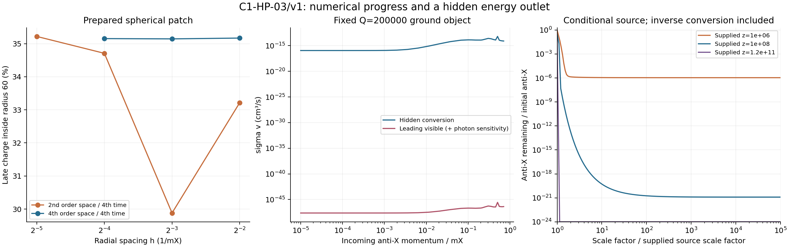

# C1-HP-03/v1: hidden conversion, core convergence and the remaining source gap

23 October 2026 · Codex / AInstein · parent c4b99f3

**This builder packet is complete. The working theory remains an unconfirmed
effective field theory, and the actual cosmological population is unfinished.**
The new deciding result is an existing hidden channel with a computed rate:
an incoming anti-X can leave as X while a ground object loses two charge units.
Closing emission of one free scalar does not force the released energy to
remain trapped until late portal decay. A conserving forward/inverse transport
prototype now implements this channel. An improved radial solver also brings
the prepared test core into subpercent grid and boundary agreement.

The soft asymptotic source remains incomplete. Neither the numerical agreement
nor the imposed-source transport is presented as a final abundance, detector
population, quantum lifetime or completed theory of reality.

## 1. The unchanged physical hypothesis

GRUT's present explicit model uses ordinary quantum matter and Einstein gravity,
plus the specified X, phi and D scalar sector and proposed Higgs portal. Charge
can organize into bound field configurations; those configurations alter probe
propagation and source the same adopted metric. The U(1)_X symmetry is global.
There is no X gauge field supplying Coulomb focusing in this action.

This packet keeps g_X=.1, lambda_phi=.03, lambda_X=.001,
v=.9240896374 GeV and kappa=9.0064e-10. It retains the original supplied Y_Q.
The scale was previously density-calibrated, and Q=200000 is a supplied test
object. It is not the charge produced by the prepared collapse below. No
quantum result at the old parameter point is transferred as a certificate.

The broader [working theory](../grut_unified_working_theory_20261022/WORKING_THEORY.md)
still supplies quantum dynamics, the Standard Model and Einstein spacetime.
Closure does not select those primitives or the initial state, and vacuum
density remains a separate underived input. No consciousness-dependent
interaction is introduced.

## 2. The capture inference is corrected by an actual rate

At the ground-object level,

\[
\mathrm{object}(Q)+\bar X(E)\to
\mathrm{object}(Q-2)+X(E+2\omega_Q)
\]

is allowed, up to finite-Q recoil and profile corrections. For a cold incident
anti-X the outgoing energy is approximately 251.573 MeV. The three-channel
perturbation matrix is derived from the actual quartic action. It retains the
closed, virtual scalar response. Higher angular modes, exact outer boundary
conditions, flux unitarity, reciprocity and inverse conversion are included.

| Incoming anti-X source | Conversion sigma v |
|---|---:|
| Cold limit sampled at p/m_X=1e-5 | 1.13039e-16 cm³/s |
| Scalar-at-rest daughter, E/m_X=sqrt(1.5) | 8.1225e-15 cm³/s |

These are weak-wave rates on the cold Q=200000 profile. They are not
geometric capture estimates or rates for an excited newly formed core.
The mechanism is established Q-ball physics, not a new GRUT law.

The portal also permits direct visible loss through an off-shell response.
Its leading inclusive timelike spectral integral retains the spatial S(r)
form factor, lepton thresholds and Higgs propagator. At the newborn daughter
energy, the lepton rate plus the parent's explicit photon-coefficient
sensitivity is **4.2311e-47 cm³/s**, or
5.21e-33 of the
hidden conversion rate. This is a restricted first-order scattering result;
it does not certify arbitrary trapped-excitation lifetimes, all multiparticle
channels, a BBN history or an observationally safe hot formation process.

## 3. Inverse conversion and redshift are now evolved together

The conditional transport uses the parent's imposed monoenergetic slow-s
daughter source, the original charge yield, identical cold Q=200000 objects
and the fixed-background scattering table. Using nu=E/m_X-q Omega makes
forward and inverse conversion local in nu. Exact positive two-state updates
handle rapid collisions; conservative redshift remapping tracks expansion
work. The background is a supplied cosmology, not a new BBN solution.

The finest 1601-node calculation gives:

| Supplied source redshift | Anti-X / initial anti-X | Forward events / initial pair | Inverse events / initial pair |
|---|---:|---:|---:|
| 1e+06 | 1.08e-06 | 1.30644 | 0.30644 |
| 1e+08 | 1.24e-21 | 34.1252 | 33.1252 |
| 1.2e+11 | 0 | 39830.6 | 39829.6 |

The reported zero is below numerical resolution, not a theorem of exactly zero
antiparticles. At z=1e6 the tiny remaining tail changes with grid size; it
is not a precision relic forecast. The early-source net conversion conclusion
survives the recorded factor-ten rate sensitivities. The sparse momentum
table does not uniformly certify interpolation through every narrow resonance.

This test illustrates why one cannot assume a single encounter is permanent
capture. At the early source there are many forward and reverse reactions,
followed by redshift below the reverse threshold. Net hidden charge transfer
can deplete the anti-X source without a compulsory late visible release.

For the parent's imposed source, nearly complete net conversion would transfer
about 12521.80 charges per reference object, or **6.261%**,
from the core into free positive carriers. The frozen-profile chemical-energy
ledger changes by about 996.512 GeV per object. That several-percent change
must be included in a future evolving-profile population calculation. The old
density calibration and detector forecast cannot simply be inherited, and
the initial charge is not retuned here.

## 4. The prepared radial core now has a controlled numerical improvement

Eighteen new full-field spherical runs were executed. Nine first isolate
fourth-order time stepping on the old second-order spatial Hamiltonian;
nine use an independent fourth-order nodal Hamiltonian in r*psi and r*(S-1).
The state, couplings and smooth Gaussian preparation are the same physical
method test, with an initial charge of about 3.90 million. It is much denser
and smaller than the actual primordial-density three-dimensional onset patch.

Late means use the last fifth of the run, normally tau=9600 to 12000.
The measured observable is charge inside radius 60/m_X, not a certified
asymptotic object charge.

| Run | h | Retained charge / initial charge | Max energy-plus-receiver error |
|---|---:|---:|---:|
| N025 | 0.25 | 35.169410% | 4.63e-06 |
| N0125 | 0.125 | 35.145033% | 3.03e-07 |
| N00625 | 0.0625 | 35.153212% | 1.85e-08 |
| N0125_time | 0.125 | 35.146286% | 1.88e-08 |
| N0125_abs | 0.125 | 35.226265% | 3.13e-07 |
| N0125_box | 0.125 | 35.176761% | 2.84e-07 |

The three finer nodal grids have **0.0693% relative
spread**. Halving the time step changes retention by at most 0.014% in the
two nodal controls. Halving absorber strength changes it by 0.231%; moving
the absorber and box changes it by 0.0903%. Moving only the extraction
radius leaves the final fields and retention unchanged. The fine grids
have more than ten points across the measured core radius.

**Richardson extrapolation is not certified.** The successive spatial
differences are nonmonotone. Formal order-four extrapolants are recorded
as diagnostics, not a continuum error bound. The stated one-percent
finite-time agreement gate is met; an asymptotic object, quantum lifetime
and three-dimensional population are not established. The older spatial
method's much larger coarse-grid deviations are preserved in full.

## 5. The escaping charge ratio is useful, but does not determine pairs

At the parent's distant probe the measured windowed charged-field ratio is
m_X Q_esc/E_esc=0.946113495. If that complete net flux were a
nonnegative free outgoing ensemble, its antiparticle **number fraction would
be at most 2.6943%**.
That is an upper bound. Kinetic energy alone lowers the ratio, including
for a pure X wave. The actual controlled positive/negative-frequency band
and its incoming-wave diagnostics are reported separately.

The new equal-time exterior projection preserves its masked canonical
charge and supplies mask/control sensitivities for all final snapshots.
It does **not** recover a complete particle source: local near-threshold
control remains incomplete, masks alter the represented field, and the
snapshot omits already absorbed radiation. The missing soft component
is not normalized into particles or added twice to integrated flux.
Formation times in these microscopic prototypes are not an established
cosmological daughter-production history.

## 6. Completed verification and concrete review surface

**18/18 new author check groups pass**, in addition to the fresh
replay of the parent's 13 implementation checks. These include independent
real-force differentiation, Hamiltonian finite variations, two origin
formulations, two/three-channel unitarity and reciprocity, optical loss,
Fourier-Bessel Parseval, quadrature and angular tails, transport conservation,
fine-grid/boundary agreement and lossless reconstruction of all 18 traces.
These counts are software/analytic controls, not experiments or independent
scientific certification. No second complete replay of the 18 production
evolutions is claimed. Earlier scientific packets remain unchanged.

The compact publication contains the report, executable code, recorded
JSON results and figure. The approximately 81 MB of raw histories, final
fields and lossless traces are retained in the builder workspace and
inventoried in RAW_DATA_MANIFEST.json; they are not part of this compact
GitHub commit. A fresh checkout can regenerate them with the documented
18 production commands before running the full data-dependent verifier.

The next deciding build is a conserving core-plus-exterior receiver with an
actual complete time/momentum source, then reaction transport with changing
object profiles. Only that output can support the abundance, nonthermal
structure, visible-deposition and revised detector chain. The requested
[Claude Code review packet](CLAUDE_HANDOFF.md) specifies the independent checks.
Publishing that packet does not mean Claude has executed it.

[Mathematics](MATHEMATICS.md) · [convergence](CONVERGENCE_RESULTS.json) ·
[rates](RATE_RESULTS.json) · [scattering controls](SCATTERING_CONTROLS.json) ·
[transport](TRANSPORT_RESULTS.json) · [exterior diagnostics](EXTERIOR_RESULTS.json) ·
[verification](VERIFICATION_RESULTS.json) · [reproduction](REPRODUCE.md) ·
[sources and scope](SOURCES.md).
