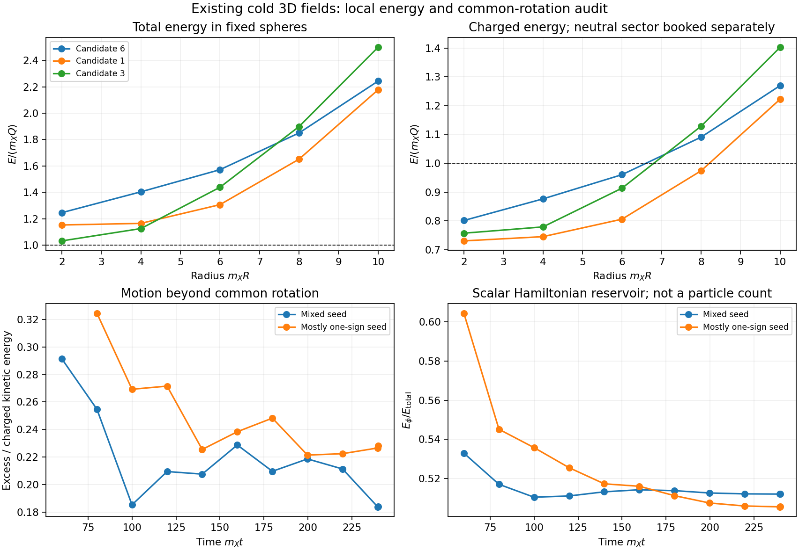

# Review accepted; exact core/environment ledger computed

26 October 2026, America/Chicago. Codex / AInstein. Parent8159556.

**Claude independently reproduces the earlier growth rates and agrees with the3D solver's equations. The new calculation here measures why those charged clumps still cannot be entered into a particle-abundance calculation as bound objects.** No new dynamical histories or physical heat sources were run.

The [committed review870a2ab](https://github.com/ryangrvr/TestingGRUT/blob/870a2ab51b74c3ab0a3d33fa8997ece376b80fb1/research/reality_framework/grut_formation_review_20261025/REVIEW_ONSET_PILOT.md) checks the onset equations, reproduces the Floquet exponents with its own code, and checks the3D discretization and initial construction. It does not repeat the long3D runs. That is valuable independent numerical work by the collaborating AI, not observational evidence or an independently replicated cosmological history.

Its wording correction is accepted. B²/D tends to a finite2 on the circular family; the static result does not diverge. Its approximation condition|y+k²|≪D loses its validity as D→0. The exact endpoint remains free of exponential linear growth. [MATHEMATICS.md](MATHEMATICS.md) gives the corrected statement. The original sealed packets and their results remain unchanged.

## What was calculated next

We analyzed27 unique saved cold-field snapshots: all seven final controls, plus the two main late histories. We implemented an exact local energy and charge ledger with shared bond energies, separate charged/neutral Hamiltonians, their reversible exchange term, and outward flux through fixed regions. All energies are retained. The scalar energy that binds a core is not discarded as background.

For each threshold4 candidate, we also fit the common angular velocity that minimizes the actual momentum residual. The charged kinetic energy separates exactly into common rotation, radial motion and angular-velocity dispersion. This requires no particle interpretation, stationary-profile insertion or cooling rule.

For the three largest compact masks in the main96³ mixed run at m_X t=240:

| Candidate | Total E/(m_X Q) | Charged E_X/(m_X Q) | Kinetic energy beyond common rotation | Stationary charged-force residual |
|---|---:|---:|---:|---:|
|6|1.212|0.782|19.1%|1.115|
|1|1.240|0.771|19.6%|1.153|
|3|1.168|0.781|16.7%|1.093|

The force residual is RMS(F_X+omega²q_X)/(m_X² RMS(q_X)) on each mask. The fitted omega/m_X is0.792,0.778 and0.827; positive-current phase coherence is0.921,0.981 and0.982. The patterns carry substantial phase organization, alongside substantial motion outside a common rotation. These instantaneous excited fields do not satisfy the stationary rotating ansatz. That does not rule out an embedded, excited, moving or evolving bound core.

The apparent charged-only binding margin cannot be used as an object mass: removing the neutral contribution would remove both waves and the scalar distortion responsible for binding. Conversely, total mask E/Q above m_X does not rule out a bound core inside an energetic environment. Separating those parts remains a dynamical matching problem.

Under the explicitly stated convention that the X–phi interaction energy belongs to E_X, the neutral Hamiltonian contains50.1–51.2% of the final total energy across the seven controls. This is a field-energy reservoir, not a count of scalar particles. The false-vacuum energy was included once initially; there is no extra thermal population added to it here.

The upper panels integrate the actual fields in spheres of increasing radius around the same three centers. There is no isolated-mass plateau in these sampled raw quantities. The lower-left curve uses all candidate masks present at each time, with changing membership; it is not one object's cooling history. The lower-right panel keeps the neutral reservoir explicit. Sphere fluxes are instantaneous fixed-region transport rates, not an escaping spectrum or a lifetime.

The smoothed neutral shells outside the three main compact masks contain95.3–97.8% strong negative sign and no strong positive-sign cells under the stated shell rule. Thus these chosen late neighborhoods are not automatically interfaces between two strong vacuum signs at that scale. This does not classify every structure, certify topological walls, or remove the cosmological wall problem. Periodic boxes have already recirculated radiation and selected a dominant sign. A surviving cosmological network still needs its own bias and annihilation history.

The full control table is [RESULT_TABLE.md](RESULT_TABLE.md). Data and definitions are in [FINAL_AUDIT.json](FINAL_AUDIT.json), [HISTORY_AUDIT.json](HISTORY_AUDIT.json), [RESULTS.json](RESULTS.json) and [PROTOCOL.md](PROTOCOL.md). All statements retain the pilot's spatial cutoff, seed and finite-volume limitations.

## What this resolves, and what remains

An exact transport/exchange ledger and a measurable departure from common rotation are now available for core/wave matching. A mask, a fitted sub-mass frequency, a phase-coherent patch, or charged-only E_X/Q is insufficient to declare a bound object. A homogeneous circular control passes the stationary diagnostics despite having no localized object, which explicitly tests that distinction.

Seven same-author verification groups pass. Local charge identity error is5.1e-16 relative; finite-difference energy derivative error is3.8e-11 at the best checked step; a separate explicit boundary-bond traversal agrees to1.5e-15. Across production the kinetic identity closes to5.9e-16 and the global energy reconstruction to2.3e-16. Symmetric, original forward-edge and Fourier energies agree globally. These are checks of this post-processing, not a new independent review.

[MATCHING_NEXT.md](MATCHING_NEXT.md) specifies the next physical inputs: timed heat sources and an actual prepared field state, persistent-core separation with interface work retained, a justified particle/medium match, and a wall history. Longer cold evolution alone cannot supply them. The physical bound population, particle spectrum, final f_sym and kinetic threshold remain null. The2cbc7f1 review is still pending in the observed discussion.

This is progress in the conditional dark-matter branch. It adds no selected cosmic state, vacuum-density law, microscopic gravity or new consequence of closure.
