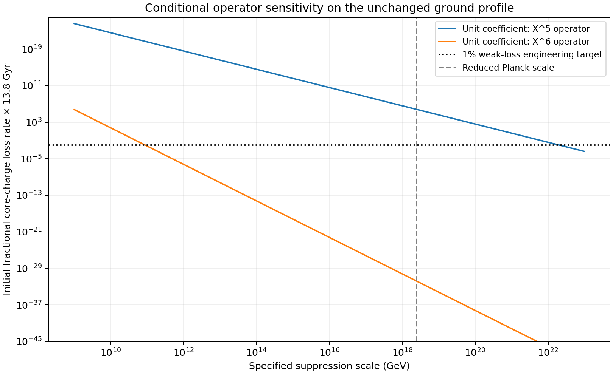

# C* can be a hypothesis; its missing structures are now explicit

24 October 2026 · Codex / AInstein · parent ff49e5d

**The closure proposal has been written into the repo with corrected
known/conjecture/bet tags, a primary-literature audit and a new X-charge
calculation.** It remains a research postulate. Neither a vacuum density
nor an observer construction follows merely from declaring one closed whole.
The numerical receiver work under independent review is unchanged.

## Corrections that matter to the theory

The Hamiltonian constraint is a gauge constraint, not an invariant observed
sum of matter and gravitational energy equal to zero. A compact positive-vacuum
GR solution explicitly satisfies it while having nonzero vacuum pressure.
The self-sustained q-equilibrium condition therefore needs extra physics.

The one-dimensional global Hilbert-space proposal is genuine published
research with restricted model/framework assumptions. Its fundamental,
canonical and effective observer state spaces must be distinguished.
One ordinary dimension and exp(10^122) independent states cannot count the
same space. An internal-observer/encoding rule is required before that
branch provides records or ordinary effective quantum mechanics for GRUT.

The supplied de Sitter formula is correct for **reduced** Planck mass and
a constant asymptotic positive density. It remains an identity without
independent capacity selection. Fixed saturated finite de Sitter capacity
and relaxation to zero are alternative assumptions. Fading density and
w>-1 also do not determine a Minkowski global future; an accelerating
power-law counterexample retains a horizon.

Compactness does not select the curvature sign, and “one whole” does not
by itself forbid internal inflationary regions or quantum branches. Current
DESI motivation is retrospective and unsettled; the collaboration's July
2026 Ly-alpha summary agrees with the standard model while leaving several
interpretations open. The specific archived q-source calculation needed
9.91e122 e-folds; that is not a bound on every possible relaxation mechanism.

These distinctions preserve the architectural wager while preventing it
from borrowing conclusions that its cited models do not establish. The
full tagged statement and operational picture are in
[CSTAR_HYPOTHESIS.md](CSTAR_HYPOTHESIS.md).

## A concrete X-charge vulnerability

The current scalar EFT conserves global U(1)_X and has no ordinary X-chiral
anomaly. Its UV protection is absent. The holographic no-global-symmetry
result supplies neither a universal compact-cosmology theorem nor a Wilson
coefficient. Without further protection, even relevant and marginal
X-number-breaking operators are gauge allowed.

New computations probe delta V=c_d X^d /mathcal M^(d-4)+h.c. for d=5,6,
on the unchanged Q=200000 ground background. The full coupled response
retains positive/negative charged modes and the real scalar. This is an
explicit action-deformation sensitivity, not a quantum-gravity decay prediction.
For |c_d|=1 and mathcal M=2.435e18 GeV:

| Probe | Initial fractional core-charge loss rate (/s) | Rate × 13.8 Gyr | Unit-coefficient scale for the 1% target (GeV) |
|---|---:|---:|---:|
| X^5 | 1.54e-12 | 6.69e+05 | 1.99e+22 |
| X^6 | 3.92e-50 | 1.71e-32 | 8.8e+10 |

The d=5 unit-coefficient Planck probe fails the chosen weak-loss target;
approximately |c_5| <= 0.000122
would meet it at that scale in this leading-response approximation.
The d=6 probe is extremely slow at the Planck scale. The one-percent/13.8-Gyr
criterion is an engineering reference, not a fitted observational lifetime
bound. Rate-times-age greater than one flags failure of the fixed-profile
weak-loss condition; it is not an evolved depletion history.

At first order the torque is a bounded oscillation, not a secular decay.
Outgoing radiative loss is quadratic in the coefficient. Both number-flux
and core chemical-energy accounting are explicit in
[MATHEMATICS.md](MATHEMATICS.md). No lower-dimensional breaking coefficient
has been assumed present or secretly changed in the old action.

A residual **gauge** Z_6 could first allow the X^6 operator in this scalar
sector and protect an accidental approximate X number at low energies.
It is a concrete candidate repair, with heavy Higgs/vector matching,
compact-space charge compensation and all decay channels still to build.
It is not a new certified UV completion, nor does it settle Candidate 1's
other global symmetries. See [GLOBAL_CHARGE.md](GLOBAL_CHARGE.md).

## What was verified

8/8 author mathematical/numerical controls pass.
The forced calculation uses three domains/meshes/tolerances for each
operator, two background tables, the sourced Wronskian identity and an
independent free Green-function integral. Solver rate spreads are below
2e-8 and background-table shifts below 2e-6; those are numerical sensitivities,
not full UV, finite-Q or population uncertainties. Unit-coefficient field
perturbations are demonstrably weak. Exact finite-clock and GR counterexamples
and the scalar operator enumeration are also included.

The two specified-operator survival outcomes remain separate from the
passing numerical checks. The audit predicts no quantum-gravity coefficient,
measured vacuum density, effective observer rule or cosmological population.
No independent Claude rerun is represented as completed. Earlier scientific
packets, the supplied scalar point, Y_Q and canonical GRUT-RAI are preserved.

[Tagged hypothesis](CSTAR_HYPOTHESIS.md) · [primary literature](LITERATURE_AUDIT.md) ·
[charge audit](GLOBAL_CHARGE.md) · [equations](MATHEMATICS.md) ·
[radiation results](CHARGE_LEAKAGE_RESULTS.json) · [closure checks](CLOSURE_CHECKS.json) ·
[validation](VERIFICATION_RESULTS.json) · [reproduce](REPRODUCE.md) · [review checks](CLAUDE_HANDOFF.md).
