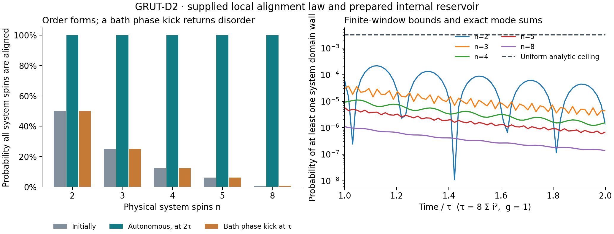

# GRUT-D2: autonomous ordering, reservoir records, and the remaining target

23 November 2026 · Exact finite construction and separate internal AI review

A connected chain of initially maximally mixed spins can become almost
entirely aligned under one fixed local Hamiltonian while a prepared internal
reservoir acquires a record of its initial defect count. A controlled bound
gives **ordering and count-decoding probability above 0.9968** at any chosen
time throughout the declared finite windows. A single endpoint disturbance
is followed by autonomous recovery above **0.9922** at the registered final
time, without resetting the reservoir.

This is a scoped partial construction of GRUT-D2. The preferred alignment
relation, a conserved orientation seed, a resonant interface and a pure
reservoir are supplied. The two absolute orientations are treated equally.
The stricter objective of deriving organization without an inserted target
class is not achieved. Neither active developmental feedback nor a new GRUT
physical law is established.

The separate review also falsified one frozen control forecast. A stationary
maximally mixed active system can transfer information initially correlated
with a diagnostic reference into its reservoir. That failure is preserved
in [CONTROL_CORRECTION_01.md](CONTROL_CORRECTION_01.md), not deleted from the
original protocol.

## Model and exact result

Let `n=m+1` physical spins have domain-wall occupations

\[
 w_i=\frac{1-Z_iZ_{i+1}}2,
 \qquad Q=\sum_{i=0}^{m-1}w_i+N_B.
\]

The [complete Hamiltonian](MODEL.md) contains the local Ising energy
`Delta*sum(w_i)`, nearest-neighbor wall hopping, a resonant wall/reservoir
exchange and ordinary XX reservoir hopping. Each physical term involves at
most three neighboring spins. Set `hbar=g=1`, `Delta=4`. The baseline has no
scheduled gates, measurement feedback, external bath or Markov approximation.
Its Schrodinger time parameter remains supplied; an internal physical clock
has not been constructed.

The physical-to-wall basis change is bijective. It turns the entire active
model into an inert orientation bit and a finite XX path of `m+L` sites.
This reduction is exact on the full Hilbert space; the large production runs
do not explicitly instantiate its exponential matrix. The physical dimension
is still `2^(n+L)`, not the small computational matrix size.

The chain starts in `I/2^n`, the reservoir in its vacuum, and an inert
diagnostic reference labels the initial wall count `K`. With `A(t)` the
system block of the finite one-particle path propagator, the exact Gaussian
baseline gives

\[
 \boxed{P_{\rm order}(t)
 =\det\!\left[I-\tfrac12 A(t)A(t)^\dagger\right]
 \ge1-\tfrac12\|A(t)\|_F^2.}
\]

Both aligned configurations count as organized, with no postselection.
Because `Q=K` is conserved and the reservoir starts empty,

\[
 K_{\rm guess}=N_B,\qquad
 \boxed{P(K_{\rm guess}=K)=P_{\rm order}(t).}
\]

The reference tags the past, and the newly generated record is the reservoir
count. It is a record of
the initial **number** of defects, not the entire initial spin pattern.

For `S2=sum(i^2,i=1,...,m)`, choose

\[
 L=64S_2,\qquad 8S_2\le gt\le16S_2.
\]

The [proof](PROOF.md) derives the finite-reservoir bound

\[
 \|A(t)\|_F\le\frac{2S_2}{\pi gt}
    +2m\left(\frac34\right)^{2(L+1)}.
\]

Using exact rational arithmetic with `pi>3.14` gives a displayed conservative
lower bound `0.9968305002231328` throughout every scored window. The numerical
mode sums give stronger sampled values; the uniform guarantee comes from
the proof, not interpolation or the grid. Reservoir size and waiting time
grow as `O(n^3)`.

| System spins n | Reservoir spins L | Dimensionless window gt | Initial order probability | Minimum over 65 numerical samples |
|---:|---:|---:|---:|---:|
| 2 | 64 | 8–16 | 0.5 | 0.999781839031 |
| 3 | 320 | 40–80 | 0.25 | 0.999962999584 |
| 4 | 896 | 112–224 | 0.125 | 0.999988838086 |
| 5 | 1920 | 240–480 | 0.0625 | 0.999994273550 |
| 8 | 8960 | 1120–2240 | 0.0078125 | 0.999998895976 |

These are single-read probabilities at any chosen time. They are not a
joint probability of continuous residence, a no-jump history, or a guarantee
under repeated measurements. Measurement backaction needs a separate model.



## Records, disturbance and causal controls

The reservoir count initially has zero information about K. Its minimum
sampled mutual information ranges from `0.9972500` bits at n=2 to `2.4466164`
bits at n=8, close to the corresponding initial binomial-count entropies.
Complete joint distributions `P(K,N_B)` are archived in [RESULTS.json](RESULTS.json).

At the beginning of each window, one specified physical endpoint X flip
usually injects an extra wall, at approximately `Delta` mean work. The same
Hamiltonian then removes it without any reservoir reset. The conservative
analytic order bound at the end is `0.9922835622546656`. The exact expected
wall number gives numerical union lower bounds from `0.999870724981` to
`0.999999105258` across the five cases. These are lower bounds on the final
order probability, not exact post-disturbance vacuum probabilities. A
number-conserving Gaussian vacuum determinant is deliberately not used
after the kick; the independent review exhibits an explicit failure of that
invalid calculation.

The old record also needs the disturbance included. The shifted decoder
`K_guess=N_B-1` has a weaker uniform success bound above `0.9891`. No unchanged
record is assumed across a process that changes the conserved excitation
sector.

Removing the interface preserves dimensions, preparation and initial mean
energy, and leaves the ordering probability at `2^(-m)`. Its energy variance
differs by `g^2/2`. It disconnects cooling and recording together and therefore
does not isolate the causal effect of stored information.

An additional bath-only staggered phase kick preserves the complete current
physical-system state and every current occupation/count readout. It changes
bath coherences and can return the system toward its initial disorder. For
n=4, the final order probability changes from `0.999998449610` to
`0.125004432050` under this intervention. The passive count record is
therefore insufficient to predict future behavior. This witnesses influence
from the coherent reservoir state, not an actuator reading a developmental
program. The phase controller and its timing are supplied. Mean work happens
to be zero for this preparation; energy variance can change and is archived.

The [control report](CONTROLS.md) accounts for all these differences and for
the short-bath recurrence. At n=2,L=1, order goes from 1/2 to 1 and back to
1/2 at gt=0,pi/2,pi. Finite closed unitary dynamics has no newly formed exact
attractor or perfect new plateau. Finite-window approximate persistence is
the result established here.

## Entropy and assumptions

Initially the active global entropy is n bits and the L reservoir spins are
pure. The closed evolution preserves total entropy and energy. In the n=4
case at the window start, the system entropy is `1.00017677` bits and the
reservoir entropy is approximately 3 bits. The orientation remains random;
wall entropy has moved into the reservoir. There is no entropy sink outside
the model. Initial reservoir purity is an explicit preparation resource.

| Item | Status and scope |
|---|---|
| Hilbert space, quantum unitary dynamics, Born probabilities | Adopted standard quantum mechanics |
| Chain, local couplings, Delta, g and interface | Supplied microscopic architecture and parameters |
| Identity source, vacuum reservoir and reference tag | Supplied initial state and diagnostic correlations |
| Aligned family and collective reservoir-count access | Supplied operational definition and readout |
| Two orientations treated equally | Derived global-flip symmetry; conserved first-spin seed remains supplied |
| Finite ordering, count record and specified recovery | Derived and numerically checked within this model |
| Unprogrammed developmental target or record-dependent controller | Unestablished |
| Physical observer, consciousness or a cosmological initial-state rule | Unestablished |
| Distinctive GRUT restriction or observation | Unestablished |

In D1's coherent four-register example, the regulated qubit was pure both
initially and finally. Its specified-basis outcome entropy decreased, while
its von Neumann entropy did not. The final memory/actuator pair is entangled
for the coherent source, or only classically correlated for a diagonal mixed
source. Three scheduled CNOTs alone did not specify autonomous time or energy
resources. These corrections are retained rather than carried into D2.

## Freeze, verification and reproduction

The model and design protocol were published at
[8e3a077](https://github.com/ryangrvr/TestingGRUT/commit/8e3a0773dbb4d8d54cb9261f12e76e2129fae403)
before finite D2 production. Exploratory pre-freeze half-line Bessel and small
matrix checks are disclosed in the [execution record](EXECUTION_RECORD.md).
The code was implemented after the design
freeze. This is neither an empirical holdout nor a frozen-code prediction.
The two frozen files are byte-preserved and identified by [FREEZE.json](FREEZE.json).

The separately tasked reviewer built full physical Pauli matrices for nine
small cases, n=2,3,4 with L=1,2,3. Those full matrices validate the wall
reduction, symmetry, initial energy moments, complete count distributions,
ordering, kick, echo, entropies and echo variance. The maximum discrepancy
is `4.09e-14`. The [review](CRITIC.md) and [raw review record](INDEPENDENT_CHECK.json)
are included. This is a distinct implementation on small matrices by another
AI in this Work run; it is not an external RAI session, human peer review or
a full exponential-matrix replication of the large reservoirs.

Same-code replay reproduces 325 archived time rows and 10,200 numerical
fields exactly in the recorded runtime. Deliberately forged physical success,
a corrupted probability and deletion of the failed-control verdict are all
rejected. [VERIFICATION.json](VERIFICATION.json) records those checks. These
counts measure replay coverage, not independent confirmations of physics.

A copied-folder replay outside the checkout also reproduces both records.
It reuses the installed pinned dependencies and does not claim a fresh
dependency installation or separate-machine replication; see
[PORTABILITY.json](PORTABILITY.json).

From this directory, with Python 3 and the pinned dependencies available:

```bash
python3 -m pip install -r requirements.txt
OPENBLAS_NUM_THREADS=1 python3 verify.py --output /tmp/grut_d2_verification.json
OPENBLAS_NUM_THREADS=1 python3 independent_check.py > /tmp/grut_d2_independent.json
```

`verify.py` re-evaluates the finite model and uniform gate arithmetic against
the stored results. It exits with failure on changed frozen files or a
material mismatch. `run.py --output /tmp/grut_d2_results.json` writes a fresh
production record. The optional plot uses `requirements-plot.txt` and
`python3 plot.py`; plotting is not needed for either physics check.

## Relationship to established physics and GRUT

The transport mechanism belongs to established quantum spin-chain and
finite-reservoir physics. Relevant primary precedents include
[Bose, unmodulated spin-chain quantum communication (2003)](https://arxiv.org/abs/quant-ph/0212041)
and [Longhi, exactly soluble tight-binding decay (2006)](https://arxiv.org/abs/quant-ph/0611164).
They contextualize transport without switching gates and decay into a chain;
this packet's physical-spin mapping and bounds are derived explicitly above.
No literature-wide novelty claim is made.

The positive result is that a closed interacting whole can exhibit useful
local ordering, an internal past-state record and recovery using prepared
resources. Closure alone does not force those conditions. An interacting
Hamiltonian with a fully maximally mixed whole, including all references,
is a counterexample to universal generation of records. A universe-selection
claim would need an extra physical restriction that excludes such cases and
has a falsifiable cosmological consequence. This packet supplies none.

**Scoped mathematical construction: completed. Full target-free GRUT-D2:
not achieved. Physical novelty and cosmological identification: unestablished.**
Candidate 1's quantum-binding program and prior scientific verdicts are
unchanged. The work is published for review on a separate branch; it does
not authorize a merge, release or change to canonical theory claims.
