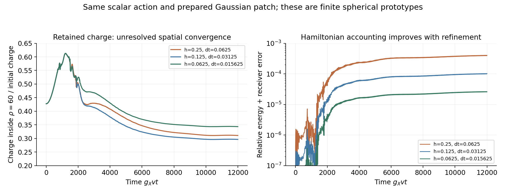
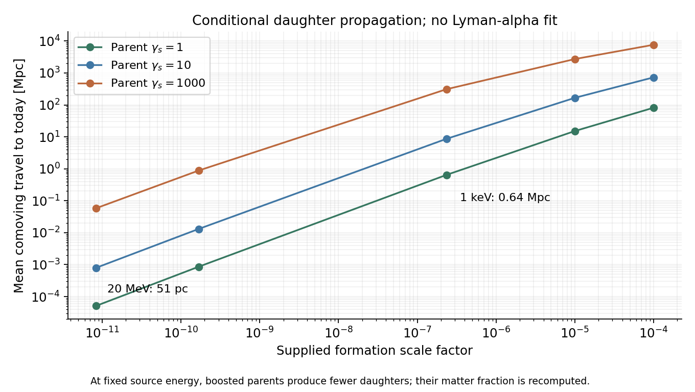

# Daughter tests and the first full-field core prototype

23 October 2026, America/Chicago · Codex / AInstein · parent d71cc01

**The free daughters do not cheaply exclude the stated early source. The
formation prototype does expose a major unresolved population assumption.**
Cold free-pair annihilation is extremely small, the proposed one-free-s
capture cycle is kinematically closed, and the nominal 20 MeV source has
a short collisionless travel distance. Eight spherical full-field runs
form concentrated cores while ejecting mostly charged-field energy.
However, their late core charge is not spatially converged, and part of
the soft emitted field still lacks a controlled particle interpretation.
There is no complete final population or new detector forecast here.
Archived loop calculations at the old benchmark are not transferred as
a quantum binding or lifetime certificate for this parameter point.

## 1. Explicit parameter version and recomputed quantities

This packet names the new point **C1-HP-03/v1**. It is the proposed
Candidate 1 Higgs-portal action with g_X=.1, lambda_phi=.03,
lambda_X=.001, h_D=.01, m_D0=.1v, lambda_D=.001,
v=.9240896374 GeV and kappa=9.006401967e-10. The original supplied
Y_Q=4.8294009077e-9 is retained. v was calibrated to the preceding
conditional total matter budget; it is not a prediction. Q=200000 was
a supplied test charge, not a formation result.

The required mass condition is explicit:
**m_s>2m_X iff lambda_phi>2g_X^2.** At this point m_X=92.409 MeV,
m_s=226.355 MeV, and Gamma_s=1.73336e-5 GeV. The free-vacuum lifetime
is 3.79731e-20 s. The old lambda_phi=.01 point retains its closed hidden
channel and its recorded slow-debris failure.

| Quantity at the new point | Value and scope |
|---|---|
| Reference object mass / binding | 17,064.54 GeV / 7.6684%; supplied Q=200000 |
| Nominal object / free-X matter fractions | 93.6494% / 6.35026%; conditional slow-s, nonreacting source |
| Median historical XENONnT kappa reach | 8.45944e-10; already recomputed at THIS point in the parent |
| More restrictive approximate LZ upper screen | 9.58872e-10; not a full LZ likelihood |
| Neutral wall tension | .128863 GeV^3, cube-root 505.10 MeV |
| Standard surviving-network tension ratio | 2.42e8 relative to the named (.81 MeV)^3 bound |
| Conditional leading high-T zero-curvature temperature | 1.671 GeV; common equilibrium/zero chemical potential, not an actual transition history |
| Dilute linear growth at the supplied 20 MeV density | Gamma/H=1.3955e8 |
| Fastest-wavelength cube charge | 1.4484e11; a diagnostic, not a final object charge |
| Bulk objects alone at fixed original charge yield | 75.0646% of the calibrated matter; replaces the old 62% diagnostic at this point |
| Bulk plus slow-s daughter rest matter | 96.5896%; same conditional source assumption, not a produced population |

The wall comparison applies only to the specified ordinary surviving
neutral network. A transient negative phi in a finite radial collapse
is not a cosmological network. The new point's mass, abundance, wall and
onset numbers are computed here; its detector numbers are explicitly
pinned to the parent's point-specific calculation, not the old benchmark.

## 2. Three daughter tests

**Free-pair annihilation.** I derived XX* -> SM from the two mixed scalar
propagators and checked the ee normalization independently with an
invariant spin sum. The nominal cold rate is 2.58e-51 cm^3/s. With the
conditional symmetric free-X fraction and all injected SM energy counted,
p_inj=5.64e-53 cm^3/s/GeV: about 1.76e-25 of the named Planck 2018
energy-injection screen. Even a separate light-pole envelope over
2m_X<=W<=2 GeV stays below 5.94e-13 of that screen if ALL matter were
free symmetric X. The nominal and photon-sensitivity choices are retained.
These are leading free-particle rate screens, not a CMB fit or a bound
on emission by trapped excitations in dense cores.

**Capture/recycling needs a correction.** A cold incoming antiparticle
plus removal of one bound constituent can release at most m_X+mu_-,
where mu_-=E(Q)-E(Q-1)<=m_X for an object stable against that emission.
Here m_X+mu_-=171.991 MeV, below m_s=226.355 MeV. The exact neighboring
integer-charge profiles leave a **54.36 MeV deficit** for the proposed
single free on-shell s. Even an antiparticle just born from an s at rest
has insufficient energy for that particular capture final state.
Capture into excitations, hot incident particles, multi-particle states
and off-shell visible emission remain uncomputed. A tiny vacuum branching
fraction alone cannot certify the lifetime of trapped, recycled energy.

**Free streaming is controlled by formation time and the source spectrum.**
For the conditional s-at-rest source, daughters have gamma=sqrt(1.5),
speed .577c and 20.77 MeV kinetic energy each. Integrating their redshifting
momenta on the declared background gives:

| Supplied formation epoch | Comoving collisionless travel to today |
|---|---:|
| Visible T=20 MeV | 51.1 pc |
| Visible T=1 MeV | .858 kpc |
| Visible T=1 keV | .644 Mpc |
| z=100000 | 15.2 Mpc |

An instantaneous electron-entropy-change sensitivity shifts the first
distance to 52.1 pc. The exact radiation-era integral agrees with direct
quadrature. Boosted-source sensitivity rows include both the changed
momentum spectrum and reduced number/rest-mass budget at fixed charge.
Early cold-source daughters therefore do not automatically constitute a
problematic warm component. Late or harder formation can be materially
different. No thermal-WDM mass bound is relabeled as a limit on this
nonthermal mixed population; a Boltzmann/structure/Lyman-alpha calculation
with the actual source remains necessary.

## 3. A concrete core evolution now exists, with a disclosed hierarchy

The new C++ finite-volume solver evolves the full bounded X,phi equations
in spherical symmetry, with the same dimensionless couplings. It starts
from a supplied Gaussian charged patch and an elliptically solved neutral
profile. Canonical momenta, gradients, charge and energy are explicit.
At the initial map Qbar equals the NR norm and Ebar=Qbar+H_ad, retaining
the neutral gradient energy. No target soliton charge is imposed.

The two amplitude/width families initially contain about 3.90 million and
7.79 million charges. These are **hierarchy-reduced prepared prototypes**,
far denser and smaller than the actual primordial-density 3D onset patch.
They are not an extrapolated cosmological charge distribution, a derivation
of the primordial charge, or a match to the earlier saved 3D trajectory.

Eight evolutions cover time/space refinement, a larger box, two more distant
probes, a longer run and the smaller initial amplitude. Every family
develops a core and outgoing flux. At the distant probe, about **99.26% of
the measured escaping field energy is charged X-field flux**, with .74%
in scalar waves. Thus direct charged emission must accompany scalar-decay
daughters in the population calculation. It cannot be replaced by the
earlier all-release-as-s preparation.

The scalar's vacuum lifetime is prompt cosmologically but spans roughly
917 light-crossing times of the reference Q=200000 core. It should not be
removed from the microscopic core equations as an instantaneous decay.
The classical calculation diagnoses the outgoing source before applying
a separately stated free-decay completion. D=0 remains exactly zero in
this classical truncation; quantum D production inside cores is not invented.

## 4. The unresolved outputs are measured, not hidden

Two population gates are **not met**:

- For the same Gaussian family, late charge inside radius 60/(g_X v)
  ranges from **29.7% to 34.4%** of initial charge across the three spatial
  grids. Time and box controls also shift it. Cores form, but this is not
  a continuum-certified retained charge, asymptotic object identity or dN/dQ.
- Soft charged flux cannot all be treated as free particles at the available
  probe radii. A declared cut requires kinetic k^2 to exceed ten times the
  measured local mass-squared correction. Its outgoing charged-energy
  coverage improves from about 27% nearby to **69.25%** at the distant probe,
  still below the 95% completeness target. This cut controls one coefficient,
  not every approximation error. Incoming and finite-time/window diagnostics
  are retained. The excluded soft/coherent component is not assigned an
  artificial particle number.

The packet returns core-charge histories, total charge/energy ledgers,
escaping field traces, and **restricted** X, X*, D number/momentum spectra.
Those spectra include direct charged emission and isotropic vacuum decay
of the eligible scalar band, with daughter energy and net charge checked.
They assume no subsequent scattering or recapture. They are not normalized
to a complete final population or imported into a new xenon forecast.

## Verification and next construction

**13 implementation/scoped-rate control groups pass.** They include a
direct annihilation spin sum, integer-charge chemical potentials, boosted
daughter conservation, an analytic free-streaming control, finite variation
of the full discrete Hamiltonian versus executable C++ forces, positive/
negative charge and real-wave normalization, Parseval, decay folding and
lossless trace reconstruction. In all eight runs, charge plus the numerical
absorber receiver is conserved within 1.93e-11. The finest run's maximum
energy-plus-receiver error is 2.65e-5, with the expected refinement decrease.
That does not repair the failed population-convergence gates.

The five physical-completeness gates remain open: converged retained charge,
complete asymptotic particle extraction, remaining capture/visible leakage,
the nonthermal structure comparison, and actual primordial-density 3D
formation. A point-calculation replay and exact trace hashes are recorded;
there is no claim of a second complete replay of all eight core runs,
independent replication, empirical validation or new quantum lifetime.
One case was rerun to restore a damaged trace shard; its full-array hash
and scientific summary exactly matched the originally recorded run.

The next build should resolve core convergence and the soft outer field,
then supply the actual source to the capture/reaction and cosmological
transport calculation. Claude's [handoff](CLAUDE_HANDOFF.md) makes those
tasks concrete. The total vacuum density remains a separate, underived
input. Earlier scientific packets and canonical GRUT-RAI remain unchanged.

[Equations](MATHEMATICS.md) · [parameters](PARAMETER_POINT.json) ·
[daughter results](DAUGHTER_RESULTS.json) · [core results](CORE_RESULTS.json) ·
[spectral results](SPECTRAL_RESULTS.json) · [verification](VERIFICATION_RESULTS.json) ·
[sources](SOURCES.md) · [reproduction](REPRODUCE.md).
