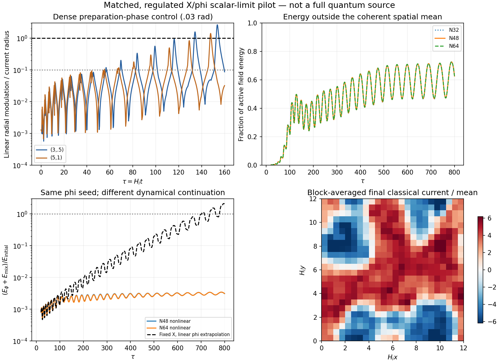
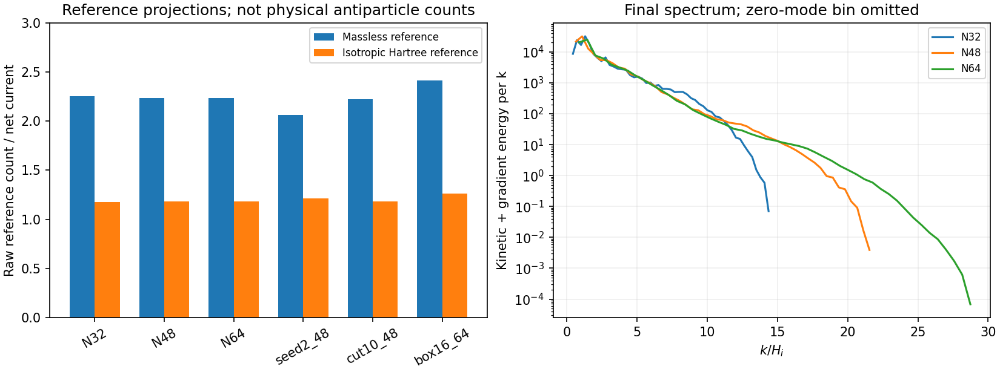

# Early nonlinear pilot: fragmentation changes the neutral-field forecast

27 October 2026, America/Chicago. Codex / AInstein. Parentb73de64, reviewec1eb7f.

**A matched, regulated three-dimensional X/phi calculation develops strong charged inhomogeneity before the prescribed X-sector decay heating. Its nonlinear continuation keeps neutral energy far below the fixed-homogeneous-orbit extrapolation. The physical antiparticle population is still not determined.**

This is a leading scalar-limit pilot. All X/Y/Sigma/phi fluctuations enter the initial linear Gaussian preparation; only X and phi subsequently evolve nonlinearly. The full gauged action, heavy-field feedback, quantum counterterms/collisions and actual mediator/vector injection are not evolved. The result is a computed conditional field history, not a complete cosmological point.

## Review corrections incorporated

The completed [ec1eb7f review](https://github.com/ryangrvr/TestingGRUT/blob/ec1eb7f860f98f8d889f90ff94ebd53396f740bb/research/reality_framework/grut_formation_review_20261025/REVIEW_TIMING.md) reproduces the earlier response and clocks with several separately authored formulations. Its sampling correction is right. On a new.025 grid, the quiet(3,.5)10% warning lies at tau56.45–56.475. The maximum through80 is20.174%, superseding8.88% in the sealed2cbc7f1 packet. Corrected Y_L warning fractions are5.68e-6 by number and1.01e-8 in prescribed conformal injection. The earlier sparse warning/clock/plot values are superseded here; old input packets stay intact.

The seed is explicitly a **Sigma preparation-phase derivative**, with X initially real and conditional amplitudes readjusted. It is not an X-phase rotation. Local unit modulation occurs near pericentre; a full-vector/orbit-size criterion crosses later, around197/214 on the new scanned grid and specified norm. Exact k0 has no exponential auxiliary growth but can have secular Jordan drift; a full-system relative preparation phase is not a pure gauge symmetry. The early Y_H cascade is clocked separately and supplies no direct heat into X. Those wording corrections are accepted.

The review's reasonable Gaussian-state estimates support substantially larger seeds than the earlier tiny controls. They do not select a unique state or bound every squeezed/conditioned quantum state. Likewise the10^-720 estimate extrapolates an unquenched fixed-orbit growth law; it is not an all-state theorem for the nonlinear system. The review's neutral catch-up at665–697 marks failure of its homogeneous linear extrapolation, rather than a computed physical phi population after the charged sector has already fragmented.

## What was built and run

We propagate a specified instantaneous conformal Gaussian on the finite band1.8<=k/H_i<=8 through the full six-real-field X/Y/Sigma tangent system and the independent phi system, from tau0 to20. The light marginal at20 initializes a nonlinear three-field Hamiltonian with the original quartics and g_X²phi²|X|² coupling. No object size, cooling, particle number or condensation recipe is inserted. A cutoff10 control adds higher seed modes. The missing IR/UV completion and cosmic-state selection are not supplied.

The radiation scalar limit has no appreciable v/H_i scale, and retains phi's full backreaction within the active sector. Matching to the original homogeneous/linear evolution through50 gives0.55% background, about1% charged-response and1.5–2.7% neutral-transfer differences. These measure the early approximation; they do not certify the later nonlinear full theory. The frozen-Sigma/quadratic-Y force estimate stays around0.45% or below. Gauge and subsequent heavy-field dynamics remain separate dependencies.

Seven histories run to tau800:32³/48³/64³ at L=12, half time step, second seed, upper seed band10, and L=16,N64. All have actual bulk sampling at Delta tau<=.05, with.025 in the half-step case. The continuous finite-band random functions are identical across the spatial refinements. Charge and seed energy are measured without retuning.

The current slice is classical current, including local negative values; it is not a particle/antiparticle image or a catalog of bound objects. The neutral comparison uses the same energy convention on both curves. The fixed-X curve becomes an unphysical extrapolation as its growing energy would require backreaction.

## Measured outcomes

The charge-contrast RMS reaches the mean around tau60.5–60.9 across controls. The charged-field variance outside its mean reaches half the total at about69.2–69.25. These are operational diagnostics with pericentre dependence, not unique definitions of a physical breakup time.

At tau800, about61–65% of active energy lies outside the coherent spatial mean. The mean charge can exceed the net current because nonzero modes carry an opposite net contribution. Neither quantity is an object-retention fraction or an antiparticle count. The energy exchange remains time-dependent;800 is not a freeze-out or a final thermal state.

The neutral Hamiltonian alone holds about0.19–0.27% of the energy. Including the full interaction for comparison with the linear neutral control gives0.28–0.36%. The same initial phi realization on a prescribed homogeneous reduced X orbit instead extrapolates to2.09 times the initial active energy by800. That control uses the same discrete momenta, includes the interaction and makes no vacuum subtraction. Its difference from the nonlinear run demonstrates that the prescribed-pump extrapolation cannot be carried through this nonlinear continuation. It does not exclude different behavior in the uncomputed full quantum/gauge/heavy history.

The main48³ and64³ runs have energy outside the mean62.722% and62.734%, and neutral-plus-interaction energy0.3098% and0.3124%. Seed, volume and preparation dependence remain visible. [RESULT_TABLE.md](RESULT_TABLE.md) gives all controls; no ensemble confidence interval or continuum quantum population is inferred.

## A field source is exported; a particle source still needs matching

The measured nonzero-mode field covariances, mean fields and separate potential energy are exported in [SPECTRAL_EXPORT.npz](SPECTRAL_EXPORT.npz), with the conventions and exact reconstruction checks in [EXPORT_CHECKS.json](EXPORT_CHECKS.json). This supplies an actual nonlinear field input rather than one of five chosen antiparticle numbers. It does not replace that bracket with an unjustified population.

In the main run, a massless Fourier reference gives2.238 nonzero-mode negative-charge quanta per net current, while an isotropic Hartree reference gives1.180. These are **raw classical reference projections**, excluding the coherent zero mode; they have no automatic physical-particle interpretation. They use the same fields and reproduce the same conserved charge. Their roughly1.9-fold difference is much larger than the grid/time changes and must be resolved by dynamics, not by selecting the answer closer to a desired relic abundance.

[PARTICLE_MATCHING.md](PARTICLE_MATCHING.md) specifies the next calculation: unequal-time statistical correlators and retarded response in the measured medium, a justified quasiparticle/condensate decomposition, quantum matching of the seed contribution and collision terms, then transport through the actual heat sources and later binding transition. The initial Gaussian is not preserved as a Gaussian by nonlinear evolution; equal-time covariance alone does not close those dynamics.

The classical statistical approximation with vacuum-type fluctuations has known ultraviolet matching limitations (Epelbaum, Gelis and Wu, [arXiv:1402.0115](https://arxiv.org/abs/1402.0115)); their kinetic counterpart is studied by Epelbaum, Gelis, Tanji and Wu, [arXiv:1409.0701](https://arxiv.org/abs/1409.0701). These results motivate retaining the present outputs as regulated classical field data. A full quantum vacuum/population is not established by sampling half-quanta on a lattice.

## Verification and status

Seven same-author groups pass. A genuine3D C++/independent FFT-DOP853 comparison agrees to5.0e-13 absolute; homogeneous time refinement shows fourth order. The continuous seeds agree across shared grid points to1.2e-13. Preparation transfers preserve canonical identities to7.3e-11. Across all histories, maximum recorded relative energy deviation is1.30e-8 and charge deviation1.87e-14; the half-step energy deviation is7.82e-10. The scalar exchange-work ledger closes to5.1e-7 of initial active energy. Exported charge and energy reconstruct to4.5e-16 and2.3e-16.

These checks establish the stated numerical pilot, not external validation or the complete EFT. Physical nbar, f_sym, kinetic threshold, bound-object population and distinctive signal remain open. The late biased phi-wall history and vacuum-density question are unchanged. Closure supplies no new law in this packet.
