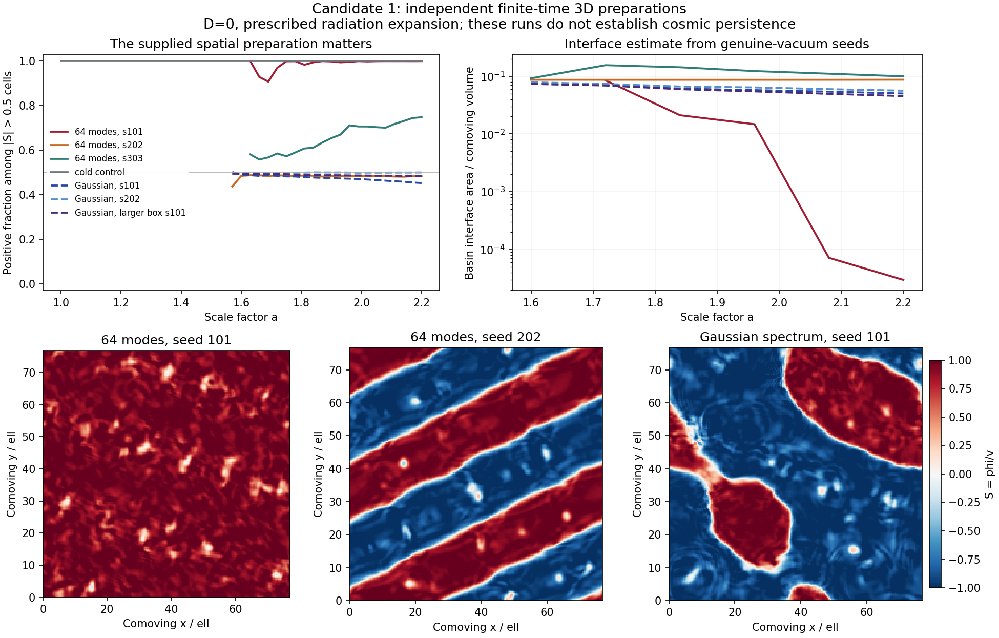

# Independent 3D charged-exit cross-check

21 October 2026. Start with [REVIEW.md](REVIEW.md).

**Three Gaussian-spectrum 3D preparations form both vacua and retain a box-winding
two-sign structure throughout the recorded post-formation window.** This independently
supports the finite-time formation link in Claude's `c7b8480` packet. The source is
a separate C++ implementation; the conformal-variable mathematics and action are shared.

**The outcome depends on the preparation.** Of the three original 64-mode seeds,
two form substantial regions of both signs and one evolves toward almost a single
positive vacuum. That one-sign outcome survives timestep halving, two spatial
refinements and a larger box. A sparse finite global-mode ensemble is not a thermal
ensemble; this is not a refutation of Claude's specified hot history. The expanding
cold-branch control has no opposite-vacuum cells by the recorded criterion.

| Item | Executed evidence | Limit |
|---|---|---|
| Production | 9 original-suite runs + 3 separately frozen exploratory Gaussian controls | Two further original large-box seeds not launched at the frozen cost cap. |
| Grids | Up to 384^3 at L=76.8; larger boxes at 288^3, L=115.2 | Periodic boxes, finite window, D=0. |
| Gaussian formation | a in (1.54,1.57], all three runs | No physical thermal bath; supplied classical spectrum. |
| Gaussian persistence | Both vacuum phases wind all axes at every recorded post-formation topology output to a=2.2 | No cosmological lifetime or infinite-volume probability. |
| Conservation | Maximum relative charge drift 9.64e-14; sampled conformal work residual <=0.1182 percent | Internal numerical gates, not empirical evidence. |
| Convergence | One-sign outcome unchanged; several scalar differences are small | Strict decreasing-error criterion not met; forming-network convergence remains unestablished. |
| Controls | 24 current solver checks + 6 Gaussian-wrapper checks pass | Two failed pre-production records retained. Not outside replication. |

One correction to Claude's report: the one-speed Lorentz factor 1.124 is not an
upper bound of 12 percent on the area-to-energy conversion. The correct statement
depends on the weighting and the speed distribution. Also the quoted 0.456 is rms
speed, not mean squared speed. See [DERIVATION.md](DERIVATION.md).

The complete field energy is accounted for. A unique split into charged-wall energy
and receiving waves is still missing. The recorded core-based velocity proxy can
exceed one, exposing its failure as an actual wall speed in those states. This is
not superluminal motion.

The lower panels are central slices at a=2.2, not a reconstruction of a full
population. All fractions and topology in the upper panels come from the full grids.

The physical scale, net hidden yield, production and primordial correlations remain
external inputs. No held-out observation was predicted or compared. The outcome is:
**the model cannot yet make a discriminating empirical prediction because identified
inputs or calculations are missing.** A new mechanism is not empirically identified.

- [Exact run table](RUN_TABLE.md) and [machine-readable results](RESULTS.json).
- [Assumption and claim ledger](ASSUMPTIONS.md).
- [Original protocol](PROTOCOL.md), [first amendment](AMENDMENT_01.md),
  [timestep correction](AMENDMENT_02.md), [source freeze](SOURCE_FREEZE.json).
- [Exploratory Gaussian protocol](GAUSSIAN_CONTROL_PROTOCOL.md) and
  [separate source freeze](GAUSSIAN_SOURCE_FREEZE.json).
- [Reproduction commands and read scope](REPRODUCE.md).
- [Raw diagnostic manifest](RAW_MANIFEST.json); scalar/topology/configuration/mode
  records are losslessly archived. Full evolving fields are not archived.

Next dependency: numerical convergence of the Gaussian-forming network and justified
physical-history matching, plus an independently calibrated empirical target. The
current packet does not adopt new action terms or silently repair a failed preparation.
