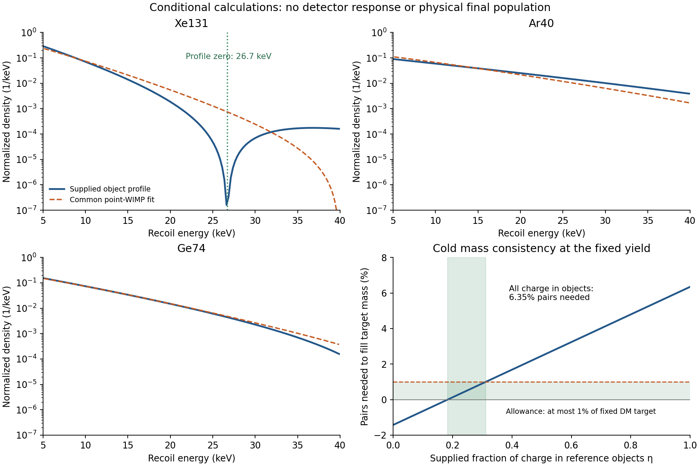

# The five requested outputs: derived relations and remaining free data

27 October 2026, America/Chicago. Codex / AInstein. Parent eff5ee2.

**The current equations do not uniquely determine all five outputs.** They do give
an explicit state family, a linked pair of effective couplings, a conditional recoil
prediction, and a necessary final-mass constraint. They leave the actual cosmic state,
formed population and vacuum density unselected. Choosing those missing quantities
would supply a new hypothesis or calibration, rather than finish a derivation.

| Requested output | What this calculation determines | What remains supplied or unsolved |
|---|---|---|
| State | Distinct pure, neutral physical states with the same constraints and initially blank records | A rule selecting the actual cosmic preparation |
| Coupling relation | Both heavy-mediated sextic coefficients obey 2\|A\|/B=r; numerical values at the stated point below | Values of the underlying couplings and full matching/RG |
| Observable | An ideal elastic form-factor zero at q=80.743 MeV for the supplied object; target-energy relation below | Physical object population, viable portal, detector response and likelihood |
| Final object abundance | Exact charge/mass ledger; a narrow conditional population requirement at fixed yield | Formation, number-changing evolution, distribution of Q and surviving pairs |
| Vacuum density | The reference value and conversions; an explicit allowed constant-offset family | A law selecting the renormalized offset or a dynamically produced residual |

## 1. State: prove the freedom instead of selecting a favorite

Using the preceding exact finite physical dictionary, define

\[
|\psi_{p,\varphi}\rangle=
\big[\sqrt p\,|010\rangle_{XCR}
+e^{i\varphi}\sqrt{1-p}\,|100\rangle_{XCR}\big]|+\rangle_P,
\quad |\Psi_{p,\varphi}\rangle=\frac12\sum_t|t\rangle W_t|\psi_{p,\varphi}\rangle.
\]

Every member satisfies CΨ=GΨ=0, global purity and blank initial records. The two
p=.25 and .75 states have equal subsystem entropies but opposite X expectation
values −3 and +3 and different later record probabilities. At p=.5, phases 0 and π
have identical local charge statistics and opposite physical joint coherence. The
state is therefore not selected by these requirements. These are finite constrained
counterexamples, not competing calculated cosmic histories.

The dark-sector background and its Gaussian reference family remain explicit
preparation inputs. No new phase holder, gravitational wavefunctional or continuum
state-selection rule has been introduced. See [STATE_FAMILY.json](STATE_FAMILY.json).

## 2. Couplings: a definite matching relation

In unitary gauge Σ=h/√2, eliminate the quadratic heavy Y field. Write

\[
\Delta V=-B|X|^6+(AX^6+\mathrm{h.c.}),\qquad
r=\frac{\sqrt2|\mu|h}{M_Y^2}<1.
\]

Then, in the real-coupling phase convention,

\[
B=\frac{|\kappa|^2}{M_Y^2(1-r^2)},\qquad A=\frac{rB}{2},
\qquad\boxed{\frac{2|A|}{B}=r.}
\]

This is the compulsory torque/radial companion relation already derived in the gauge
bridge. Here it is evaluated at the current heavy point and checked independently
with real and complex heavy-field matrix minimization:

* r = .45;
* B = 9.37271×10⁻³¹ GeV⁻²;
* A = 2.10886×10⁻³¹ GeV⁻².

The supplied light couplings also give m_X=92.409 MeV, m_phi=226.355 MeV and
m_phi/m_X=√6. These are conditional EFT relations. They do not determine the input
couplings from closure. The elimination requires controlled fields and frequencies;
it is not a replacement for the nonlinear inflationary release or full quantum matching.
See [COUPLING_RELATIONS.json](COUPLING_RELATIONS.json).

## 3. A computed conditional observable

Use the stored refined Q=200000, lambda_phi=.03 profile, at v=.9240896374 GeV.
Its recomputed mass is 17064.53745 GeV. The static Higgs-portal source is proportional
to the binding-field depletion. Its normalized form factor is

\[
F_Q(q)=\frac{\int d\rho\,\rho^2[1-S(\rho)^2]
\operatorname{sinc}[q\rho/(g_Xv)]}{\int d\rho\,\rho^2[1-S(\rho)^2]}.
\]

The first zero is **q₀=80.7428 MeV**. The ideal elastic feature therefore appears at
E_R=q₀²/(2m_A):

| Mono-isotope target | First source zero, recoil energy | Inside the fixed 5–40 keV primary window? |
|---|---:|---|
| Xe131 | 26.713 keV | Yes |
| Ge74 | 47.290 keV | No |
| Ar40 | 87.486 keV | No |

The profile predicts the same momentum-space feature across targets; the energy scales
inversely with nuclear mass. The comparison windows were fixed before this calculation
and have not been expanded to include the other nodes. This source zero is independent
of a smooth nonzero halo factor in the ideal single-charge elastic spectrum. A Q mixture,
isotopes, resolution, inelastic processes and backgrounds can fill it. No exact zero
in a real detector is predicted without those calculations.

In the fixed 5–40 keV windows, independently fitted point-WIMP masses are 22.553 GeV
(Xe131), 28.056 GeV (Ar40), and 22.143 GeV (Ge74). One common point mass fits at
22.624 GeV. The equal-target signal-only KL information is .01815 per signal event.
Each target normalization is free. Nine shared-halo controls give .01757–.02999.
A secondary post-primary coarse scan lets the comparator's halo vary while fixing
the object's baseline halo; its best KL is .01676. Neither scan exhausts halo or
detector nuisances, and these numbers are not an experimental significance.

This supplies a falsifiable shape conditional on one profile, population and nonzero
portal. It is not a distinctive new law of closure or a prediction of absolute events.
For zero portal the scattering signal is absent. A nonzero portal must still pass the
thermal-source/abundance history. Composite dark-matter form factors and target
comparisons are published physics; Hardy et al., [1504.05419](https://arxiv.org/abs/1504.05419),
are credited. Their event counts and population are not imported.

## 4. Final abundance: a new joint consistency constraint

For final object yields y_Q=n_Q/s_vis, the general accounting is

\[
Y_N=\sum_Qy_Q,\qquad Y_{Q,\rm obj}=\sum_QQy_Q,\qquad
\frac{\rho_{\rm obj}}{s_{\rm vis}}=\sum_Q E(Q)y_Q.
\]

Charge conservation alone fixes neither the number nor the mass moment. For a named
**cold, positive-charge, monocharge** completion, let η be the fraction of conserved
charge in the reference objects and p=Y_antiparticle/Y_Q the leftover free-pair ratio.
All other net charge remains in free X; no other late reservoirs or species are included.
Then

\[
\frac{\rho_{\rm dark}}{s_{\rm vis}}=
Y_Q\,[\eta\epsilon_Q+(1-\eta)m_X+2m_Xp],\qquad
Y_N=\frac{\eta Y_Q}{200000},\quad \epsilon_Q=E(Q)/Q.
\]

At the fixed supplied Y_Q=4.8294009×10⁻⁹ and target D=4.4×10⁻¹⁰ GeV per visible
entropy, ε_Q=.08532269 GeV while the required total mass per net charge is
D/Y_Q=.09110861 GeV. Consequently:

* If all charge binds into reference objects and no pairs survive, they supply
  **93.6494% of the target**. Their number yield is 2.41470×10⁻¹⁴. These are conditional
  values, not a derived final population.
* Filling the remaining mass with pairs requires p=.031306, carrying **6.3506%** of
  the target mass, above the inherited 1% allowance.
* Requiring the target density and at most 1% of D in leftover pairs gives the
  necessary interval **.18350≤η≤.31207** under these assumptions. The corresponding
  objects carry **17.185–29.226% of the target dark-matter mass**; the remainder is
  mostly free asymmetric X. The interval is not a simulated formation prediction.
* An all-reference-object completion would need at least a **5.71% larger Y_Q** at
  saturated 1% pair allowance, or **6.78% larger Y_Q** with no pairs. Changing the yield
  or physical mass scale is a new matched point requiring the shared history again.

The primary denominator remains D in every row. The separately labelled object-mass
allowance sensitivity in JSON uses a different definition and must not be interchanged
with this result. Antiobjects, a Q distribution, surviving heat/reservoirs or different
E(Q) change the ledger. Mass-consistent completions are not proof they are dynamically
reachable. There is no new exclusion of the full theory or a selected object fraction.

The classical source near 1.74–1.75 remains a frequency action, not a certified thermal
population that can be inserted as p. Chemical evolution and formation must compute
η, p and y_Q. [ABUNDANCE_LEDGER.json](ABUNDANCE_LEDGER.json) keeps those actual outputs null.

## 5. Vacuum: an observational target and a remaining parameter

The archived observational reference is

\[
\rho_{\Lambda,\rm ref}=2.52\times10^{-47}\;\mathrm{GeV}^4
=(2.2405\;\mathrm{meV})^4,
\quad \rho_{\Lambda,\rm ref}/c^2=5.85\times10^{-30}\;\mathrm{g\,cm^{-3}}.
\]

This is a fixed Planck-era base-LambdaCDM reference, not a new current-data fit or
GRUT prediction. The standard model-dependent cosmological inference is discussed
in [Planck 2018 VI](https://arxiv.org/abs/1807.06209). Our conversion is explicit in
[VACUUM_FREEDOM.json](VACUUM_FREEDOM.json).

The present EFT admits V→V+c. All matter-potential derivatives remain unchanged;
the stress tensor changes by −c g_mu_nu. Geometry responds. For each of c=−rho_ref,
0,+rho_ref, homogeneous flat initial data with matter density 3rho_ref satisfy the
Friedmann constraint by choosing H²=(3rho_ref+c)/(3M²). These are different allowed
models/initial geometries. Holding H fixed while shifting c would be inconsistent;
we explicitly do not do that. Nothing in the stated closure requirement selects c.

The q-theory equilibrium-reference condition adds a vacuum matching rule; the observed
positive gap, small offset or actual relaxation history still needs selection, as
the earlier construction and scoped response explain. The numerical target is known;
its derivation from GRUT remains absent.

## Outcome

A useful conditional EFT can take some parameters and preparation as inputs and still
predict other observations. The derived coupling relation and profile feature do that.
The larger foundational aim needs an additional state/vacuum law or physical restriction
with demonstrated content. The present action and closure conditions permit multiple
answers for those quantities. This calculation identifies that freedom explicitly and
adds a quantitative abundance constraint; it does not remove it by selecting values.

Six same-author mathematical/numerical groups pass. Independent review is requested,
not claimed. [VERIFICATION.json](VERIFICATION.json), [REPRODUCE.md](REPRODUCE.md),
[CLAUDE_HANDOFF.md](CLAUDE_HANDOFF.md).
