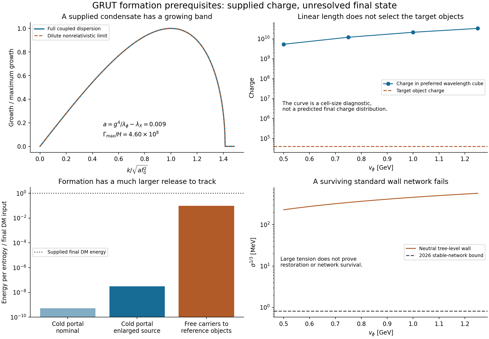

# Formation before another detector forecast

22 October 2026 (America/Chicago). Codex/AInstein; one author.
Parent: `8b0d96b219ea6616de23d0adbb67d4dc8be511ea`.

**Result:** the previous cold history does not yet produce the proposed
objects. An empty sector receives far too little energy through the
portal. A supplied dilute gas has no perturbative two-body bound seed.
A supplied coherent charged condensate does have a fast density
instability, but its final objects and radiation are uncomputed.
Formation also releases a much larger energy budget than the earlier
portal-production test covered. A detector exposure forecast is deferred.

## Three different formation questions

Keep the same classical scalar action and reference values:
g=.1, lambda_phi=.01, lambda_X=.001, v_phi=1 GeV, Q=39944.
The object energy is 3639.24 GeV, while a free X carrier has mass
100 MeV. The illustrative portal coupling 6.2093e-10 remains near an
uncertain LZ boundary; it is not an established allowed point.

| Initial hidden state | What follows | What remains |
|---|---|---|
| Empty +v vacuum; only the computed cold portal sources | At most 3.07e-8 of the required DM energy, even in the enlarged response | This route cannot supply all the DM in that history |
| Supplied dilute free-carrier gas | Leading two-body Yukawa potential has no bound seed | A conventional dimer-first synthesis chain cannot start through that channel; many-body routes are not excluded |
| Supplied smooth rotating charged condensate | Coupled field equations have a fast unstable band | Nonlinear fragmentation, mass function, efficiency and radiation must be evolved |

The first conclusion uses the parent's conservative total-energy
estimate and is independent of clustering details. Both other states
add a charge/energy preparation which the portal calculation did not
derive. U(1)_X conservation cannot generate a primordial net charge
from an empty state. Conservation by itself does allow object/antiobject
populations with zero net charge; the energy shortfall still applies.

For the supplied charge abundance needed to end in the reference objects,
Y_Q=n_Q/s_vis=4.8294e-9. At a supplied visible temperature of 20 MeV,
n_Q=1.8218e-13 GeV^3. These numbers calibrate the initial population to
the assumed final DM abundance; neither is an independent prediction.

## The gas and condensate are physically different

One-scalar exchange between free X carriers has the leading
nonrelativistic potential -alpha exp(-m_s r)/r, with
alpha=g^2/(4pi)=7.96e-4 and m_s=141.4 MeV. The zero-energy
Birman-Schwinger trace is 2 mu alpha/m_s=5.627e-4, below one.
Therefore this leading attractive Yukawa potential has no two-body
bound state; the positive lambda_X contact interaction does not help
binding. This is a sufficient comparison bound in the stated
nonrelativistic approximation, not a complete relativistic few-body
analysis or a theorem against every many-body assembly mechanism.

For a supplied gas dominated by one charge sign at this number density,
the ideal nonrelativistic Bose condensation
temperature would be approximately **106 eV**, the temperature of the
X gas itself, not of the visible bath. An adiabatically expanding,
decoupled ideal nonrelativistic gas has n/T_X^(3/2) constant. Expansion
alone does not turn an initially nondegenerate gas into a condensate.
The smooth coherent state must therefore be specified separately.

For that state write X=f_0 exp(-i omega t)/sqrt(2). Its positive-phi
stationary background satisfies

\[
\phi_0^2=v^2-\frac{g^2}{\lambda_\phi}f_0^2,\qquad
\omega^2=g^2v^2-a f_0^2,\qquad
n_Q=\omega f_0^2,\quad
a=\frac{g^4}{\lambda_\phi}-\lambda_X=0.009.
\]

The effective small-amplitude quartic is attractive. We derived the
full coupled radial, phase and phi dispersion relation, then checked
it using a separately organized six-variable linear evolution system.
At the calibrated reference density:

| Onset quantity | Result |
|---|---:|
| Fastest physical momentum | 1.2805e-7 GeV |
| Maximum growth / H at 20 MeV | 4.5965e8 |
| Growth time | 8.03e-12 seconds |
| Charge in a cube of the preferred wavelength | 2.1524e10 |

Thus expansion cannot suppress ordinary-sized initial perturbations in
this supplied condensate. This is a constructive **linear onset** result.
It is not a nonlinear formation simulation. The wavelength cube holds
about 5.4e5 times the target Q; assigning one final object to each such
cube would be an additional assumption. Collapse, breakup, charge
shedding and mergers may change that assignment. We do not claim
to have derived Q around 4e4, or any final charge distribution.
Condensate fragmentation is an established route, not a new GRUT idea.

## Formation has a separate radiation budget

Assembling Q free carriers into the reference object releases

\[
Qm_X-E_Q=355.158\ {\rm GeV\ per\ object}.
\]

For the calibrated population that is 4.2940e-11 GeV per visible
entropy, or **9.76% of the final object DM energy** (8.89% of the
initial free-carrier energy). It is 1.88e8 times the earlier nominal
cold portal-production budget, and 3.18e6 times its enlarged budget.
The earlier small photodisintegration result cannot be carried over
to a formed population without following this energy.

The action must determine whether energy leaves as phi waves, stable
hidden particles, unbound carriers, kinetic energy or other excitations.
For scale only: if all the release remains as nonrelativistic s rest
mass, its yield is 3.0363e-10 and its energy at the parent's nominal
decay epoch is about 1.75% of the radiation energy in the supplied
radiation-era estimate. That is **not** a derived radiation spectrum,
branching fraction, new BBN exclusion or a full backreaction calculation.
If only fraction f_rest remains in that form, both estimates scale
with f_rest. Early relativistic redshifting or stable debris changes
the outcome. No new nuclear run is represented as having been done.

Gresham--Lou--Zurek's work explicitly studies fusion energy and
mediator decays. That precedent strengthens the need to compute this
part of the history; their fermionic nugget rates and bounds cannot
be imported into this scalar model unchanged.

## The wall estimate closes a conditional outcome

For a neutral tree-level wall the exact kink gives

\[
\sigma=\frac{2\sqrt{2\lambda_\phi}}{3}v^3
=0.0942809\ {\rm GeV}^3,\qquad
\sigma^{1/3}=455.136\ {\rm MeV}.
\]

This confirms Claude's approximate eight-order comparison in tension.
A primary 2026 stable-network CMB analysis gives
sigma^(1/3)<0.81 MeV at 95% credibility for its specified network model.
Our reference tension is 1.77e8 times its tension limit. Across the
four supplied scales it is between 2.22e7 and 3.46e8 times that limit.
The tension was also checked by integrating the kink energy directly.

**A surviving standard scaling wall network at these scales is
incompatible with the assumed observed cosmology.** This conclusion
does not require solving hidden particle multiplication *once such a
network is assumed*. It does not establish which hot histories restore
the symmetry, erase initial sign memory, or retain a network. Biased
phase populations and early-decaying closed walls require their own
dynamics; earlier finite-box work already distinguished them. The even
Higgs portal supplies no explicit Z2 vacuum-energy bias.

The CMB result concerns stable late networks in its modeled background.
We do not extrapolate its subdominant template into a wall-dominated
universe to invent a significance, or apply it unchanged to networks
that decay long before recombination. The old wall simulations and
their extrapolations were read, not rerun. The computed cold source
does not thermally restore the prepared homogeneous phase; a cold
visible bath alone does not prove every possible hidden state is cold.

## What this changes

The empty-sector cold portal route can be retired for all-DM production
under its stated assumptions. A supplied smooth condensate is a
specific route worth evolving, with an explicit charge density and
growing modes. It is not yet a formation completion. The next needed
output is its **nonlinear charge distribution and emitted energy
spectrum**, with conserved charge/energy and a stated initial fluctuation
spectrum, followed by the relevant decay/survival calculation. Those
results must precede the requested multi-target exposure forecast.

The absolute vacuum density remains a separate calibrated input.
No derivation of its observed value is supplied here.

[Equations](MATHEMATICS.md) · [credits and read scope](SOURCES.md) ·
[results](RESULTS.json) · [verification](VERIFICATION.md) ·
[reproduction](REPRODUCE.md).
