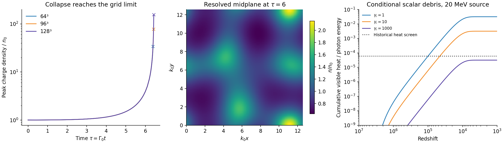

# Fragmentation onset and debris transport

22 October 2026 (America/Chicago). Codex/AInstein. Parent bd2cac3.

**Result:** a supplied condensate develops nonlinear clumps in a controlled
3D calculation, but the calculation reaches its spatial limit before it
can produce a final soliton charge distribution or emitted spectrum.
The reference completion in which all binding energy becomes slow,
freely surviving scalars fails a historical CMB heat screen. Early
formation alone does not cure their delayed visible decays.

This is a conventional asymmetric scalar-composite / Q-ball-like
dark-matter model with a Higgs portal, of the Friedberg--Lee--Sirlin type.
GRUT names the research program. The extra fields are hypotheses; QM,
the SM and Einstein gravity are adopted foundations. This packet supplies
no new principle, evidence for the hidden fields, or explanation of the
observed positive vacuum density. All prior science packets are unchanged.

## Let the charge emerge

We fix the previously supplied n0=1.82183e-13 GeV^3 at visible T=20 MeV
and do not target Q=39944. The dilute adiabatic reduction is the 3D
focusing equation i psi_tau=-laplacian psi-|psi|^2 psi. We run the same
continuous random initial field in a periodic box at 64^3, 96^3 and
128^3; add a second seed and a half-time-step 96^3 control. The seed
spectrum and initial coherent state are assumptions, not derived production.

| Run | Last safe time tau | First spectral-stop time | Peak density at stop / n0 |
|---|---:|---:|---:|
| 64^3, seed 17 | 6.38836 | 6.39465 | 34.05 |
| 96^3, seed 17 | 6.41685 | 6.41963 | 77.08 |
| 128^3, seed 17 | 6.42829 | 6.42968 | 154.65 |
| 96^3, seed 17, half maximum step | 6.41663 | 6.41938 | 78.07 |
| 96^3, seed 29 | 6.77831 | 6.78074 | 88.26 |

All five runs reach the specified spectral stop. The rising peak at
finer resolution is a warning about unresolved collapse, not a measured
object density. At common resolved time tau=6, the 64-to-96 and
96-to-128 coarse-field comparisons are 1.13e-7 and 2.74e-8 in relative
L2. Halving the maximum time step changes the coarse density by .0178%.
Charge drift stays below 8.3e-14; maximum relative Hamiltonian drift is
2.01e-5. These establish controlled onset, not dense-core formation.

The old ~2.15e10 charge per fastest-wavelength cube remains a length-scale
diagnostic. At tau=6 in the 128^3 run, threshold n>=2n0 picks two
overdensities containing ~2.05e9 and 5.69e7 charges; thresholds 4n0 and
8n0 pick none. Most charge is still outside them. Neither those components
nor a grid cell is labeled a soliton. No final mass function, target charge,
ground-state relaxation or detector update follows from this run.

A naive direct grid spanning the onset box while resolving a full-model
wall would require ~2.1e22 cells. This is not a fundamental computational
no-go: it identifies a need for matched dilute/core evolution and adaptive
resolution, with conservation checked at the handoff. A larger uniform NR
grid alone would simply postpone the present failure. Full-model core
physics and massive radiation must enter before claiming finished objects.

## Binding energy, time and channel

The reference 355.16 GeV per chosen object corresponds to 4.29401e-11
GeV per entropy, or 3.02274e-10 GeV per photon in today's entropy
convention. At z=1e5, prompt conversion to photon heat would inject
.004765 of the photon energy. The named historical 6e-5 screen then
requires an electromagnetic heat fraction below about 1.26%.

**Formation time is not deposition time.** The nominal inherited scalar
lifetime is 1.238e11 s; the enlarged SM-response envelope gives 2.180e9 s.
For instant emission at 20 MeV, all reference binding energy into free s,
no subsequent reactions, and unit visible heat deposition:

| Initial scalar boost | Nominal integrated heat proxy | Maximum source fraction from historical screen |
|---|---:|---:|
| gamma=1 | .03177 | .001889 |
| gamma=10 | .003177 | .01889 |
| gamma=1000 | 3.177e-5 | No restriction from this screen alone |

For slow scalars, nominal median decay is at z~16135 and the proxy exceeds
the screen by ~529.5. The enlarged response still exceeds it by ~67.6.
The hard-spectrum row illustrates redshift dilution, not a derived emission
mechanism. A formal gamma=1e8 row is also archived, but cannot be powered by
one old reference object's binding energy. The calculation retains time
dilation and the radiation-to-matter transition.

This is a conditional heat screen, not an actual COBE/FIRAS likelihood,
electromagnetic cascade, photon-injection calculation or BBN nuclear run.
Passing it does not establish viability. The previous ACROPOLIS result
covered tiny portal production, not this much larger formation source.
The earlier rough radiation ratio also omitted post-annihilation entropy
degrees of freedom; the explicit photon-energy kernel here supersedes that
estimate without changing the frozen earlier packet.

The action has **no massless hidden free particle**. Ordinary s, X and D
waves are massive. Modestly boosted stable D particles become matter;
calling their energy dark radiation would misapply N_eff. A true massless
receiver would be cheap at 20 MeV, Delta_Neff~1.76e-8 for this budget,
but that outlet has not been constructed. An order-one graviton channel
is not implied by adopted gravity.

There is an existing alternative worth calculating: ss->DD. Its cold
threshold sigma v is 2.744e-8 GeV^-2. A deliberately incomplete cold,
irreversible, DD-only diagnostic leaves 36.2% of the reference scalars
at 20 MeV, still far too much for the nominal heat screen. It converts
some energy into stable matter, not radiation. The ss->XX* threshold
amplitude cancels at these couplings, but at p/ms=.1 its rate already
exceeds DD. Inverse reactions, actual spectra and accretion cannot be
discarded in a full conclusion. Hotter source examples are different
histories, not repairs to the stated 20 MeV maximum.

## Abundance and the next required result

Keeping the same primordial charge yield, the limiting population of very
large relaxed objects would supply only **61.7%** of the old assumed dark
matter density and release **4.92 times** the old reference binding budget.
This is a bulk-limit comparison, not the final distribution measured by the
simulation. It shows why retuning Q or the initial abundance after formation
would conceal a physical change. Free carriers and stable D must also be
included in the final matter accounting.

The next useful deliverable is a conserved transfer from this dilute state
into resolved full-field cores, returning both dN/dQ and the time/momentum
spectra of s, X and D emission, including retained object excitation. Those
outputs must then feed a reaction/deposition calculation, with the supplied
charge fixed. A preparation mechanism for that coherent state remains
another required input. Only an acceptable resulting population can justify
recomputing profiles and a xenon/argon/germanium forecast.

Kusenko--Shaposhnikov and Enqvist--McDonald are credited for condensate
instability formation, Kasuya--Kawasaki for nonlinear lattice formation,
and Hiramatsu--Kawasaki--Takahashi for later resolution/distribution work.
Their supersymmetric potentials and charge distributions are not transferred
to this action. The earlier conditional exclusion of surviving hot wall
networks is unchanged; no new all-hot-history exclusion is asserted.

**Verification:** five full NR onset runs and 197/197 same-author controls,
including analytic linear growth, grid/time refinement, energy/probability
accounting, an analytic radiation-era decay kernel and an alternative ODE
route for the channel-only result. See VERIFICATION.md. This is not
independent replication or experimental support.

Crosses mark spectral stopping, not formed objects. The middle panel is a
resolved slice, not a final population. The right panel holds the old
reference energy budget fixed to display response kernels; it does not
supply a formation spectrum. Detailed equations and limitations are in
MATHEMATICS.md; runnable code and archived diagnostics are in code/ and data/.
