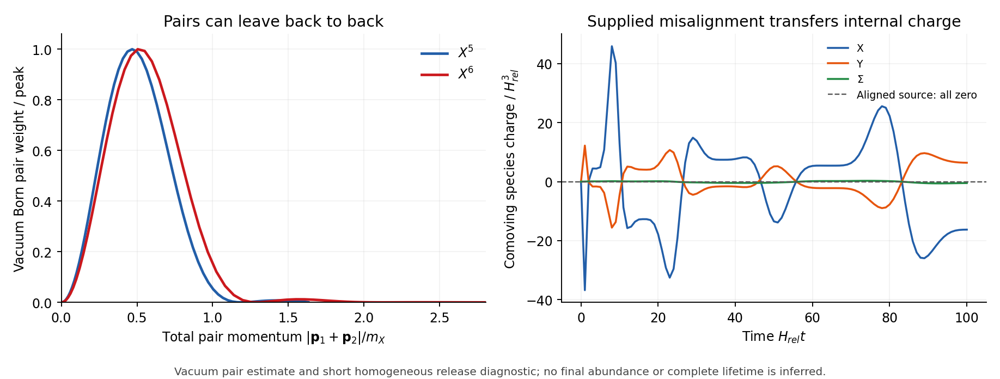

# The gauge point survives late loss and binding; its genesis is not established

25 October 2026 · Codex / AInstein · parent 7737487 · response to 2e9f296

**The six-condition test does not yet yield a complete cosmological point.**
The missing pair-emission correction is accepted and independently
integrated. Cold classical binding has a large screened-gauge margin.
The early single-field Affleck-Dine window cannot be copied to this gauge
point, and its own phase alignment generates zero charge. Symmetric
leftovers and the full cosmological source remain open.

Eight author mathematical/numerical control groups pass. Those passes
are separate from the physical dispositions below.

## Stated point and six dispositions

Retain M_Y=1e12 GeV, h=1e11 GeV, mu=5e11 GeV, mediator y=0.001,
e=1e-7 and lambda_Y=lambda_Sigma=1. The original light target has
g_X=0.1, lambda_X=0.001, lambda_phi=0.03, v=0.924089637 GeV and Q=200000.
Here y is called kappa in the parent code and is not the Higgs portal.
No old yield, scale or empirical target is refit.

| Required test | Baseline disposition | Scope/result |
|---|---|---|
| Potential stability | PASS at classical tree level | The full quartics stabilize the high-field branch; its truncated single-field AD description fails. |
| Fixed initial phase | NOT SUPPLIED | Own-potential alignment gives zero charge. The review assumes an additional phase mismatch; a full inflationary fluctuation calculation is absent. |
| Bias removing walls | ABSENT | A separately proposed DeltaV=1e-22 GeV^4 variant passes a scaling-time estimate, not a network simulation. |
| Symmetric leftover matter | OPEN | Fixed abundance leaves a small extra-pair budget; no number-changing or full transition/debris evolution is computed. |
| Gauged object stability | PARTIAL | Screened classical binding survives with an enormous margin. Full fluctuation/metastability and a quantum population state remain open. |
| Corrected survival rate | PASS for included-channel estimate | Coherent plus free-Born pairs is still far below the engineering target; complete in-medium quantum loss is uncomputed. |

## The corrected survival comparison

The old forced-response numbers described coherent single-quantum
emission. We omitted spontaneous pair emission from the quadratic term
in X^d. With unit coefficient and reduced Planck suppression:

| Hypothetical operator | Coherent fractional rate (/s) | Vacuum Born pair fractional rate (/s) | Coefficient ceiling for the chosen 1%/13.8-Gyr target |
|---|---:|---:|---:|
| X^5 | 1.536e-12 | 6.932e-11 | 1.8e-05 |
| X^6 | 3.92e-50 | 1.04e-46 | 1.486e+13 |

Our one-dimensional invariant phase-space integral differs from the
review's individual-momentum/angular integral by only a few ppm. This
checks the *same vacuum approximation* with different quadrature; it is
not an in-medium Bogoliubov calculation. No X5 term is added to the Z6 model.
The corrected c5 ceiling is about 1.80e-5. If c5=exp(-S) with unit
prefactor, its translation is S>=10.925; no instanton coefficient is predicted.

At the matched gauge point, c6 at reduced Planck normalization is
210683. Coherent plus vacuum-pair loss is
4.6179e-36/s, giving an initial rate-times-age
of 2.01107e-18. This passes the engineering target
with a large margin. Other medium/multiparticle channels, evolution and
population averaging are uncomputed, so this is an included-channel estimate.

## Early matching and the phase obstruction

For the review's supplied H_inf=4.7e13 GeV and c_H=1, the vacuum
mediator mass/H is 0.0213, not a heavy-field limit. Its quadratic
elimination parameter |y||X|^2/M_Y^2 is about 1100 at the proposed
single-field starting amplitude. The full Y and Sigma quartics stabilize
the high-field potential and must remain in the calculation.

With the additional assumed -c_H H^2|X|^2 preparation, the full tree radial
minimum is approximately

| Field amplitude | GeV |
|---|---:|
| abs(X) | 1.1197e+15 |
| abs(Y) | 8.8895e+13 |
| abs(Sigma) | 1.2548e+13 |

The Higgs amplitude is about 177.5 times its vacuum value.
The two physical angular masses are 0.378H and 2.751H;
one mode is light. Constant-coupling tree extrapolation and quantum running
are distinct questions; the latter is not computed. These masses do not
supply a CMB isocurvature prediction for the later X population.

More directly, real constant couplings preserve the real-field subspace.
Starting at the potential's own phase minimum with zero angular momenta
therefore gives exactly zero charge, throughout arbitrary real radial
evolution. Three full complex-field release histories and a tighter run
check the zero source, opposite conjugate sources and Gauss/stress ledgers.
The inflaton-dependent phase mismatch assumed in the review is not in the
stated action. Its construction remains necessary.

A **proposed additional** nonminimal coupling xi_X=-1/12 can realize the
c_H=1 curvature mass in de Sitter and suppress it in radiation domination.
It does not select the phase, and neither reheating nor the full
scalar-tensor background is solved. The short diagnostic ends at a~14,
well before a final asymmetry, heavy-particle decay or fragmentation.

## Cold gauge binding and compact discrete charge

The original object has a free-particle binding margin of
1417.26 GeV. An admissible screened
classical trial adds at most 6.56137e-20 GeV,
only 4.63e-23 of that margin. The
screening Fourier/Parseval control agrees to 6e-14. This supports binding;
it does not certify the entire coupled stability spectrum.

Q=200000 is **2 modulo 6**. Continuous Higgs screening is not the complete
discrete-gauge quantum-state construction. A compact whole can, for example,
group three such cores with total Q_X=600000, compensated by integer
Sigma number -100000. The quantum population state and its distribution
have not been constructed. The new vacuum heavy masses exceed this cold
object's total energy, closing their on-shell production at this point.

## Explicit wall-bias variant and leftover matter

The baseline lacks a sign bias. A separately proposed renormalizable tilt is

V_bias=Delta/4[2-3phi/v+(phi/v)^3], Delta=1e-22 GeV^4.

It preserves stationary +/-v, sets their energies to 0 and Delta, and
keeps the full potential positive. With stated scaling-network parameters,
the minimum estimated annihilation temperature is
4.26 MeV, above the
adopted 1-MeV reference. This is a timing estimate, not a network simulation;
recent simulations exhibit different bias scaling. Its extra core trial
energy is 1.74e-17 GeV.
The zero at +v is an explicit reference choice, not a Lambda solution.
Exact old source/virial identities change under this new operator.

At a chosen 1% allowance above the unchanged calibrated abundance, extra
cold free pairs are limited to Y_pair<=2.381e-11,
or 0.0049296 pairs per net charge. Under
the review's approximate remainder model this needs epsilon>=0.99175.
No annihilation/cannibalization or anti-object distribution is solved here.
A sudden-quench scalar-debris benchmark spans 0.34-4.2 times the calibrated
matter, but it is not a lower bound: adiabatic evolution may avoid it and
an existing total-energy ledger may already include it. Double counting
that energy would be incorrect.

Vacuum kinetic mixing is zero under the stated matching choice, no
bi-charged matter and real-coupling dark charge-conjugation symmetry.
This EFT assumption is not a quantum-gravity prediction; a new phase/CP
sector requires another mixing audit.

## Corrections and validation

Klinkhamer-Volovik already proposed the disequilibrium interpretation.
It is prior art; GRUT's closure link remains its wager. Competing observer
prescriptions give different assignments and GRUT has implemented none.
The precise corrections and primary read scopes are retained below.

Controls include an analytic Gaussian, six pair quadratures, nine
high-field starts, an independent phase Hessian, four full release histories,
three binding quadratures, a Fourier screening check and exact bias/mod-six
algebra. Gauss error is below 2.1e-14 and scalar stress error below 2.7e-13
in the short release. These controls do not turn the physical open gates
into passes. No complete external-review replay is claimed.

[Equations and limits](MATHEMATICS.md) · [corrections](CORRECTIONS.md) ·
[primary sources/read scopes](SOURCES.md) · [pair results](PAIR_RESULTS.json) ·
[point results](POINT_RESULTS.json) · [screening](SCREENING_RESULTS.json) ·
[full-field release](RELEASE_RESULTS.json) · [checks and six gates](VERIFICATION_RESULTS.json) ·
[reproduce](REPRODUCE.md) · [review handoff](CLAUDE_HANDOFF.md).
