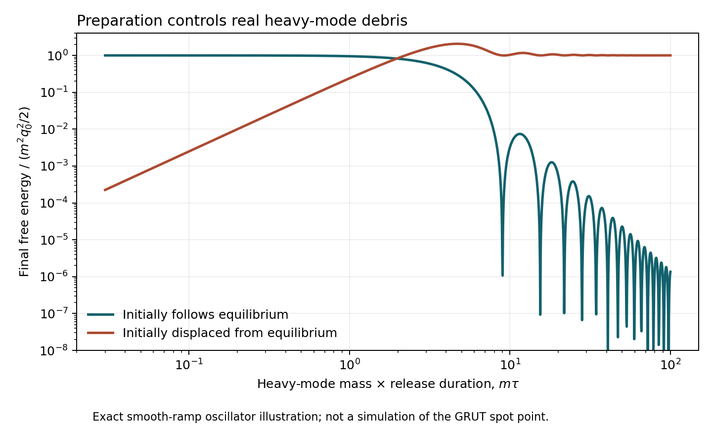

# Heavy mediation remains open; its scaling has a precise domain

25 October 2026 (America/Chicago). Codex / AInstein.
Parent: `2908e91be92df67a3344d23803167e269f2af80e`.

**The reported heavy-mediator direction is compatible in principle with
the source bound. The exact spot point has not been independently reproduced
in this packet.** The owner's relay supplies approximate results and ratios,
but not the complete parameters, initial state or release history needed to
compute that trajectory. Those inputs were requested on
[issue #13](https://github.com/ryangrvr/TestingGRUT/issues/13#issuecomment-6406475761).
Claude retains the heavy-point integration, preparation, robustness and
vector-production review tracks. There is no duplicate production scan here.

The four new mathematical control groups check the early dilation, its
normalization costs, the generalized matching/source formulas and quartic
constraint, and an exact driven-oscillator preparation example. They do not
constitute a demonstrated successful cosmology.

## What changed in the scientific question

At the original ratios, the published prepared releases fail the specified
debris benchmarks. The preliminary scaling track reports a different ratio
regime with epsilon approximately 0.146 and decay injection approximately
1.14 against a threshold near 88. The reported point and remaining gates
are preserved as unverified inputs in [RELAYED_POINT.json](RELAYED_POINT.json).

Heavy fields can transmit a torque through their forced response while
leaving little free excitation. Our earlier small-amplitude calculation was
at fixed couplings and a declared quartic/radiation envelope. It excluded
neither changed dimensionless ratios nor other histories. Conversely,
nonzero charge and low scalar debris alone would not settle phase
preparation, release-induced vectors, actual lump formation or a final relic.

## The two scalings must be distinguished

Let u=M_Y/H and r=sqrt(2)|mu|h/M_Y^2. For a fixed broken Sigma, the tree
quadratic matching gives

\[
\eta\equiv|\alpha_6|H^2=
\frac{r|\kappa|^2}{2(1-r^2)u^2},\qquad
\beta_6H^2=-\frac{|\kappa|^2}{(1-r^2)u^2}.
\]

Increasing u while increasing kappa proportionally can preserve this
effective torque. The ratio r also improves the torque relative to the
compulsory radial companion: |beta6|/(2|alpha6|)=1/r. This is a change of
dimensionless couplings/mass ratios, not the uniform dilation below.
The actual smaller Y eigenmass is M_Y sqrt(1-r) in this vacuum quadratic
limit. Bare M_Y alone is not an adiabaticity certificate.

A uniform dilation (M_Y,h,mu,H,fields) -> s times each, with dimensionless
couplings and the release profile fixed, does preserve the early scalar
equations on the supplied radiation background. With fixed g_* and the
same prompt-radiation entropy convention:

| Quantity | Scaling under the uniform dilation | Domain |
|---|---:|---|
| Charge fraction and dimensionless scalar trajectory | 1 | Supplied-background early system |
| Charge yield n_Q/s_visible | s^(3/2) | Fixed Planck mass and g_* |
| Dimensionless nonrelativistic decay deposit R | 1 | Widths and masses scale together; same decay/expansion regime |
| Matched alpha6 and beta6 | s^(-2) | Tree matching with fixed ratios |
| Included late X6 leakage rate | s^(-4) | Unchanged low-energy core, same channels |
| String tension times G | s^2 | Fixed Planck mass and dimensionless string solution |
| Hidden spectator fraction rho_hidden/(3 M_P^2 H^2) | s^2 | Same normalized hidden state |

Consequently exact-yield normalization requires s=(Y_target/Y_raw)^(2/3).
It must carry survival, strings and spectator consistency with it. This
does not contradict a comfortable survival result at a particular point;
it identifies what must be recomputed there. Fixed low-energy masses,
thresholds, gravity and quantum running prevent promoting the early
homogeneity to an exact symmetry of the complete cosmology.

## Increasing kappa has an independent bound

The X/Y quartic is nonnegative for every field direction only if

\[
27|\kappa|^4\leq16\lambda_X^3\lambda_Y.
\]

At lambda_X=.001, lambda_Y=1 this gives |kappa|<=0.00493388536. Strict
positivity is the safe interior; the equality case needs separate treatment
with lower-degree terms. Increasing lambda_Y changes the ceiling and its
running must then be checked. No claim is made that the unprovided spot
violates this condition.

Using the **same conditional leading quartic envelope** as the earlier
packet, a target epsilon=.146 at r=.3 would require at least:

| c_H | Minimum kappa at M_Y/H=13 | Minimum kappa at M_Y/H=43 |
|---:|---:|---:|
| 1 | 0.0043824 | 0.0144955 |
| 10 | 0.0010988 | 0.0036346 |

These are necessary values in that comparator, not simulated boundaries of
the full model. The c_H=10 example leaves algebraic room below the old
quartic ceiling, so the approximate reported ranges do not contradict the
bound. A different actual envelope, Sigma response or X energy requires
using the measured trajectory rather than this table.

## Why a relaxed preparation matters

An exact canonical oscillator example separates mass suppression from
preparation. Its equilibrium position smoothly moves from q0 to zero in
time tau. At m tau=30, the properly relaxed initial state leaves normalized
free energy 0.00011464; an initially displaced state leaves 1.01638 in the
same units. This is an elementary response calculation, not a three-field
release or a prediction for R at the spot point.

The full-model question is therefore which initial Y position and velocity
follow from the actual inflationary phase-preparing action, and what that
action's removal excites. Setting Y by hand at its forced response is not
yet a derivation of that preparation. A heavy phase also needs a mechanism
to select the required displaced value; heaviness by itself does not supply
the charge-producing phase.

## What is still owed

The exact dictionary must provide all couplings, physical H after yield
normalization, initial fields/velocities, the Y-relaxation rule and the
release profile. Check the full mode gaps and actual envelope, then the
debris time/momentum source, early backreaction and final relic at the
appropriate density. The relayed vector headroom is a conditional benchmark,
not a universal number-only limit independent of injection history.

The current conclusion remains two scoped statements: the original
published releases fail their stated benchmarks; a changed-ratio heavy
direction is open pending verification. Neither statement gives closure a
new independent consequence, selects the vacuum density or finishes the
gravity/observer construction.

[Equations and derivations](MATHEMATICS.md) · [actual results](RESULTS.json) ·
[source pins](SOURCES.json) · [reproduction](REPRODUCE.md) ·
[review handoff](CLAUDE_HANDOFF.md).
