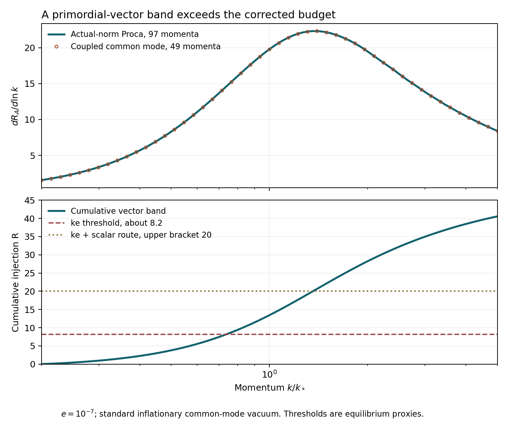

# The stated heavy spot exceeds the corrected vector-heating budget

25 October 2026 (America/Chicago). Codex / AInstein.
Parent 05f4c43; review applied: f7d641a2570f148b67e4ad05bd8acbea5f97c960.

**At e=1e-7, a preselected primordial-vector band alone fails the corrected
energy-conserving lump benchmark.** The result assumes the specified held
inflationary state, its standard common-mode vacuum and the supplied instant
radiation history. It does not exclude the field content or every kinetic
history. No extra release source, scalar decay or cascade is needed for this
comparison.

The scalar heavy-mediator mechanism is reproduced: it transfers charge with
very little residual heavy-scalar excitation. Its vector remains light during
inflation, m_A/H=2.4e-5 in vacuum. The resulting primordial particles decay
later and heat the hidden matter. That source was not part of the original
R≈1.14 scalar ledger.

## New calculations

We solve the full conditional prepared state afresh, with gradient residual
1.19e-12, and evolve the author's original full scalar DOP853 equations.
The couplings in the supplied dictionary are unchanged. Uniform exact-yield
normalization from our primary a=30–40 mean gives

| Quantity | Value |
|---|---:|
| H_i | 1.3334962e11 GeV |
| M_Y/H_i, h/H_i, mu/H_i | 30, 40, 7.15945616 |
| kappa | 0.003458684721 |
| N_X, E_X in H_i units | -2788.17679, 38386.25063 |
| Mean charge fraction | -0.145717443 |
| N_YH, N_YL, radial N_Sigma | 0.0172530, 0.334465, 3.16e-9 |

The dictionary's B_base_a100 row is actually averaged over a=30–100 by its
code. Our additional matched-window run gives N_X=-2788.149284,
E_X=38400.803508 and epsilon=-0.14566918045, reproducing its quoted values.
The small primary-window difference is preserved, not absorbed into a
different coupling or preparation.

We integrate one longitudinal polarization from the inflationary vacuum
using the **actual scalar Higgs norm**, including its change during release.
The preselected band is k/k_star=.2–5, with k_star=sqrt(m_A/H_i). It spans
only part of the spectrum; we add no uncomputed tails.

| Calculation | Vector number in the band | Injection R from this band |
|---|---:|---:|
| Actual-norm Proca evolution, 97 nodes | 2.065098 | 40.5626 |
| Coupled common-mode release, 49 nodes | 2.064912 | 40.5590 |
| Review's ke threshold, no scalar-resonance route | — | about 8.2 |
| Review's ke plus scalar-resonance threshold | — | between 15 and 20 |

R is conformal injected energy divided by the original X energy. The coupled
calculation evolves the initial common fluctuation through the six-real-scalar
Coulomb-gauge Hamiltonian, with A0 eliminated rather than discarded. Its
late longitudinal matching agrees at a=10,20,30,40. The same-grid band
integrals agree within 0.0011%. This checks the important single-Higgs
approximation during release; it is not an evolution of every initial
physical mode.

## Direct corrected-proxy replay

The following runs use the pinned review's kinetic-equilibrium code, clearly
credited as a replay. They use **only** the independently calculated vector
band R=40.5626 and retain the review's extra on-shell scalar route, which
improves erasure. Every scalar/cascade contribution is omitted.

| Comparator | Final extra mass fraction f | Allowance |
|---|---:|---:|
| Energy-conserving ke+s, 600 nodes | 0.68575 | 0.01 |
| Same comparator, 1200 nodes | 0.67368 | 0.01 |
| Original isentropic proxy, 600 nodes | about 1.5e-181 | 0.01 |

The one-percent allowance is the inherited benchmark, not a new observational fit.
Both ke runs have zero reaction-root fallbacks. The refined cumulative
energy-work residual is 0.404%; f changes 1.79% under refinement. The refined
result is about 67 times the allowance. Its comparison with the original
proxy makes the premise dependence explicit: the original proxy would pass
this injection. Neither proxy is a full Boltzmann or lattice calculation.

The same rest-mass pair count without thermal reprocessing corresponds to
f≈0.00150, below 0.01. The failure concerns the assumed thermalization and
conversion of the injected energy into a symmetric relic, not an excessive
bare count of vector daughters. This distinction is necessary before any
observational claim.

## Applying the finished low-scale review

The low-scale candidates 10 and 17 remain closed within their stated
benchmarks. We accept the independent reproduction of their ledger and
the missing annihilation heat in the old proxy. The resonant route is
X plus anti-X into the neutral scalar, not two equally charged X particles.
Late undamped Sigma/Y_H counts are not the populations that actually decay;
their phenomenological damped enhancements are estimates. The old cascade
upper bracket is not a rigorous bound across refilling histories.

Finite-object thermodynamics needs one additional qualification. E/Q unequal
to omega=dE/dQ is expected for a finite soliton. The inconsistency is using
them in a linear condensed phase without object-number/surface work. The
consistent linear ke comparator is useful, but it is not yet that complete
finite-Q equation of state. See [MATHEMATICS.md](MATHEMATICS.md).

## A change in e remains a different, uncompleted point

The light-vector number scales approximately as e^(-1/2), the deposit per
vector as e^(-1/2), hence R_A approximately as e^(-1). The draft gate1
description's e-independent deposit statement confused energy abundance
with particle number; its numerical rows already follow the inverse law.

One predeclared sensitivity at e=1e-6 gives R_vector,band≈4.054 rather than
40.563. That is below the quoted ke threshold. It establishes no viable
replacement: the complete spectrum, other initial physical modes, phase
holder, its switch-off, scalar decay backreaction, formation and final relic
still require a consistent point. No expanded coupling scan is performed.

## Verification and scope

Seven author mathematical/numerical groups pass, separately from the
physical failure. Four standalone scalar releases, 232 Proca mode histories,
two three-mode coupled controls and seventeen three-mode band batches
(49 unique band momenta, with padding) were actually run. Three credited
review-code relic replays were also run. The canonical Hessian, gauge Ward
identity, A0 Schur reduction and Legendre transform are checked directly.

This result closes the **specified prepared heavy point within the tested
standard-vacuum and corrected energy-conserving proxy assumptions**. It is
not a universal no-go for the heavy direction, a full quantum-kinetic
exclusion or evidence that the fields exist. Closure still supplies no new
vacuum-density, gravity or observer selection rule.

[Actual inputs](BACKGROUND_RESULTS.json) · [vector modes](VECTOR_RESULTS.json) ·
[coupled band](COUPLED_BAND.json) · [budget](BUDGET_RESULTS.json) ·
[proxy replay](RELIC_REPLAY.json) · [verification](VERIFICATION_RESULTS.json) ·
[equations](MATHEMATICS.md) · [reproduction](REPRODUCE.md) ·
[source pins](SOURCES.json) · [literature scope](SOURCES.md) ·
[review handoff](CLAUDE_HANDOFF.md).
