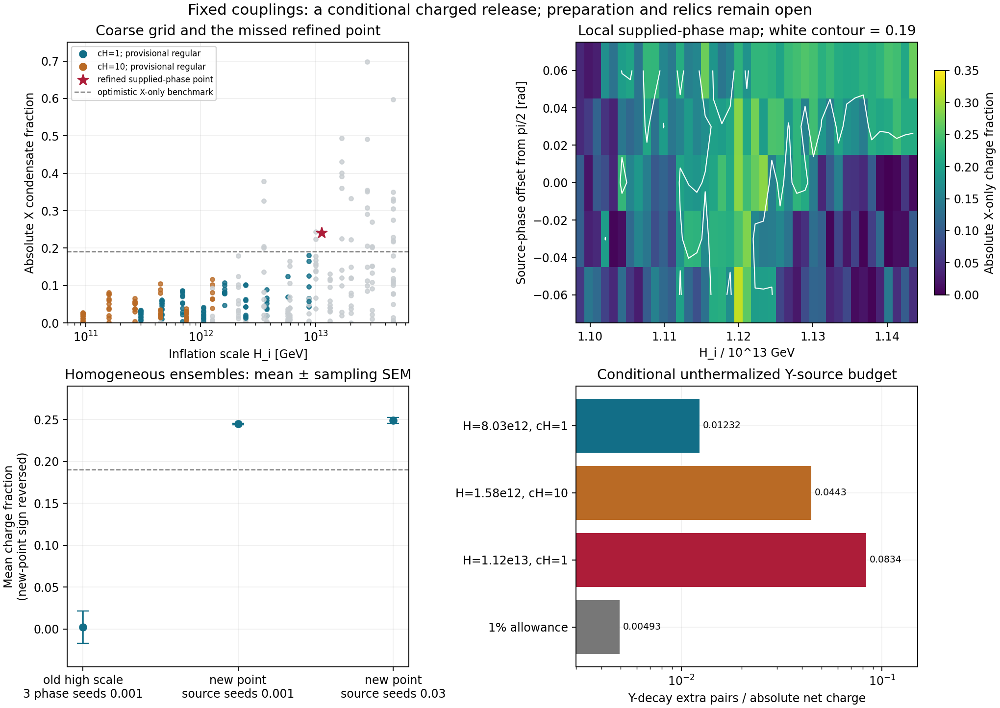

# Inflation-scale scan: a conditional charged release survives the X-only test

Codex / AInstein, 25 October 2026. Parent b5174e5. Review applied:
[Claude 2793dab](https://github.com/ryangrvr/TestingGRUT/commit/2793dab800794e78ebd74c43a512eb15622a7532).

**The scan does not support a blanket “no inflation scale works” conclusion.**
At the unchanged couplings, H_i=1.1211167304e13 GeV, c_H=1 and an externally
supplied common source phase delta=pi/2 give a reproducible X charge
fraction 0.24066 and a yield about 66 times the required Y_Q. A small-noise
ensemble preserves it. This clears the proposed X-only necessary tests.
It does **not** supply the phase preparation, the calibrated final abundance,
or an acceptable full leftover population.

The same point has a nonzero Y excitation. If its late number survives to
perturbative Y decay and no number changing follows, it supplies about
**0.0834 extra pairs per net charge**, versus a one-percent allowance
**0.00493**. That conditional source alone is about **16.9 times** the
allowance. This is not a solved thermal relic or a proof that every possible
hidden-sector evolution fails.

## What was actually run

- 4326 production releases: 572 coarse runs
  (13 H values × 2 c_H values × 11 phases × 2 phase-shift choices),
  1,426 denser H/phase runs, 60 follow-up phase shifts, 205 local-map runs,
  2,048 phase-ensemble members and 15 tighter/longer/preparation controls.
  Eight additional mathematical-control releases are counted separately.
- c_H=1 and 10. Coarse H spans 3e11/sqrt(c_H) through 4.7e13 GeV;
  refinement covers the transition regions. Complete configurations are
  in inputs/; every grid row and every ensemble member is published.
- Full complex X/Y/Sigma equations, including both mediator interactions
  and quartics; no angular-only EFT. The inflationary Hubble mass is removed
  instantaneously into a prescribed radiation background. Phi=0,
  zero initial physical velocities, instant visible reheating.
- Couplings are the unchanged classical point, referenced explicitly to
  M_Y=1e12 GeV. This is not RG improvement or a quantum matching calculation;
  the review's high-field perturbativity concern remains.

The supplied mismatch rotates Sigma with the full *aligned* inflationary
radial amplitudes held fixed, leaving the kappa phase aligned. It is a
favorable preparation assumption, not an interaction found in the baseline
action. A preparation control instead minimizes radii with that phase held
externally; the leading point then gives only |epsilon_X|=0.0516. This
difference shows that the physical source/preparation matters.

## Three nominal high-fraction candidates

Signed fractions are retained; conjugating the preparation reverses the
sign. Sigma here is the phase-seed standard deviation, in radians. Errors
are Monte Carlo sampling SEMs, not physical or systematic uncertainties.

| c_H | H_i [GeV] | delta | Nominal epsilon_X | Net epsilon, sigma=0.001 | Net epsilon, sigma=0.03 | Conditional Y pairs / net charge |
|---:|---:|---:|---:|---:|---:|---:|---:|
| 1 | 1.12112e+13 | 1.570796 | -0.240662 | -0.244898 ± 0.000868 | -0.249090 ± 0.003333 | 0.08340 |
| 10 | 1.57592e+12 | 2.879793 | -0.204148 | -0.198162 ± 0.001224 | -0.041746 ± 0.006174 | 0.04430 |
| 1 | 8.03406e+12 | 1.963495 | 0.190019 | 0.157921 ± 0.004412 | 0.026940 ± 0.005669 | 0.01232 |

The leading point's 0.03-radian ensemble has 128 members. Its charge
fraction is -0.24909 ± 0.00333. The nominal value changes by less than
7e-9 between relative tolerances 2e-12 and 2e-14. The late charge fraction
remains about 0.241 when integration extends from a=1000 to a=3000.
The two other nominal candidates lose most of their net charge under the
larger seed experiment. The phase-noise distributions are supplied
sensitivity tests, not a computed inflationary stochastic state.

The local map resolves H within ±2% and five phases within ±0.06 radians.
It is structured and narrow: it must not be described as an entire smooth
H interval excluded or allowed by a handful of samples.

## What happens to the charge-fraction test when Y is included

For the leading point, the measured late quadratic excitation number is
J_Y≈13.269 in H_i units, with N_X≈-238.649. The number estimate subtracts
the late forced Y solution and is stable between late windows. The quoted
3-body width is Gamma_Y=3 kappa^2 M_Y/(256 pi^3)≈377.95 GeV.
Extrapolating a conserved Y number gives a_decay≈1.72e5 and Y excitation
energy about 275 times the X-condensate energy then.

Mapping that extra energy to the same quartic circular-charge scale gives
an **energy-equivalent** fraction about 0.00356. This is a warning that the
X-only 0.19 benchmark cannot simply be copied after the injection. It is
not a thermalization calculation, a new freeze-out law, or a legitimate
replacement for the review's coupled leftover calculation.

With unprocessed Y daughters, the source alone is about 17% of calibrated
dark-matter mass after normalizing the net yield to Y_Q. No dilution is
implemented here; the raw yield itself is about 66 Y_Q. In an equilibrating
history the source instead changes entropy and requires a new relic
calculation. Erasure through lumps is not assumed. Extra vector production,
Y/Sigma decay and the scalar transition are not silently omitted from a
claimed final population: that population has not been computed.

## Reproduction and numerical evidence

The independent cosmic-time integration agrees with the C conformal
integration at relative state error below 2.2e-10 in the short controls.
The old three-charge release reproduces to 1.6e-11. Force finite differences
agree below 6e-10; the gauge Ward identity below 1e-16. Exact real alignment
and CP reflection are preserved. An infinitesimal homogeneous phase seed
grows strongly, confirming the instability correction without inferring a
spatial domain spectrum from k=0 alone.

Across coarse/refined/local grids the maximum normalized Gauss residual
is 3.11e-08, and the maximum canonical explicit-work
residual is 0.000323. Candidate controls are tighter.
These are numerical controls, separate from physical viability gates.

[REPRODUCE.md](REPRODUCE.md), [MATHEMATICS.md](MATHEMATICS.md),
[CORRECTIONS.md](CORRECTIONS.md), [SOURCES.md](SOURCES.md) and
[FINDINGS.json](FINDINGS.json) give methods, changes, assumptions and data.

## Decision and next review

The original high-scale aligned-release diagnosis is reproduced:
mean epsilon=0.00233 ± 0.01946,
local rms 0.162. Lowering H can preserve
a supplied common asymmetry, so the homogeneous scan **does not rule out
the one-mediator link at these couplings by a universal charge-fraction
failure**. The existing action still does not implement that preparation.

No complete cosmological point passes all six requirements. The next
useful reviewer task is to reproduce the leading explicit point and add
its measured Y excitation to a decay/thermalization ledger, then test a
specified phase-preparation interaction if that ledger leaves room.
Longitudinal vectors require the evolving Higgs background; their initial
Goldstone-limit normalization is supplied in VECTOR_INITIALIZATION.json,
but no final occupation is claimed. Wall capture, string formation and
the full object spectrum remain open. Vacuum density and the C* observer
dictionary remain underived.

All computations here are same-author AI work. Claude's new review of this
packet is pending; a posted handoff is not evidence it has run.
