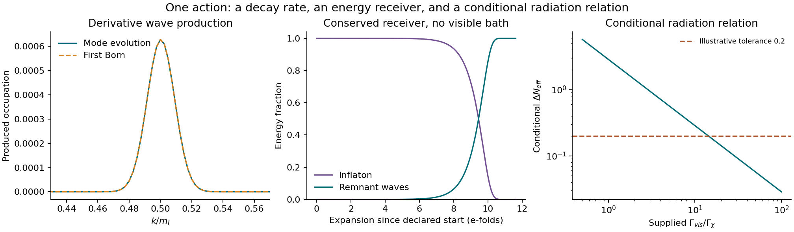

# An existing reheating channel, with a distinct radiation consequence

22 October 2026. Base d601fd1. This continues the unfinished calculation
identified in the shared chat and issue #13. One author, no outside
replication. The underlying action and decay/radiation physics are
published work, credited below.

**The assisted-relaxation action already contains a calculable decay
channel from the inflaton to remnant-field waves.** Its pole-dominated,
weak-amplitude limit gives

\[
\boxed{\Gamma_{I\to\chi\chi}={m_I^3\over128\pi\kappa M^2}},
\qquad\kappa=3c^2/2.
\]

The earlier report's statement that a receiver was missing needs this
qualification: a derivative wave receiver exists in the displayed
metric. What remains missing is a complete visible-sector reheating
interaction and transport of the actual inflaton/remnant state into
this late, perturbative regime. No new field or fitted dark-energy
density was added to derive the partial rate.

## One action links three calculations

The remnant kinetic coefficient contains exp(-varphi/M). Oscillating
varphi therefore couples to two canonically normalized remnant waves.
Keeping the literal action normalization and using the previously
declared N=55 inflation calibration yields:

| c | Inflaton mass (GeV) | Partial width to remnant waves (GeV) |
|---:|---:|---:|
| .5 | 3.062e13 | 32.10 |
| 1 | 2.970e13 | 7.324 |
| 2.5 | 2.689e13 | .8699 |
| 3 | 2.610e13 | .5521 |

These use the same action's inflation normalization for each c;
alpha is recalculated rather than silently held fixed. They are
conditional rates for a light daughter, regular local field branch
and a negligible spectator energy during this stage. They are not
a new observational fit or GRUT-specific predictions.

The same action also fixes the conditional relation

\[
\boxed{\rho_*m_I^2={4V_0^2\over3M^2}},\qquad V_0=\lambda v^4/4.
\]

Here rho_star is the parent's **prepared** remnant energy. In its
single-adiabatic inflation limit the mass and partial rate can also
be expressed using A_s, n_s and r; the explicit formulas are in
MATHEMATICS.md. This ties several consequences to common inputs.
It does not derive the preparation or make rho_star today's density.

First, a quantum-wave calculation checks the rate coefficient. A
smooth, finite inflaton pulse produces quanta near k=m_I/2. Direct
canonical mode evolution, original-coordinate evolution, Bogoliubov
normalization and the first-Born energy integral agree. Halving the
small pulse amplitude reduces the nonlinear energy correction by
about a factor of four. This is a scattering calculation with a
prepared external pulse, not a full backreaction history.

Second, a separate averaged reheating calculation includes the
opposite inflaton energy loss and the relativistic receiver in the
Friedmann equations. It produces radiation domination. An independent
fraction/e-fold formulation agrees with the refined density/time
calculation. Energy is accounted for; it is not assigned to a varying
vacuum constant without a receiver.

Third, if an additional visible bath is specified, standard entropy
evolution links the resulting dark radiation to the relative widths:

\[
\Delta N_{\rm eff}\simeq2.858\,
{\Gamma_\chi\over\Gamma_{\rm vis}}
\quad(g_{*\rho}=g_{*s}=106.75).
\]

This supplies an observable **interface** for completing the model.
Gamma_vis is not fixed by the displayed terms analyzed here. Ratios
1,4,20 in the worked comparisons are supplied diagnostics, giving
Delta_Neff about 2.858,.7145,.1429; they are not newly derived
visible couplings. With only the computed channel there is no visible
reference bath, so no finite Delta_Neff comparison can be assigned.
The formula is established radiation/entropy physics, not evidence
for GRUT. No new observational limit or confidence level is claimed.

## This channel does not yet prepare the tiny dark-energy state

Relativistic remnant waves have radiation pressure. They must not be
counted as the homogeneous vacuum-like remnant. In the post-pole stage
where the remnant potential is negligible,

\[
a^3 e^{-I/(\sqrt\kappa M)}\dot\chi_0=\text{constant}.
\]

An initially stationary homogeneous field therefore retains any of its
possible positions. This coupling can damp momentum and carry energy
into waves while leaving the field-position selection unresolved.
The calculation checks that statement explicitly. It is a statement
about the shift-symmetric limit, not a theorem excluding earlier
potential-driven or nonperturbative preparation.

The d601fd1 stochastic probe remains a fixed-early-inflaton calculation.
Its probability distribution has not been transported to the beginning
of these reheating runs, and the c=10 probe is not substituted for the
c=1 calibration. A large alternate spectator population can invalidate
the negligible-spectator approximation and must be evolved together
with the background. No post-reheating abundance is inferred from a
fixed-inflaton rms alone.

The prior conditional remnant-density mismatch is unchanged. The
present work neither supplies a positive vacuum constant nor turns
the earlier inflation–remnant consistency relation into a prediction
of today's density. The absolute quantum vacuum zero, common potential
scale and required initial state remain assumptions.

## Verification and the next dependency

**42 internal checks pass.** They cover metric normalization and its
normal-coordinate amplitude, three wave spectra including refinement,
Bogoliubov Wronskians, finite-pulse/Born normalization, original versus
canonical mode coordinates, zero-mode momentum, five conserved receiver
runs including refinement, an independent receiver formulation and
entropy conversion, the mass/remnant identity and inflation-observable
elimination of the partial rate. These are mathematical/numerical checks by one
author, not empirical validation or independent scientific replication.

The receiver's largest sampled normalized Friedmann residual is below
4.2e-10 in the baseline runs and 6.5e-12 in the refined run. The two
receiver formulations agree on refined late H to about 2.2e-12
relatively. At q=.001/.002, finite-pulse production exceeds the
first-Born result by .02225%/.08901%, within its weak-pump regime.
Numerical precision does not certify the approximations to a complete
cosmological state.

The next dependency is now sharper: specify the visible interaction
and propagate the joint inflaton/remnant distribution into the
post-pole state, including its potential energy and any early
nonperturbative production. The existing derivative channel must be
included in that budget. Its radiation relation can then test the
completed receiver model beyond the dark-energy calibration.

The previous q, action-freezing and assisted-preparation packets are
preserved. No empirical target is adopted, no canonical GRUT-RAI merge
is made, and Candidate 1's unresolved status is unchanged. See
[MATHEMATICS.md](MATHEMATICS.md), [LEDGER.md](LEDGER.md),
[SOURCES.md](SOURCES.md), [PROTOCOL.md](PROTOCOL.md) and
[REPRODUCE.md](REPRODUCE.md) for assumptions, credits and executable
reproduction.
