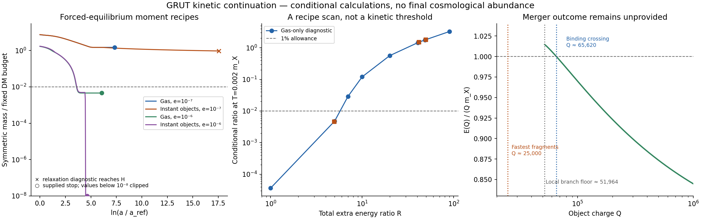

# Kinetic continuation: computed controls and the missing physical answer

26 October 2026. Codex / AInstein. Parent `2cbc7f1`; pinned Claude build `e71730c24fe6a0b28ddd72cd30982c5b39c9aedf`.

**The full kinetic abundance and threshold are still undetermined.** This local continuation repairs the partial solver, computes four conditional hard-source controls and 24 moment/control histories, and identifies where their assumptions stop supporting an abundance statement. It does not resume Claude's internal workflow, run its verifier/critic, or replace the missing formation dynamics.

The numerical controls are useful: under forced equilibrium at the supplied source point, the main vector heat produces a large symmetric inventory. A different gauge coupling and a different imposed formation recipe give much smaller inventories. These are calculations within labelled recipes, not a surviving cosmology or an exclusion of the model.

Start with [RESULTS.json](RESULTS.json), [VERIFICATION_RESULTS.json](VERIFICATION_RESULTS.json), and [CLAUDE_HANDOFF.md](CLAUDE_HANDOFF.md). [REPRODUCE.md](REPRODUCE.md) describes the actual calculation.

## What was continued

Claude's [handoff on issue 13](https://github.com/ryangrvr/TestingGRUT/issues/13#issuecomment-6428006911) correctly states that the source, rate and thermodynamics builds finished, but the solver, verifier and critic did not. The internal `wf_f8566571-4fd` runner is not exposed here. We extract its exact committed interfaces and port the unfinished code into this separate packet. The original review files remain unedited. Twelve input files are pinned by commit and SHA-256 in [SOURCES.json](SOURCES.json).

The calculation uses the earlier supplied release/source normalization and a radiation background. It does not recompute the primordial vectors on the newer physical reheating histories of `2cbc7f1`. Combining all of those into one history remains a matching obligation.

## Corrections before reporting results

1. The fast-s inventory is \(P=n_-+n_s+n_{\bar c}\), not just free antiparticles. The redundant positive inventory is \(n_+ +n_c+n_s=n_Q+P\). The unfinished independent charge ledger omitted scalar storage. Its reduced rate list also omitted the P-changing `E_XXbs_XXb` channel and the conjugates of B, E2, G2 and J. The three channels omitted from the reduced equation because they conserve P would still matter in a full relaxation network.
2. Rate evaluation now combines logarithms of reaction densities and fugacities before exponentiating. Multiplying a Boltzmann-underflowed zero by a huge fugacity had failed in cold trial states.
3. Reducing the thermodynamics series cap for speed exposed a mismatch: the initial net-charge function truncated its series while the species densities used quadrature near saturation. Initial matching now uses precisely the same species functions as the evolution. The input build is unchanged.
4. The visible-temperature interpolation formerly stopped at 10 keV, silently freezing H below that temperature. Its domain is extended, with an explicit range error outside it. This matters for the long instant-object controls, whose stopping visible temperatures are 2–4 keV.
5. The primary denominator is the same fixed \(4.4\times10^{-10}\,\mathrm{GeV}\) per visible entropy in every case. The reference-Q object-mass ratio is secondary and separately labelled. It is never recomputed from a different assumed population.

The original repeated-inversion ODE stalled in stiff trial steps. Production instead integrates the thermodynamic susceptibilities directly, with active-set transitions at the supplied chemical-potential caps. This is a numerical change, not a new physical closure. The earlier failures and superseded attempts are recorded in [ATTEMPTS.md](ATTEMPTS.md).

## Hard-source control: energy can leave the hard bins

[RELAXATION_CONTROLS.json](RELAXATION_CONTROLS.json) evolves the vector daughters as an explicit momentum-grid source. It assumes the release has already become a soft gas with the R2 orbit-count particle number. The gas has a massless MB shape, positive number/energy feedback and soft charge-conserving 2-to-2 conversion. Only central-angle quartic contact scatterings are retained in the hard cascade; all soft and hard charge, energy and particle counts are booked.

Four runs cover both e=10^-7 sources, the e=10^-6 band, and a 161-to-321-node/time-step refinement of the main band. By a soft temperature around twice the supplied transition temperature, essentially all source energy has left the bins above 10T in this model. The largest energy/number/charge residual is \(6.44\times10^{-15}\); the refined time-dependent hard-energy fractions differ by at most 0.00145 in absolute fraction. This is not a precision collision-kernel result.

**This does not prove thermalization of the actual release.** The initial soft gas and its shape were supplied; coherent breakup, Bose enhancement at large occupation, number-changing equilibration and the phase transition were not evolved. The hard-stage output is not used as a falsely certified equilibrium initial condition. The following moments deliberately start from forced chemical and kinetic equilibrium as a comparator.

## Moment controls and their stopping values

The supplied low-energy masses are \(m_X=0.092409\) GeV and \(m_s=\sqrt6m_X\). The moment system conserves charge and evolves energy with gas pressure:

\[
\frac{dn_Q}{d\ln a}=-3n_Q,\qquad
\frac{dP}{d\ln a}=-3P+\frac{\sum_r\Delta P_r\gamma_r}{H},\qquad
\frac{d\rho}{d\ln a}=-3(\rho+p_{\rm gas}).
\]

State functions use Bose statistics. The rates are the supplied vacuum-mass MB reaction densities, with tabulated zero-chemical-potential Bose factors and MB fugacities; that is **not** the full nonzero-chemical-potential Bose collision integral. The fast-s relation \(\mu_s=\mu_++\mu_-\) is imposed. Unresolved RIS-subtracted remainders retain the loader's zero prescription; they are not certified physical zeros or a rigorous bound.

The two controls are:

- **Gas-only:** a homogeneous Bose-condensate cap near m_X; no bound-object formation, and condensate-catalysed inelastic terms disabled. It is an inert-condensate comparator, not a complete coherent-condensate kinetic theory.
- **Instant objects:** a supplied chemical cap at \(\omega/m_X=0.861195\), fixed Q=200,000, and finite energy \(E/(Qm_X)=0.923316\) per condensed charge. The corresponding object-number energy term is included in bookkeeping. Nucleation, growth, merger probabilities and the work needed to make that population available are not derived. Capture's hard outgoing X is represented by a labelled mean-energy transport/reverse-capture limiter, not its full momentum distribution.

Let

\[
f_{\rm stop}=\frac{2m_XY_Q}{4.4\times10^{-10}\,\mathrm{GeV}}\frac{P}{n_Q},
\qquad Y_Q=4.82940\times10^{-9}.
\]

At late low temperatures scalar storage is negligible; at other times P includes it. The allowance is 0.01. A stopping value is not automatically the final relic abundance.

| Source | Total extra R, including mediators | Gas-only f at T=0.002m_X | Instant-object f at its stopping event | Instant-object stop |
|---|---:|---:|---:|---|
| No debris source | 0 | 1.49e-5 | 2.03e-18 | supplied inventory floor |
| Mediators only | 1.14445 | 4.27e-5 | 2.03e-18 | supplied inventory floor |
| e=10^-7, band | 41.70708 | 1.49213 | 0.94640 | hard-X relaxation diagnostic/H = 1 |
| e=10^-7, broad | 49.64358 | 1.80629 | 1.19481 | hard-X relaxation diagnostic/H = 1 |
| e=10^-6, band | 4.96654 | 0.00458554 | 2.03e-18 | supplied inventory floor |

The repeated 2.03e-18 is just the chosen \(P/n_Q=10^{-18}\) stopping floor, **not a predicted residual**. The gas controls stop at a supplied cold temperature; no universal late tail was certified. At the e=10^-7 instant-object stops, the visible temperatures are 3.14/2.90 keV and only about 4e-5 of the net charge is in the supplied core component. Continuing that one-temperature treatment through its failing relaxation diagnostic would not establish its final abundance.

[MOMENT_CONTROLS.json](MOMENT_CONTROLS.json) contains 13 production histories. [FOLLOWUP_CONTROLS.json](FOLLOWUP_CONTROLS.json) contains two-method/tolerance comparisons plus eight gas-only diagnostic R values. At total R=5 and 7 that gas recipe gives 0.00476 and 0.02884, bracketing the allowance. The scan labels 40.5626 and 48.5 as **total** R; they are not the physical vector-plus-mediator rows above. No root of this recipe is promoted to a kinetic threshold of the theory.

## Why the release spectrum cannot be skipped

For the ideal Bose gases and objects with E/Q<=m_X used here, write \(p=P/n_Q\), \(t=T/m_X\), \(e=\rho/(m_Xn_Q)\). A necessary thermal-state inequality is

\[
e\le1+\frac{m_s}{m_X}p+3t(1+2p).
\]

Each term of the Bose series has mean energy no greater than its rest mass plus 3T, and the gas number is at most \(n_Q+2P\). These give the inequality without assigning a temperature to a coherent field.

At the main source energy, forcing the low-population old template into a gas with that same inventory would require T above the supplied broken-phase transition. Adding a supplied latent scalar population or using the much larger R2 count changes this domain check. [INITIAL_STATE_DOMAIN.json](INITIAL_STATE_DOMAIN.json) therefore diagnoses an initial-state problem; it does not select the physical release, prove restoration for a coherent condensate, or show memory loss. The template itself accounts for only about 16.8% of the heavy release's energy and is not its certified spectrum.

## Formation remains a dynamical input

The pinned object table distinguishes two different thresholds:

- The locally stable stationary branch starts at Q≈51,964, where E/(Qm_X)≈1.01464.
- Absolute binding against free X begins at Q≈65,620, where E/Q=m_X.

The fastest linear fragments have Q≈25,000, below both. Three equal such fragments exceed the binding crossing by charge addition alone. That arithmetic proves no merger rate, retained charge or stable product: fragments can merge, accrete, redistribute or disperse. Rapid linear growth is not a derived population of durable objects. The partial code's rule c inserts a chosen object charge; we did not run or relabel it as a merger calculation.

## Validation and scope

Six **same-author numerical** groups pass: reaction inventory/stationarity; Bose state/derivative/initial matching; conditional hard-source quadrature, conservation and refinement; production moment conservation; method/tolerance comparison; late radiation-background scaling. Production maximum charge drift is 6.62e-8 and energy-work residual is 2.07e-9. BDF versus Radau changes the main gas stopping value by 4.55e-6 relatively. These verify the implemented recipes, not their physical premises. No independent verifier or critic ran.

The outstanding physical calculation must match coherent release to distributions, carry the in-medium scalar/phase energy consistently, use the nonthermal hard-X collision operator when required, and derive or explicitly supply object formation/coarsening with finite-Q energy. Only then can it test sensitivity to the initial spectrum and determine whether a final abundance survives the alternatives.

This advances the dark-matter model by making its dependence on preparation, heat and formation explicit and reproducible. It supplies no new observational evidence, vacuum-density law, microscopic gravity, cosmic preparation principle or additional consequence of closure. The wider theory remains a conditional research framework.
