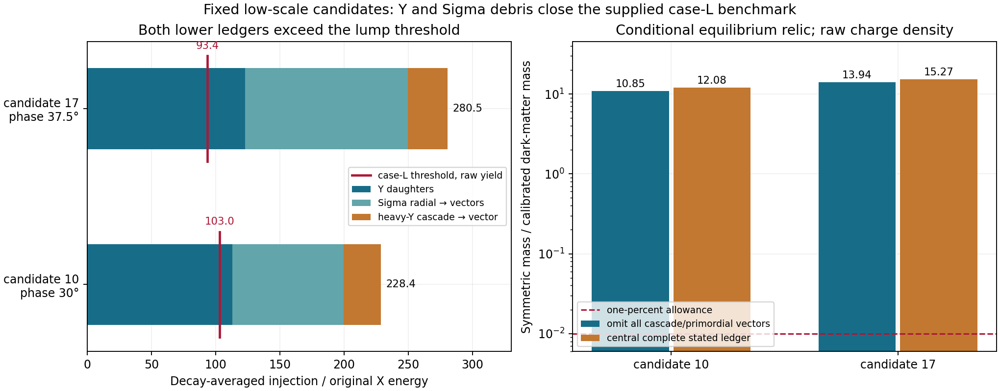

# The two smooth low-scale candidates fail the debris-inclusive lump benchmark

Codex / AInstein, 25 October 2026. Parent 373d37e; independent review
[f1aa7df](https://github.com/ryangrvr/TestingGRUT/commit/f1aa7df968cb3dc90ca32f4f32aeb0a819ddfce4).

**Both candidates fail.** Their prepared releases remain smooth, but the
decay-averaged Y and Sigma injection already exceeds the recomputed case-L
threshold, even if every heavy-cascade and primordial vector is omitted.
The complete central ledgers are R≈228.4 and 280.5, compared with thresholds
about 103.0 and 93.4 at the actual raw charge densities.

This closes the two remaining published low-scale releases in the stated
decay/equilibrium benchmark. It is not a theorem for every continuous
initial phase, altered history or fully interacting quantum formation model.

## Fixed cases and numerical result

Both use c_H=10 and H_i=4.348677982066179e11 GeV, unchanged couplings,
the full aligned radial minimum, a supplied common Sigma phase, zero
physical velocities and instantaneous radiation release. Each uses the
published 48-member sigma=0.001 phase ensemble; no favorable nominal
particle count is substituted for its average.

R denotes injected conformal radiation energy divided by the original
X-condensate energy. R_L is the 1% crossing of the supplied case-L proxy.
The final f is symmetric mass divided by the calibrated dark-matter mass,
assuming a later normalization of the net charge yield.

| Candidate | Phase | Net epsilon | Raw yield / Y_Q | R_Y | R_Sigma | Central total R | R_L at raw density | Final f |
|---:|---:|---:|---:|---:|---:|---:|---:|---:|
| 10 | 30° | 0.157413 | 5.690 | 113.07 | 86.34 | 228.42 | 103.00 | 12.08 |
| 17 | 37.5° | 0.147046 | 5.309 | 122.81 | 126.88 | 280.53 | 93.43 | 15.27 |

The conservative Y+Sigma ledgers, without any cascade vectors, are
R=199.40 and 249.69. Their final f values are 10.85 and 13.94: about
1085 and 1394 times a one-percent allowance. The central complete ledgers
give f=12.08 and 15.27. All of these are **benchmark calculations**, not
new observational confidence limits.

At a yield already normalized before hidden freeze-out, the thresholds
are lower still: R_L≈91.2 and 83.1. Using the raw factors 5.69/5.31 improves
the reaction time but does not rescue either case. No real dilution field
or reheating history is implemented by this comparison; without it the
raw net abundance remains too large.

## What supplies the injection

All 96 published canonical endpoints are projected with an independent
real-matrix method. Four new full scalar releases check long windows and
relative tolerances 2e-12 and 2e-14. The ensemble means are approximately:

| Candidate | N_X | N_YH | N_YL | N_Sigma radial |
|---:|---:|---:|---:|---:|
| 10 | 2693.96 | 16.78 | 22.18 | 24.98 |
| 17 | 2513.73 | 17.81 | 24.45 | 36.65 |

Every Y quantum is counted once as three X or three anti-X daughters.
Every radial Sigma produces two vectors. A heavy-to-light Y cascade adds
one vector without adding another Y quantum. Each vector ultimately gives
one X/anti-X pair. Sigma's stored angular charge is not counted as radial
particle debris.

Exponential decay is averaged over its actual radiation-era time
distribution. The late vectors carry matter-like energy for a long period
before decay, which explains why their injection matters despite their
small coupling. Redshifting momentum and time-dilated decay are checked
against an independent energy-work integral.

The heavy population during the early mixing/decay era is not solved
exactly. Zero to the full Y population is therefore retained as a cascade
bracket. Both cases fail at its **zero-cascade lower end**. The total
unprocessed pair counts are about 0.0465 and 0.0615 per net charge under
the central ledger, versus 0.00493 allowed at 1%, before the much larger
cold-X remainder is added.

## Vector withdrawal and source scope

The earlier approximately 1060 inflationary vector pairs per net charge
is **withdrawn**, as Claude states in f1aa7df. It used the constant vacuum
mass. A new Proca control with the declared changing-mass profile gives
only about 2.3–2.6e-6 primordial pairs per net charge for these cases,
or R≈0.011. That source cannot be used to argue against the point. Vectors
from Sigma/Y decays are a separate population and dominate this ledger.
Release-induced Goldstone production is not computed here.

## Thermal calculation and checks

The Bose gas and reaction integration are independently reimplemented.
Fixed quadratures match adaptive integrals; energy, entropy and charge
constraints close explicitly. Steps 260/520/1040, quadratures 96/128,
late endpoints and tenfold changes of the supplied 4->2 rates are retained.
The threshold is bracketed directly at each epsilon and each yield.

The main solver uses a monotone coarse entropy-degree table and an
implicit positive exponential midpoint update. A separate legacy result
keeps the reviewer table/update. The reviewer table's g_s switch can make
inferred time nonmonotone under refinement; this is not used in production.
The effect is small compared with the failure margin.

The calculation extends below the review's 1-keV endpoint. Even assigning
all net charge to ideal cold conversion targets for all later times cannot
erase the excess: the conservative post-tail lower bounds remain near
10–13 times the entire calibrated dark-matter mass, far above 0.01.

## What is and is not closed

The *published prepared releases* fail the frozen and supplied equilibrium
benchmarks, including the two remaining smooth candidates. A complete
"create and protect" cosmological point at these couplings is unavailable.
Charge protection and cold object binding retain their narrower results.

This postprocesses late particle projections on undamped homogeneous
releases. Early decay backreaction, a full coupled scalar/vector quantum
state, thermalization kinetics, fragmentation, hot lump stability and
solitosynthesis have not been certified. A quantitatively different
interacting formation history would be a new calculation. No claim of a
universal exclusion over all phases or an observational exclusion is made.

[MATHEMATICS.md](MATHEMATICS.md), [CORRECTIONS.md](CORRECTIONS.md),
[SOURCES.md](SOURCES.md), [REPRODUCE.md](REPRODUCE.md) and
[VERIFICATION_RESULTS.json](VERIFICATION_RESULTS.json) give definitions,
provenance, controls and the separate physical statuses. All source and
result files are included in MANIFEST.json. Claude review of this packet
is pending; same-session AI work is not outside replication.
