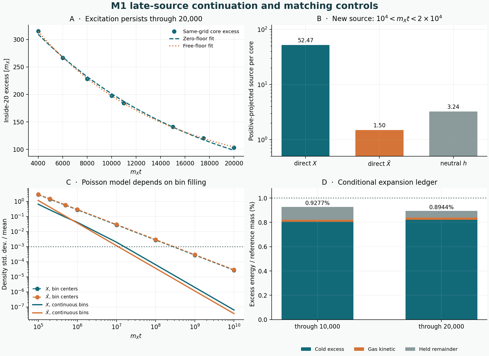

# M1: late core radiation, near-core matching and mixing sensitivity

29 October 2026. Parent published commit [`8f67a83be4177f6baaa475c94565aab3b7c0cd94`](https://github.com/ryangrvr/TestingGRUT/commit/8f67a83be4177f6baaa475c94565aab3b7c0cd94).

**Extending the supplied radial pulse to `m_X t=20000` leaves a conditional
0.8944% modeled energy excess after the same expansion calculation, including
its recomputed held remainder. It does not establish an M1 cosmological 1%
pass.** The field still has unresolved core excess; the quantum and angular
source match, local interactions, formation history, and actual spatial
mixing remain open.

The supplied Argon review describes exact analytical checks but explicitly
states that it did not run repository code or data. We use it as a proposal
and audit, not as independent numerical replication. Its neutral-daughter
kinematics is sound for the stated outward-parent model; several further
claims need correction or tighter conditions, as documented below.

## A direct extension of the field evolution

Restart the previous isolated radial runs from their actual final field and
momentum arrays at `m_X t=10000`. Continue for another `10000/m_X` using
the same nonlinear equations, outer absorber, and grids
`(h,dt)=(0.05,0.00625)` and `(0.025,0.003125)`. The restart values of
global and regional energy/charge agree exactly with the recorded prior
endpoints in the stored precision. During the fine continuation, total
field-plus-absorber energy drifts at most `0.00810 m_X` and charge at most
`4.16e-8`; the coarse energy drift is `0.03505 m_X`.

At the fine probe `r=60.0125/m_X`, the added segment carries
`140.008 m_X` of integrated classical energy flux and `50.97` units of net
outward charge. The raw rectangular trace integration gives `140.016 m_X`;
the difference is the expected endpoint/quadrature convention. Time-frequency
positive projections with the 400-wide window give:

| Source during `10000 < m_X t <= 20000` | Fine `h=0.025` | Coarse `h=0.05` |
|---|---:|---:|
| Direct positive `X` | 52.469 | 50.339 |
| Direct antiparticles `Xbar` | 1.503 | 1.668 |
| Neutral parents `h` | 3.238 | 3.587 |

Across 200-, 400-, and 800-wide windows the fine direct antiparticle
projection is 1.499–1.503 and the neutral projection 3.238. If these neutral
waves are instead treated as on-shell particles that subsequently decay in
vacuum, each parent produces one additional antiparticle and one positive
particle. This is a model prescription, not a measured quantum occupation.
The proposed assertion that late radiation is antiparticle-free therefore
does not hold in this isolated field-source model. The result says nothing
definitive about radiation after `m_Xt=20000` or about a core interacting
with its gas.

The claim that only direct late `Xbar` or `h` can matter is too strong even
as a kinematic statement: positive `X` above `1+2 Omega` can enter the
reverse core-conversion channel of the linear scattering model. The
fine late source's positive projection above the **reference** threshold
`2.76344 m_X` is approximately 0.20, 0.26, and 0.86 particles per core for
the 800-, 400-, and 200-wide windows, respectively. That strong
time-frequency sensitivity makes this a diagnostic of possible support, not
a precise prediction or proof of an actual conversion.

At `m_X t=10000`, the fine `r<20/m_X` field energy exceeds the same-grid
stationary energy at its instantaneous charge by `197.543 m_X`. At `20000`
the excess is `103.350 m_X`; the core charge changes from `201482.101` to
`201431.001`. The drop in core excess is not the full `140.008 m_X` flux:
the stationary core energy also changes as charge is emitted. Nor is the
core excess automatically identical to the earlier `199.373 m_X` held
ledger remainder, which also contains source and matching differences.

The fine eight-checkpoint energy series over `4000 <= m_Xt <= 20000` can
be fit with a zero-floor exponential of time scale about `13945/m_X`
(maximum residual `5.85 m_X`) or with a free nonnegative floor of
`46.41 m_X` and time scale `10456/m_X` (maximum residual `1.13 m_X`). These
are empirical fits to a regional energy diagnostic, **not complex
quasinormal-mode measurements or a measurement of the infinite-time
floor**. They illustrate why the present interval cannot determine the
eventual fate of the remainder.

## Recalculate the conditional expanding-core ledger

Append the whole-window `10000–20000` signed spectrum in the same compact
bin convention as the parent, use the same positive-bin prescription and
prompt vacuum neutral-daughter reduction, and rerun the same seven-profile,
charge-dependent homogeneous expanding-core model. Recompute the residual
from the original pulse energy, the stationary energy at the new source
charge, and the new gas energy. This prevents counting the late radiation
both as gas and as part of a fixed old remainder. All three source windows
are still treated as an instantaneous homogeneous initial gas; the actual
pre-mixing core/cloud dynamics is not solved.

| Fine radial source, 96 kinetic nodes, `a/a0=10` | Through `t=10000/m_X` | Through `t=20000/m_X` |
|---|---:|---:|
| Final modeled core charge | 187088.27 | 186810.87 |
| Stationary cold excess | 0.80517% | 0.82226% |
| Gas kinetic excess | 0.01616% | 0.01656% |
| Held, unassigned remainder | 0.10634% | 0.05562% |
| **Total modeled excess** | **0.92768%** | **0.89444%** |

The new held remainder is `104.284 m_X`, compared with the parent's
`199.373 m_X`. The decrease, `95.089 m_X`, is not identical to the late
probe flux: recomputing the stationary core energy and gas spectrum matters.
The additional source increases modeled cold excess and leads to about 277
more units of modeled core-charge reduction in the final solution; the
full total nevertheless falls because more energy participates in gas
redshift work. This does not isolate a cause for the charge change to any
one particle species. The late-source results at 64 and 96 kinetic nodes are
0.89360% and 0.89444%, respectively. All residual negative solver
populations are tiny numerical ODE errors, not physical negative particle
numbers.

The energy argument deserves precise wording. If a closed sector's *complete*
comoving energy is actually known and its subsequent integrated pressure
work is nonnegative, then that total cannot increase and an internal
conversion cannot create additional energy. This includes catalytic charge
conversion: it can change how energy and charge are distributed, but it
cannot bypass energy conservation. The antecedents are not established here:
the parent and current calculations assume a supplied source, homogeneous
gas, a quasistatic core, a specified background, and a remainder held as a
bookkeeping component. Formation, source matching, and the pressure and
coupling of the excited core remain unproved. Thus neither the old 0.9277%
nor the new 0.8944% is a physical pass.

## What the 40–80 matching surfaces do and do not measure

The `h=0.05` runs use identical field dynamics, measured at different probe
radii. For the first energy bin `1 <= E_Xbar/m_X < 1.025`, the total
positive-projected counts are:

| Time-window width `m_X^-1` | `r=40/m_X` | `r=60/m_X` | `r=80/m_X` |
|---|---:|---:|---:|
| 200 | 7.949 | 7.385 | 7.423 |
| 400 | 11.404 | 10.922 | 11.121 |
| 800 | 11.789 | 11.680 | 11.771 |

At width 400 the total projected direct counts at radii 40 and 80 are
201.588 vs 201.269 for `X`, 1688.302 vs 1688.082 for `Xbar`, and 17.082
vs 17.015 for `h`. The changing slow bin and its strong window dependence
remain material for the previous narrow-resonance estimate.

Independently of the particle projection, the nonlinear classical field
energy left in `40<=r<80` increases by `1.0326 m_X` and its charge by
0.29545 over the run. The inner-minus-outer probe integrals are `1.03499 m_X`
and 0.29406, respectively; the small residual reflects the finite-volume
cell/face assignment and central-difference probe conventions. These agree
as an energy/charge transport check. A small **net** flux difference does
not bound interaction or conversion rates in the shell: reactions can
redistribute momenta or species while conserving energy and charge, and
waves still in flight affect finite-time comparisons. Nothing here bounds
unmeasured `r<40/m_X` dynamics.

## What the 3D quadrupole test measures

The archived object case was a **5%** radial-plus-quadrupole disturbance in
a periodic box of side `64/m_X`, not the 10% radial cosmological pulse. Its
full 96-cubed field snapshots were not present in the parent packet. We
recreated the original 64- and 96-cubed disturbed initial states with exact
recorded SHA-256 hashes and reproduced the saved energy and charge traces at
common times through `m_Xt=78`; same-code agreement is not independent
replication. Matched undisturbed controls were also run. A 64-bit snapshot
replay checks precision against the regular 32-bit snapshots.

A sphere of `r=60/m_X` cannot be uniquely contained in this box. On an
inside-box `r=20/m_X` sphere, over `0 <= m_Xt <= 29.64`, the **difference
field** between the disturbed and undisturbed 96-cubed runs has 54.95%,
44.88%, and 0.17% of its charged-field squared amplitude in `l=0,2,4`,
respectively, among modes through `l=4`. The corresponding `l=2` share of
the signed perturbation-field radial energy flux is 49.76%; the 64-cubed
value is 49.72%. The angular-gradient fraction is 0.745% with radial
derivative spacing 0.75, but 0.643% with spacing 0.5. The neutral-field
`l=2` amplitude fraction changes from 8.5% to 33.8% between 64 and 96
nodes, so the neutral decomposition is not grid-converged.

These are finite-time near-field multipoles of a difference field. Its
energy flux omits interference with the undisturbed field; the projections
are not particle occupations, do not separate all incoming and outgoing
waves, and do not establish two-particle relative-angle correlations. The
time window, spatial interpolation, periodic images and core tails also
matter. They cannot be inserted as a measured collision-angle kernel for
the 10% plume.

## Mixing extrapolation: a real spectral-resolution sensitivity

The parent Poisson-center calculation represented each energy bin by its
center speed. That is a well-defined **discrete-speed model**, but the
quoted density fluctuations are not robust to how each finite bin is filled.
We now evaluate a separate model using a piecewise-linear continuous energy
source and integrate its retarded flux at each radius. For the same original
direct source through `m_Xt=10000`:

| Time | Model | `X` density standard deviation / mean | `Xbar` density standard deviation / mean |
|---|---|---:|---:|
| `m_Xt=100000` | Bin-center speeds | 2.803 | 2.954 |
| `m_Xt=100000` | Continuous bins | 0.653 | 1.162 |
| `m_Xt=10000000` | Bin-center speeds | 0.0276 | 0.0295 |
| `m_Xt=10000000` | Continuous bins | 0.00198 | 0.00116 |

At `m_Xt=10^10`, the respective pairs are about `(2.77e-5, 2.97e-5)`
and `(6.37e-8, 3.67e-8)`. The discrete result has up to 0.7% number
normalization error at that extreme time from the knot-sweep floating-point
cancellation; the continuous integral agrees with its independent asymptotic
control to 0.05%. A 140/280/560 source-bin scan changes the discrete
`m_Xt=10^7` charged variations from roughly 0.035–0.041 to 0.020–0.021;
the continuous-bin `X` result ranges 0.00163–0.00239. The underlying
within-bin spectrum is not independently resolved, so neither prescription
should be called the physical answer.

A direct counterexample to counting every core inside a solid ball is a
single-speed pulse of duration `200/m_X` and speed 0.7 at `m_Xt=10^7`.
Only the thin shell contributes at a point: its effective Poisson source
count is 104.66 and its exact coefficient of variation is 0.0977. Counting
the full ball gives 1.74 million and 0.000757. Different velocity spectra
can fill the ball, but that must be calculated, not assumed. The general
Poisson shot-noise moment method follows Campbell's theorem; see Schmidt,
[*Poisson bounds for moments of shot noise processes*](https://doi.org/10.1080/02331888508801853).

These are pointwise **ensemble** statistics for identical synchronous
sources at independent Poisson centers. They exclude the new late source,
neutral daughters, interactions, real source correlations and formation;
they do not guarantee homogenization at every point or quantify angular
collision correlations.

The review's density-clock arithmetic also needs adjustment:
`tau=(n_core/m_X^3)(m_X t)` equals `1.2141e-8` at `m_Xt=10^7`, and
`tau=1` occurs near `8.24e14/m_X`, not `4e14/m_X` in the static-density
approximation. `tau` is a density clock, not a universal collision optical
depth. For example, the parent's homogeneous model already decreases
`N_Xbar` from 1705.6 to 1388.8 by `tau=0.1`. In the separately frozen
Poisson direct-source model, the distinct-center s-channel reaches 0.01
events per core at about `m_Xt=6.46e9` and would give 0.0155 at `10^10`;
that extrapolation excludes evolving spectra, further emission and other
channels.

## Verification and next physical obstacle

Thirty-one same-author engineering checks pass: restart continuity, field and
absorber conservation, source-window controls, the shell ledger, recomputed
remainder identities, 64/96 kinetic comparisons, reproduced 3D traces,
multipole precision, and separate continuous/discrete Poisson controls.
These are not independent replication. `ATTEMPTS.md` retains the initially
unstable/underresolved choices.

Next, construct an outgoing, positive phase-space source with angular and
time correlations from a larger open 3D domain, resolve the slow-energy tail
and include core/cloud feedback and late emission. Then connect a justified
formation population and complete sector stress-energy to the expansion
ledger. Those are necessary before calling the 1% gate closed.
