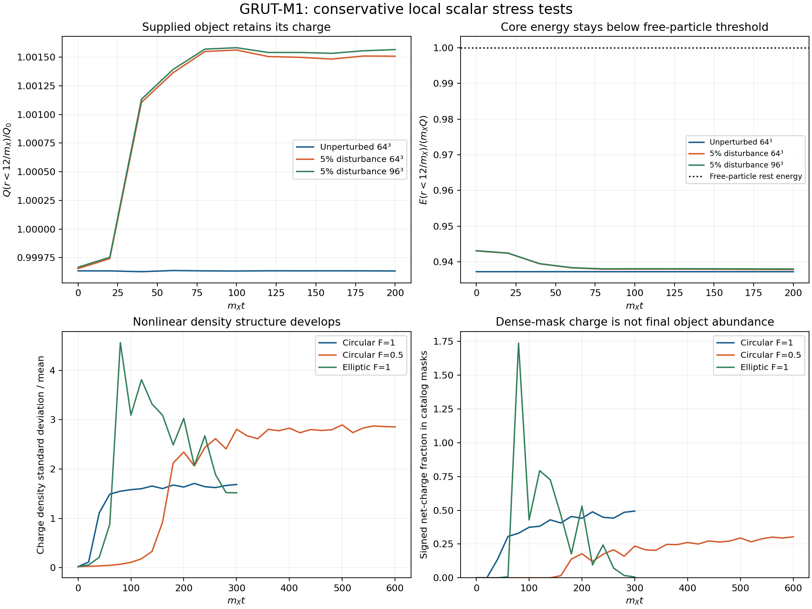
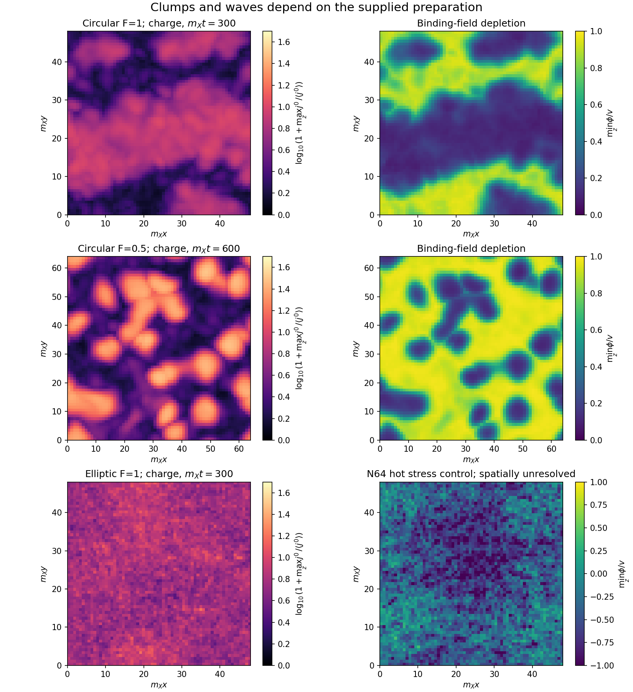

# GRUT-M1 played out: robust objects, cold clumping, excitation and heat still matter

27 October 2026, America/Chicago. Parent d4747cb. **No M1 coupling, mass target,
preparation phase or vacuum input was retuned.** This packet runs 13 conservative
three-dimensional scalar histories and nine open spherical histories. It tests
the light matter mechanism, not a complete cosmology or an independent replication.

**Result:** the supplied M1 object survives finite disturbances; cold circular
fields spontaneously concentrate their charge. A hot elliptical stress control
does not give a spatially converged population. Excited objects can survive while
emitting a significant negative-charge source. Consequently the necessary next
link is a measured formation/cooling and chemical history, not another static
binding calculation. The actual final abundance and vacuum explanation remain open.

## What was actually evolved

The local light Hamiltonian is M1's X/phi action, with g_X=.1, lambda_X=.001,
lambda_phi=.03, epsilon=.002, v=.9240896374 GeV and m_X=.09240896374 GeV.
The new term -epsilon v(phi-v)^3 is included in both force and energy.
The charged field and binding field evolve together with no imposed core, damping
or cooling in the periodic 3D tests. The spherical tests have a remote absorber
with an explicit energy/charge receiver, never damping the core.

The cold preparations and elliptical control are supplied local classical fields.
They are not the actual expanding, heated release distribution. Expansion, timed
mediator/vector sources, the full gauge sector, quantum chemical reactions and
the physical phase holder are absent here. Gauge and charge-six omissions inherit
the stated local/cold approximation; no full hot-gauge stability is inferred.
The full gauged theory still needs its compensating sector and Gauss constraint;
this reduced scalar box does not construct that state.

The protocols were recorded before their corresponding runs. The lower-density
control was added after retaining the dense primary's merging structures. Finer
hot controls were added because the primary had excessive cutoff power. The open
radial tests remove the periodic-return ambiguity. All outcomes are retained.

## The supplied object passes a nonlinear survival test

The primary object has Q=200000 and stationary E/(Q m_X)=.93739999. The 3D
unperturbed control and a smooth 5% radial-plus-quadrupole disturbance run to
m_X t=200. The disturbed control is repeated at 96³ instead of 64³.

- The fine disturbed box has total E/(Q m_X)=.94322083, still below free-particle
  rest energy and only .621% above the reference object's energy.
- The core stays compact. A radius12/m_X sphere contains essentially the original
  charge; it can contain slightly more than the original net charge because the
  exterior carries negative charge. Its regional E/Q remains below m_X.
- The fine/coarse total E/Q differs by 5.8e-5 relative. A dense-mask count changes
  from40.1% to36.6% of charge even though the physical core survives in both.
  This directly demonstrates why a mask fraction cannot be called final eta.

An additional open spherical control runs to m_X t=1000. A 5% radial disturbance
relaxes to core20 E/(Q m_X)=.93787 on the finer grid. The core charge is about
200401. Moving the absorber from100/m_X to200/m_X changes the primary final core
charge by less than1e-7 relative; halving spacing and time changes it by2.3e-5.
The explicit Q+Q_abs ledger is conserved to1.2e-14 in these controls. This is
nonlinear scalar survival evidence over the tested interval, not an astronomical
simulation, a complete gauge spectrum or an all-disturbance theorem.

## Surviving objects can still create the unwanted population

In the weak exterior of the disturbed 3D object, a vacuum-mass Fourier projection
gives negative-frequency occupation about .00174–.00200 per original net charge
in the late window. The interaction-energy residual is below9.4e-5 of the free
energy. The taper-energy sensitivity is below.25%; varying the extraction radius
also changes which outgoing radiation is included. The grid control agrees.
The unperturbed control has only about1e-7 in this exterior reference.

The open spherical receiver independently records net negative outgoing charge.
It is a **lower bound** on negative-charge quanta in the weak exterior, not a
complete count when positive waves are also emitted:

| Supplied radial amplitude | Negative charge emitted / original Q | Final core20 E/(Q m_X) |
|---|---:|---:|
|5%, fine|.00200|.93787|
|10%|.00799|.93899|
|20%|.0304|.94136|
|40%, fine|.0949|.93911|

The exterior probe amplitudes remain small even for the largest pulse. The 40%
coarse/fine source differs by about.8%, so the table deliberately uses limited
precision. This radiation conserves total X charge: the remaining core acquires
additional positive charge. It is distinct from the previously computed tiny
charge-six loss of a cold ground-state object.

The original eta1 pair-source allowance is p=.004687. Thus the10% pulse already
exceeds that **raw** allowance in negative-charge emission alone. It is not a
cosmological exclusion: later capture, annihilation and redshifting have not been
computed, and these pulses are not the measured formation population. It does
establish a concrete requirement: either formation leaves sufficiently quiet
cores, or their outgoing population must be processed. A long lifetime by itself
does not settle this gate.

There is also a bookkeeping correction to keep explicit. With negative exterior
charge, eta=Q_objects/Q_net can exceed1. For positive objects plus free gas the
charge constraint is Nplus/Qnet=1-eta+p>=0. The same mass identity continues to
hold with the actual object energy per charge; restricting eta to[0,1] would
omit these legal states. This is not a new mass tolerance or a fitted final state.

## Cold fields clump, but the object population is not yet extracted

The primary self-consistent circular fluid has F=1, S=.82125, Omega=.88003,
L48/m_X. Its 64³ run to300/m_X develops dense merging charge regions. A matched
48³ control and a half-time-step64³ control reproduce the bulk result. The final
four-times-mean masks contain49.4% of net charge; a second seed gives51.7%.
Those regions include large connected structures, not a certified isolated mass
function.

The auxiliary F=.5, L64/m_X runs to600/m_X produce20–21 compact catalog candidates
at64³/48³ and two seeds. Their dense masks carry30–32% of charge. Surrounding
spheres often have E/Q below m_X, but still contain a wave background and core
tails; this does not certify an isolated-object energy for every candidate.
There is no replacement of these fractions by the required final eta>=.85.

No negative phi cells are seen at sampled times in the cold controls. Analytically,
the fixed-density phi equilibrium is unique and positive at every F>=0, not just
in empty space. Thus the original pair of sign vacua is not revived by a constant
charged density. Driven hot fields can still cross zero and form transient
interfaces, as the next test does. This is not a theorem that every cosmological
interface or its released energy is harmless.

The zero-pressure bulk calculation gives S=.15117, F=2.40648 and
E/(Q m_X)->.77586 at infinite size. An explicit quartic proves there is one
positive stationary minimum; independent three-equation solving agrees.
It also gives the global classical bound E>=.77586 m_X |Q|. Finite surface energy
raises the reference object's ratio to.93740. Therefore coarsening changes the
mass per charge: **Q=200000 is still an assumed reference, not a selected size.**
Its actual population must be used before judging the frozen mass calibration.

## The hot stress control remains unresolved

The supplied elliptic orbit preserves net charge and has harmonic shape action1.75.
It is not the actual release spectrum; with the interacting potential it starts
at E/(Q m_X)=5.79268, much hotter than the cold preparation.

At64³ it produces a wave bath, transient negative phi patches and only.60% of
charge in the four-times-mean masks by300/m_X. About20% of kinetic-plus-gradient
energy lies in the axial high-k shell. Halving dt leaves bulk moments close but
does not remove that shell; the full final field differs by6.1%, so complete
pointwise time convergence is not claimed either.

At96³, about9.6% remains in the analogous high-k shell, the dense-mask fraction
is3.45%, charge contrast changes23%, and the neutral-field evolution changes
substantially. **The hot population is not spatially converged.** Energy
conservation alone does not fix this. No hot formation efficiency, antiparticle
erasure or failure of every M1 cosmological history can be inferred from it.

## What this advances, and what must come next

M1 now has a dynamically tested durable scalar object and a working cold
clumping mechanism without the old pair of sign vacua. We have also measured a
finite-excitation negative-charge source rather than assuming a surviving core
has no leakage. These are useful conditional results, not evidence that nature
uses this model.

The next connected calculation must derive the M1 preparation after heat and
number-changing evolution, match its resolved waves/cores consistently, and use
the actual charge-weighted object spectrum. The changed scalar cubic must enter
its collision kernels; the old thresholds cannot be imported unchanged. The hot
classical cutoff must be controlled or matched to a justified quantum kinetic
description before it supplies a population. Core-tail membership and excitation
must be measured together. The mass tolerance stays fixed; a measured failure
of that complete history closes the named point rather than changing its verdict.

Actual eta, p, final object abundance and f_sym remain unset in RESULTS.json.
Vacuum density is still the explicit measured M1 input, not a new prediction.
Conservative M1 still has zero Standard Model portals and no portal recoil signal.
This packet does not change those scope statements.

Eight same-author verification groups pass: the new force/energy, separate
DOP853 evolution, linear growth, conservation, cold time refinement, supplied
object grid check, bulk bound, radial receiver controls and exterior reconstruction
are checked in the grouped output. These checks do not certify the unresolved
hot population. See DERIVATION.md, VERIFICATION.json and REPRODUCE.md.
