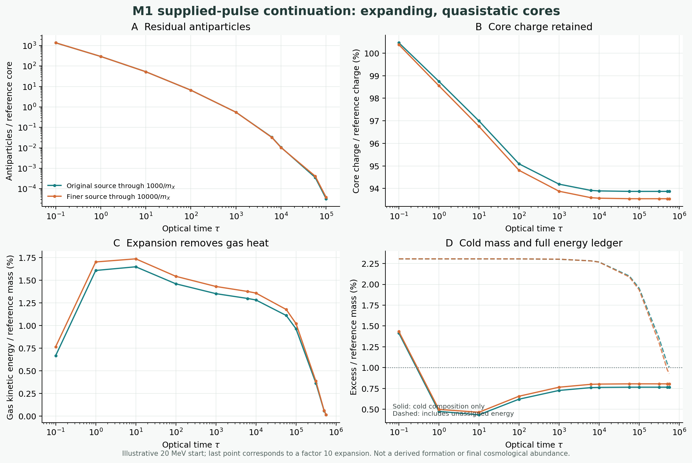

# M1: charge-dependent expansion and the local-emission gap

28 October 2026. Parent: `c4815306753ece00dad2b03412f0ed9fe89b8f92`.

**A supplied M1 pulse can satisfy the 1% energy comparison inside an
expanding, homogeneous, quasistatic-core model, including the retained
unassigned energy. This is a conditional numerical result, not a cosmological
formation calculation or a validated 1% pass.** The new obstruction is that
the actual emission is initially localized. The homogeneous calculation has
not computed the local cloud's collisions, correlations or mixing.

## What was calculated

The M1 action and couplings, `Q_ref=200000`, reference mass
`187479.9981 m_X`, and supplied yield `Y_Q=5.0794142327e-9` are unchanged.
The source is a **supplied 10% radial pulse**, not a derived primordial source.
As in the parent packet, assume the population represented by one reference
core per `Q_ref` of total conserved charge at an illustrative Standard Model
temperature of 20 MeV. Use an isotropic homogeneous dilute gas and an idealized
radiation background with constant `g_rho=g_s=10.75` through a factor-ten
increase in scale factor. The corresponding nominal temperature is 2 MeV.

This packet extends the radial source through `m_X t=10000`, constructs a
stationary energy/frequency family and **seven separate charge-dependent
partial-wave scattering tables** for `Q=186000,...,204000`, and evolves the
charge, gas spectrum, expansion work and stationary core energy together. The
tables use the parent's radial finite-difference scattering method; they are
interpolated in charge. A frequency-interpolated energy-grid operator keeps
the nonzero generator energy defect as a separate quantity. The core profile is
quasistatic; its outstanding excitation is **not** dynamically coupled to the
gas. Field/particle matching, local source mixing, extra channels, recoil and
formation are not resolved.

## The source and the full modeled ledger

The outgoing radial spectrum is signed and finite-windowed. Negative aggregate
bins and support outside the kinetic grid are separately recorded when a
positive numerical source is formed; the result is not a positivity-certified
quantum particle source. Neutral waves are converted to `X Xbar` daughters
using the parent's prompt vacuum-decay reduction. This source prescription
assumes the plume may subsequently be replaced by a homogeneous gas.

| Source and kinetic energy grid | Core charge retained at `a/a0=10` | Conditional stationary cold excess | Full modeled excess including held remainder |
|---|---:|---:|---:|
| Original `m_X t<=1000` source, 96 | 93.869% | 0.7651% | 1.0040% |
| Finer radial source `m_X t<=10000`, 64 | 93.551% | 0.8044% | 0.9269% |
| Finer radial source `m_X t<=10000`, 96 | 93.544% | 0.8052% | 0.9277% |

The original and extended rows also use different radial resolutions, so their
difference is not a clean measurement of the effect of the longer window
alone. The same `h=0.025` radial source and 64-node kinetic grid with the
window stopped at `1000/m_X` gives 12232 free positive particles and 0.7633%
cold excess at `a/a0=2`; extending it to `10000/m_X` gives 12899 and 0.8044%.

For the finer source at 96 kinetic nodes, the initial gas contains about
223.8 positive particles and 1705.6 antiparticles per reference core after
the initial neutral-wave decay prescription. At `tau=1000` it has about
12247.6 positive particles and 0.5554 antiparticles. At `a/a0=2`, the latter
has fallen below this ODE calculation's useful numerical precision, and the
core charge is approximately 187088.3. At `a/a0=10`, the free positive count
is about 12911.7 and the gas kinetic energy is 30.30 `m_X`. Do not read the
solver's tiny signed residual as an exact zero antiparticle abundance.

The initial pulse energy on the fine radial lattice is 191803.589 `m_X`.
After assigning stationary-core energy at the inferred initial charge and the
resolved outgoing spectrum, **199.37 `m_X` remains unassigned**. It includes
core excitation, radiation not represented by the source, and matching and
finite-window differences. The modeled gas does work on the expanding
background amounting to 2584.38 `m_X`; the generator energy defect is
0.00055 `m_X`. Holding the unassigned term as energy rather than discarding
it yields the 0.9277% figure. Equivalently it is approximately 0.8052% cold
mass + 0.0162% gas heat + 0.1063% held remainder. It is a modeled total-energy
checkpoint, **not an empirically established final mass**.

If the whole sector were subsequently closed and its integrated pressure work
were nonnegative, the comoving excess energy could not grow through expansion.
Under those additional assumptions, and provided the cold composition is bounded
by the sector's total energy, this 0.9277% checkpoint would bound the later
cold-mass excess even if the remainder changed composition. These conditions,
including the stress of the excited core and the actual local initial history,
have not been proved. A larger physical energy input or an incorrect local
history can change the comparison.

## The radial remainder really persists

An isolated classical radial run using `h,dt=(0.025,0.003125)` measured
321.623 `m_X` of outward probe energy between `m_X t=1000` and `10000`; the
core inside `r=20/m_X` still exceeds its same-lattice stationary energy at
the same charge by 197.543 `m_X` at the end. The corresponding late probe
energies at `h=0.1,0.05,0.025` are 277.790, 312.509 and 321.623 `m_X`.
Halving the step from 0.05 to 0.025 changes the last result by 2.83%; the
three-point observed convergence order is about 1.93. At `h=0.1`, halving
only the time step changes the late probe energy by 0.14%. This improves the
resolution evidence but does not certify the continuum or the quantum source.
The radial calculation contains no imposed core ringdown lifetime, vacuum
decay term, background gas, portal, or cosmic expansion.

The earlier 419.35 `m_X` ledger remainder cannot simply be reduced by the
321.62 `m_X` outgoing energy: the core also changes charge and stationary mass,
and the spectra and spatial regions have matching differences. All are kept
in the detailed ledgers.

## Cosmological clock and the stronger local-source objection

Let `A=a/a0`, `x=ln A`, `epsilon=H0*m_X^2/n_core0` and
`tau=integral(n_core/m_X^2 dt)`. With the explicitly assumed constant-g
radiation background,

    n_core = n_core0 A^-3,       H = H0 A^-2,
    tau(A) = (1-A^-1)/epsilon,   epsilon = 1.5897278e-6.

Thus `tau(2)=314519`, `tau(10)=566135`, and the constant-g extrapolation
would approach `tau=629039`. The physical kinetic equation uses the standard
FRW redshift characteristic `p proportional to 1/a`; see S. Profumo,
[*Chemical and kinetic equilibrium in cosmology: Facts and myths*, Phys. Rev.
D 112, 103509 (2025)](https://doi.org/10.1103/lfvd-bkk4). The extrapolated
infinite optical depth is **not** an actual late-Universe calculation.

At the assumed density, `n_core/m_X^3=1.2141e-15`, and the characteristic
inter-core spacing `n_core^(-1/3)` is 93738 `m_X^-1`. A 10000 `m_X^-1`
radial evolution corresponds to optical time `1.214e-11` and only
`1.93e-17` of the initial Hubble time. Hence the radial source is effectively
instantaneous **on the mean-density cosmological clock**, but this does not
show that local collisions are negligible.

For a thought experiment where each localized pulse starts at the same time,
the fraction of space reachable by its emissions by `m_X t=10000` is at most
`(4 pi/3) (n_core/m_X^3) 10000^3 = 0.00509`, neglecting the much smaller
initial core radius. This is a union bound; overlapping balls only reduce the
covered fraction. The emitted population's average density inside the covered
regions is therefore at least about 197 times its global mean, under this
synchronous-source thought experiment. Outgoing directions and daughter
momenta are correlated, so that ratio alone does **not** calculate a collision
rate. Asynchronous sources or a pre-existing background require their own
history. A representative neutral with the measured mean energy travels
about `3957/m_X` before decay, about 4.2% of the mean inter-core spacing.
Actual decay lengths have a distribution.

The homogeneous calculation may apply after a plume has mixed. What happens
before then—including repeated interactions with its parent core and
`X Xbar <-> h` in a correlated, anisotropic cloud—has not been solved.
Mean-density occupation numbers and mean-density optical time do not bound
that local stage.

The resonance is also angularly selective. Two oppositely charged particles
with `p=m_X` each require a 90-degree relative angle to reach the h pole; a
narrow outward plume need not contain such pairs. A kinematic cone study of
the direct charged source marginals is in `BEAM_KINEMATICS.json` and
`LOCAL_SOURCE_ANALYSIS.md`. It is a support calculation, not a collision rate
or a measurement of the plume's angular distribution.

## Numerical checks and known failures

`VERIFICATION.json` reports 50 **same-author engineering checks**, all passing;
it is not an independent replication. Seven scattering-table nodes have
maximum sampled unitarity/reciprocity error below `7e-13`. At five populated
snapshots, direct recalculation of selected rates gives a total rate differing
from charge interpolation by at most 0.064%; the selected bins account for at
least 98.6% of the interpolated total event rate. That check is not a bound on
unvisited narrow resonances or on near-cancellation of separately large rates.

At the fine-source endpoint, the 64-to-96 energy-grid change is about 12.8
free positive particles and 0.000790 percentage points in cold excess. A
finer frequency-table spacing, tighter ODE tolerance, and 12-angle elastic
quadrature were separately tested at 64 nodes. At `a/a0=10`, about 361
particles occupy the lowest 96-grid energy node, and 0.229 attempted events
have omitted daughter support; the detailed spectra and omitted-event ledger
are therefore not exact. A collisionless test from `a/a0=2` to 10 shows about
0.5% kinetic-energy error on the 96 grid.

**Moving-frequency diffusion is real.** Ten forced off-grid forward/reverse
round trips at the same shifted frequency produce a spurious energy variance
of about `0.00130 m_X^2` on the 96 grid even though number and mean energy are
conserved. The aligned reference-frequency control has only roundoff-level
variance. The computed integrated quantities compare well across these grids,
but this is not a rigorous error bound on the spectral shape, rare tails, or
the full evolving-Q dynamics. `VERIFICATION_INITIAL.json` preserves an initial
roundoff-tolerance failure and `ATTEMPTS.md` explains its correction.

## Correction to the previous reply's event count

The earlier response called 9840 a net charge-transfer count. That was wrong.
The independent **channel counters implemented by the same author** on the
parent's 64-node static run give approximately 9843 neutral events in total:
9787 initiated by antiparticles and 56 by positive particles. Their net core
charge change is about -9730, not -9843. About 9878 forward and 8128 reverse
exchange events give an additional net core change of -3501. The channel
stoichiometry and the parent trajectory are checked in `channels64.json`.

## What would resolve the remaining gap

Evolve the emitted charged and neutral spectra locally around a core with their
radial positions and angular distributions, including the explicit finite
`h` lifetime, the core boundary scattering and a checked matching surface. If
explicit `h <-> X Xbar` is evolved, subtract or remove the on-shell resonant
`X Xbar -> h -> X Xbar` contribution already included in the parent gas
kernel. Compare interacting and collisionless plumes through the onset of
inter-core mixing; carry their joint charge, energy, and spectra into the FRW
solver. Then evolve the actual remaining core excitation and check the sector's
pressure-work and external-transfer assumptions. A real formation history and
independent review are still required.

`FREEFLIGHT.json` also contains an exploratory ballistic distance from the
2 MeV snapshot to equality. It is not a matter power spectrum or a Lyman-alpha
constraint, assumes no later interactions, and uses an approximate treatment
of the electron/positron entropy transition.

Full inputs and commands are in [REPRODUCE.md](REPRODUCE.md); the review
questions are in [ARGON_HANDOFF.md](ARGON_HANDOFF.md).
