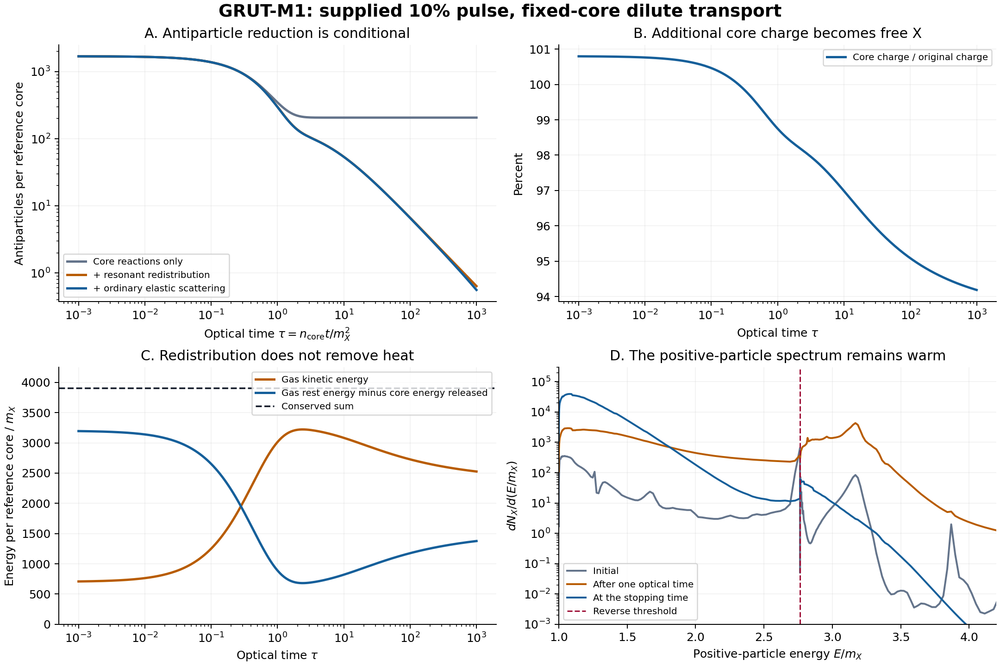

# M1 transport: strong antiparticle reduction, with heat and core depletion retained

28 October 2026. Built from `bf8ab3b96c07691410145c3b8c21ca18b009d66d`.

**The stalled kinetic step has been reconstructed and tested as a bounded,
fixed-profile experiment.** In the supplied 10% pulse case, antiparticles fall
from about 1695 to 0.559 per reference core by optical time tau=1000. Neutral
production and subsequent decay also free additional core charge: 94.186% of
the original charge remains in cores. No heat is removed by the collision
operators. This is a conditional kinetic result, not a final cosmological
abundance or a completed theory of reality.

## What was recovered and rebuilt

The first shared conversation ends at the committed scattering packet. The
second supplied link includes Argon's analytical review and the stalled
transport updates, but no accessible unfinished solver or numerical arrays.
This packet is a new implementation from the published action, profile and
source histories. It does not claim to reproduce unseen transport numbers.

Argon's width and thresholds agree with the committed calculation. His
written neutral coupling FS must be sqrt(2)FS in the canonical radial matrix;
the committed scattering code already has the correct factor. Argon disclosed
that he had not run the profile or packet files. No independent-author review
has been performed on this new packet.

The inherited 10% pulse history was regenerated with zero difference in every
archived history column. Its outgoing spectrum contains 89.356 positive
particles, 1689.506 antiparticles and 5.503 neutral quanta. After the initial
neutral quanta decay, the resolved source has 94.859 positive particles and
1695.010 antiparticles. Its postpulse core charge exceeds 200000 because the
pulse emitted more negative than positive charge; total charge remains 200000.

## What the kinetic experiment includes

The gas is isotropic, homogeneous and dilute, with counts measured per supplied
reference core. The core scattering profile is held at Q=200000 and
Omega=0.88172049195 while its charge and tangent energy are tracked. The model
includes both charge-exchange directions, neutral production from either
charged incident species, prompt neutral decay, resonant X Xbar -> h -> X Xbar
redistribution, and ordinary XX and Xbar Xbar elastic scattering.

The real neutral intermediate state is included once through its narrow-width,
prompt-decay reduction. There is no extra inverse-decay term counting it again.
The resonant process preserves both gas species counts and energy; it affects
antiparticle removal by changing which energies encounter cores. The ordinary
elastic operator likewise redistributes energy without removing it.

At the inherited illustrative 20 MeV clock, tau=1000 corresponds to
H delta-t=0.001590. This makes a short static-background diagnostic useful
under that supplied density assumption. The calculation does not derive a
formation epoch or an actual population of these objects.

## Measured result at the stated stopping time

The primary run uses 96 graded nodes per 2Omega interval, repeated to preserve
the exact forward/reverse energy shifts. Energies extend to approximately
8m_X. The comparison uses the 64-node-per-interval controls where indicated.

| Included processes | Antiparticles per core at tau=1000 | Free positive particles |
|---|---:|---:|
| Core reactions and neutral decay | 206.525 | 1589.659 |
| Add resonant redistribution | 0.638 | 11687.681 |
| Add ordinary identical-charge elastic scattering, refined primary | 0.559 | 11629.389 |

In the primary result, Q_core=188371.170, gas energy is 14156.238m_X and gas
kinetic energy is 2526.289m_X per reference core. About 8.176 positive particles
remain above the reverse threshold E_X=2.763441m_X. Antiparticles are reduced
by about 99.967% relative to the supplied initial gas, but the reverse channel
has not disappeared. Ordinary elastic scattering changes the surviving tail;
the resonant channel produces the much larger change relative to the
core-only control.

The gas-plus-core tangent invariant

    E_gas - Omega (Nplus-Nminus)

has maximum relative drift 1.52e-15 in the primary trajectory. Charge is
reconstructed from Q_core+Nplus-Nminus=200000, so its algebraic closure is not
counted as an independent evolution check. Positive bin populations, per-event
energy identities, reciprocal scattering, and an independent equilibrium
diagnostic provide additional checks.

## The mass result is more demanding than the earlier ideal completion

Re-solving the unchanged stationary M1 equations at the primary final charge
gives a **stationary cold-mass excess of 0.7266%**. The earlier one-conversion,
no-further-source diagnostic for the same pulse gave 0.1127%. The increase is
the cost of the additional core charge released into free positive particles.

The 0.7266% number assumes the remaining kinetic energy subsequently leaves
the matter sector without changing its composition. That has not happened in
this simulation: the gas still carries kinetic energy equal to **1.3475% of
the original reference mass**.

There is also an unprocessed energy remainder of **419.35m_X**, or **0.2237%**
of the reference mass, between the archived initial pulse energy and the
stationary postpulse core plus measured outgoing spectrum. It includes core
excitation and finite-grid/spectral matching error. It is retained explicitly;
its later release is not evolved. The outgoing spectral energy and recorded
probe energy differ by 0.316m_X, much smaller than this remainder.

Therefore this packet does **not** certify the 1% final cold-mass criterion.
It measures a possible short-time processing stage and the heat still to be
handled. The full pulse initially carries about 2.305% excess energy over the
reference stationary object. A successful cooling history must account for it.

## Numerical evidence and limits

Twelve same-author verification groups pass. Details are in
[VERIFICATION.json](VERIFICATION.json) and [PHYSICS_CHECKS.json](PHYSICS_CHECKS.json).

- The batched stationary solver matches inherited monopole probabilities to
  1.98e-14; sampled full matrices are unitary and reciprocal to about 2.5e-13.
- The resonant rate agrees with the independent thermal inverse-decay identity
  to floating-point precision. Resolved finite-width examples differ from the
  narrow-width result by less than 0.019%.
- Refining the translated graded grid from 64 to 96 nodes per interval changes
  the positive count by 0.022%, the antiparticle count by 0.297%, and the gas
  kinetic energy by 0.012%. Extending the same grid to 12m_X and increasing
  elastic angular quadrature have negligible effects at the displayed precision.
- The primary gas-only Maxwell-Boltzmann residual per collision is at most
  0.536% in the tested distributions. It decreases with resolution; exact
  discrete thermal stationarity is not claimed. This residual and the tested
  trajectory refinements do not establish an error bound for every preparation.
- The primary accumulated omitted-event count is 0.000272 per core. Source
  support omissions are recorded separately. No unsupported energy is clipped
  into the grid and no artificial cold bath is used.
- Arbitrary energy grids produced artificial diffusion under repeated reversible
  core conversion despite conserving mean energy. An exact closed two-state
  control now passes on the translated grid. Those rejected interpretations,
  the slow uniform-grid convergence, and the initial decay-endpoint bug are
  preserved in [ATTEMPTS.md](ATTEMPTS.md).

The frozen core profile is a physical approximation, larger than the ODE error.
At the resulting charge, the stationary frequency becomes 0.884213. Sampled
exchange cross sections change by +1.03%, -1.92% and -7.54% at incident
k/m_X=0.4, 1 and 1.5. Re-solving the stationary energy changes the tangent
cold-mass result by 0.00761 percentage points. Those checks quantify some
backreaction sensitivity; they do not replace a coupled finite-Q history.

Off-shell opposite-charge contributions and interference, pair-to-neutral-pair
reactions, higher multiplicity, core recoil/excitation and actual cosmological
expansion remain outside the collision operator. The measured dilute
occupation is tiny at the illustrative clock, but no full in-medium quantum
collision operator has been completed.

## Next connected calculation

The next physical dependency is to evolve the scattering profile and Omega
with Q, release or retain the measured core excitation through an explicit
source model, and include expansion and the additional reaction channels with
an energy ledger. Only that continuation can test freeze-out, surviving warm
matter, and the final mass budget. Formation, the phase preparation, vacuum
density selection and empirical discrimination remain open at the theory level.

Equations: [DERIVATION.md](DERIVATION.md). Commands: [REPRODUCE.md](REPRODUCE.md).
Review target: [ARGON_HANDOFF.md](ARGON_HANDOFF.md).
