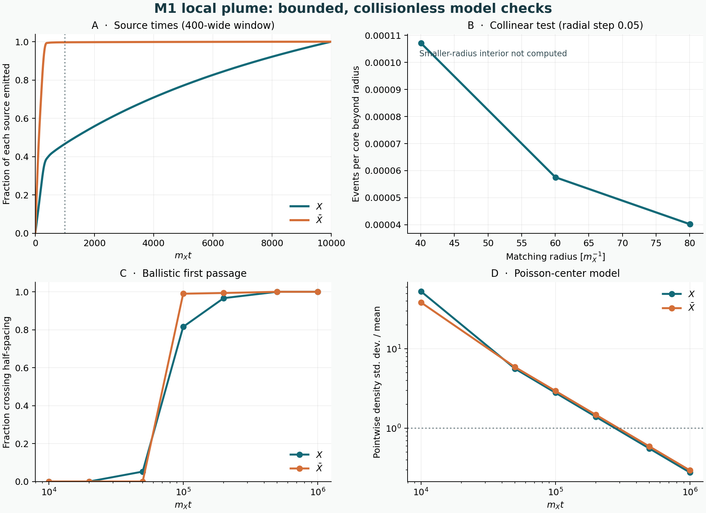

# M1 local plume: a bounded pre-mixing calculation

29 October 2026. Parent tree `ab9dd63d743b737e7eefd36cf575df24f88e369c`,
published parent commit [`12b5696c2e5722d253a02ca4e9d57435879f5dc1`](https://github.com/ryangrvr/TestingGRUT/commit/12b5696c2e5722d253a02ca4e9d57435879f5dc1).

**The measured source has a small resonant collision exposure in a particular
ballistic plume model. This is not a bound on the physical local cloud and
does not validate the earlier conditional 0.9277% mass-energy checkpoint.**
The unknown angular source, interactions near the core, late radiation and
the source's field-to-particle interpretation remain consequential.

## Setup and measured emission

Keep the M1 couplings and the supplied 10% radial pulse from the parent,
with `Q_ref=200000`, `n_core/m_X^3=1.2141071422639381e-15` and density
length `d=n_core^(-1/3)=93737.7/m_X`. This is not a derived formation
history. The field is evolved without gas interactions, expansion or a
phenomenological decay term. The fine radial trace has spatial step `0.025`,
time step `0.003125`, matching surface `r=60.0125/m_X` and ends at
`m_X t=10000`.

We partition its measured field flux into overlapping squared-cosine windows,
then into 280 energy bins from `m_X` to `8m_X`. With a 400-wide window and
positive projection of the signed frequency bins, the direct charged
sources contain 206.696 positive particles and 1687.656 antiparticles per
reference core; the neutral source has 16.632 parents. These are **a source
prescription applied to classical flux**, not measured quantum occupations.
The raw all-frequency charge and energy satisfy the Parseval check to better
than `1e-12`; the total negative-bin weights are 0.0064, 0.0539 and 0.0006
for the respective species. None of this proves positivity or uniqueness of
the quantum source.

The reconstruction places 53.35% of direct positive particles, but only
0.316% of direct antiparticles, after `m_X t=1000`. A 200- or 800-wide window
gives 53.29–53.64% and 0.312–0.319%, respectively. These times are smeared by
the chosen windows; they are not exact event times. The observed separation
in emission histories matters for whether outward beams can meet.

## Direct particles from one core

Assume the direct charged particles leave the matching sphere on exactly
outward radial rays. Propagate them without interactions, integrate their
actual reconstructed time-energy overlap and calculate first-order
`X Xbar -> h -> X Xbar` exposure out to `d/2`. The energy-integrated
narrow-width results, with 140, 280 and 560 source-energy bins, are
`6.23e-5`, `6.03e-5` and `6.59e-5` expected events per reference core. The
result is a collision or redistribution count, **not** a net antiparticle
loss. The 280-bin Gauss-order 64/128 result changes by 0.009%; the 560-bin
32/64 result changes by 0.016%. The bin-to-bin differences are larger and
are not a rigorous error bound.

For the same model, a full s-channel Breit–Wigner calculation integrating
continuously over both energies gives `5.96e-5` events at 280 bins and
`6.59e-5` at 560 bins. Its full-width result is about 1.2–1.4% above its
own same-grid narrow-width control. It includes the resonance once, and
omits t/u-channel and contact contributions and their interference. The
full-width positive-energy integral stops at the bin centers; approximately
3.47 and 1.15 positive particles lie in the omitted half-bin endcaps at
280 and 560 bins, respectively, and no event bound for them is established.
In a different smooth synthetic spectrum one case differs from its
narrow-width result by about 8%, so the small difference is source-specific.

The slow antiparticle tail is important: excluding `E_Xbar < 1.025 m_X`
removes about 9.98 of 1687.66 represented antiparticles but lowers the
280-bin collinear exposure from `6.03e-5` to `2.67e-5`. The endpoint shape
and time-energy spectrum are not independently established. The finite
windows are also shorter than the neutral rest lifetime, `1/Gamma_h` about
`5331/m_X`, so use of an asymptotic cross section for these reconstructed
wave packets is another unresolved approximation.

Changing the matching surface probes a separate uncertainty. On the same
`0.05` radial run, surfaces near `r=40,60,80` give direct-primary
exposures **outside** the surface of `1.072e-4`, `5.755e-5`, and `4.020e-5`
events per core. Moving the probe changes the field-to-particle matching and
the integration domain; the uncomputed interior prevents this from being
interpreted as a complete, radius-independent result. The underlying
energy/charge/core histories at the 40 and 80 probes are identical.

The exact-collinearity assumption is especially restrictive. For freely
outward rays intersecting the matching sphere, geometry constrains their
direction at radius `r` to a cone with `sin(theta)<=r0/r`. Using independent
energy-marginal draws, the fraction whose energies permit *some* angle in
that cone to hit the pole is 5.76% at `3r0` and 0.438% at `4r0`; these are
support fractions, not scattering rates, and no physical angular
distribution follows from the radial field trace.

## Neutral decay and return

Take `m_h=sqrt(6)m_X`, `Gamma_h/m_X=1.87565899199e-4`, isotropic two-body
vacuum decay and outward radial parent motion. A parent of `E_h >= 3m_X`
cannot produce an inward-moving daughter. Any inward daughter has
`E <= sqrt(6)m_X/2 = 1.224745 m_X`, below the
`2.76344 m_X` reverse-exchange threshold for the reference stationary-core
linear scattering model. This kinematic statement does not rule out nonlinear
capture, excitation, other channels, or neutrals created by subsequent
scattering.

Applying this model to the separate full-time neutral spectrum, the expected
direct crossings of a `20/m_X` sphere are `0.00253` per daughter species per
core, for parents emitted at `r=60/m_X`. A crossing is not absorption.
The same source spectrum hypothetically emitted at `r=20/m_X` gives `0.0107`
per species; that spectrum was not measured there. On the time-windowed
source, direct daughter hits of the `r=60/m_X` matching sphere are about
`0.0256` per species, consistent with a separate geometric integral; a hit
of that larger sphere does not imply a hit on the `r=20/m_X` core region.

We also sample explicit neutral lifetimes and daughter worldlines. For
`m_X t<=100000`, `r<=d/2`, and 262144 Sobol samples with three scrambles,
the estimated sum of direct daughter–primary narrow-width exposures is
`3.85e-7` to `4.29e-7` events per core for the 400-wide source window.
The positive-daughter component is rare-path dominated: changing the
window to 200 or 800 changes it from `2.90e-8` to `4.60e-7` in the
131072-sample controls, while the antiparticle component ranges from
`2.38e-7` to `2.60e-7`. These are sensitivities, not confidence intervals
or a bound on all daughter interactions. The calculation excludes
daughter–daughter collisions, subsequent h production, core interactions,
and finite-width integration on the actual time-dependent daughter paths.
Fixed-angle smooth-spectrum tests compare full width with narrow width to
about 0.04%, but do not establish a width bound on the plume estimate.

## First passage and independent-core overlap

For ballistic direct primaries, at `m_X t=100000` about 98.98% of the
represented antiparticles and 81.52% of the positive particles have crossed
the sphere at `d/2`. At `m_X t=200000` the corresponding fractions are
99.35% and 96.65%. These are crossings of a geometric sphere around a single
source; they do **not** establish that particles have actually mixed with
neighbors. The slowest tail below the finite energy-bin resolution is not
certified. Explicit neutral daughter and parent first-passage energy and
charge bookkeeping is in `mixing_seed37.json`.

As an additional model, place identical, synchronized primary sources at
independent homogeneous Poisson core centers. At `m_X t=100000` the
pointwise density standard deviation divided by the mean is 2.80 for `X`
and 2.95 for `Xbar`. The ratio
`<n_X n_Xbar> / (<n_X><n_Xbar>)` is 2.02; at `m_X t=10000` it is about
248. This ratio is **not** a collision enhancement: the particles' relative
directions are correlated, and the same-source part needs its own angular
kernel. The result changes if core centers, pulses or source histories are
correlated or asynchronous. The finite-radius Poisson density profiles are
spatially resolved to 0.23% source-number error in the finest control.

For this Poisson ensemble only, independent-source pairs factorize in the
mean and their relative directions are isotropic. The finite-width
s-channel contribution from **different** cores is `1.49e-7` to `1.52e-7`
events per reference core by `m_X t=100000` across 140–560 energy bins.
It is about `1.5e-6` by `m_X t=1000000` if one continues the same frozen
collisionless sources with no additional emission or interactions. The
second number is an illustrative extrapolation, not a late-time prediction.
Do not add a separate on-shell term to the full Breit–Wigner result; the
pole is already present. For the general double-counting problem when real
intermediate states are kept explicitly, see Ala-Mattinen et al.,
[*Anatomy of real intermediate state-subtraction scheme*](https://arxiv.org/abs/2309.16615).

## Verification and what remains open

`VERIFICATION.json` records 20 passing same-author engineering checks,
including synthetic-wave flux, analytic pulse overlap, independently rooted
decay geometry and resonance roots, energy/charge closure, source-window
Parseval identities, energy quadrature, Poisson profile normalization and an
independent angular integral for the finite-width kernel. These checks are
not independent replication and do not validate the physical assumptions.
The initial discrete-energy calculation was resonance-aliased; its results
are kept as negative controls in `ATTEMPTS.md`.

The decisive next problem is a controlled field-to-particle and angular
matching calculation nearer the core, including any later emitted energy and
nonlinear core/cloud interaction. An interacting, spatially resolved
calculation must then assess production, reabsorption and subsequent mixing
with a justified core population and source history. The model has not
closed the 199.37 `m_X` held energy, the excited core, sector pressure or
formation budget. Consequently the parent's 0.9277% conditional result
remains a checkpoint, not an established cosmological 1% pass.
