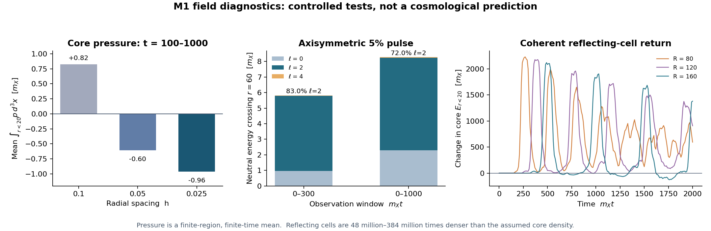

# M1: pressure, open multipoles, and coherent feedback

**Status: the proposed tests expose material model dependencies; the 1% outcome is still conditional.** The published `0.8944364%` remains the result of the earlier homogeneous, quasistatic kinetic calculation with its held matching remainder. It is not an all-future or self-consistent core–gas–FRW calculation. The review's inferred `0.841%` is neither established by these tests nor obtained by its own proposed arithmetic.

Parent commit: [`6dc95562635287f3aca47de078395d3ef0fbec97`](https://github.com/ryangrvr/TestingGRUT/commit/6dc95562635287f3aca47de078395d3ef0fbec97). All energies below are in units of `mX` per reference core; times and radii are in `1/mX`. The field equations, potential, source profile, normalization, and absorber are inherited from that commit. Read `PROTOCOL.md` for the test plan and `results.json`, `axis_spec*.json`, `axis_direction*.json`, and `timing_sensitivity*.json` for machine-readable numbers.



## 1. Pressure and the finite-region virial identity

For the evolved real fields `x,y,s`, the code records the spatial stress trace `3 K − G − 3 V`, with `K = (px²+py²+ps²)/2`, `G = (|∇x|²+|∇y|²+|∇s|²)/2`, and the inherited scalar potential `V`. It divides the integrated stress by `g² = 0.01`, consistently with the prior energy normalization. The integral of isotropic pressure is one third of the trace. Centered and face-gradient estimates are both retained.

Conservation `∂μ T^{μν}=0` in the **undamped** interior gives, for a sphere of radius `R`,

```text
G_R = ∫_(r<R) x_i T^{0i} d³x
 dG_R/dt = ∫_(r<R) T^{ii} d³x − 4π R³ T^{rr}(R).
```

Thus a finite-region average contains both a surface stress and a change in the virial. With a bounded virial and vanishing surface contribution, the whole-system long-time average of the trace is zero, not strictly positive. For a stationary isolated Q-ball the full-space pressure integral obeys the Laue/virial condition; it does not make a finite-radius integral identically zero. See [Mai and Schweitzer, *Phys. Rev. D* 86, 076001 (2012)](https://doi.org/10.1103/PhysRevD.86.076001) and [Loginov and Gauzshtein, *Phys. Rev. D* 102, 025010 (2020)](https://doi.org/10.1103/PhysRevD.102.025010).

The original 10% radial pulse, with 0.25 time-unit stress sampling, gives these **finite-interval** results for `100 ≤ mXt ≤ 1000`:

| Radial spacing | Mean trace inside 20 | Mean pressure integral inside 20 | Mean surface term | Virial change / duration | Trace identity residual |
|---:|---:|---:|---:|---:|---:|
| 0.100 | +2.4724 | +0.8241 | +1.6053 | −4.2902 | +5.1572 |
| 0.050 | −1.8143 | −0.6048 | +1.6641 | −4.8085 | +1.3301 |
| 0.025 | −2.8863 | −0.9621 | +1.6824 | −4.9432 | +0.3744 |

The instantaneous trace oscillates in sign; the refined early-window mean is negative. The virial residual decreases strongly with grid refinement, and the centered/face conventions and same-lattice stationary control show similar `O(h²)` offsets. This is evidence against a general strict-positivity claim in this finite region and interval, not an assertion that cosmological work is negative. A finite-radius integral, finite-duration unweighted time average, and flat-space, uncoupled evolution do **not** determine the expansion-weighted work of the entire interacting sector. Boundary transport, core–cloud coupling, and FRW response remain missing.

At `R=60`, the stationary control has initial centered trace `13.0446`, `3.2601`, and `0.8150` for spacings `0.1`, `0.05`, and `0.025`, respectively: the apparent finite-grid baseline is not zero. The 20,000-unit runs use coarser stress samples spaced by one unit; comparing the same fine trajectory over `100–1000` changes the mean trace inside 20 from `−2.8863` at 0.25 sampling to `−2.0418` at unit sampling. This aliasing and the virial residual prevent reliable sign claims for small late averages at that cadence.

For `10000 ≤ mXt ≤ 20000`, unit-spaced samples give mean traces inside 20 of `+3.8692`, `−0.0431`, and `−0.9285` at `h=0.1`, `0.05`, and `0.025`, with corresponding virial residuals `+5.4101`, `+1.6442`, and `+0.6831`. These are not a resolved late-time sign test. We additionally restarted the same fine field state at `mXt=20000` and sampled stress every 0.25 through 21000. The inside-20 trace mean is `+0.2408` over 20000–21000 but `−1.4077` over 20100–21000; the changing virial endpoint is substantial. The restart reproduces core energy and charge at the join. These two windows illustrate the limitations of a short, unweighted mean, not an asymptotic statement.

## 2. Open axisymmetric angular modes

We implemented an even-Legendre Galerkin solver for the same nonlinear fields, with spherical finite volumes and the inherited outer absorber. The new supplied perturbation is **5% monopole plus 5% regularized axisymmetric P₂**, with total initial charge renormalized to 200,000. It is a deliberately chosen source: the prior 3D run used `(x²−y²)/(r²+4)`, whose quadrupole tensor has different eigenvalues and cannot be rotated into a pure `Y20`. Nor is this the original 10% radial pulse. Therefore these results do not settle the prior 3D source's angular distribution.

At radius `60`, using the finest tested spacing `h=0.05`, the integrated *signed classical neutral field energy flux* is:

| Observation window | ℓ=0 | ℓ=2 | ℓ=4 | ℓ=2 fraction of net neutral energy |
|---|---:|---:|---:|---:|
| 0–300 | 0.97195 | 4.82910 | 0.01612 | 83.01% |
| 0–1000 | 2.29207 | 5.95616 | 0.02355 | 72.01% |

The `h=0.1 → 0.05` change in the ℓ=2 neutral energy through 1000 is approximately `0.041%`. At `h=0.1`, increasing `ℓmax` from 4 to 6 hardly changes that quantity; changing the angular quadrature from 12 to 16 points likewise agrees in the 0–300 check. The pure-monopole evolution agrees with the spherical engine through time 300 to roundoff. Parseval residuals, signed and discarded negative spectral weights, and charge/energy budgets are reported in the JSON files.

The finite-window positive-projected ℓ=2 neutral counts at `t≤1000` are `2.2194`, `2.2634`, and `2.2797` for window widths 100, 200, and 500. A separate spherical-Hankel diagnostic gives a neutral ℓ=2 incoming/outgoing energy ratio of about `0.000235` with one sine taper and `k>0.1`; this is a diagnostic for those assumptions, not proof of an independent-particle source. The number-weighted positive-species angular-gradient proxy changes from `0.0265` to `0.00352` when the low-momentum cutoff changes from `k>0.1` to `k>0.2`. Multipoles, threshold-sensitive proxies, and one-particle fluxes do **not** determine the joint angular correlations required by the particle collision kernel.

## 3. Coherent reflecting-cell feedback

We compared the same 10% pulse in a box with a reflecting outer boundary and with the `R=200` open/absorbing setup. The cell is an artificially coherent mirror: returned waves revisit the core, so this is a sensitivity/control calculation, not a calibrated many-core gas or periodic cosmology. At `t=100`, before returned waves can reach the central region, the core histories agree to numerical precision. At `t=2000`:

| Reflecting radius | Cell density / assumed physical core density | Change in energy inside 20 | Change in charge inside 20 |
|---:|---:|---:|---:|
| 80 | 3.840×10⁸ | +594.30 | −851.34 |
| 120 | 1.138×10⁸ | +908.34 | −731.60 |
| 160 | 4.801×10⁷ | +1381.01 | −1289.34 |

Core changes oscillate and depend strongly on the observation time. The assumed physical density here is `ncore/mX³=1.2141071423e−15`; one core per reflecting sphere gives densities about 48–384 million times larger. The field solver conserves total energy and charge to the stated numerical tolerance; these controls do not establish the size of feedback at the physical density. An initial `R=160` output was truncated and was rerun with explicit stream-flush checking; only the complete rerun is used.

## 4. Ledger and future-release extrapolation

At `a/a0=10`, the previous two 96-node trajectories give:

| Quantity | Difference: through 20,000 minus through 10,000 |
|---|---:|
| Held unassigned remainder | −95.08937 |
| Stationary-core plus gas rest energy | +32.03087 |
| Gas kinetic energy | +0.74087 |
| Accumulated redshift work | +62.31777 |

The components balance the remainder change to approximately `0.000142 mX`, consistent with the reported interpolated-generator energy-defect difference. Thus the `63.05` quoted by the review is the combined work **plus residual gas heat**, not the work alone. The ratio `32.03087/95.08937 = 0.33685` is a finite difference between two complete nonlinear model trajectories; it does not determine the response to an arbitrary subsequent emission. The held matching residual is not demonstrated to be identical to physical trapped core excitation, even though the measured co-rotating late flux and the residual change are close numerically.

Even granting the review's hypothetical constant ratio, its own arithmetic gives

```text
0.8944364% − 0.0556241% × (1 − 0.3368502) = 0.85755%,
```

not `0.841%`. This is a conditional arithmetic illustration, **not** a derived asymptote or proof of the 1% target.

To expose timing dependence explicitly, we restarted the earlier 64-node homogeneous kinetic model at `a/a0=10` and injected the **same hypothetical** packet at either 10 or 20, observing both at 40. The packet is 20% of the previously recorded positive-projected late source; its `28.0027 mX` gas energy and its change to stationary core energy consume `18.9859 mX` from an explicitly held residual. This is a model stress test, not a claim that the remaining core emits that packet.

| Injection scale factor | Added cold core + particle rest energy at 40 | Added gas kinetic energy | Added integrated redshift work |
|---:|---:|---:|---:|
| 10 | 1.8899 | 1.1108 | 15.9852 |
| 20 | 1.9012 | 4.5782 | 12.5066 |

The numerical ledger closes to better than `1e−6 mX` at saved points. However, the baseline puts approximately `10,057/13,175` particles on the lowest grid node by 40 and records about 251 omitted events. The comparison also inherits homogeneous mixing, finite-grid diffusion, a frozen prescribed spectrum, quasistatic stationary profiles, and constant-`g` radiation expansion; it is not a calibrated cosmological prediction. A further `a=1000` stress test is included as an even less reliable numerical sensitivity, with much stronger grid-floor and omission effects.

## Reproduction and evidence

- `reproduce.sh` regenerates initial profiles, the stress and axisymmetric finite-volume runs, spectra, diagnostics, and inherited kinetic timing controls in the parent repository. It is CPU intensive; the `h=0.025`, 20,000-unit radial evolution is the dominant run.
- `field_diagnostics.npz` preserves time-resolved pressure, virial, core histories and reflecting controls; `axis_spec005_t1000.npz` preserves the refined axisymmetric modal trace and windowed spectra. Other summaries record the radial, multipole, angular-quadrature, window and momentum-cutoff tests.
- `python code/verify.py` checks the delivered compact artifacts without re-running the solvers; `python code/manifest.py --check` checks the artifact hashes. These are consistency and regression checks by the same implementation, not independent physical validation. `python code/figure.py` regenerates the figure.
- Parent replay comparisons, conservation errors, checksums and endpoint/sampling limitations are recorded in `results.json` and the repository coordination log. The original raw history was regenerated because temporary data from the prior session were gone; the published parent profile, compact history and source files were restored from the pinned Git commit. Run `python code/check_inputs.py` to verify the 34 recovered parent Git blob hashes recorded in `INPUT_PINS.json`.

A decisive follow-up would evolve a dilute core–cloud system with a matched outgoing source and controlled angular correlations in an expanding background, including finite-region boundary flux and the pressure of the full interacting sector. Its eventual source history and core excitation cannot be inferred from the present finite windows alone.
