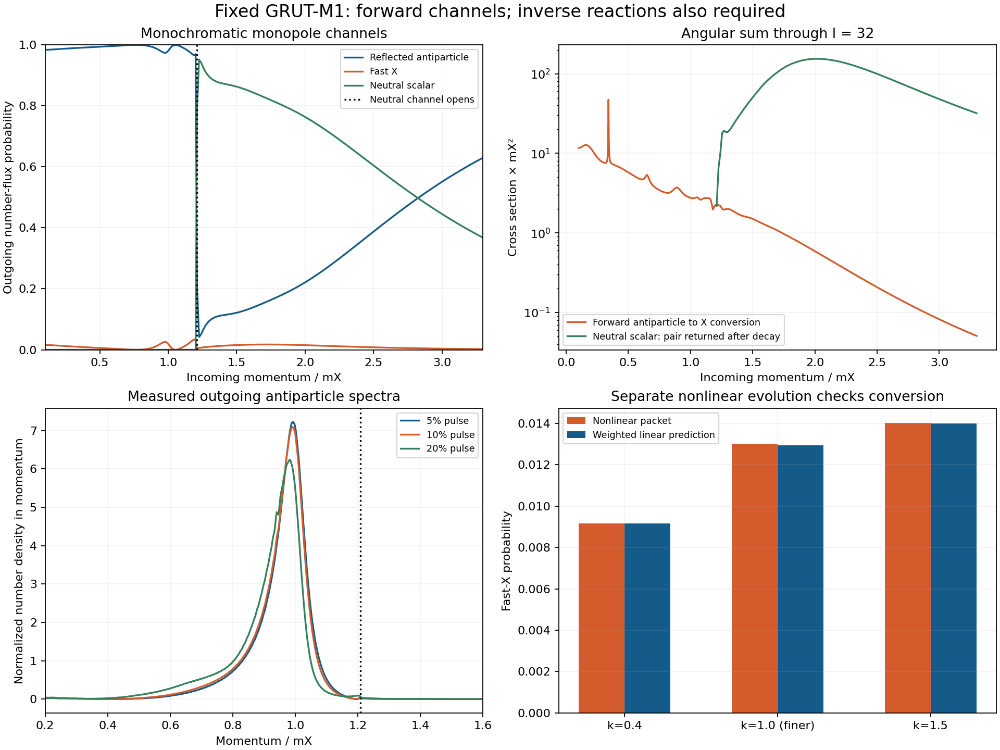

# M1 antiparticle reprocessing: a measured kernel and conditional cold budgets

28 October 2026. Parent ed73791. Ryan supplied Argon's proposed capture/cooling
dispatch. **The proposed gate is useful and has now been run at the unchanged
M1 point.** The result is a genuine charge-exchange channel with a calculable
cross section. It keeps reprocessing open, but does not compute the actual final
population. Several premises in the dispatch need the corrections below.

This packet contains stationary three-channel scattering, angular partial waves,
a separate continuum solver, nine nonlinear incoming-packet/control histories,
measured previous-pulse spectra, limited vacuum kernels and conditional mass
bookkeeping. It has no independent-author review or external-model execution.

## Corrections that change the calculation

1. **The canonical scalar width is larger than Argon's numerical value.** The
   action contains g_X² phi²|X|². Thus hXXbar has vertex2g_X²v and
   Gamma(h->X Xbar)=g_X^4 v² beta/(4pi m_phi)=1.733277e-5GeV=
   **1.875659e-4m_X**, lifetime3.7975e-20s. The quoted9.38e-6m_X is20times low.
   The old e71730c kinetic input already has the correct vertex and width; this
   is not a newly discovered20-fold error in our kinetic code. M1's cubic change
   leaves this leading vacuum decay unchanged.
2. **Low-energy on-shell neutral production is closed.** For an incoming
   antiparticle of energyE, the neutral wave has energyE+Omega. It propagates
   only for k/m_X>1.20744. The lowered bare X mass inside the core does not remove
   the asymptotic threshold. Off-shell scalar exchange is not a free outgoing
   energy carrier.
3. **Quartic mixing is not a static vector potential.** The rotating core
   couples particle, antiparticle and neutral modes. The charged normal diagonal
   is S²+2aF², the anomalous coupling is aF², and the neutral coupling is required.
   Treating the core as an attractive absorbing well misses the relevant channels.
4. **Excitation pays for the emitted antiparticles.** Although E(Q)/Q decreases
   along the branch, E(Q) increases: dE/dQ=Omega*m_X. Emitting an antiparticle
   while adding one charge to the core costs approximately(1+Omega)m_X. A cold
   ground-state object is not a perpetual antiparticle pump.
5. **A neutral wave is not automatically antiparticle erasure.** Free h decay
   returns one X and one Xbar. The outgoing-X charge-exchange channel is the
   one that removes an incoming antiparticle under the vacuum-decay-only ledger.
   Plasma scattering and inverse reactions can change that ledger and remain open.

DERIVATION.md provides the canonical action, matrix, thresholds, flux convention
and source-energy accounting. The coupled-mode rotating-background effect has
prior art in Saffin, Xie and Zhou, PRL131,111601; our M1-specific three-channel
profile and cross sections are new same-author calculations.

## Track A: incoming packets and angular cross sections

Use the supplied Q200000 M1 object, Omega=.88172049, a=lambda_X/g_X²=.1,
b=lambda_phi/g_X²=3 and c=epsilon/g_X²=.2. The propagating energies are

- reflected Xbar: E=sqrt(1+k²);
- outgoing X: E+2Omega;
- outgoing h: E+Omega, when above sqrt(6).

The flux-normalized stationary probabilities obey Pbar+PX+Ph=1. The core change
is DeltaQ=-2PX-Ph and its lost energy supplies the outgoing energy gain. There
is no imposed absorption/friction in the core. Vacuum and uncoupled-diagonal
potential controls have exactly zero conversion.

The nonlinear finite packets independently reproduce these channels. The table
uses their measured packet spectra, not a monochromatic central-k approximation:

| Incoming packet k/m_X | Fast X | Reflected Xbar | Neutral h |
|---|---:|---:|---:|
|.4|.916%|99.08%|.0006%|
|1.0, finer grid|1.30%|98.68%|.019%|
|1.5|1.40%|11.98%|86.63%|

After a single free h decay, the last row still returns an antiparticle in most
events. Calling all86.6% neutral conversion successful cleanup would be wrong.
The core-charge shifts agree with the outgoing-channel ledger. Baseline, no-core,
smaller-amplitude, phase-rotation and grid controls are stored in PACKET_DATA.npz.
The finite packets agree with weighted stationary probabilities to about.002
absolute or better. The k1 fast-X probability changes about4% relatively between
the two packet grids; no sub-percent nonlinear continuum result is claimed.

An l0 packet is not the total cross section. The angular sum through ell32 gives
charge-exchange sigma_X~2.76/m_X² at k1 and1.50/m_X² at k1.5. Extending to ell48
changes the tested sums negligibly. Halving radial spacing changes representative
cross sections by at most.35%; moving the exterior matching boundary changes
them by about1e-5. Separate continuum collocation agrees with the refined
monopole FD calculation within.0011 absolute probability.

The sampled ell4 resonance near k=.340 is resolved on a separate fine momentum
grid and two radial grids. Zero-padding controls are also applied to the
source-weighted integral. All possible arbitrarily narrow resonances have not
been globally certified. The quoted rate is a controlled sampled kernel with
that limitation, not a theorem about every momentum/preparation.

## The source is now measured for these pulses

The prior pulse histories were regenerated from their published inputs; every
archived history number matches exactly. Weak exterior time/derivative spectra
split the outgoing X and Xbar fluxes and measure neutral waves. In particular,
net negative receiver charge was a lower bound, not the whole antiparticle count:

| Radial disturbance | Direct Xbar/Q0 | Would-be h/Q0 | Median Xbar k/m_X |
|---|---:|---:|---:|
|5%, fine|.002088|.00000430|.972|
|10%|.008448|.0000275|.967|
|20%|.03447|.000268|.944|
|40%, fine|.1459|.00295|.828|

Here h/Q0 is an additional pair source after one vacuum decay, with its parent
energy transferred to daughters rather than added again. This is a scalar-wave
control, not the full quantum source evolution. Interaction, finite-time and
mass-gap limitations remain; it does not supply the primordial release spectrum.
Most antiparticles from5–20% pulses are below the neutral-channel threshold.

Weighting the angular kernel by those spectra gives covered-interval
<sigma_X v> about **2.07/m_X²=243GeV^-2** for the5% source, rising to about
2.25/m_X² for40%. The interval covers roughly99.9% of measured source number;
uncomputed tails are not silently extrapolated. Resolving the low-k resonance
changes the widest-source average by about.6%, and further FFT padding/grid
controls are reported in RESONANCE_CHECKS.json.

For an explicitly assumed already-formed cold population with eta1,Q200000 and
the M1 yield, the5% source kernel gives Gamma_X/H~**1.3e6 at20MeV**. Thus the
small single-pass conversion probability does not by itself close reprocessing.
This conditional rate is not an integrated optical depth: actual formation,
momentum redshift, changing Q, inverse reactions, heat and repeated encounters
must still be followed. Each successful conversion produces a fast X and costs
the core two charges.

The reverse channel is checked directly, not only left as a caveat. Fast outgoing
X can scatter into Xbar while increasing a core's charge. At the energy matched
to kbar1, the reverse cross section is.3032/m_X² versus2.7582/m_X² forward; its
per-particle rate is about15% of the forward rate at the same core density.
The full open-channel S matrix is unitary and reciprocal to about1e-13, with
kbar² sigma_forward=kX² sigma_reverse. The inverse exchange shuts below X energy
2.76344m_X. Cooling/redistribution must beat or eventually shut that reverse
channel; a large forward Gamma/H alone cannot demonstrate cleanup. Neutral
production by incoming X can also return antiparticles after decay.

## Conditional mass accounting gives a useful, limited window

We froze an additional explicit diagnostic before solving its new profiles:
suppose every emitted h decays once, all Xbar eventually convert into X, no
additional sources occur, free positive X never rejoin a core, and all kinetic
energy redshifts away. These processing assumptions are **not** demonstrated.
Then Q_final=Q0-Nplus-Nminus-2Nphi. Re-solving the actual unchanged finite-Q M1
branch gives the following cold mass relative to the original fixed target:

| Original pulse | Conditional final core charge fraction | Cold mass excess |
|---|---:|---:|
|5%|.99782|.0275%|
|10%|.99105|.1127%|
|20%|.96087|.4903%|
|40%|.79519|2.482%|

The first three fit the unchanged1% program mass tolerance under those
assumptions;40% fails that particular completion. No coupling or yield was
retuned. This does not exclude40% pulses under every possible later process,
nor establish that10–20% pulses actually undergo the assumed cleanup. It shows
why the earlier raw source allowance does not force an unconditional7% quietness
requirement. Actual E(Q)/Q, free charge and heat all matter. Final eta,p,f(Q)
and physical f_sym remain uncomputed.
In particular, the no-further-production assumption requires cooling or
redistribution that suppresses the explicitly calculated inverse source. The
forward kernel alone has not established that condition.

## Track B: kernels updated only to a stated extent

The leading vacuum decay and all canonical vertices are fixed above. Limited
nonresonant tree kernels for XbarX<->hh and hh->hh are recomputed. The cubic's
6.67% shift does not imply a uniform6.67% rate change because amplitudes
interfere: near threshold the pair-production cross section changes about10%,
and the tested neutral elastic kernel changes by roughly30–40% in part of the
range. Detailed balance and separate angular quadrature agree.

This is not a complete in-medium2<->2 or4<->2 collision operator. Resonant
real-intermediate-state subtraction, Bose factors, medium masses, bound states
and the scalar reservoir's number-changing chemistry remain necessary. The old
kinetic framework already included h decay; its other kernels cannot simply
be relabelled M1.

## Track C: a physical clock and an explicit kinetic receiver

Do not add untracked UV damping. The hot N64/N96 disagreement proves that those
runs are unresolved; it does not prove no finite-time classical grid can converge.
FLRW coordinates alone are not a cure. Mapping the supplied late F=.5/1 densities
to the fixed yield with illustrative g*=100 gives H/m_X~3e-14–7e-14: expansion
over300/m_X is only about1e-11. That is a conditional clock check, not a computed
formation temperature. Actual early and late backgrounds must be matched.

The connected continuation should use the measured scattering kernel in an
energy/charge-conserving kinetic reservoir, with real sources, actual object
formation and outgoing momentum evolution. A low/high momentum split must be
derived and its overlap tested; deleting high-k power would delete precisely
the heat and particle population whose survival is at issue.

The vacuum density, phase holder, full cosmological state, independent observation
and zero-portal limitations are unchanged. This packet provides a concrete
reprocessing route and its obligations, not a completed cosmological M1 verdict.
