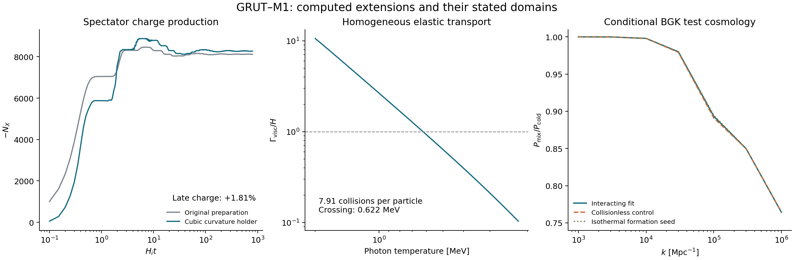

# GRUT–M1: bounded cubic holder and interacting transport

29 October 2026. Additive continuation of commit `94f660d0e04e7b40b668ffb316793a575f3e3813`.

**We constructed a scalar potential bounded below at every fixed finite curvature, evolved its charge production through reheating, and solved the inherited gas's homogeneous elastic relaxation.** We also implemented a conditional density-perturbation hierarchy. These calculations strengthen a specified effective model; they do not establish a UV completion, an actual CMB isocurvature prediction, or a complete M1 matter-power spectrum.

The numerical inputs, code, controls and reproduction commands are included. [VERIFICATION.json](VERIFICATION.json) records **71/71 same-author checks**, including a distinct Python/Radau background integration. This is not independent external review. [INPUT_PINS.json](INPUT_PINS.json) records 30 exact parent blobs. The frozen M1 point and earlier research packets are unchanged.

The later Gemini notes and separate record-selection attachment receive an additional **8/8 direct checks** in [FOLLOWUP_NOTES.md](FOLLOWUP_NOTES.md). Small gravitational backreaction does not by itself justify neglecting the forward curvature response. The proposed record objective also fails to select the claimed unique history; this work establishes no conscious cosmic choice.

## 1. A bounded replacement for the sextic holder

We use Argon's Option 1A,

\[
 V_R\supset\frac{\xi_{\mu R}R}{M_Y}
 (e^{i\alpha_R}\Sigma^*Y^2+\mathrm{h.c.}),
 \qquad
 \frac{\mu_{\rm eff}(R)}{H_i}=\frac\mu{H_i}
 +\frac{10i-\mu/H_i}{12}\frac{R}{H_i^2}.
\]

This gives `xi_muR = 30.74672874`, `alpha_R = 2.19214407` radians and initial `mu_eff = 10 i H_i`. Its curvature operator has mass dimension five; calling the full action renormalizable or UV-complete would be incorrect. Cubic dependence on scalar fields does, however, permit an explicit lower-bound proof including the mixed quartic `kappa Y* X^3`. See [DERIVATIONS.md](DERIVATIONS.md).

At `R = 12 H_i²`, the stationary solution has amplitudes `(87.19556, 5.75425, 28.38718) H_i` and relative phase `arg(Sigma) − 6 arg(X) = −pi/2`. The five physical scalar Hessian eigenvalues are

\[
 m_a^2/H_i^2=(13.0914,14.5892,538.147,1546.66,3239.89).
\]

The remaining eigenvalue is the gauge direction. The initial phase is **encoded in the chosen complex coefficient**; this calculation does not derive a unique state-selection law. The Hessian statement concerns the canonical scalar sector on the prescribed background.

The potential is bounded below, not everywhere nonnegative. Its initial value is `−32480.6 H_i⁴`; a conservative global fixed-`R` lower bound is `−285370 H_i⁴`. The effective Planck coefficient stays positive on the calculated trajectory and differs from its reference value by at most about `4.81e−11`. That local result does not prove global gravitational positivity for arbitrarily large fields.

For `H_i t <= 800`, the late charge average is `N_X = −8267.43703`, compared with `−8120.73970` for the original preparation: **+1.80645% in charge magnitude**. Reducing the integration tolerance tenfold leaves this average unchanged at the quoted precision; changing the late averaging window changes it by about `3.7e−5` fractionally. Gauge and energy-ledger residuals are small, and a separate Radau implementation agrees with the C background to `3.7e−10` in the reported scaled maximum norm through `H_i t = 3`.

At unchanged final mass per charge, the conditional abundance refit is `H_i(new)/H_i(old) = 0.98813541`, or `H_i(new) = 1.32691046e11 GeV`. This uses the fixed-dimensionless-history law `Y_Q ∝ H_i^(3/2)` and co-scales all heavy masses and decay rates with `H_i`; it is not a fixed-heavy-mass scan. Other mass hypotheses are tabulated in [STABILIZED_CANDIDATE.json](STABILIZED_CANDIDATE.json). The gas population below is inherited, rather than re-formed with the new holder.

## 2. Vacuum-to-charge transfer, with its missing cosmological pieces

We propagated a declared de Sitter Bunch–Davies scalar state through the canonical transfer system. The old 12×12 engine contains scalar/longitudinal-gauge mixing but **omits metric, inflaton and radiation perturbations**. The longwave result uses five scalar modes orthogonal to the gauge direction, with finite-`k`, finite-`e` controls on that subspace. It does not initialize or account for a separate longitudinal-vector vacuum contribution.

The homogeneous phase response is `d ln|N_X|/d delta = 0.554384305`; direct perturbed trajectories give `0.554384322` at step `0.0005`. Finite-wave-number projected response errors scale as `k²`: `7.33e−5` at `k/H_i=0.001`, `7.33e−7` at `0.0001`.

| Assumed e-folds between horizon exit and reheating | Fixed-background fractional charge power |
|---:|---:|
| 4 | `1.23575e−10` |
| 8 | `7.59235e−16` |
| 20 | `1.76119e−31` |
| 50 | `1.44301e−70` |

This suppression follows from the selected heavy scalar masses and supplied de Sitter duration. The calculation does not construct the preceding 50 e-folds of inflation. It also lacks `delta R`, the metric constraints, radiation entropy, curvature correlations, and the response of the final mass per charge to formation. Consequently these numbers are **spectator charge-power proxies, not `P_CDI`**, and cannot establish passage of a Planck likelihood or a minimum observationally allowed holder coefficient. [perturbations.json](perturbations.json) retains all assumptions and controls.

## 3. Gas relaxation and the temperature clock

Starting with the inherited 96-source-bin checkpoint at approximately 2 MeV, we evolve classical, isotropic, nonrelativistic `XX -> XX` scattering in comoving kinetic energy. This avoids adding a new fixed physical-energy floor during redshifting. It does not undo distortions already present in the inherited source, establish a cosmic formation ensemble, or include gas-core reactions.

The threshold cross section is `sigma = 2.16627561e−7 / m_X²`. Number and comoving nonrelativistic kinetic energy are conserved to rounding accuracy. The refined 512-node calculation gives:

| Quantity | Result |
|---|---:|
| Integrated collisions per particle, expansion by factor 10 | **7.91173** |
| Viscosity-rate proxy crossing `H` | **0.62156 MeV** |
| Expansion factor at crossing | `3.26194` |
| Temperature after expansion by factor 10 | `0.22086 MeV` |
| Initial / final `⟨p⁴⟩/⟨p²⟩²` | `1.91713 / 1.67301` |
| Maxwell value for that ratio | `5/3` |
| Generalized-Maxwell fitted exponent | `1.98120` |
| Maximum node-midpoint CDF fit discrepancy | `0.000536` |

The three-parameter fit is `f(q)=A exp[−(q/q0)^beta]`; it matches number and the final exact `⟨v²⟩`, `⟨v⁴⟩`. This supports approximate Maxwellization for this source and collision model. The conclusion comes from evolving the distribution, not merely from the initial collision rate. Grid and angular controls agree on the integrated count; the 64-bin inherited source changes it by about `0.19%`.

Against the inherited fully relativistic tree-level rate kernel, the nonrelativistic rate is `1.106%` high initially, `0.115%` high near expansion factor three, and `0.0102%` high at factor ten. The omitted initial high-energy tail carries about `2.8e−8` of kinetic energy. These controls quantify approximations; no exact relativistic transport solution is claimed. `Gamma_visc/H=1` is a useful homogeneous diagnostic, while perturbative tight coupling also depends on `kv/a`.

## 4. A conditional parsec-scale density response

We now have an internal conserving BGK (relaxation-time) hierarchy, rather than inferring power directly from a smooth homogeneous spectrum. The gas is `5.87674%` of all matter in this test model. Formation matching is supplied at 2 MeV: gas and cold matter have equal density and bulk-velocity perturbations, with an assumed temperature perturbation. The hierarchy approximates all other matter, including baryons, as cold; radiation is one barotropic perfect fluid. It neglects gas metric anisotropic stress and order-`v²` background corrections. Its collision operator is matched to the measured viscosity proxy, not derived by linearizing the full `XX` collision integral around the evolving nonthermal background.

The following values use the fitted shape, refined momentum/angular hierarchy, and refined radiation-oscillation averaging. They are **linearly extrapolated `z=0` ratios in that test cosmology**, with the same initial radiation/cold mode in both runs. They are not nonlinear structure predictions or an observational M1 fit.

| `k` [Mpc⁻¹] | Comoving wavelength `2pi/k` [pc] | `P_mix/P_cold` |
|---:|---:|---:|
| 10,000 | 628.3 | 0.997879 |
| 30,000 | 209.4 | 0.979835 |
| 100,000 | 62.83 | **0.893210** |
| 300,000 | 20.94 | 0.849806 |
| 1,000,000 | 6.283 | 0.764169 |

Combined numerical refinement changes the sampled ratios by less than `3e−5`. At `k=1e5/Mpc`, a factor-two collision-rate change shifts the unrefined ratio from `0.893240` to `0.892604–0.893839`; a zero-temperature-seed Maxwell control gives `0.894510`, versus `0.893112` for its default Maxwell counterpart. A collisionless control gives `0.890969`. These are limited sensitivity tests, not bounds on all allowed formation states. The highest modes were already inside the horizon at the starting checkpoint; their actual source perturbations must be derived. The shape before relaxation is also approximated by a fixed comoving fit. [TRANSFER_COMPARISON.json](TRANSFER_COMPARISON.json) retains the full comparison.

The curve is a concrete conditional forecast that can now be challenged. It is not yet an earned, distinctive GRUT prediction.

## 5. CLASS outcomes and the remaining closure problem

Smoothing did not automatically cure CLASS. The high-`k` warm run failed with a minimum-step error; the matching cold attempt timed out after 240 seconds. Successful Runge–Kutta collisionless controls at moderate `k`, including a 60-to-120 momentum-bin/tolerance refinement, show no resolved power departure at `1–10 h/Mpc`: ratios differ from unity by only a few parts per million, comparable to the numerical control change. These back-extrapolate an adiabatic relic before its modeled formation and omit self-scattering. They are not the interacting M1 prediction. Failures and settings are retained in [CLASS_CONTROL_RESULTS.json](CLASS_CONTROL_RESULTS.json).

The next decisive construction is the common perturbation chain: a covariant inflation/reheating state with metric and radiation perturbations, propagated into an actual formation ensemble and its core/gas source terms, followed by a linearized interacting Boltzmann treatment. Independent reproduction is also still needed. The bounded holder and solved homogeneous transport are completed pieces of that chain; the chain itself remains open.

Read [DERIVATIONS.md](DERIVATIONS.md), [REVIEW_RESPONSE.md](REVIEW_RESPONSE.md), [REPRODUCE.md](REPRODUCE.md), and [SOURCES.md](SOURCES.md) for definitions, corrections and replay instructions.
