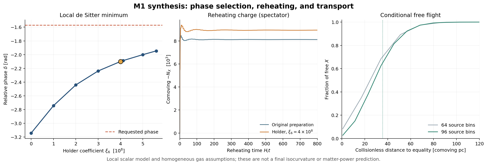

# M1 synthesis: scale separation, phase holding, and the free-X population

**Status, 29 October 2026.** A curvature-coupled phase holder has been constructed and evolved in a *local spectator model*; scale-separated expansion and geometric crossing estimates have been computed; and the saved gas spectrum has been propagated ballistically and tested in CLASS. These are concrete steps toward the requested synthesis, not a completed theory, a proof of the actual relic population, or a converged M1 matter-power prediction. The frozen parent candidate was not edited. Results and choices are reproducible from the code and numerical files in this directory.

The benchmark used here is parent commit `6c504de651cb7085025f4620bdd3a37c8c5c805f`; exact inherited inputs are listed in [INPUT_PINS.json](INPUT_PINS.json). The primary formulas are in the accompanying scripts. [REPRODUCE.md](REPRODUCE.md) explains how to regenerate them. Numerical controls and limitations of the Boltzmann-code attempt are in [CLASS_ATTEMPTS.md](CLASS_ATTEMPTS.md).

## 1. The pulse, the physical-density estimate, and recalibration

### Expansion work

The candidate specifies `H_i = 1.3428427349e11 GeV`, not 134.284 GeV. At a visible temperature of 20 MeV, the inherited radiation clock with `g_* = 10.75` and reduced Planck mass `2.435e18 GeV` gives

\[
H=\sqrt{\pi^2g_*/90}\,T^2/M_{\rm Pl}=1.78359\times10^{-22}\ {\rm GeV},\quad
H/m_X=1.93010\times10^{-21}.
\]

At constant H, the duration `m_X Δt = 20000` has `Δ ln a = 3.8602e-17`. This differs from the `H/m_X ≈ 3e-14` in the handoff. The fixed-temperature assumption and the normal radiation clock are explicit inputs, rather than a proof of the formation epoch.

A conservative bound follows for the minimally coupled canonical light-scalar system, with nonnegative potential and a closed comoving volume. Write `ρ = K + G + V` and `p = K - G/3 - V`, where `K,G,V ≥ 0`. Then `|p| ≤ ρ` pointwise and conservation gives `|dE/dt| ≤ 3HE`. For the M1 light potential, the neutral part factors as `(s-1)^2(0.75 s² + 1.3 s + 0.95)`, whose quadratic factor has negative discriminant and positive leading coefficient; the charged terms are nonnegative. Thus

\[
|E(t)-E(0)|/E(0)\le e^{3\int Hdt}-1=1.1581\times10^{-16}
\]

for the stated clock and duration. Using `E(0) = 191803.589 m_X`, the bound is `2.22e-11 m_X`. It is not a bound on boundary flux, curvature-improved stress, additional omitted sectors, or the evolution of a non-closed subregion.

The saved finite-region pressure has large oscillations: at `r < 20/m_X` the sampled average of `|∫p d³x|` over the full pulse is about `3725 m_X`, not 1. Multiplying the sampled absolute integral by `3H` gives `4.31e-13 m_X`; sampling can alias oscillations, so the positive-energy result is the more conservative bound. The previously quoted small negative signed mean was for a different, limited window. A stationary, isolated, localized soliton in flat space has the usual integrated-stress identity under the necessary falloff and stationarity assumptions; this does not show that the evolving core-cloud system has already reached it.

### Physical-density geometric crossing

The inherited abundance hypothesis gives `n_core/m_X³ = 1.2141071e-15` at the specified 20 MeV clock. Its volume per core is `8.2365e14/m_X³`; `n^(-1/3) = 93737.7/m_X` is a spacing scale, while the radius of an equal-volume sphere is `58150.2/m_X`.

For an independently distributed homogeneous **ballistic** bath, a target of radius `60/m_X` sweeps a first-interception fraction `π R² n v Δt = 1.92e-7` with `v=0.7`, or at most `2.75e-7` with `v≤1`. This supports a small average *geometric hit fraction* during the short pulse under those assumptions. It is not a bound on coherently focused radiation, angular or spatial correlations, long-range interactions, repeated crossings, or phase randomization. Indeed, under an additional Poisson-center model, the probability of at least one other center within a causal distance `(20000+120)/m_X` is `4.06%`; that is a different question from a small target's first interception. The true formation history and mixing remain uncalculated.

### Mass budget and scale adjustment

The `0.894436%` model total at `a/a_0=10` remains the parent finite-checkpoint accounting, including `0.822257%` cold excess, `0.016556%` gas kinetic energy, and `0.055624%` held/unassigned energy. It is not an asymptotic abundance. Using the two saved checkpoints to hypothesize a `0.3368502` cold conversion fraction for the held remainder yields two different future scenarios:

| Future assumption | Hypothetical excess |
|---|---:|
| Current gas heat retained | `0.857549%` |
| Current gas heat fully redshifts | `0.840994%` |

Both require an unproved assumption about the remainder, and neither is a dynamical calculation. **Correction of our earlier packet:** it was too broad to say `0.841%` is necessarily an arithmetic error. It is consistent if the gas heat also fully redshifts. See [CORRECTIONS.md](CORRECTIONS.md).

The user's underlying calibration point is correct: an assumed final mass per charge can be absorbed into a refit of a freely calibrated scale. The parent's derivation has `Y_Q ∝ H_i^(3/2)` for its fixed dimensionless early history, so if that history and other matching factors are held fixed,

\[
H_{i,\mathrm{new}}/H_{i,\mathrm{old}}=(1+\delta_M)^{-2/3}.
\]

For the hypothetical `δ_M = 0.0085754931`, the shift is **−0.567645%**, giving `H_i = 1.335220156e11 GeV`; not −0.29%. For the fully cooled hypothetical value it is −0.556762%. The fixed 1% budget is a diagnostic of the originally calibrated population, not a universal observational exclusion. Refitting does not by itself derive the actual formation fraction or final abundance. The new holder below changes the dimensionless early dynamics, so it must be recalculated rather than rescaled by this fixed-history formula alone.

## 2. A tested curvature phase holder

With canonical four-dimensional complex scalars, `[X]=[Y]=[Σ]=1`, `[R]=2`, and charges `(1,3,6)`, both `Σ*Y²` and `Σ*X⁶` are gauge invariant. Their curvature terms have dimensions five and nine. The correctly dimension-four Lagrangian terms have denominators `Λ` and `Λ⁵`, respectively:

\[
\Delta\mathcal L=-\frac{\xi_YR}{\Lambda}(i\Sigma^*Y^2+\mathrm{h.c.})
-\frac{\xi_6R}{\Lambda^5}(i\Sigma^*X^6+\mathrm{h.c.}).
\]

The `Λ²`/`Λ⁴` denominators in the original proposal, and `M_Y⁴` in its six-field alternative, do not have the right dimensions if their coefficients are dimensionless. For `δ = θ_Σ − 6θ_X`, `iΣ*X⁶ + h.c. = 2|Σ||X|⁶ sin δ`; the positive `V = ξ_6 R(iΣ*X⁶+h.c.)/Λ⁵` term acting alone favors `δ=−π/2` for positive `R,ξ_6`.

We solved the *full existing scalar potential plus that term*, continued a local stationary branch, checked the canonical Hessian, and evolved it through the prescribed inflaton/radiation background. For `Λ=1e15 GeV` and `ξ_6=4e8`, the result is:

| Quantity | Result |
|---|---:|
| Local equilibrium `(|X|, |Y|, |Σ|)/H_i` | `(86.657, 3.823, 28.338)` |
| Gauge-invariant phase `δ` | `−2.09993 rad` |
| Lightest physical scalar Hessian eigenvalue | `10.669 H_i²` |
| Desired prepared phase | `−π/2 = −1.57080 rad` |
| Late `|N_X|`, holder vs original, average over `640≤H_i t≤800` | `8926.915 / 8120.740` |
| Relative charge change | `+9.927%` |

The numerically vanishing sixth Hessian direction is the gauge orbit, not an extra light physical scalar. Existing phase torques shift the true minimum away from the holder-only value; the radial condensates move too. The original, unmodified-preparation run independently reproduces the old charge at `H_i t=20` to about `1e-6`. The longest runs preserve the gauge-charge constraint to better than `6e-7` in the displayed charge units and the spectator energy-work ledger to `3e-12` relative. Their late averaging windows vary by about `0.04%` or less. During the switch `R/H_i²` changes sign, so the operator's effect is not simply to disappear monotonically.

The construction is **local and conditional**. The chosen operator is unbounded in a large-field direction without further stabilizing terms; its Wilson coefficient is large. At the old prepared state the holder-only estimate for `m_δ²=9H_i²` is `ξ_6≈4.12e8`, corresponding to `Λ/ξ_6^(1/5)≈1.89e13 GeV`. This is a diagnostic, not a derived cutoff or UV completion. The initially requested mediator scale is also not automatically a controlled suppression scale: `|X|/M_Y = 2.55` at the original preparation. A second local test of the dimension-five `RΣ*Y²/M_Y` operator can approach the target phase only as the amplitudes change substantially; e.g. at coefficient 100, `δ≈−1.748` and `|X|≈8 M_Y`. Its fixed-Σ quadratic sign is not a substitute for the full Hessian. Full results are in [phase_holder.json](phase_holder.json) and [phase_cubic.json](phase_cubic.json).

For the `4e8` local equilibrium, an idealized constant-H, constant-Hessian, Bunch–Davies test-mode calculation gives `sqrt(P_δ) ≈ 1.09e-5` after four e-folds outside the horizon and `2.70e-8` after eight. The massless analytic control is accurate to `9.3e-9`; starting the vacuum integration twice as deep changes the reported powers' square roots by about `1.9e-8` fractionally. A separate homogeneous Σ-phase perturbation produces `d ln|N_X|/dθ_Σ ≈ 1.00405` with two finite-difference steps, compared with the old preparation's `−0.21997`. If one *also* adopts the old uncorrelated, scale-invariant CDI conversion and freezes the final mass per charge, this homogeneous response would suggest a phase amplitude of order `9.1e-6`, not the old `4.14e-5`. That estimate is only a comparison: a heavy phase has a different spectrum, and the actual gauge/metric perturbations, correlations, transition transfer, final-population response, and appropriate observational likelihood have not been solved. Planck's `β_iso<0.038` is a restricted 95% result for a specified uncorrelated scale-invariant CDI case, not a universal threshold; see [SOURCES.md](SOURCES.md).

A locally stable potential and an assumed vacuum also do not derive the foundational preparation law `B` or a unique quantum state. The original candidate's `phase_holder_constructed` flag should remain false for that complete obligation; this is a useful *candidate implementation*, not its certified completion.

## 3. Free X: speed, distance, scattering, and power

The parent kinetic simulation at `a/a_0=10`, interpreted as 2 MeV under its inherited constant-`g` clock, yields `N_+ = 13189.13` per reference core and `6.5946%` of the original charge in free X. Because a core's mass per charge differs from a free particle's mass, the free component is about **6.9737% of the cold-plus-held mass budget** under this construction. Its `v_rms = 0.06838 c`, not `0.050 c`.

Using that saved one-point energy distribution, a standard homogeneous radiation/matter/Λ background, equilibrium electron-positron entropy transfer and instantaneous neutrino decoupling at 2 MeV, we integrated `∫ v da/(a²H)` with exact relativistic `v(p,a)` from the checkpoint. The particle-weighted distribution is:

| Conditional collisionless distance | Result |
|---|---:|
| Mean to matter-radiation equality | `35.51 comoving pc` |
| RMS to equality | `39.86 comoving pc` |
| Median to equality | `34.06 comoving pc` |
| 10th–90th percentile | `12.12–61.36 comoving pc` |
| Mean through today | `39.61 comoving pc` |

The integral grid refined from 4500 to 9000 steps changes the mean by `8.6e-9` fractionally. Replacing the 96-bin input with the 64-bin input changes the mean by about `2.9%`; respectively `2.76%` and `8.40%` of the gas population lie in the numerical lowest-energy bin. Thus integration convergence is much better than source/grid convergence. The background gives `z_eq=3420.5` in this simplified setup. The distances are conditional on **collisionless free flight after 2 MeV** and are not themselves power spectra.

That condition is material. With the inherited, homogeneous tree-level elastic `X X` kernel and the 96-bin gas at the same checkpoint, the total scattering count is `Γ_coll/H = 15.72` per particle per Hubble time. The angular viscosity-weighted proxy is `10.48/H`. The 64-to-96 input change is about 1.1%; doubling angular nodes changes the 96-bin result by about 0.004%. The ordinary collision result reproduces the parent full operator to floating-point precision. The viscosity weight is **not** the eigenvalue of a solved perturbation collision operator; actual formation, density, medium effects, core interactions, and later transport remain open. It nevertheless means the collisionless model cannot be presented as the physical M1 answer without further work.

We also built and ran CLASS v3.4.1 at the pinned source commit. The comparator uses a cold component plus an adiabatic, collisionless, noncold component with the same background mass fraction and a specified smoothed distribution. It extrapolates the gas before the modeled 2 MeV checkpoint and does not model formation, scattering, source perturbations, or their correlations. The actual saved spectrum is narrow at low momentum: with 30, 60 and 120 momentum nodes, the alleged `ΔP/P` at `k=1 h/Mpc` varies between `+0.129%`, `−0.049%`, and `+0.604%`. That is a **failed convergence test**, not three physical predictions. A separate moment-matched smooth distribution yields very small departures on the tested scales, but solver comparisons still leave numerical residuals. These exploratory runs do not exhibit an 8–12% step on the tested Lyman-α-scale range; they do **not** constitute a converged M1 spectrum, a likelihood, or an exclusion. See [CLASS_ATTEMPTS.md](CLASS_ATTEMPTS.md) and [class_results.json](class_results.json).

For intuition only, a no-gravity toy model of isotropic free displacements from the same initial perturbation gives `|ΔP/P|≤ f k²⟨λ²⟩/3`; at `k=10 h/Mpc` its equality bound is `1.68e-9`. This is not a Boltzmann transfer function and cannot account for gravitational feedback, independent source perturbations, or collisional transport.

## Next calculations required for a genuine prediction

1. Supply a controlled stabilizing/UV completion of the curvature operator, derive the allowed initial quantum state, and evolve coupled scalar, gauge and metric perturbations through the sign-changing reheating background. Refit the new charge yield with the dimensionless dynamics actually held or recomputed consistently.
2. Derive and evolve the real source and core/gas correlations from formation; solve the expanding interacting kinetic and perturbation system, including gas self-scattering and relevant core channels. Quantify the low-energy numerical floor.
3. Produce a converged linear power spectrum with well-tested momentum quadrature and interactions, then compare its scale dependence with the relevant data and likelihood. None of the three numerical tasks above substitutes for these calculations.

All checks here are same-author controls. Independent scientific reproduction has not been performed.
