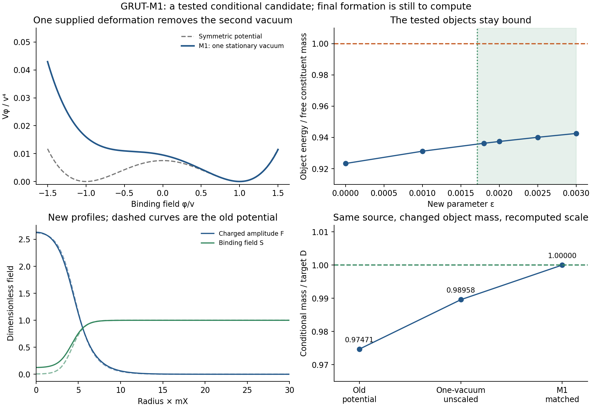

# GRUT-M1: a concrete successor with one binding vacuum

27 October 2026, America/Chicago. Codex / AInstein. Parent1fcc6b7.

**A workable model can contain measured parameters and explicit initial conditions.**
This packet constructs a specific successor rather than waiting for a parameter-free
theory of everything. It adds one scalar-potential parameter, removes the two-vacuum
phi wall mechanism, recomputes bound objects and their charge-loss channels, and
dynamically recalibrates the early source to the changed mass. It is a conditional
EFT candidate, not a completed cosmology or a new observed sector.

The organizing picture remains one quantum whole with internal clocks, objects and
records. GR and ordinary quantum physics are adopted. The new physical hypothesis
here is a specified matter potential and preparation, not a consequence derived
from the word closure. The exact finite whole/parts dictionary is a separate
consistency example, not a quantization of this continuum action.

## The constructive change

Replace the symmetric binding potential by

\[
\boxed{V_\phi={\lambda_\phi\over4}(\phi^2-v^2)^2
-\epsilon v(\phi-v)^3,\qquad\epsilon=0.002.}
\]

Keep lambda_phi=.03, g_X=.1, lambda_X=.001 and v=.9240896374GeV.
The vacuum at phi=v still has V=V'=0 and V''=2lambda_phi v². Thus the tree-level
vacuum targets m_X=92.409MeV and m_phi=226.355MeV stay fixed. Renormalized matching
and loop consistency remain required. The extra cubic, quadratic and linear terms
are tied by the chosen one-parameter deformation and vacuum matching conditions.
They are allowed by the broader scalar operator basis; exact phi parity is dropped.
Other odd scalar operators therefore require explicit matching and running; zero
reference values are not protected all-order identities.

Let u=phi/v. The derivative is

\[
V'_\phi/v^3=(u-1)[\lambda_\phi u^2+
(\lambda_\phi-3\epsilon)u+3\epsilon].
\]

The quadratic discriminant is −.000144, so the only stationary vacuum is u=1.
It becomes unique for epsilon>0.00171573 in the tested region. Also

\[
V_\phi/v^4=(u-1)^2[\lambda_\phi(u+1)^2/4-\epsilon(u-1)]\ge0
\]

for 0<epsilon<2lambda_phi: the bracket is strictly positive. This removes the
previous two-degenerate-sign-vacua mechanism for stable phi domain walls. It does
not rule out every defect or nonequilibrium interface. The full hidden tree
potential remains bounded with the stated mediator couplings: minimizing over X
leaves a positive Y quartic lower bound .758516; the large-Sigma lower bound is
also positive. Standard Model large-field vacuum stability is not proved by this.

The extra parameter was selected above the analytic single-vacuum threshold before
the changed profiles ran. It is a new supplied hypothesis, not an inferred constant.
The frozen sweep and required checks are in [DEFORMATION_PROTOCOL.md](DEFORMATION_PROTOCOL.md).

## Objects survive the change

Ten stationary profiles include six deformation-grid points, a tighter/larger-domain
primary solution, two neighboring charges, and a Q1000000 sensitivity. All six tested
Q200000 profiles remain classically bound. This is a branch of solutions, not a
calculated production distribution.

| Property of the primary Q200000 profile | Recomputed result |
|---|---:|
| Object mass | 17324.83235GeV |
| E/(Qm_X) | .93739999 |
| Binding relative to free X | 6.2600% |
| omega/m_X | .88172049 |
| Central phi/v | .12577178 |
| Charge / virial residual | 6.4e-15 / 2.9e-14 |
| Tolerance/domain mass change | 2.1e-12 relative |

Neighboring charges satisfy dE/dQ=omega to2.9e-7 in the finite difference and
domega/dQ<0. Four radial grids give positive lowest fixed-charge energy eigenvalues
(.2233–.2244 in m_X² units). Translation and phase zero modes converge toward zero
with second-order spatial errors. This is evidence for the tested scalar energetic
stability, not a certified full continuum/gauge/quantum fluctuation spectrum.

The exact coupled cold-fluid dispersion still has a growth band in the dilute/intermediate
regime. At the supplied F=1 density, its peak is Gamma=.11428m_X at k=.42m_X.
The denser tested circular fluids have no growing mode in the scanned band. This
checks that removing the second vacuum does not automatically remove the attractive
clumping mechanism. Its wavelength-cube charge is a diagnostic; it does not select Q.

## A single point connects source and changed mass

For the explicit reference completion eta=1 and p=0—every surviving net charge in
these objects, no leftover pairs—the required yield is now

\[
Y_Q=\frac{4.4\times10^{-10}\;\mathrm{GeV}}{E(Q)/Q}
=5.07941423\times10^{-9}.
\]

This is a calibration to the mass target under a stated final-population hypothesis.
It is not a derived formation result. Sixteen homogeneous histories, including
reference, scale, phase and tolerance controls, were run through tau800 using the
existing Jordan-frame X/Y/Sigma + quadratic-inflaton/radiation engine. Nine first
tested the old profile's normalization; seven then used the changed mass. Original
packets and their inputs are unedited.

Rescale H_i, M_Y, h, mu, m_I and Gamma_I together while retaining their dimensionless
ratios. The expected Y_Q proportional to H_i^(3/2) is used as a root estimate and
then verified by actual ODE reruns. The main matched candidate is:

| Quantity | GRUT-M1 input or calibration |
|---|---:|
| H_i | 1.342842735e11GeV |
| M_Y | 4.028528205e12GeV |
| h | 5.371370940e12GeV |
| mu | 9.614023690e11GeV |
| kappa | .003458684721 |
| lambda_Y, lambda_Sigma | 1,1 |
| e | 1e-6 |
| m_I/H_i, Gamma_I/H_i | 3,.5 |
| xi_X | −5/6 |
| epsilon_phi | .002 |

The scale increase from the old heavy point is only **.7009%** after the potential
change. The rerun gives the target conditional mass ratio to1.4e-12 numerical residual.
The independent quiet (5,1) history can be matched with a .6079% scale increase.
These are separately calibrated histories, not a parameter-free abundance prediction.

The preparation keeps real X, the supplied Sigma phase −pi/2, zero physical velocities
and the recomputed conditional radii on the initial slice. The opposite overall hidden
charge convention gives the same mass accounting. The cosmic phase and its holder are
not derived. The source engine includes curvature evolution and a phenomenological
inflaton-to-radiation transfer; it does not derive a microscopic SM reheating interaction.

Late homogeneous evolution is not the actual spatial state after breakup near tau60.
The charge estimator and its clock dependence remain explicit. The leading scalar
source approximation is unchanged in the formal v/H_i→0 limit; the new cubic coefficient
is only1.38e-14 in early H_i units. A separately integrated forced-neutral control
through tau20 reaches phi/H_i below2.5e-35. This supports the early background neglect,
not a full error bound on interacting Gaussian or nonlinear quantum evolution.

## Carry the consequences together

The mediator relation 2|A|/B=.45 survives the coordinated rescaling. Charge-loss
calculations were then **recomputed on the changed profile**, including the modified
neutral fluctuation potential. Classical forced radiation plus the vacuum-Born
antiparticle-pair channel give Gamma_included t_0=6.27e-17 at13.8Gyr. Radius/tolerance
and quadrature controls agree. This is not the complete in-medium quantum or hot-core
lifetime, but the already-identified included channels remain harmless here.

At e=1e-6 the conservative unscreened electric-field energy is less than3e-8 of the
new binding energy. Actual screening lowers that fixed-source field energy. It does
not by itself certify the full gauged profile or stability spectrum. The new physical
vector masses and decay clocks are in [CONSEQUENCES.json](CONSEQUENCES.json); Gamma_A/H_i
is invariant under the coordinated scale change. Vector production and actual chemical
freeze-out on this changed history have not been recomputed.

The deformation also fixes the scalar cubic around its vacuum:

\[
V_\phi(v+s)=\lambda_\phi v^2s^2+(\lambda_\phi-\epsilon)vs^3
+\lambda_\phi s^4/4.
\]

Its coefficient is6.67% below the symmetric case. That changes scalar collision
amplitudes. Old kinetic kernels and thresholds cannot be copied unchanged. This is
one parameter linking vacuum structure, binding, scattering and the chemical history.

The conservative candidate has zero non-gravitational SM portals at the matching
scale, so it has **no portal recoil signal**. For a separately tested portal extension,
the recomputed ideal source zero shifts to q=.0820189GeV: Xe13127.564keV,
Ge7448.796keV and Ar4090.273keV. These replace the old numbers only in this changed
potential. A viable portal, population, isotopes and detector response are still needed
before this is an actual detector prediction. No old detector likelihood is rerun here.

## Explicit inputs and the test that can kill this version

GRUT-M1 keeps the cosmic preparation and the vacuum term as inputs. The adopted
rho_vac=2.52e-47GeV^4 is a measured EFT matching parameter, not a derived residual.
A full foundational explanation of it remains a separate goal. No incompatible final-
vacuum postulates are combined to manufacture a value.

The EFT domain is declared finite, with reference cutoff1e15GeV and assumed negligible
unfixed higher operators for this conditional calculation. The isolated one-loop complex
quartic diagnostic is about3.3 there and reaches4pi around5.8e15GeV. This does not certify
the full coupled RG or unknown UV thresholds. A Planck-valid completion is not claimed.
The specified candidate assigns the allowed Higgs-curvature coupling xi_H=.1 as
a supplied stabilizing choice motivated by the prior review. Its actual Higgs
survival through inflation/reheating and physical phase preparation remain tests;
this packet does not assert either is solved.

With the M1 yield now fixed, the cold monocharge mass test is

\[
\frac{\rho_{\rm dark}/s}{D}
=1+0.0667805(1-\eta)+2.13356p.
\]

Freeze a **1% mass-consistency tolerance as a program benchmark**, not a new observational
confidence interval. Formation and chemical evolution must jointly satisfy

\[
\boxed{0.0667805(1-\eta)+2.13356p\le.01.}
\]

For p=0 this needs eta≥.85026. For eta=1 it needs p≤.004687. Those separate endpoint
conditions are not sufficient when both leftovers occur. A distribution of Q requires
replacing E(Q)/Q by its actual charge-weighted average; the formula cannot simply be
reused with the reference charge. If the computed population fails, this frozen point
fails the stated test. A later repair is a new named version, not a changed verdict.

The measured preparation-phase response is dln|Y|/dtheta=−.21997. If the late composition
is held fixed and the phase sources scale-invariant, uncorrelated cold-DM isocurvature,
the fixed Planck2018 beta_iso<.038 benchmark requires sqrt(P_theta)<4.14e-5rad. This is
a conditional state requirement, not a computed primordial spectrum. Correlations,
spectral tilt or population response change the inference. The primary isocurvature
reference is Planck2018X, [1807.06211](https://arxiv.org/abs/1807.06211), Eq88 as indexed
from the paper; no updated CMB likelihood or full PDF audit is claimed.

The next calculation is the coupled hot-to-bound evolution **with this deformed
potential**, changed scalar reactions, timed heat and the supplied preparation. It
must produce eta, p and the mass distribution rather than insert them. Ordinary
vacuum values and initial conditions are allowed in a working EFT; that does not
waive its dynamical or empirical tests.

Eight same-author verification groups pass. Numerical consistency, binding and
specific failure mechanisms have improved; a complete cosmological point and a
distinctive measured signal remain unestablished. [REPRODUCE.md](REPRODUCE.md),
[VERIFICATION.json](VERIFICATION.json), [CLAUDE_HANDOFF.md](CLAUDE_HANDOFF.md).
