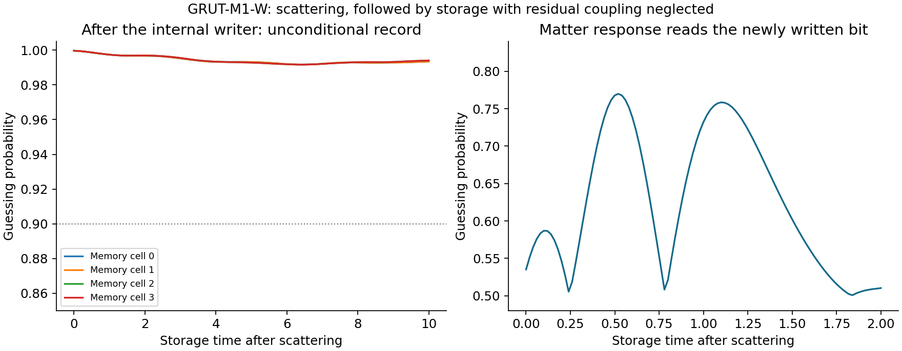
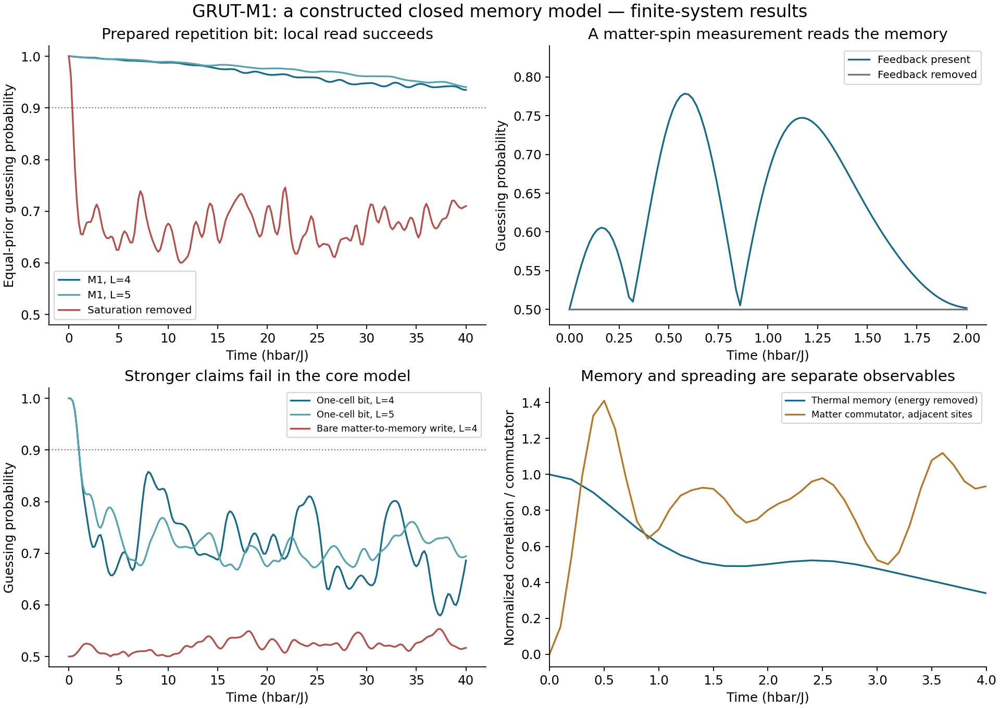

# GRUT-M1-W: a constructed and calculated memory candidate

**Outcome: a narrower working physical model, not the intended universal
theory.** One explicit, closed, time-independent Hamiltonian can write a
prepared input into a structured register, retain a readable record, and
let that record alter later matter interactions. The core and completed
writer have actual numerical regimes, specified resources and retained
failed tests. A gravitational theory or gravitational scrambling exponent
has not been produced.

## The constructive proposal

The added principle is **kinetic saturation**: a cell surrounded by an
ordered memory neighborhood rewrites slowly, while its stored value changes
the matter bond. It is an explicit proposed law, not a conclusion inferred
from the words “closed whole.”

With matter spins \(\sigma\), memory spins \(\tau\), and a supplied ring,

\[
H_{M1}=\sum_i[J(1+\alpha\tau_i^z)\sigma_i^z\sigma_{i+1}^z
+h_x\sigma_i^x+h_z\sigma_i^z-K\tau_i^z\tau_{i+1}^z
-\Delta F_i\tau_i^x],
\]

\[
F_i=\epsilon+(1-\epsilon)(1-\tau_{i-1}^z\tau_{i+1}^z)/2.
\]

The fixed benchmark is \(J=K=\Delta=\hbar=1\),
\(\alpha=0.5,h_x=1.05,h_z=0.5,\epsilon=0.05\). The law supplies the
small rewriting ratio; it does not derive it. There is no disorder or
external drive in the core dynamics.

The initial core could retain and read a supplied record but failed to
write a new durable one from the tested matter input. Its separately named
completion includes the missing apparatus:

\[
H_{M1W}=P^2/(2M)+H_{M1}
+\Omega(1-R^z)\sum_i f_i(Q)\tau_i^x/2.
\]

A massive quantum particle carries the source bit \(R\) through fixed,
local gate regions \(f_i\). Its energy changes as it writes. Both source
inputs start with identical blank memory registers. There is no timed
external pulse or transmitted-only postselection. The complete state
space, functions, parameters, domains and instruments are in
[GRUT_CANDIDATE_M1.md](GRUT_CANDIDATE_M1.md).

## What the calculations actually give

| Calculation | Result | Scope |
|---|---:|---|
| Core prepared-record success, L=4 | At least 0.987510 through sampled t=10 | One repeated bit, local measurement |
| Core matter readout | 0.778468 at t=0.58 | Memory success then 0.999312 |
| Same core readout, L=5 | 0.778460 | Finite-size check, not a thermodynamic limit |
| Writer: initial output in all four cells | At least 0.999680 | Actual coupled scattering calculation at t=0.06 |
| Writer: all-cell success through sampled storage t=10 | At least 0.991697 | Subsequent storage neglects residual carrier/gate interaction |
| Writer: matter readout | 0.769977 at storage t=0.52 | Memory success then 0.998568 |
| Writer time/algorithm/spatial refinement | Maximum probability change below 6.8e-7 | Does not bound every physical approximation |

The core uses exact finite-system spectral evolution. Independent
Kronecker assembly and Krylov evolution agree within 2.24e-13 in the
retention trace. Thirteen originally registered core conditions pass.

The writer uses an FFT scattering calculation and two core-evolution
implementations. All six writer conditions pass at the registered
thresholds after refining the time step and doubling the clock grid.
These are internal numerical results, not independent validation.

The storage portion of this figure uses the unconditional spin state
after scattering and neglects the small remaining carrier/gate coupling.
It is not a rigorous all-times result for the complete carrier Hamiltonian.

## Energy and numerical limits

The supplied carrier's mean kinetic energy is 10002.0408163 in the chosen
units. In the writing branch it becomes 10004.0290991, while the core
energy changes from 1.55 to -0.437569946. The calculated total-energy
drift is 0.000712816 J. It is small compared with the energy transfer,
but it is not zero; its cutoff behavior is nonmonotonic. The probability
refinement is much stronger than the energy-convergence evidence.

The final norm error is 1.33e-12, residual gate-region probability
6.87e-10, edge probability 1.76e-9, and negative-momentum probability
1.36e-8. All reflected components are included. These diagnostics support
the scattering/storage approximation but do not prove that a later
carrier return is impossible. No statistical error bar or rigorous
long-time error certificate is inferred from them.

Preparation resources and measurement energy changes are kept explicit in
[WORKED_REGIME.md](WORKED_REGIME.md). The source bit and a blank register
are supplied; this is autonomous writing from prepared resources, not
spontaneous creation of information, matter or the universe.

## What failed, and what the construction explains

The stronger attacks were registered before execution. A single-cell bit
falls below the declared retention standard; the bare matter-to-memory
writing protocol fails; and extra unconstrained flip terms spoil the
retention threshold. The six false attack conditions remain false in
`challenge_results.json`. The explicit writer does not retroactively pass
the failed bare-writing protocol.

At exact saturation, the number of memory domain walls is conserved.
That proves a protected organized subspace exists, and also proves that
it cannot acquire additional probability from arbitrary initial sectors.
The model reveals a write/protect tradeoff, rather than obtaining free
organization by calling a frozen state emergent.

## What this says about the proposed non-scrambling gravity claim

This attempt demonstrates that structured memory and active information
spreading can coexist under a closed law. It does not establish that
gravity must have a smaller Lyapunov exponent. The finite core OTOCs lack
a controlled large-size, factorized exponential regime; no exponent or
ratio to the MSS bound has been extracted.

The MSS bound is not a universal equality, and submaximal examples already
exist. A new gravitational theory needs an explicit modification of the
gravitational channel and a calculated observable. The present spin
feedback is not called gravity. Related constrained quantum models are
acknowledged in [SOURCES.md](SOURCES.md); no novelty claim is established.

## Deliverable and remaining boundary

The candidate now has an actual law, preparations, energy accounting,
instruments, a worked finite regime, controls, failure records and code.
It supplies a concrete physical meaning for “records that affect later
interactions and persist.”

Universal GRUT remains unfinished. Missing pieces include a gravitational
sector, relativistic propagation, observed matter, the origin and
robustness of the saturation rule, and generic autonomous formation.
[COMPATIBILITY.md](COMPATIBILITY.md),
[PREDICTIONS_AND_TESTS.md](PREDICTIONS_AND_TESTS.md), and
[OPEN_CLAIMS.md](OPEN_CLAIMS.md) give the exact obligations. A finite
working construction is the result achieved here; it is not evidence
that those remaining pieces have been solved or are impossible.
