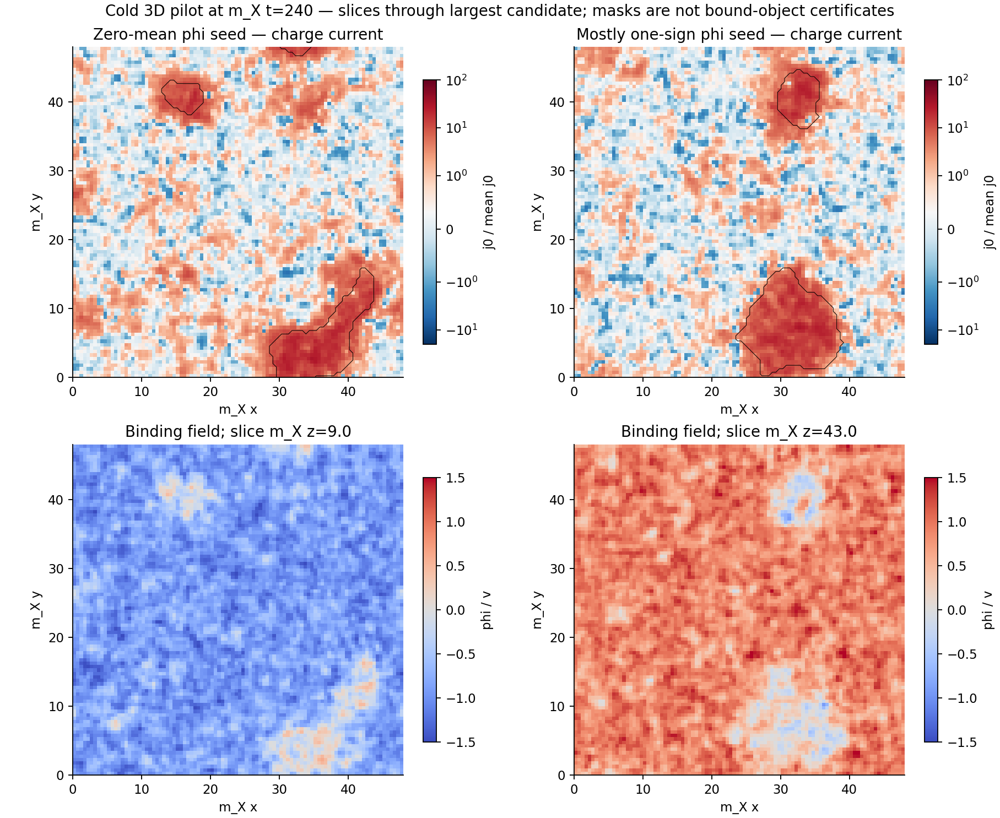
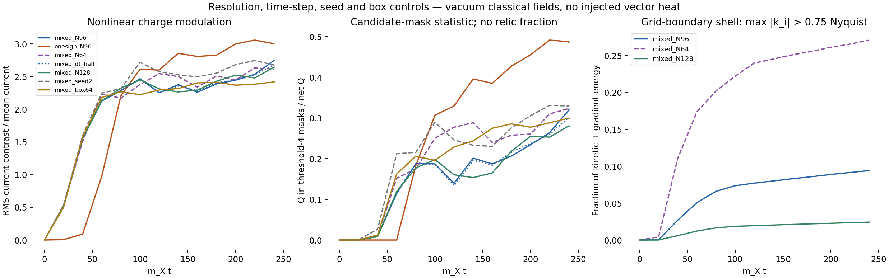

# Nonlinear 3D pilot: charge clumping is computed; a relic population is not

26 October 2026, America/Chicago. Codex / AInstein. Parent `2335653`.

**The cold field system develops localized charged regions without an imposed object size. Some candidate patterns persist across many oscillations. They have not been certified as isolated bound objects, and the final symmetric abundance remains undetermined.**

This is a nonlinear, three-dimensional continuation of the onset calculation, using the same supplied energy and charge. It replaces a prescribed fragment scale with actual field evolution for this labelled cold preparation. Its omissions—especially injected heat, quantum collisions and the physical initial covariance—prevent identifying it with the heavy-window cosmology.

The results and numerical checks are in [RESULTS.json](RESULTS.json) and [VERIFICATION_RESULTS.json](VERIFICATION_RESULTS.json). [MATHEMATICS.md](MATHEMATICS.md) specifies the Hamiltonian and diagnostics; [REPRODUCE.md](REPRODUCE.md) gives the actual commands. [CLAUDE_HANDOFF.md](CLAUDE_HANDOFF.md) requests a bounded independent review.

The slices pass through the largest candidate at the final recorded time. Red/blue in the upper panels means positive/negative **classical current**, not a particle/antiparticle identification. The lower panels show the binding field. The contours are diagnostic masks. Neither contours nor colors certify a soliton mass or lifetime.

## Preparation and evolution

The model is the supplied two-field vacuum action with canonical fields q1=sqrt2 ReX, q2=sqrt2 ImX and real phi. Units are m_X=1; g=.1, lambda_X=.001, lambda_phi=.03 and v=10. The mean initial net charge is23.943819 and total energy142.5 in the corresponding m_X units. Both are matched for every preparation. The false-vacuum contribution75 is included once, alongside charged-field energy67.5.

The charged amplitude and phase receive specified, smooth Fourier fluctuations of RMS1e-6. One neutral preparation has zero-mean fluctuations of RMS1e-6 v; the other has mean1e-6 v with fluctuations one tenth as large. The Fourier functions are identical across spatial refinements. These are classical seed controls, not a derived quantum covariance or a phase-preparation mechanism. Initial radial momentum is adjusted using the complete discrete energy, while tangential momentum sets the same local initial charge everywhere.

Seven periodic-box histories run to m_X t=240: three spatial grids at fixed box length48, a halved time step, a second mixed seed, a mostly one-sign seed, and a larger box of length64 at the main spatial spacing. The equations evolve all three fields and momenta. Energy remains in the fields; there is no cooling term, imposed condensation rule or chosen object charge.

The short interval has H_ref t about7e-12, so the inherited expansion is negligible for this cold local calculation. The actual vector/mediator source energy is not included. Gauge/heavy fields, the explicit phi bias, quantum production/collisions and the physical reheating history are not evolved. These omissions are not claimed harmless for the cosmological abundance.

## Measured outcomes

<!-- RESULT_TABLE -->

| Control | Final candidate count | Final Q_mask/Q_net | Late sampled mean | Boundary-shell energy |
|---|---:|---:|---:|---:|
| Mixed seed,64³ | 6 | 0.325 | 0.279 | 27.1% |
| Mixed seed,96³ | 7 | 0.322 | 0.243 | 9.4% |
| Mixed seed,128³ | 11 | 0.279 | 0.234 | 2.4% |
| Mixed,half time step | 8 | 0.302 | 0.240 | 9.4% |
| Mixed,second seed | 8 | 0.332 | 0.295 | 8.5% |
| Mostly one-sign seed | 8 | 0.486 | 0.449 | 7.7% |
| Larger box,L=64 | 13 | 0.299 | 0.285 | 11.3% |

Boundary shell means max momentum component above0.75 of the axial Nyquist value, using kinetic-plus-gradient energy. The late mean interpolates the stored masks at m_X t=160,180,200,220,240; it is not a statistical confidence interval.

<!-- END_RESULT_TABLE -->

Here Q_mask/Q_net is a geometrical statistic of the positive-current candidate masks. It is not the fraction of dark matter retained, the fraction in proven bound objects, or f_sym. The masks use a fixed physical smoothing length, current above four times the mean, and suppressed phi². Thresholds2 and8 are retained in the data. Mask charge omits tails; the mask energy includes ambient fields and edges. OPPOSITE_CURRENT.json applies the same criteria with current sign reversed; neither catalog identifies particles or anti-Q-balls by itself.

At the final time no opposite-current candidates satisfy this detector at thresholds2,4 or8 in any run. This is not a bound on antiparticles in the waves, and it is not a proof that all possible negative-charge structures are absent.

The mask statistic is still changing near the chosen stopping time;240/m_X is not a measured freeze-out or the end of formation. ASSOCIATION.json separately selects the highest-current decile without using phi and then measures its binding environment, so co-location is not inferred solely from the joint mask definition. It is a spatial association, not an independent causal intervention.

In the main mixed run, that independently selected decile has mean phi²/v²≈0.469, compared with about0.79 across the box; the current/phi² correlation is−0.301. The high-current regions preferentially occupy a reduced binding-field contribution to X's mass. Quartic and medium contributions are separate; this is not a fluctuation pole-mass calculation.

The histories first develop neutral-field structure and then nonlinear charged modulation. At the main grid the mixed and mostly one-sign preparations produce different candidate populations despite identical mean charge and energy. The second seed, grid and box controls quantify further sensitivity. No Richardson extrapolation or unique final charge distribution is inferred from these chaotic finite trajectories.

Several candidate patterns survive the conservative overlap-matching rule for at least about60 units of m_X t. That is persistence over several field rotations, not a cosmological lifetime or a perturbative stability certificate. [PERSISTENCE.json](PERSISTENCE.json) records the definition and tracks.

## Why these are still candidates

The vacuum stationary branch and its binding crossing remain reference calculations. This pilot does not insert that branch into the dynamics. A candidate's measured frequency and depleted binding field are useful signs of organized charge, but its raw mask energy is not an isolated-object energy.

For the main mixed run, the three largest compact masks at the final time have raw E_mask/(Q_mask m_X) around1.21,1.24 and1.17. Expanding them by a few grid layers raises those values because the region includes surrounding energy. The mostly one-sign run behaves similarly. [MASK_SENSITIVITY.json](MASK_SENSITIVITY.json) retains the measurements. These numbers certify neither a bound core nor its absence: an embedded core and its environment have not been separated into a validated energy decomposition.

The earlier eta=1.0146 inequality capped the specified stationary-object energies. It does not cap the energy of these excited field regions.

Some connected masks are elongated or contain multiple peaks. Pattern overlap can also reflect growth, exchange, merging, splitting or threshold changes. It is not a measured binary-merger kernel. A fixed Q≈25,000 starting population is not used anywhere.

## Wave energy and the particle-matching limit

Energy moves to shorter wavelengths as the fields reorganize. The coarse grid has appreciable energy near its momentum boundary. Refinement changes the tail and the candidate statistics; conservation alone does not establish a continuum population. The plotted boundary-shell diagnostic uses the kinetic-plus-gradient energy, with the momentum convention stated in ANALYSIS.json. Potential energy is not arbitrarily assigned to individual momenta.

We also compute a vacuum-mass reference projection of X into positive/negative charge modes. It obeys the exact integrated charge identity. **That identity does not make the occupations physical particles.** The measured global interaction residual remains appreciable, and bound/coherent regions have not been removed. Its reference counts therefore supply no f_sym. Local reversals of classical current are not substituted for antiparticle counts either.

The needed next step is a controlled field/kinetic match: separate persistent coherent structure from weak waves, determine the medium dispersion and particle distributions, and carry their energy and charge into the collision network. The supplied hard vector source and mediator debris must enter that same ledger. Adding a fully thermal population on top of all the coherent field energy would count the release twice.

## Finite-volume and state limits

By the final time the main and larger boxes have experienced5 and3.75 light crossings. Radiation recirculates and phase domains can disappear in a finite periodic box. Ending mostly in one sign of phi is not a solution to cosmological domain walls. The larger box is a sensitivity control, not an infinite-volume certificate.

The seed dependence is physical preparation dependence within the classical model. This calculation supplies a consistent cold history, not the unique cosmic state. The hot sources can alter binding, cooling, collision rates and fragmentation. There is still no full cosmological point, final f_sym or physical kinetic threshold.

## Validation and deliverables

Nine same-author numerical groups check the spatial operator and U(1) identity, initial matching, homogeneous convergence, both linear mode sectors, periodic component bookkeeping, spectral/energy identities, synthetic boundary geometry, nonlinear conservation, and snapshot reconstruction. The engine uses a fourth-order symmetric Hamiltonian time step and a matching fourth-order spatial energy. A halved time step reduces the energy deviation substantially. None of those tests is an independent review or a proof of a physical relic abundance.

The full main96³ final checkpoint is preserved separately; [DATASET.md](DATASET.md) describes it. Public visualization arrays are explicitly block averages and are not used to calculate the reported dynamics or core catalogs. The code, exact Fourier seeds, parameters, traces, catalogs, spectra and hashes support reproduction.

This advances the organization sector: localized charged patterns arise from the supplied equations in a genuine3D calculation. Their physical cooling, mass decomposition, particle export and abundance still need to be computed. It supplies no new observational evidence, gravity/vacuum law or additional consequence of closure.
