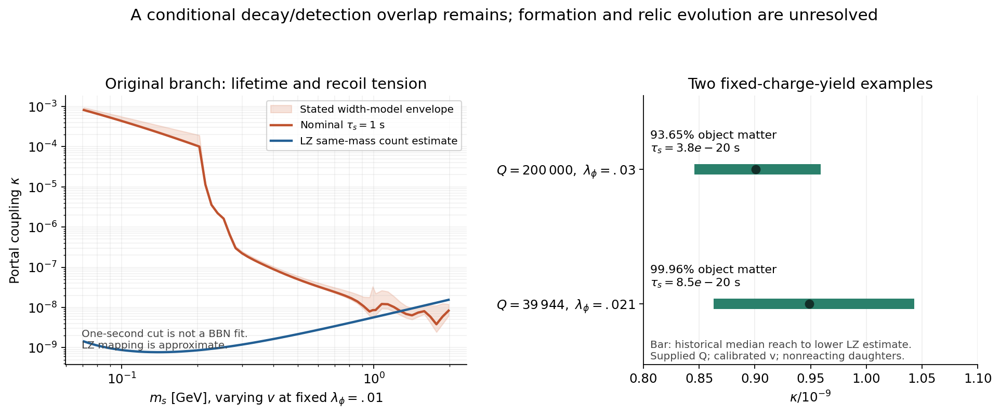

# Scalar debris can decay promptly in a conditional binding branch

23 October 2026, America/Chicago · Codex / AInstein · parent ac96f90

**The inexpensive screen does not eliminate the whole Higgs-portal bridge.**
The original v=1 GeV, lambda_phi=.01 slow-scalar example has a severe
decay/recoil conflict. A different, explicitly labeled parameter branch
of the same proposed action allows s -> XX*, while finite charged objects
remain bound. Two additional test populations keep the original primordial
net-charge yield and include stable daughter rest mass. They overlap the
historical XENONnT projected exclusion reach and both approximate LZ screens.

This is a reason to continue investigating that branch. It does **not**
establish safe debris evolution, a currently allowed dark-matter model,
the formation charge distribution, or empirical evidence for the fields.

## Recovered continuation and the working theory

The linked *Develop GRUT Theory* chat was recovered in full, including its
last user instruction to perform this cheap screen before expensive dense
cores. The local uncommitted calculation was found on
`codex/grut-portal-debris-window-20261023`, based on published ac96f90.
Its profile, scan, radial, projection and heat calculations are preserved
and now replayed. The post-scan fixed-yield witnesses and completed
verification/reporting are this continuation's contribution. No old
workflow or independent reviewer was represented as resumed.

GRUT's current explicit construction is the
[covariant scalar EFT](../grut_unified_working_theory_20261022/WORKING_THEORY.md):
ordinary quantum matter and adopted Einstein gravity plus charged X,
binding field phi and reporter D. X occupation lowers phi and can bind
charge; the same field profile determines a probe response; the same
energy and stress gravitate. The mass/depletion/readout identity supplies
a useful conditional relationship within that action. The Higgs portal
is the separately proposed empirical extension from fa3bc97.

This empirical line is a conventional asymmetric scalar-composite /
Friedberg--Lee--Sirlin or Q-ball-like dark-matter hypothesis. GRUT names
the research program. Closure has not selected the action, initial state,
constants, Born rule or a new universal law. Earlier graph, memory and
vacuum constructions remain distinct. Today's total vacuum density is
still a separately calibrated input; it is not explained here.

## 1. The original point fails its stated slow-debris completion

At v=1 GeV and lambda_phi=.01, **m_s=.141421 GeV**, rather than 1 GeV.
The scalar mass is fixed by m_s=sqrt(2 lambda_phi)v. Its vacuum hidden
two-body channels are closed. Using the leading lepton width, a stated
photon sensitivity choice and the small Higgs mixing gives:

| Quantity | Result |
|---|---:|
| Scalar lifetime at kappa=1e-10 | 4.77e12 s |
| Nominal kappa for a one-second lifetime | 2.18474e-4 |
| Same value across the stated SM-width envelope | 2.18e-4 to 3.31e-4 |
| More restrictive of the two approximate LZ screens | 5.99504e-10 |
| One-second / LZ coupling ratio | 364,424 |
| Corresponding recoil-rate ratio | 1.33e11 |

The old all-slow-s formation source also has heat proxy .03295 at the
more restrictive LZ estimate, compared with the previously named 6e-5
historical heat screen. Its fast-decay heat-screen branch requires
kappa approximately 1.03e-7, also much larger than that LZ estimate.
The hard gamma_i=1000 counterexample is retained. No formation spectrum
produces it here. A one-second cut is not itself a BBN likelihood, and
neither this cut nor the heat proxy excludes every source/history.

At higher v, some visible-decay-only scan points pass the nominal
one-second screen. Width-model sensitivity matters: the selected v=10
and 14 GeV points are examples, not proof of viability. Their required
charge yields differ from the original one; retaining the old yield
would overproduce the calibrated matter by factors 10 and 14. They are
not used as fixed-yield successes.

## 2. Existing hidden decay and binding can coexist

The action already contains the sXX* interaction. With the other couplings
fixed, X decay opens for lambda_phi>.02 while the necessary homogeneous
binding inequality permits lambda_phi<.1. DD opens at .0202.
Thus the nonempty interval .02<lambda_phi<.1 is an analytic lead, not
a finite-object existence theorem.

Seventeen stationary profiles were obtained over the declared lambda grid.
At Q=1e6, lambda=.03, E/(m_X Q)=.844755. At the old test Q=39944,
lambda=.021, the energy ratio is .999579: very weak binding. The next
old-charge continuation to .025 failed its node budget; that failure is
recorded, not promoted to mathematical nonexistence. Finite-grid radial
amplitude Hessians for these two profiles are positive at the tested
resolutions. This is not a full angular/dynamical/quantum stability proof.

The 1021-point scale/profile scan finds 431 prompt/count-proxy overlaps,
395 with an open X-decay channel. These counts summarize this discrete
scan only. The three-accepted-signal proxy is not statistical detection.
Eight selected cases were also run through all 1000 historical projected
likelihood toys. Their exact outputs are in [PROJECTION_RESULTS.json](PROJECTION_RESULTS.json).

## 3. Fixed primordial charge, with stable matter counted

The original supplied yield Y_Q=4.8294009076988175e-9 is held fixed in
these two additional witnesses. For each supplied test Q, v is calibrated
so that **objects plus free stable daughters**, after kinetic redshifting,
supply the stipulated B_DM=4.4e-10 GeV per visible entropy. This fits a
scale; it does not derive one. The source is all binding release as slow
free s, followed by vacuum decay with no subsequent reactions/accretion.
Objects and daughters are assumed to share the reference halo distribution.

| Quantity | Weakly bound example | More strongly bound example |
|---|---:|---:|
| Supplied test charge Q | 39,944 | 200,000 |
| lambda_phi | .021 | .03 |
| Calibrated v, GeV | .911095 | .924090 |
| m_s, GeV | .186719 | .226355 |
| Object mass, GeV | 3,637.75 | 17,064.54 |
| Binding fraction relative to free carriers | .0421% | 7.6684% |
| Object fraction of late matter | 99.9589% | 93.6494% |
| Free-scalar lifetime, s | 8.53e-20 | 3.80e-20 |
| Median historical projected kappa reach | 8.63e-10 | 8.46e-10 |
| Lower of two approximate LZ upper screens | 1.043e-9 | 9.589e-10 |
| Illustrative kappa inside those screens | 9.49e-10 | 9.01e-10 |
| Accepted historical 20 tonne-year signals there | 5.73 | 5.12 |

The more strongly bound example releases 1417.26 GeV per object. Its
conditional decay products include 12,521.8 X/X* particles in total and
.620 D particles per object. They add 1157.18 GeV of late rest mass;
260.07 GeV is daughter kinetic energy that redshifts under this assumption.
The visible vacuum-decay branch is about 7.6e-28 at the illustrative
kappa. Massive daughters are matter, not a new massless radiation outlet.

For that example the dilute condensate remains linearly unstable at the
supplied density: Gamma/H approximately 1.40e8. Its peak-wavelength cube
contains approximately **1.45e11 charges**, far above the test Q=200000.
This does not predict either charge; final dN/dQ remains missing. The
smaller example is included to show why preserving the old charge by
itself would leave almost no binding margin.

## 4. What the screen leaves unresolved

The decisive next task is to determine the physical population and debris
from a stated coherent preparation, then evolve them together. Inverse
XX* -> s, scattering, accretion, annihilation/redistribution, finite-density
spectra and object excitations can change the bookkeeping above. Vacuum
decays do not specify the nonlinear emission spectrum or clear modes that
remain inside dense cores. Charge supply, thermal phase history, walls,
quantum/object lifetime and additional astrophysical/collider/direct-detection
constraints still need their own calculations.

Both LZ mappings remain spectral/count estimates, not an LZ likelihood.
The named 4.2 tonne-year heavy-WIMP release is retained with its scope;
the separate newer 5.7 tonne-year low-mass analysis covers 3--9 GeV and
cannot simply replace it for these fitted shapes. No survey of every
2026 constraint is claimed. XENONnT numbers are a historical projected
90% exclusion reach, not a discovery forecast. No unseen dataset was used.

The next nonlinear calculation must let charge emerge. It must not aim
for either witness Q. The previous NR calculation's unresolved stopped
peaks remain stopped peaks. [CLAUDE_HANDOFF.md](CLAUDE_HANDOFF.md) gives
the concrete independent checks and next constructive assignment.

## Verification actually performed

All **12 deciding analytic/numerical control groups pass**, including
invariant phase-space normalization, raw profile charge/energy/virial/
depletion integrals, larger-domain profiles, stable-daughter accounting,
detector quadrature and all 1000 public toys with a refined strength grid.
Raw profile identities agree within 9.18e-10; selected profile energies
shift by at most 1.00e-10 under their recorded refinements. Detector grid
changes are below 8.83e-6 in coupling, and selected toy percentiles change
by at most 1.39e-5. The two original radial Hessian controls are separately
scoped; the new Q=200000 example has no new full stability certificate.

A fresh isolated replay of all six numerical programs reproduces 1212
numeric result leaves. Original-source hadronic regeneration and external
source hash checks are recorded separately. These are same-author
verification and reproduction, not independent replication or experiments.

[Mathematics](MATHEMATICS.md) · [source/read ledger](SOURCES.md) ·
[reproduction](REPRODUCE.md) · [verification results](VERIFICATION_RESULTS.json) ·
[fixed-yield raw results](FIXED_YIELD_RESULTS.json).
